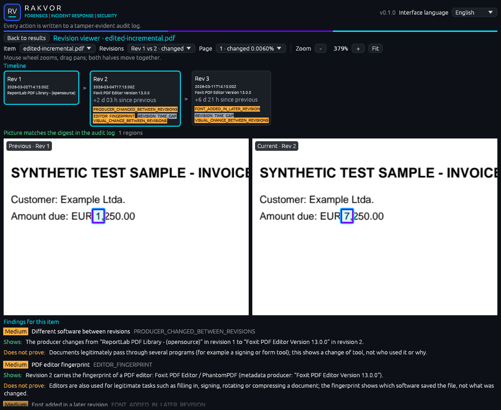
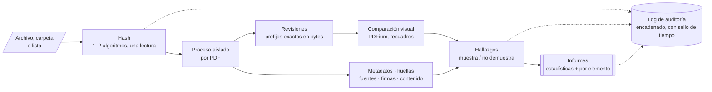
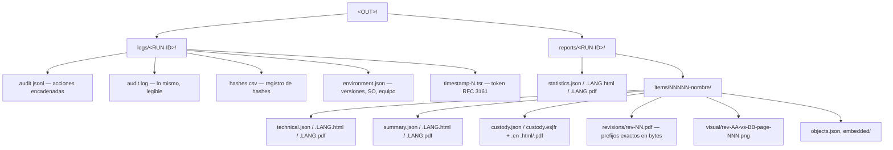

> La versión de referencia es la inglesa ([README.md](README.md)); esta traducción la sigue.

<p align="center"></p>

# RV PDFAuth

[English](README.md) · **Español** · [Français](README.fr.md)

<!-- forge:description -->
**Encuentra las señales de modificación en documentos PDF.** RV PDFAuth extrae cada revisión guardada de un PDF, las compara visualmente, revisa los metadatos, las huellas de productor, las fuentes, las firmas y el contenido oculto, e informa de lo que muestra cada señal y de lo que no demuestra.
<!-- /forge:description -->

[](https://github.com/Panacota96/rv-pdfauth/actions/workflows/ci.yml)






## Contenido

- [Qué obtiene](#qué-obtiene)
- [Instalación](#instalación)
- [Inicio rápido](#inicio-rápido)
- [Salidas](#salidas)
- [Documentación](#documentación)
- [Estructura del proyecto](#estructura-del-proyecto)
- [Contribuir, seguridad, licencia](#contribuir-seguridad-licencia)
- [Licencia](#licencia)

## Qué obtiene

| | |
| --- | --- |
| **Dos formas de usarlo** | `rv-pdfauth` (línea de comandos) y `rv-pdfauth-gui` (aplicación de escritorio de Windows 10/11). Mismo motor, mismos resultados. |
| **Análisis de PDF** | Cada revisión guardada extraída exacta en bytes, páginas de revisiones consecutivas comparadas visualmente (PDFium), metadatos y fechas Info frente a XMP, huellas de productor/editor, fuentes, firmas y DocMDP, JavaScript, adjuntos, texto invisible; cada PDF en un proceso de análisis aislado. Cómo funciona: [docs/theory.md](docs/theory.md) (en inglés). |
| **Individual o masivo** | Un archivo, muchos archivos, carpetas completas (`--recursive`) o un archivo de lista (`--input-list`). |
| **Hash** | Elija 1 o 2 de md5, sha1, sha256, sha512, sha3-256, blake3. Ambos se calculan en la misma lectura. |
| **Progreso** | Barra de progreso, tiempo transcurrido, rendimiento y tiempo restante estimado (CLI y GUI). Se puede cancelar en cualquier momento. |
| **Auditable** | Cada acción va a `logs/<RUN-ID>/audit.jsonl`, donde cada entrada lleva el hash de la anterior. `verify-log` detecta cualquier edición. |
| **Informes** | Un informe de estadísticas por ejecución y, para **cada archivo**, una revisión técnica y un resumen para el cliente, en HTML, PDF y JSON, en inglés, español o francés. |
| **Carpeta del caso** | `--case-dir` enlaza las herramientas Rakvor de un caso: cada PDF se vuelve a hashear y se verifica contra el registro de evidencias escrito en la recepción por rv-hashinv (`E0001`, …) antes de analizarlo; ver [docs/case-folder.md](docs/case-folder.md) (en inglés). |

## Instalación

**Windows 10/11**: descárguelo desde la página de [Releases](https://github.com/Panacota96/rv-pdfauth/releases):

- `rv-pdfauth-<version>-windows-x64-setup.exe`: instalador (acceso directo en el menú Inicio, agrega la CLI al PATH), o
- `rv-pdfauth-<version>-windows-x64.zip`: portable; descomprima y ejecute, no se instala nada.

Compruebe la descarga antes de usarla: SHA-256, atestación de procedencia, Authenticode y la biblioteca PDFium, paso
a paso en [docs/installation.es.md](docs/installation.es.md) (resumen en [SECURITY.md](SECURITY.md#verifying-a-release), en inglés).

**Desde el código fuente** (cualquier sistema, Rust 1.88+ para la CLI, 1.95+ para la GUI; el compilador fijado para la compilación está en `rust-toolchain.toml`; auditores: [docs/installation.es.md](docs/installation.es.md#9-compilar-desde-el-código-fuente-para-auditores)):

```bash
cargo build --release
# binarios: target/release/rv-pdfauth y target/release/rv-pdfauth-gui
```

## Inicio rápido

```powershell
# Compruebe primero la compilación: cada algoritmo contra vectores de prueba publicados
rv-pdfauth self-test

# Revisar una carpeta con SHA-256 + MD5, informes en español, para el caso CASE-2026-014
rv-pdfauth analyze -i D:\evidence -r --hash sha256,md5 --lang es --case CASE-2026-014 --actor "Ana Ruiz"

# Caso francés: formato de custodia en francés + inglés, cada PDF firmado con su certificado
$env:RV_SIGN_PASSWORD = Read-Host -AsSecureString | ConvertFrom-SecureString -AsPlainText
rv-pdfauth analyze -i D:\evidence -r --jurisdiction fr --sign-cert C:\certs\examiner.p12 --lang fr

# Lote grande: sin comparación visual, informes por elemento solo para los archivos señalados
rv-pdfauth analyze -i E:\mailbox-export -r --visual-diff off --item-reports flagged

# Enseñar a la herramienta un editor a partir de archivos que usted hizo con él (base local, no se envía nada)
rv-pdfauth fingerprints learn made-with-editor.pdf --label "Editor X" --category online_editor

# Más tarde, demostrar que el log no se alteró (también comprueba el sello de tiempo RFC 3161)
rv-pdfauth verify-log rakvor-out\logs\<RUN-ID>

# ¿La ejecución fue sin red? Agregue el sello de tiempo confiable cuando vuelva la red
rv-pdfauth timestamp rakvor-out\logs\<RUN-ID>
```

Las tareas habituales, paso a paso: [docs/quick-guide.es.md](docs/quick-guide.es.md).
Cada opción, ejemplo y código de salida: [docs/usage-cli.md](docs/usage-cli.md) (generado a partir de `--help`, en inglés).
La aplicación de escritorio: [docs/usage-gui.es.md](docs/usage-gui.es.md). Una muestra lista para usar: [examples/](examples/README.md) (en inglés).

## Salidas



| Código de salida | Significado |
| :-: | --- |
| 0 | Terminado, sin hallazgos de severidad alta |
| 1 | Error de ejecución |
| 2 | Error de uso (p. ej. tres algoritmos de hash) |
| 3 | Terminado con hallazgos de severidad alta / cadena de auditoría rota |
| 130 | Cancelado (se escriben informes parciales) |

## Documentación

| Página | Para |
| --- | --- |
| [docs/quick-guide.es.md](docs/quick-guide.es.md) | Las seis tareas habituales (analyze, carpeta del caso, verify-log, verify-case, timestamp, fingerprints), cada botón de la GUI, códigos de salida |
| [docs/theory.md](docs/theory.md) | Por qué funciona cada proceso: parte en lenguaje sencillo para clientes, abogados y jueces; algoritmos, umbrales y referencias para peritos y peritos de la contraparte (en inglés) |
| [docs/admissibility.md](docs/admissibility.md) | Argumento de fiabilidad y requisitos de Colombia, Francia/UE, ISO y EE. UU./Reino Unido frente a las funciones de la herramienta, lista de brechas, lista de control del perito (para revisión por un abogado; en inglés) |
| [docs/installation.es.md](docs/installation.es.md) | Instalación en Windows 10/11, verificación de la versión (SHA-256, procedencia, Authenticode, PDFium), uso sin red, compilación desde el código fuente |
| [docs/usage.es.md](docs/usage.es.md) | Recorrido completo de un caso, lectura de las salidas, interpretación de cada hallazgo, sellos de tiempo, firma, verificación de una ejecución, solución de problemas |
| [docs/usage-cli.md](docs/usage-cli.md) | Cada comando y opción (generado a partir de `--help`; en inglés) |
| [docs/usage-gui.es.md](docs/usage-gui.es.md) | Uso de la aplicación de escritorio |
| [docs/architecture.md](docs/architecture.md) | Cómo encajan el motor, la CLI y la GUI (en inglés) |
| [docs/case-folder.md](docs/case-folder.md) | Carpeta compartida del caso: verificación de cada PDF contra el registro de evidencias de rv-hashinv (`--case-dir`, `verify-case`; en inglés) |
| [docs/forensic-audit.md](docs/forensic-audit.md) | Rastro de auditoría, cadena de hashes, manejo de la evidencia, correspondencia con ISO/IEC 27037 (en inglés) |
| [docs/reports.md](docs/reports.md) | Tipos de informe, campos, esquemas JSON, idiomas (en inglés) |
| [docs/development.md](docs/development.md) | Compilación, pruebas, CI/CD y publicación (en inglés) |
| [docs/release-process.md](docs/release-process.md) | Paquetes de Windows, firma de código y versiones de GitHub, paso a paso (en inglés) |
| [docs/adr/](docs/adr/) | Decisiones de arquitectura (p. ej. por qué Rust; en inglés) |

El README, la guía rápida, la guía de uso, la guía de la aplicación de escritorio y la guía de instalación existen
también en español (`.es.md`) y en francés (`.fr.md`); las páginas en inglés son la referencia.

## Estructura del proyecto

```text
rv-pdfauth/
├── src/
│   ├── pdf/       analizador de PDF y hallazgos (sin código unsafe, nunca escribe archivos)
│   ├── render/    renderizado con PDFium y diferencia de píxeles
│   ├── core/      biblioteca del motor: entrada, hash, proceso de análisis, análisis, log de auditoría, informes (nunca imprime)
│   ├── cli/       línea de comandos rv-pdfauth (clap)
│   └── gui/       aplicación de escritorio rv-pdfauth-gui (egui); state.rs contiene todas las reglas comprobables
├── templates/     plantillas HTML de los informes + CSS (compatibles con Jinja2/minijinja)
├── i18n/          textos de los informes: en.json, es.json, fr.json
├── schemas/       esquemas JSON de los tres tipos de informe
├── docs/          documentación (los diagramas Mermaid se muestran en GitHub)
├── tests/         comprobaciones entre lenguajes (verificador en Python de la cadena de auditoría)
├── scripts/       comprobaciones de la documentación (las traducciones mantienen la forma de las páginas en inglés)
├── examples/      evidencia de muestra + scripts de ejecución + hashes esperados
├── packaging/     instalador de Windows (Inno Setup)
└── .github/       flujos de CI y de publicación
```

## Contribuir, seguridad, licencia

- Cómo contribuir: [CONTRIBUTING.md](CONTRIBUTING.md) · Cambios: [CHANGELOG.md](CHANGELOG.md)
- Informe de una vulnerabilidad en privado: [SECURITY.md](SECURITY.md)
- Licencia: ver [Licencia](#licencia). Avisos de terceros: [NOTICE](NOTICE).

## Licencia

Código disponible, no comercial: [PolyForm Noncommercial 1.0.0](LICENSE). Cualquiera puede usar, estudiar, modificar
y compartir RV PDFAuth con fines no comerciales. Se exige el crédito en todo uso: "RV PDFAuth by Rakvor", y conservar
la línea `Required Notice:` de [LICENSE](LICENSE). El uso comercial (venderlo, servicios de pago, uso en el trabajo
remunerado de una empresa con ánimo de lucro) requiere una licencia escrita de Rakvor: ver
[COMMERCIAL.md](COMMERCIAL.md). Rakvor conserva todos los derechos comerciales como titular de los derechos de autor.
Los textos de licencia de Rakvor ([COMMERCIAL.md](COMMERCIAL.md), [NOTICE](NOTICE), esta sección) son borradores,
pendientes de verificación por un abogado (*to be verified*; Colombia, Francia), y no constituyen asesoría legal. Los componentes de terceros conservan
sus propias licencias: [NOTICE](NOTICE).
