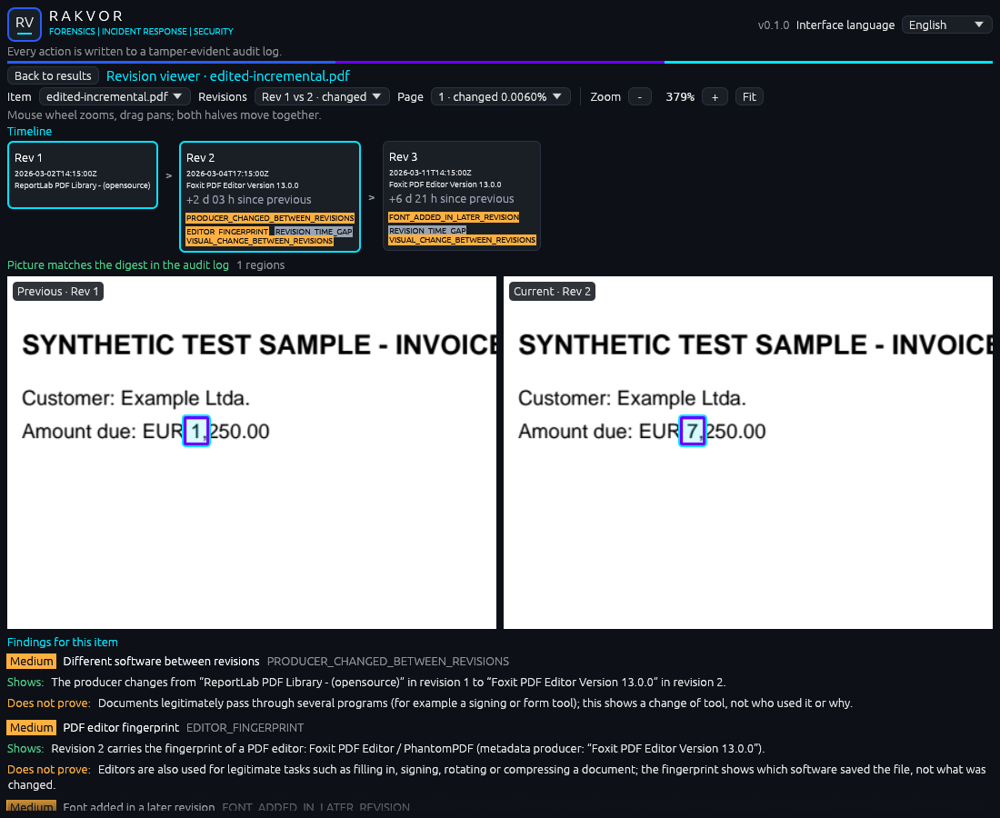
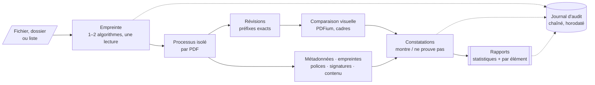
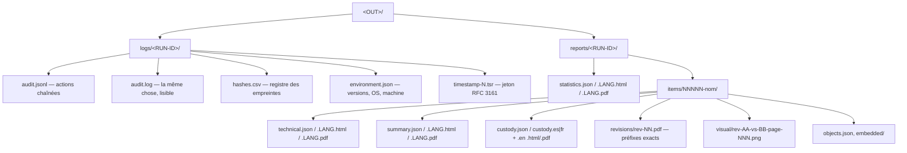

> La version de référence est la version anglaise ([README.md](README.md)) ; cette traduction la suit.

<p align="center"></p>

# RV PDFAuth

[English](README.md) · [Español](README.es.md) · **Français**

<!-- forge:description -->
**Repère les signaux de modification dans les documents PDF.** RV PDFAuth extrait chaque révision enregistrée d'un PDF, les compare visuellement, contrôle les métadonnées, les empreintes de producteur, les polices, les signatures et le contenu caché, et indique ce que montre chaque signal et ce qu'il ne prouve pas.
<!-- /forge:description -->

[](https://github.com/Panacota96/rv-pdfauth/actions/workflows/ci.yml)






## Sommaire

- [Ce que vous obtenez](#ce-que-vous-obtenez)
- [Installation](#installation)
- [Démarrage rapide](#démarrage-rapide)
- [Sorties](#sorties)
- [Documentation](#documentation)
- [Organisation du projet](#organisation-du-projet)
- [Contribuer, sécurité, licence](#contribuer-sécurité-licence)
- [Licence](#licence)

## Ce que vous obtenez

| | |
| --- | --- |
| **Deux façons de l'utiliser** | `rv-pdfauth` (ligne de commande) et `rv-pdfauth-gui` (application de bureau Windows 10/11). Même moteur, mêmes résultats. |
| **Analyse des PDF** | Chaque révision enregistrée extraite à l'octet près, pages des révisions successives comparées visuellement (PDFium), métadonnées et dates Info contre XMP, empreintes de producteur/éditeur, polices, signatures et DocMDP, JavaScript, pièces jointes, texte invisible ; chaque PDF dans un processus d'analyse isolé. Fonctionnement : [docs/theory.md](docs/theory.md) (en anglais). |
| **Unitaire ou en masse** | Un fichier, plusieurs fichiers, des dossiers entiers (`--recursive`) ou un fichier de liste (`--input-list`). |
| **Empreintes** | Choisissez 1 ou 2 parmi md5, sha1, sha256, sha512, sha3-256, blake3. Les deux sont calculées pendant la même lecture. |
| **Progression** | Barre de progression, temps écoulé, débit et temps restant estimé (CLI et GUI). Annulable à tout moment. |
| **Auditable** | Chaque action va dans `logs/<RUN-ID>/audit.jsonl`, où chaque entrée porte l'empreinte de la précédente. `verify-log` détecte toute modification. |
| **Rapports** | Un rapport de statistiques par exécution et, pour **chaque fichier**, un examen technique et une synthèse pour le client, en HTML, PDF et JSON, en anglais, espagnol ou français. |
| **Dossier de l'affaire** | `--case-dir` relie les outils Rakvor d'une même affaire : chaque PDF est de nouveau haché et vérifié par rapport au registre des preuves écrit à l'entrée par rv-hashinv (`E0001`, …) avant son analyse ; voir [docs/case-folder.md](docs/case-folder.md) (en anglais). |

## Installation

**Windows 10/11** : téléchargez depuis la page [Releases](https://github.com/Panacota96/rv-pdfauth/releases) :

- `rv-pdfauth-<version>-windows-x64-setup.exe` : programme d'installation (raccourci dans le menu Démarrer, ajoute la CLI au PATH), ou
- `rv-pdfauth-<version>-windows-x64.zip` : portable, à décompresser et lancer, rien n'est installé.

Vérifiez le téléchargement avant usage : SHA-256, attestation de provenance, Authenticode et bibliothèque PDFium, étape
par étape dans [docs/installation.fr.md](docs/installation.fr.md) (résumé dans [SECURITY.md](SECURITY.md#verifying-a-release), en anglais).

**Depuis les sources** (tout système, Rust 1.88+ pour la CLI, 1.95+ pour la GUI ; le compilateur fixé pour la compilation est dans `rust-toolchain.toml` ; auditeurs : [docs/installation.fr.md](docs/installation.fr.md#9-compiler-depuis-les-sources-pour-les-auditeurs)) :

```bash
cargo build --release
# binaires : target/release/rv-pdfauth et target/release/rv-pdfauth-gui
```

## Démarrage rapide

```powershell
# Vérifiez d'abord la version : chaque algorithme avec des vecteurs de test publiés
rv-pdfauth self-test

# Examiner un dossier avec SHA-256 + MD5, rapports en espagnol, pour l'affaire CASE-2026-014
rv-pdfauth analyze -i D:\evidence -r --hash sha256,md5 --lang es --case CASE-2026-014 --actor "Ana Ruiz"

# Affaire française : fiche de traçabilité en français + anglais, chaque PDF signé avec votre certificat
$env:RV_SIGN_PASSWORD = Read-Host -AsSecureString | ConvertFrom-SecureString -AsPlainText
rv-pdfauth analyze -i D:\evidence -r --jurisdiction fr --sign-cert C:\certs\examiner.p12 --lang fr

# Gros lot : pas de comparaison visuelle, rapports par élément seulement pour les fichiers signalés
rv-pdfauth analyze -i E:\mailbox-export -r --visual-diff off --item-reports flagged

# Apprendre un éditeur à l'outil à partir de fichiers que vous avez faits avec lui (base locale, rien n'est envoyé)
rv-pdfauth fingerprints learn made-with-editor.pdf --label "Editor X" --category online_editor

# Plus tard, prouver que le journal n'a pas été modifié (vérifie aussi l'horodatage RFC 3161)
rv-pdfauth verify-log rakvor-out\logs\<RUN-ID>

# L'exécution était hors ligne ? Ajoutez l'horodatage de confiance une fois le réseau revenu
rv-pdfauth timestamp rakvor-out\logs\<RUN-ID>
```

Les tâches courantes, étape par étape : [docs/quick-guide.fr.md](docs/quick-guide.fr.md).
Chaque option, exemple et code de sortie : [docs/usage-cli.md](docs/usage-cli.md) (généré à partir de `--help`, en anglais).
L'application de bureau : [docs/usage-gui.fr.md](docs/usage-gui.fr.md). Un exemple prêt à l'emploi : [examples/](examples/README.md) (en anglais).

## Sorties



| Code de sortie | Signification |
| :-: | --- |
| 0 | Terminé, aucune constatation de gravité élevée |
| 1 | Erreur d'exécution |
| 2 | Erreur d'utilisation (par ex. trois algorithmes d'empreinte) |
| 3 | Terminé avec des constatations de gravité élevée / chaîne d'audit rompue |
| 130 | Annulé (rapports partiels écrits) |

## Documentation

| Page | Pour |
| --- | --- |
| [docs/quick-guide.fr.md](docs/quick-guide.fr.md) | Les six tâches courantes (analyze, dossier de l'affaire, verify-log, verify-case, timestamp, fingerprints), chaque bouton de la GUI, codes de sortie |
| [docs/theory.md](docs/theory.md) | Pourquoi chaque processus fonctionne : partie en langage courant pour les clients, avocats et juges ; algorithmes, seuils et références pour les experts et les experts adverses (en anglais) |
| [docs/admissibility.md](docs/admissibility.md) | Argumentaire de fiabilité et exigences de la Colombie, de la France/UE, de l'ISO et des États-Unis/Royaume-Uni rapprochés des fonctions de l'outil, liste des écarts, liste de contrôle de l'expert (pour revue par un avocat ; en anglais) |
| [docs/installation.fr.md](docs/installation.fr.md) | Installation sous Windows 10/11, vérification de la version (SHA-256, provenance, Authenticode, PDFium), usage hors ligne, compilation depuis les sources |
| [docs/usage.fr.md](docs/usage.fr.md) | Parcours complet d'une affaire, lecture des sorties, interprétation de chaque constatation, horodatages, signature, vérification d'une exécution, dépannage |
| [docs/usage-cli.md](docs/usage-cli.md) | Chaque commande et option (généré à partir de `--help` ; en anglais) |
| [docs/usage-gui.fr.md](docs/usage-gui.fr.md) | Utiliser l'application de bureau |
| [docs/architecture.md](docs/architecture.md) | Comment s'articulent le moteur, la CLI et la GUI (en anglais) |
| [docs/case-folder.md](docs/case-folder.md) | Dossier partagé de l'affaire : vérification de chaque PDF par rapport au registre des preuves de rv-hashinv (`--case-dir`, `verify-case` ; en anglais) |
| [docs/forensic-audit.md](docs/forensic-audit.md) | Piste d'audit, chaîne d'empreintes, traitement des preuves, correspondance ISO/IEC 27037 (en anglais) |
| [docs/reports.md](docs/reports.md) | Types de rapports, champs, schémas JSON, langues (en anglais) |
| [docs/development.md](docs/development.md) | Compilation, tests, CI/CD et publication (en anglais) |
| [docs/release-process.md](docs/release-process.md) | Paquets Windows, signature de code et versions GitHub, étape par étape (en anglais) |
| [docs/adr/](docs/adr/) | Décisions d'architecture (par ex. pourquoi Rust ; en anglais) |

Le README, le guide rapide, le guide d'utilisation, le guide de l'application de bureau et le guide d'installation
existent aussi en espagnol (`.es.md`) et en français (`.fr.md`) ; les pages en anglais font référence.

## Organisation du projet

```text
rv-pdfauth/
├── src/
│   ├── pdf/       analyseur PDF et constatations (sans code unsafe, n'écrit jamais de fichier)
│   ├── render/    rendu PDFium et différence de pixels
│   ├── core/      bibliothèque du moteur : entrées, empreintes, processus d'analyse, analyse, journal d'audit, rapports (n'affiche jamais rien)
│   ├── cli/       ligne de commande rv-pdfauth (clap)
│   └── gui/       application de bureau rv-pdfauth-gui (egui) ; state.rs contient toutes les règles testables
├── templates/     modèles HTML des rapports + CSS (compatibles Jinja2/minijinja)
├── i18n/          libellés des rapports : en.json, es.json, fr.json
├── schemas/       schémas JSON des trois types de rapport
├── docs/          documentation (les diagrammes Mermaid s'affichent sur GitHub)
├── tests/         contrôles entre langages (vérificateur Python de la chaîne d'audit)
├── scripts/       contrôles de la documentation (les traductions gardent la forme des pages anglaises)
├── examples/      éléments d'exemple + scripts d'exécution + empreintes attendues
├── packaging/     programme d'installation Windows (Inno Setup)
└── .github/       workflows de CI et de publication
```

## Contribuer, sécurité, licence

- Comment contribuer : [CONTRIBUTING.md](CONTRIBUTING.md) · Modifications : [CHANGELOG.md](CHANGELOG.md)
- Signaler une vulnérabilité en privé : [SECURITY.md](SECURITY.md)
- Licence : voir [Licence](#licence). Mentions de tiers : [NOTICE](NOTICE).

## Licence

Code source disponible, usage non commercial : [PolyForm Noncommercial 1.0.0](LICENSE). Chacun peut utiliser, étudier,
modifier et partager RV PDFAuth à des fins non commerciales. La mention est obligatoire dans tout usage : « RV PDFAuth
by Rakvor », en conservant la ligne `Required Notice:` de [LICENSE](LICENSE). L'usage commercial (le vendre, des
services payants, l'utiliser dans le travail rémunéré d'une entreprise à but lucratif) exige une licence écrite de
Rakvor : voir [COMMERCIAL.md](COMMERCIAL.md). Rakvor conserve tous les droits commerciaux en tant que titulaire du droit
d'auteur. Les textes de licence de Rakvor ([COMMERCIAL.md](COMMERCIAL.md), [NOTICE](NOTICE), cette section) sont des
projets, à faire vérifier par un avocat (*to be verified* ; Colombie, France), et ne constituent pas un avis
juridique. Les composants tiers conservent leurs propres licences : [NOTICE](NOTICE).
