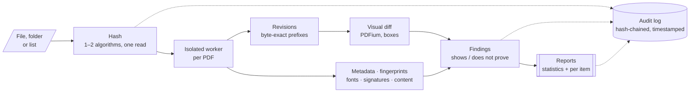
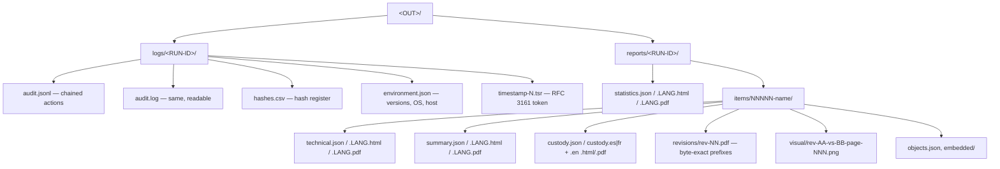

# RV PDFAuth

<!-- forge:description -->
**Finds the signals of modification in PDF documents.** RV PDFAuth extracts every saved revision of a PDF, compares them visually, checks metadata, producer fingerprints, fonts, signatures and hidden content, and reports what each signal shows and what it does not prove.
<!-- /forge:description -->

[](https://github.com/Panacota96/rv-pdfauth/actions/workflows/ci.yml)




## Contents

- [What you get](#what-you-get)
- [Install](#install)
- [Quick start](#quick-start)
- [Outputs](#outputs)
- [Documentation](#documentation)
- [Project layout](#project-layout)
- [Contributing, security, licence](#contributing-security-licence)

## What you get

| | |
| --- | --- |
| **Two ways to use it** | `rv-pdfauth` (command line) and `rv-pdfauth-gui` (Windows 10/11 desktop app). Same engine, same results. |
| **PDF analysis** | Every saved revision extracted byte-exact, pages of consecutive revisions compared visually (PDFium), Info vs XMP metadata and dates, producer/editor fingerprints, fonts, signatures and DocMDP, JavaScript, attachments, invisible text — each PDF in an isolated worker process. How it works: [docs/theory.md](docs/theory.md). |
| **Single or bulk** | One file, many files, whole folders (`--recursive`) or a list file (`--input-list`). |
| **Hashing** | Choose 1 or 2 of md5, sha1, sha256, sha512, sha3-256, blake3. Both are computed in the same read. |
| **Progress** | Progress bar, elapsed time, throughput and estimated time remaining (CLI and GUI). Cancel at any time. |
| **Auditable** | Every action goes to `logs/<RUN-ID>/audit.jsonl`, where each entry carries the hash of the previous one. `verify-log` detects any edit. |
| **Reports** | A statistics report per run, and for **each file** a technical review and a customer summary — HTML, PDF and JSON, in English, Spanish or French. |

## Install

**Windows 10/11** — download from the [Releases](https://github.com/Panacota96/rv-pdfauth/releases) page:

- `rv-pdfauth-<version>-windows-x64-setup.exe` — installer (Start-menu shortcut, adds the CLI to PATH), or
- `rv-pdfauth-<version>-windows-x64.zip` — portable: unzip and run, nothing is installed.

Check the download before use: SHA-256, provenance attestation, Authenticode and the PDFium library, step by
step in [docs/installation.md](docs/installation.md) (summary in [SECURITY.md](SECURITY.md#verifying-a-release)).

**From source** (any OS, Rust 1.88+; auditors: [docs/installation.md](docs/installation.md#9-build-from-source-for-auditors)):

```bash
cargo build --release
# binaries: target/release/rv-pdfauth and target/release/rv-pdfauth-gui
```

## Quick start

```powershell
# Check the build first: every algorithm against published test vectors
rv-pdfauth self-test

# Review a folder with SHA-256 + MD5, reports in Spanish, for case CASE-2026-014
rv-pdfauth analyze -i D:\evidence -r --hash sha256,md5 --lang es --case CASE-2026-014 --actor "Ana Ruiz"

# French case: custody form in French + English, every PDF signed with your certificate
$env:RV_SIGN_PASSWORD = Read-Host -AsSecureString | ConvertFrom-SecureString -AsPlainText
rv-pdfauth analyze -i D:\evidence -r --jurisdiction fr --sign-cert C:\certs\examiner.p12 --lang fr

# Large batch: no visual comparison, item reports only for flagged files
rv-pdfauth analyze -i E:\mailbox-export -r --visual-diff off --item-reports flagged

# Teach the tool an editor from files you made with it (local DB, nothing is sent anywhere)
rv-pdfauth fingerprints learn made-with-editor.pdf --label "Editor X" --category online_editor

# Later, prove the log was not altered (also checks the RFC 3161 timestamp)
rv-pdfauth verify-log rakvor-out\logs\<RUN-ID>

# The run was offline? Add the trusted timestamp once the network is back
rv-pdfauth timestamp rakvor-out\logs\<RUN-ID>
```

Every option, example and exit code: [docs/usage-cli.md](docs/usage-cli.md) (generated from `--help`).
The desktop app: [docs/usage-gui.md](docs/usage-gui.md). A ready-made sample: [examples/](examples/README.md).

## Outputs



| Exit code | Meaning |
| :-: | --- |
| 0 | Completed, no high-severity finding |
| 1 | Runtime error |
| 2 | Usage error (e.g. three hash algorithms) |
| 3 | Completed with high-severity findings / broken audit chain |
| 130 | Cancelled (partial reports written) |

## Documentation

| Page | For |
| --- | --- |
| [docs/theory.md](docs/theory.md) | Why each process works: plain-language part for clients, lawyers and judges; algorithms, thresholds and references for examiners and opposing experts |
| [docs/admissibility.md](docs/admissibility.md) | Reliability argument and requirements of Colombia, France/EU, ISO and US/UK mapped to tool features, gap list, examiner checklist (for counsel review) |
| [docs/installation.md](docs/installation.md) | Installing on Windows 10/11, verifying the release (SHA-256, provenance, Authenticode, PDFium), offline use, building from source |
| [docs/usage.md](docs/usage.md) | End-to-end case walkthrough, reading the outputs, interpreting each finding, timestamps, signing, verifying a run, troubleshooting |
| [docs/usage-cli.md](docs/usage-cli.md) | Every command and option (generated from `--help`) |
| [docs/usage-gui.md](docs/usage-gui.md) | Using the desktop app |
| [docs/architecture.md](docs/architecture.md) | How the engine, CLI and GUI fit together |
| [docs/forensic-audit.md](docs/forensic-audit.md) | Audit trail, hash chain, evidence handling, ISO/IEC 27037 mapping |
| [docs/reports.md](docs/reports.md) | Report kinds, fields, JSON schemas, languages |
| [docs/development.md](docs/development.md) | Building, testing, CI/CD and releasing |
| [docs/adr/](docs/adr/) | Architecture decisions (e.g. why Rust) |

## Project layout

```text
rv-pdfauth/
├── src/
│   ├── pdf/       PDF parser and findings (no unsafe code, never writes files)
│   ├── render/    PDFium rendering and pixel diff
│   ├── core/      engine library: input, hashing, worker, analysis, audit log, reports (never prints)
│   ├── cli/       rv-pdfauth command line (clap)
│   └── gui/       rv-pdfauth-gui desktop app (egui); state.rs holds all testable rules
├── templates/     HTML report templates + CSS (Jinja2/minijinja compatible)
├── i18n/          report wording: en.json, es.json, fr.json
├── schemas/       JSON Schemas of the three report kinds
├── docs/          documentation (Mermaid diagrams render on GitHub)
├── tests/         cross-language checks (Python verifier of the audit chain)
├── examples/      sample evidence + run scripts + expected hashes
├── packaging/     Windows installer (Inno Setup)
└── .github/       CI and release workflows
```

## Contributing, security, licence

- How to contribute: [CONTRIBUTING.md](CONTRIBUTING.md) · Changes: [CHANGELOG.md](CHANGELOG.md)
- Report a vulnerability privately: [SECURITY.md](SECURITY.md)
- Licensed under the [Apache License 2.0](LICENSE). See [NOTICE](NOTICE).
