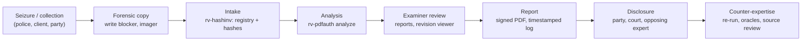
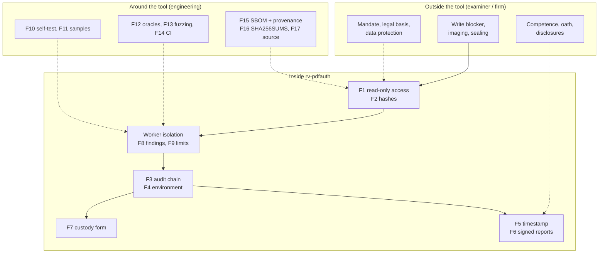

# Admissibility and reliability

> **Not legal advice.** This page maps legal and technical requirements to what RV PDFAuth actually does, so that
> an examiner, a lawyer or an opposing expert can see where the tool helps and where it does not. It was prepared
> from a sourced research note dated 2026-10-21 and **must be reviewed by counsel in each jurisdiction before it is
> relied on or quoted**. Status: draft for counsel review.

## Contents

- [1. Purpose and how to read this page](#1-purpose-and-how-to-read-this-page)
- [2. Evidence lifecycle and where each control sits](#2-evidence-lifecycle-and-where-each-control-sits)
- [3. The reliability argument](#3-the-reliability-argument)
- [4. Colombia](#4-colombia)
- [5. France and the European Union](#5-france-and-the-european-union)
- [6. International standards](#6-international-standards)
- [7. United States and United Kingdom](#7-united-states-and-united-kingdom)
- [Consolidated gap list](#consolidated-gap-list)
- [Examiner checklist before filing a report](#examiner-checklist-before-filing-a-report)
- [Sources](#sources)

## 1. Purpose and how to read this page

RV PDFAuth is used **locally** by Rakvor; it is not distributed. Clients, courts and opposing experts may audit
it. Its results are **signals for an examiner, never a verdict** ([theory.md](theory.md#a1-what-the-tool-is-and-is-not)).
Admissibility and weight are decided by a court about the **examiner's evidence**, of which the tool's output is
one part. This page therefore separates three kinds of status:

| Status | Meaning |
| --- | --- |
| **met** | A tool feature satisfies or directly supports the requirement (the file or command is named) |
| **partial** | Supported, with a named shortfall |
| **examiner** | An obligation of the examiner or of Rakvor as a firm, not a tool feature |
| **gap** | Not met today; listed in the [consolidated gap list](#consolidated-gap-list) with a mitigation and an owner |
| **context** | Background that frames the other rows |

**Verification marks** (kept from the research note; never upgraded here):

| Mark | Meaning |
| --- | --- |
| **[V]** | Article or clause number and substance checked against the primary text (project document, official gazette or faithful mirror). Quoted fragments are verbatim. |
| **[S]** | Checked against a secondary source (Conseil constitutionnel dossier, law-firm note, Rama Judicial cartilla). The number is reliable; check the wording before quoting. |
| **to be verified** | Marked UNVERIFIED in the research: from general professional knowledge, or the primary text could not be reached. **Do not cite before a lawyer or engineer has checked it against the primary source.** |

Research limits that still apply: the Colombian project PDFs `Ley_906_de_2004.pdf`, `Ley_1564_de_2012.pdf` and
`manualcadena2.pdf` were verified against official web copies, not the project files — **re-check quoted
fragments against the project PDFs before publishing**; the ISO/IEC 27037 copy was the free preview (table of
contents and clauses 1–4); Légifrance refused automated access (CPP read from the Pappers LEGI mirror); eIDAS,
GDPR, ISO 27041/27042/27043/17025, NIST and the FRE text were not fetched.

### Tool features referred to in the tables

| Key | Feature | Where it is implemented (file / command) |
| --- | --- | --- |
| F1 | Read-only evidence access (software level) | `File::open` in [src/core/src/run.rs](../src/core/src/run.rs); read-only memory map in [src/core/src/pdfscan.rs](../src/core/src/pdfscan.rs); `mtime_unchanged` in `item_hashed` |
| F2 | Hashing with 1 or 2 algorithms (md5, sha1, sha256, sha512, sha3-256, blake3) | [src/core/src/hash.rs](../src/core/src/hash.rs); `analyze --hash`; `logs/<RUN-ID>/hashes.csv` |
| F3 | SHA-256 hash-chained audit log + independent verifier | [src/core/src/audit.rs](../src/core/src/audit.rs); `rv-pdfauth verify-log`; [tests/verify_chain.py](../tests/verify_chain.py) |
| F4 | `environment.json`: tool, compiler and dependency versions, OS, host, user, command line | [src/core/src/env.rs](../src/core/src/env.rs) |
| F5 | RFC 3161 timestamp of the audit chain head | [src/core/src/trust.rs](../src/core/src/trust.rs); `--tsa-url`, `--no-timestamp`, `rv-pdfauth timestamp` |
| F6 | PDF reports signed with the examiner's own certificate (CMS, `adbe.pkcs7.detached`) | `--sign-cert`; `PdfSigner` in [src/core/src/trust.rs](../src/core/src/trust.rs); [src/core/src/report/pdf.rs](../src/core/src/report/pdf.rs) |
| F7 | Per-item chain-of-custody form: Colombia (Fiscalía style) or France (scellés), plus English | `--jurisdiction co` or `fr`; `custody.json/.html/.pdf`; [templates/custody.html](../templates/custody.html); [schemas/item-custody.schema.json](../schemas/item-custody.schema.json) |
| F8 | Findings state what they show **and** what they do not prove; signals only | [i18n/en.json](../i18n/en.json) (`findings`), es/fr; [src/pdf/src/analysis.rs](../src/pdf/src/analysis.rs) |
| F9 | Declared limitations, printed in every report | `LIMITATIONS` in [src/core/src/report/mod.rs](../src/core/src/report/mod.rs); [i18n/en.json](../i18n/en.json) (`limitations`) |
| F10 | Known-answer self-test (hash algorithms only) | `rv-pdfauth self-test` |
| F11 | Synthetic sample evidence with expected results | [examples/sample/](../examples/README.md): `expected_findings.json`, `expected_hashes.csv`; checked by [src/pdf/tests/samples.rs](../src/pdf/tests/samples.rs) |
| F12 | Test oracles (independent tools) | [tests/oracle_pdf.py](../tests/oracle_pdf.py) (pikepdf/qpdf, pyHanko — CI job `oracle` on every push, a disagreement fails the build); [tests/verify_chain.py](../tests/verify_chain.py) (in CI); Python `hashlib`/`blake3` for the sample hashes |
| F13 | Fuzzing and malformed-input tests | [fuzz/fuzz_targets/analyze.rs](../fuzz/fuzz_targets/analyze.rs) (`.github/workflows/fuzz.yml`, nightly, 10 min); [src/pdf/tests/no_panic.rs](../src/pdf/tests/no_panic.rs) (in CI); `crash.pdf` sample |
| F14 | CI on Windows and Linux | [.github/workflows/ci.yml](../.github/workflows/ci.yml) |
| F15 | SBOM and build provenance | [.github/workflows/release.yml](../.github/workflows/release.yml) (CycloneDX, `actions/attest-build-provenance`) |
| F16 | Versioned releases with `SHA256SUMS` | [.github/workflows/release.yml](../.github/workflows/release.yml); [installation.md](installation.md#2-verify-the-download) |
| F17 | Source auditable by customers and opposing experts; local use only | Repository access. Note: the `LICENSE` file at this commit is Apache-2.0, while the owner's stated model is proprietary, auditable, no redistribution — to be aligned (see G17) |

Further features named below: **worker isolation** ([src/core/src/worker.rs](../src/core/src/worker.rs)),
**byte-exact revision extraction** (`revisions/rev-NN.pdf`), **visual diff** (`visual/*.png`), and the
**revision viewer** with digest check ([usage-gui.md](usage-gui.md#revision-viewer)).

## 2. Evidence lifecycle and where each control sits

## 3. The reliability argument

Courts in all four traditions ask, in different words, whether the method is **reliable** and whether it was
**reliably applied** in this case. Colombia's Ley 906 art. 422 lists Daubert-like criteria ([V]); France leaves
evidence free but weighs it; ISO/IEC 27041 (to be verified) asks for validation before use and verification by
each user; the US FRE 702 (2023 amendment, [S]) and Daubert/Kumho (to be verified) give the vocabulary opposing
experts use.

| Factor | What RV PDFAuth offers (evidence an examiner can show) | Status |
| --- | --- | --- |
| **Testability** — can the method be tested? | Deterministic outputs ([theory.md B17](theory.md#b17-determinism-and-reproducibility)); 7 synthetic samples with expected findings (F11); unit and integration tests run on Windows and Linux (F14); malformed-input tests (F13); byte-exact revisions anyone can re-derive with `head -c` or PowerShell ([theory.md B5](theory.md#b5-revision-extraction-byte-exact-prefixes)) | met |
| **Known or potential error rate, and limits** | Every finding states what it does not prove (F8); 9 limitations in every report, plus item-specific ones such as `VISUAL_DIFF_UNAVAILABLE` (F9); thresholds published ([theory.md B1](theory.md#b1-source-map-and-constants)). **No measured false-positive / false-negative rates** on a labelled corpus (G5) | partial |
| **Peer review / independent oracles** | Source auditable (F17); oracles pikepdf/qpdf and pyHanko (F12, CI); independent chain verifier in Python (CI); nightly fuzzing (F13); OpenSSL for timestamps. No publication or external review (G7) | partial |
| **Standards controlling the operation** | ISO 32000-1 file model for revisions; RFC 3161, RFC 5652, FIPS 180-4/202 for cryptography; release verification ([installation.md](installation.md)); examiner checklist (below). No enforced hash policy (G11); no formal SOP signed by the firm | partial |
| **General acceptance** | Hashing and incremental-update analysis are standard practice; results agree with established parsers on the samples (F12). Acceptance of the producer-fingerprint method is not demonstrated (G5, G7) | partial |
| **Validation for intended use** (ISO/IEC 27041, 17025 §7.2.2 — to be verified) | Inputs exist (F10–F14) but there is **no per-release validation report** with plan, acceptance criteria, results and sign-off (G6) | gap |
| **Verification by the user** before casework (27041 — to be verified) | `self-test` (hashes) + sample run with known expected summary ([installation.md](installation.md#7-first-run-self-test-and-sample)) | met |
| **Reliable application in this case** (FRE 702(d), 2023 — [S]) | Every step of the run in the audit chain (F3), environment pinned (F4), PDFium and fingerprint DB digests per item, timestamp (F5), signed report (F6) | met |

## 4. Colombia

### 4.1 Ley 906 de 2004 (Código de Procedimiento Penal)

Context: adversarial criminal procedure; digital items are *elementos materiales probatorios / evidencia física*
(EMP/EF) and data messages are expressly included (art. 275 lit. g). Authenticity rests on the chain of custody
(arts. 254–266, 277); expert evidence is tested orally (arts. 405–423); novel techniques must meet at least one
of four Daubert-like criteria (art. 422). Sources: Secretaría del Senado (arts. 202–286) and the Colpensiones
normograma mirror (arts. 366–453).

| # | Requirement | Source | How rv-pdfauth meets it | Status |
| --- | --- | --- | --- | --- |
| CO-P1 | Data messages are EMP/EF and enter the chain-of-custody regime | Art. 275 lit. g [V] | F7 per-item custody form; F2 identity by hash | met |
| CO-P2 | Chain of custody evidences identity, original state, collection, preservation, packaging, sending, places and dates, changes by each custodian, everyone who had contact | Art. 254 [V]: "identidad, estado original, condiciones de recolección, preservación, embalaje y envío" | F2 (identity, state by hash); F3 (who, when, what); F7; physical packaging by the examiner | met (digital) / examiner (physical) |
| CO-P3 | Everyone who packs, labels, hands over or receives records full name, cédula and position on the form | Art. 264 [V] | F7 transfer rows ask for "name, ID, signature" (cédula fits "ID"); **no field for position (cargo)**; F4 records OS user and host | partial |
| CO-P4 | Recipient inspects the container and records its state; the perito records it on receipt | Arts. 263, 260 [V] | F7 column "Condition of packaging / media"; F2 re-hash at analysis, logged in F3 | met (digital) / examiner (seal) |
| CO-P5 | Each custodian prevents destruction, substitution, alteration, deterioration | Art. 261 [V]: "no pueda ser destruido, suplantado, alterado o deteriorado" | F1, F2, F3 | met |
| CO-P6 | Police and peritos certify the item is the one collected and was always in custody | Art. 265 [V] | F6 signed report citing F2/F3/F7 | met (support) / examiner (signs) |
| CO-P7 | Authenticity = detected, fixed, collected, packed technically and kept in custody; without it, the proponent proves authenticity | Art. 277 [V] | F3, F7, F2 | met |
| CO-P8 | Evidence is legal only if collected per Constitution, treaties and law (data recovery: fiscal order + legality hearing) | Art. 276 [V]; arts. 236–237 [V] | None: mandate, consent, authorisation | examiner |
| CO-P9 | Lab report describes EMP, procedures, instruments and their state, scientific principles, interpretation | Art. 210 [V] | F4 (instruments, versions); F10 (instrument state); technical report "Method"; F8; F9; [theory.md](theory.md) for principles | met |
| CO-P10 | Field report describes "la forma, técnica e instrumentos utilizados" | Art. 209 [V] | F3, F4 | met |
| CO-P11 | Perito holds a recognised title or competence | Art. 408 [V] | None | examiner |
| CO-P12 | Party-retained report comes with a "certificación que acredite la idoneidad del perito" | Art. 413 [V] | None | examiner |
| CO-P13 | Summary report disclosed ≥ 5 days before the hearing; inadmissible if the perito does not testify | Art. 415 [V] | F6 produces the report | examiner |
| CO-P14 | Perito examined on instruments, principles, methods, and "corroboración … por otros expertos" | Art. 417 [V] | F4, F9, F12, F17; [theory.md](theory.md); validation dossier missing (G6) | partial |
| CO-P15 | Court weighs competence, acceptance of principles, instruments, consistency | Art. 420 [V] | F12, F16, F17; fingerprint-method acceptance not shown (G5, G7) | partial |
| CO-P16 | Novel technique meets ≥ 1: verifiable; published and peer-reviewed; "se haya acreditado el nivel de confiabilidad"; academic acceptance | Art. 422 [V] | Verifiable: F11, F13, byte-exact revisions (criterion 1 met); reliability level not measured (G5); no publication (G7) | partial |
| CO-P17 | Peritos have access to the EMP referred to in reports (enables opposing review) | Art. 416 [V] | F17 auditable source; F11 samples; F16 exact release; revisions/visual outputs hashed | met |
| CO-P18 | Data messages are documents; authenticated by certification of a digital-signature entity or "informe de experto" | Art. 424 #7, art. 426 [V] | F6 (expert report); signature signals (`SIGNATURE_*`, `DOCMDP_VIOLATION`); trust chain not validated (G4) | met (expert route) |
| CO-P19 | Documentary appraisal: "Que no haya sido alterado en su forma ni en su contenido" | Art. 432 #1 [V] | F2, F3; revision analysis, visual diff, F8 | met |
| CO-P20 | Best evidence: the original is required where it is part of custody or a technical study | Arts. 433–434 parágrafo [V] | F1 preserves; hashed working copy | examiner (custody of the original) |
| CO-P21 | Defence and non-imputed persons may collect evidence and use private peritos | Arts. 267–268 [V] | F7 | context (Rakvor as defence expert) |
| CO-P22 | Remnants of analysed material kept identified in an evidence store | Art. 262 [V] | F3 keeps the records | examiner |

### 4.2 Ley 1564 de 2012 (Código General del Proceso)

Context: civil, commercial, labour and family litigation. A *dictamen* must be "claro, preciso, exhaustivo y
detallado" with ten disclosures (art. 226), weighed by *sana crítica* (art. 232); data-message documents are
presumed authentic (art. 244) and valued as such only in native or exact format (art. 247); a disowned document
needs its authenticity established, possibly *de oficio* (art. 272).

| # | Requirement | Source | How rv-pdfauth meets it | Status |
| --- | --- | --- | --- | --- |
| CO-C1 | Report clear, precise, exhaustive, detailed; explains exams, methods, experiments, technical bases | Art. 226 [V] | F6 technical review, F8, F9, F4; [theory.md](theory.md) | met (template) / examiner |
| CO-C2 | Expert declares under oath (by signing) that the opinion is "independiente y corresponde a su real convicción profesional"; attaches documents and proof of competence | Art. 226 [V] | F6 signature; no oath wording in the template | examiner |
| CO-C3 | Ten disclosures (#1–#10), incl. whether methods differ from prior reports (#8) and regular practice (#9) and "Relacionar y adjuntar los documentos e información utilizados" (#10) | Art. 226 #1–10 [V]; look-back periods of #4/#5 **to be verified** | #8, #9: F4 and F16 pin the method version; #10: F3 log, hashes.csv, intake registry | met (#8–10) / examiner (#1–7) |
| CO-C4 | Dictamen from an "institución o profesional especializado" | Art. 227 [V] | None | examiner |
| CO-C5 | Opposing party may summon the expert or file a competing dictamen; no attendance, no value | Art. 228 [V] | F11, F12, F16, F17 enable reproduction | met (support) |
| CO-C6 | Sana crítica on soundness, clarity, exhaustiveness, precision, foundations, competence | Art. 232 [V] | F8, F9; validation dossier missing (G6) | partial |
| CO-C7 | Objectivity and impartiality; no fees contingent on the outcome | Art. 235 [V]: "se prohíbe pactar cualquier remuneración que penda del resultado del litigio" | None | examiner (commercial terms) |
| CO-C8 | Data messages count only in native format or exact reproduction; a printout is an ordinary document | Art. 247 [V] | F1 native preserved; F2 proves exactness; revisions are exact prefixes | met / examiner (produce the natives) |
| CO-C9 | Data-message documents presumed authentic; disowned ones need authenticity established, possibly *de oficio* | Arts. 244, 272 [V] | rv-pdfauth supplies signals; F8 keeps them non-conclusive | met (support) |
| CO-C10 | *Tacha de falsedad*: judge orders a *cotejo pericial* | Art. 270 [V] | rv-pdfauth, F6 | met (support) |

### 4.3 Ley 527 de 1999 (data messages, e-commerce, digital signatures)

Context: Colombian implementation of the UNCITRAL Model Law; read in full from the project file. Art. 10 still
refers to the repealed Código de Procedimiento Civil, now the CGP.

| # | Requirement | Source | How rv-pdfauth meets it | Status |
| --- | --- | --- | --- | --- |
| CO-L1 | Evidential effect not denied solely because information is a data message | Arts. 5, 10 [V] | None | context |
| CO-L2 | "Original" satisfied by a "garantía confiable de que se ha conservado la integridad de la información" since first generated in final form | Art. 8 lit. a [V] | F2 at intake; F3 continuity; F5 time anchor | met from intake onward; integrity **before** intake cannot be proven by the tool (F9) |
| CO-L3 | Integrity = "completa e inalterada", except endorsements or changes inherent to communication, storage, display | Art. 9 [V] | F2; rv-pdfauth separates inherent changes (incremental saves, signatures, form filling: `change_kind`) from content changes, with F8 | met |
| CO-L4 | Weight by sana crítica: reliability of generation, archiving, communication, integrity, originator identification | Art. 11 [V] | Integrity: F2, F3, F5. Process: F4, F10–F12. Originator: signals only (F8) | partial — the tool cannot attribute authorship |
| CO-L5 | Retention: accessible; original format or one that "reproduce con exactitud"; origin, destination, date, time kept | Art. 12 [V] | F1; F2; metadata extraction keeps the source metadata (`technical.json`, `objects.json`) | met |
| CO-L6 | Retention through third parties under the same conditions | Art. 13 [V] | None | examiner (storage contracts) |
| CO-L7 | Signature requirement met by a method that identifies, shows approval, "tanto confiable como apropiado" | Art. 7 [V]; Decreto 2364 de 2012 **to be verified** | F6 | met (electronic-signature level) |
| CO-L8 | **Firma digital** equals a handwritten one if unique, verifiable, under sole control, linked so changes invalidate it, and "conforme a las reglamentaciones adoptadas por el Gobierno Nacional" | Art. 28 parágrafo [V] | F6 uses the examiner's own certificate; unless issued by an authorised *entidad de certificación* (arts. 29–30), condition 5 and the presumption are doubtful | gap (G3) |
| CO-L9 | Trusted time-stamping (*estampado cronológico*) is a service of authorised certification entities | Art. 30 #5 [V]; art. 2 lit. d [V] | F5 uses an RFC 3161 TSA (default DigiCert); not a Colombian ECD | gap (G2) |
| CO-L10 | Foreign certificates recognised if a Colombian authorised entity vouches for them | Art. 43 [V] | F5, F6 with a French/EU certificate | gap unless cross-recognised |

### 4.4 Fiscalía chain-of-custody manuals

Context: the project doc `manualcadena2.pdf` is the earlier *Manual de Procedimientos para Cadena de Custodia*
(ISBN 958-97542-8-7; cites Res. 0-2869/2003 and Res. 0-6394/2004). The current manual is *Manual del Sistema de
Cadena de Custodia* v4 (2018), adopted by Acuerdo 001 of 18 April 2018 of the Consejo Nacional de Policía
Judicial. **Neither has a procedure specific to digital evidence**; fill that with ISO/IEC 27037 and the Rama
Judicial cartilla. Both read via Fiscalía PDFs ([S]: AI-summarised extraction — check quotes against the PDF).

| # | Requirement | Source | How rv-pdfauth meets it | Status |
| --- | --- | --- | --- | --- |
| CO-F1 | Nine validity requirements: autenticidad, capacidad demostrativa, identidad, integridad, preservación, seguridad, almacenamiento, continuidad, registro | Manual 2018 §5.3.1–5.3.9 [S]; older manual (integridad, continuidad, autenticidad, identidad, registro) [S] | identidad, integridad: F2; continuidad, registro: F3, F7; preservación: F1; seguridad, almacenamiento: examiner | met / examiner |
| CO-F2 | One Registro de Cadena de Custodia per EMP/EF, a single original, accompanying it to final disposal | Manual 2018 §6 [S]; older manual p. 63 [S] | F7 per item, but a "Fiscalía-style" internal record, not the official form | partial (G9) |
| CO-F3 | Minimum fields: entry/exit date, NUNC, EMP/EF identifier, description, handover parties, ID document type and number | Manual 2018 §7.3 [S] | F7 has NUNC (case ID), description, transfer rows with date/time and "name, position, ID type and number, signature"; a persons table (examiner, assistants, witnesses: name, position (*cargo*), ID type, ID number, signature) filled in by hand; EMP/EF code is generated (`<RUN-ID>-<index>`), not the official one | partial (G9) |
| CO-F4 | Label (*rótulo*) filled separately, never on the item; year-month-day; 00:00–24:00; legible, no erasures | Manual 2018 §8.1.5 [S]; older manual pp. 52–53 [S] | F7 dates in ISO 8601 UTC, 24-hour; no separate label output | partial / examiner (physical) |
| CO-F5 | Receiver inspects the container; normally only the designated perito opens it; other openings documented | Manual 2018 §6 [S]; older manual pp. 67–68 [S] | F2 re-hash; F3 logs each run | met / examiner |
| CO-F6 | Private entities with their own custody procedures follow the manual; provisional delivery to the defence needs written authorisation | Manual 2018 §2, §6 [S] | F7 | examiner |
| CO-F7 | Photos and video kept in the entity's system and delivered digitally | Manual 2018 §8.1.4 [S] | F2, F3 | context |

### 4.5 Ley 1581 de 2012 (personal data)

Context: evidence nearly always contains personal data, including sensitive data (art. 5). Relevant exceptions:
public entity in its functions or court order (art. 10 lit. a); sensitive data for the "defensa de un derecho en
un proceso judicial" (art. 6 lit. d). Rakvor is usually an *Encargado* for a client *Responsable* (art. 3). Text
from Secretaría del Senado [V].

| # | Requirement | Source | How rv-pdfauth meets it | Status |
| --- | --- | --- | --- | --- |
| CO-D1 | Principles: legalidad, finalidad, libertad, veracidad, transparencia, acceso y circulación restringida, seguridad, confidencialidad | Art. 4 [V] | Local processing, no telemetry; network only for the optional timestamp, which sends a 32-byte hash, never evidence (F5); F3 records access | met (tool) / examiner (policies) |
| CO-D2 | Sensitive data may be processed for the defence of a right in judicial proceedings | Art. 6 lit. d [V] | None | examiner |
| CO-D3 | No authorisation needed for data requested by a public entity or by court order | Art. 10 lit. a [V] | None | examiner |
| CO-D4 | Keep information "bajo las condiciones de seguridad necesarias"; report breaches to the SIC | Art. 17 lit. d, n; art. 18 lit. b, k [V] | F1, F3 help; no encryption at rest or access control of outputs (they contain extracted content) | examiner / gap (G13) |
| CO-D5 | Controller and processor duties (both if one party holds both roles) | Arts. 3 lit. d–e, 18 parágrafo [V] | None | examiner |
| CO-D6 | Registration in the Registro Nacional de Bases de Datos | Art. 25 [V]; thresholds and decree **to be verified** | None | examiner |
| CO-D7 | International transfer only to adequate countries, with exceptions | Art. 26 [V]; C-748/11 flagged lit. f [S] | Local processing, no cloud | examiner (Colombia–France flows) |

### 4.6 Colombian case law and judicial-school criteria

Context: the Escuela Judicial cartilla (project file) reproduces the method of **CSJ Sala de Casación Civil,
16 Dec. 2010, M.P. Pedro Octavio Munar Cadena, exp. 11001-3110-005-2004-01074-01** ([S], cartilla §9.11,
§9.13), which separates *autenticidad* from *veracidad* and applies art. 11 Ley 527. The cartilla also cites the
Raúl Reyes computers: the INTERPOL 2008 report (conclusion 3) found "48.055 archivos" with timestamps changed by
direct access without imaging or write-blocking, presented with **CSJ Sala de Casación Penal, proceso 29.877**
(auto 18 May 2011; reposición 1 Aug. 2011) ([S]; the holding itself **to be verified**). Corte Constitucional
**C-662/2000** and **C-831/2001** upheld Ley 527 ([V]). **C-604/2016** (linked to CGP art. 247 in searches):
content **to be verified**.

| # | Requirement | Source | How rv-pdfauth meets it | Status |
| --- | --- | --- | --- | --- |
| CO-J1 | *Integralidad*: received complete | CSJ Civ. 16-12-2010 via cartilla Tabla 9 [S] | F2 | met (from intake) |
| CO-J2 | *Inalterabilidad*: unchanged after its final form | Same [S] | F2, F3, F5; revision analysis, visual diff | met |
| CO-J3 | *Rastreabilidad*: original source traceable | Same [S] | F7, F3 record provenance at intake; `--case-dir` re-verifies every item against the intake registry ([case-folder.md](case-folder.md)) | partial — depends on the examiner recording the source |
| CO-J4 | *Recuperabilidad*: accessible for later consultation | Same [S] | F1; F16 (tool remains re-runnable) | met |
| CO-J5 | *Conservación*: loss and destruction prevented (forensic image) | Same [S] | F2 for images or copies | met / examiner (storage) |
| CO-J6 | *Autenticidad*: mechanisms identify the author and link them to the content | Same [S] | Signature and metadata signals (F8); cannot attribute authorship | partial (examiner opinion) |
| CO-J7 | Never access original media without write-blocking (access alters metadata — Raúl Reyes/INTERPOL); desynchronised clocks undermine traceability | Cartilla §9.4, §9.5.1, §9.5.2 [V] | F1 is software read-only, **not** a hardware write-blocker; F4 does not record the clock source or offset | partial (G10, G12) |
| CO-J8 | Reliability: tested procedures, known tool error rates, two tools to cross-check, audits of tool efficacy | Cartilla §9.10.1 (Jeimy Cano questions) [V] | F12 (second-tool oracles, manual); F10, F11; error rates not measured (G5) | partial |

## 5. France and the European Union

### 5.1 Code de procédure pénale (CPP)

Context: evidence is free in criminal matters (principle of art. 427 — wording **to be verified**), so probative
weight and procedural regularity matter more than admissibility. Data are seized as the medium or "une copie
réalisée en présence des personnes qui assistent à la perquisition" (art. 56 al. 5; art. 97), inventoried and
sealed. A *personne qualifiée* may open seals "pour réaliser une ou plusieurs copies … sans porter atteinte à leur
intégrité", reporting "conformément aux articles 163 et 166" (art. 60-3). Experts come from the Cour de cassation
and cour d'appel lists (art. 157); non-listed experts swear each time (art. 160). Texts from justice.pappers.fr
(LEGI mirror) [V] unless marked.

**Recodification.** Ordonnance n° 2025-1091 of 19 Nov. 2025 rewrote the legislative part of the CPP; arts. 56, 60,
60-3, 97, 157, 160, 163 and 166 are shown as "sera abrogé le 1 janvier 2029". **Article numbers change on
1 January 2029.** A concordance table (old → new numbers) must be added here once the new numbering has been
verified (to be verified; G14).

| # | Requirement | Source | How rv-pdfauth meets it | Status |
| --- | --- | --- | --- | --- |
| FR-P1 | Data seized as the medium or a copy made in the presence of those attending | Art. 56 al. 5 (loi 2024-582, in force 26-06-2024) [V]; art. 97 (loi 2019-222) [V] | F2 hash of the copy; F7 FR form has transfer rows and a persons table with witness rows (name, *qualité*, ID document, signature) filled in by hand | partial (G9) |
| FR-P2 | Seized items immediately inventoried and sealed (provisional closed seals if needed) | Art. 56 al. 4 [V]; art. 97 [V] | F7 "Seal number" (generated) and description | examiner (OPJ/JI act); F7 internal record |
| FR-P3 | Seals opened in the presence of the *personne mise en examen* and their lawyer (with exceptions) | Art. 97 [V] | F3 logs each run (each opening of the copy) | examiner |
| FR-P4 | Qualified person opens seals and copies data "sans porter atteinte à leur intégrité", reporting under arts. 163, 166 | Art. 60-3 (loi 2023-22, in force 26-01-2023) [V] | F1, F2, F3, F6 | met |
| FR-P5 | Non-listed persons requisitioned under art. 60 swear in writing "d'apporter leur concours à la justice" | Art. 60 al. 3 [V] | None | examiner |
| FR-P6 | Expertise on "une question d'ordre technique"; mission limited to technical questions | Arts. 156, 158 [S] (CC 2018-765 QPC dossier) | F8: technical signals only, no verdict or legal conclusion | met |
| FR-P7 | Experts from the national or cour d'appel lists (loi 71-498); others exceptionally, by reasoned decision | Art. 157 (loi 2004-130) [V] | None | gap for Rakvor experts not yet listed (G8) |
| FR-P8 | Non-listed experts take the loi 71-498 oath at each appointment | Art. 160 [V] | None | examiner |
| FR-P9 | Experts may open and re-seal; must mention it in the report after inventory | Art. 163 al. 2 (loi 2016-731) [V] | F7 FR form (transfer rows, condition of packaging); F3 | partial (no explicit open/re-seal fields) |
| FR-P10 | Report describes operations and conclusions, is signed, names qualified assistants; divergent opinions reasoned; report and seals deposited with the clerk | Art. 166 (loi 2003-239) [V] (the old "attester avoir personnellement accompli" wording applied 1986–2003 only) | F6 signed report; F3 operations; F4 operator; assistant rows in the custody form's persons table (the technical report itself has no assistants field) | partial |
| FR-P11 | Parties receive conclusions and may request a "complément d'expertise ou de contre-expertise" (period ≥ 15 days) | Art. 167 [S] | F11, F12, F16, F17 make counter-expertise reproducible | met (support) |
| FR-P12 | At trial, experts swear to assist justice "en leur honneur et en leur conscience" | Art. 168 [S] | F6, F9 | examiner |
| FR-P13 | Results of technical operations under arts. 230-1 ff. come with an attestation "certifiant la sincérité des résultats transmis" | Art. 230-3 [S] (CC 2022-987 QPC) | F6 | context |
| FR-P14 | Plan for renumbering when the recodified CPP takes effect on 1 Jan. 2029 | Ordonnance n° 2025-1091 [S] (search results; Pappers abrogation notes [V]) | This page (versioned in git) | gap (G14) |

### 5.2 Civil side: Code civil, décret 2017-1416, Code de procédure civile

Context: C. civ. art. 1366 makes an electronic writing equal to paper "sous réserve que puisse être dûment
identifiée la personne dont il émane et qu'il soit établi et conservé dans des conditions de nature à en garantir
l'intégrité" ([S], via CMS). Art. 1367 al. 2 requires "l'usage d'un procédé fiable d'identification garantissant
son lien avec l'acte", presumed reliable "jusqu'à preuve contraire" under decree conditions ([S], via Centre
Inffo). Décret 2017-1416 limits the presumption to **qualified** electronic signatures (eIDAS arts. 26, 28, 29)
(**to be verified**: Légifrance unreachable). Cass. 1re civ., 7 Oct. 2020, n° 19-18.135: a signature electronic
under eIDAS but not reliable under art. 1367 did not create a valid electronic writing ([S], via CMS). Arts. 1368
and 1358, and CPC arts. 233, 237, 238, 263–284-1, 145: **to be verified**.

| # | Requirement | Source | How rv-pdfauth meets it | Status |
| --- | --- | --- | --- | --- |
| FR-C1 | Electronic writing has probative force only if the author is identifiable and integrity is guaranteed (applies to Rakvor's reports and to the PDFs examined) | C. civ. art. 1366 [S] | Reports: F6 (identity), F2, F3, F5 (integrity). Examined PDFs: signals (F8) | met / partial |
| FR-C2 | Reliable identification process linked to the act; presumption needs decree conditions | C. civ. art. 1367 al. 2 [S] | F6 (CMS, examiner certificate) | partial — no presumption (G3) |
| FR-C3 | Presumption only for qualified electronic signatures (eIDAS arts. 26, 28, 29) | Décret 2017-1416 art. 1 — **to be verified** | F6 is not a QES unless a qualified certificate on a QSCD is used (RSA `.p12` files only today) | gap (G3) |
| FR-C4 | Technician acts personally, objectively, impartially; no legal assessment | CPC arts. 233, 237, 238 — **to be verified** | F8 (no legal verdict); F4 records the operator | met (support) / examiner |
| FR-C5 | Adversarial principle: parties can discuss the technical bases | CPC arts. 16, 276 — **to be verified** | F17, F11, F12; [theory.md](theory.md) | met (support) |

### 5.3 eIDAS — Regulation (EU) 910/2014 as amended by (EU) 2024/1183

Not fetched in the research: article content is **to be verified** (art. 41's existence and placement in
Chapter III §6 confirmed by search, UK retained copy). Whether arts. 41–42 changed in substance with 2024/1183 is
**to be verified** against the consolidated EUR-Lex text.

What an RFC 3161 timestamp from a **non-qualified** TSA does and does not give (legal analysis **to be verified**,
for counsel):

- **Gives:** cryptographic proof that the audit chain head existed no later than the TSA time, signed by the TSA
  key; under art. 41(1) it "shall not be denied legal effect and admissibility … solely on the grounds that it is
  in electronic form or that it does not meet the requirements of the qualified electronic time stamp". With F3,
  every entry up to the covered one existed by then and was not changed afterwards (assuming SHA-256 collision
  resistance).
- **Does not give:** the art. 41(2) presumption of accuracy of date/time and integrity (qualified ETS from a QTSP
  on an EU Trusted List, art. 42); any statutory status in Colombia (Ley 527 art. 30 #5); proof of anything
  before intake; proof of when individual entries were written (only the head is stamped).
- **Consequence:** Rakvor carries the burden of showing the TSA's reliability: policy OID, clock source,
  certificate chain and revocation at stamping time. `verify-log` checks the TSA signature and, with `--tsa-ca`,
  the chain; it does **not** check revocation, policy or accuracy (G18): run the OpenSSL check in the
  [checklist](#examiner-checklist-before-filing-a-report).

| # | Requirement | Source | How rv-pdfauth meets it | Status |
| --- | --- | --- | --- | --- |
| EU-1 | Electronic signature not denied effect solely for being electronic or non-qualified; QES equals handwritten | eIDAS art. 25(1)–(2) — **to be verified** | F6 | context |
| EU-2 | Advanced e-signature: uniquely linked, identifies, sole control, detects changes | eIDAS art. 26 — **to be verified** | F6 (CMS over the PDF byte range; any change is detectable); sole control of the key is the examiner's (hardware token recommended; today the key comes from a `.p12` file) | met technically if the key is controlled; not qualified |
| EU-3 | Time stamp not denied effect solely because it is not qualified | eIDAS art. 41(1) — **to be verified** | F5 | met (no presumption) |
| EU-4 | Qualified time stamp: presumption of accurate date/time and integrity | eIDAS art. 41(2) — **to be verified** | F5 with a non-qualified TSA (default DigiCert URL) | gap (G2) |
| EU-5 | Qualified ETS: binds date/time to preclude undetectable change, UTC-linked source, QTSP advanced signature or seal | eIDAS art. 42(1) — **to be verified** | F5 pointed at a QTSP's TSA with `--tsa-url` | gap (configure a QTSP) |
| EU-6 | QES validation checks the qualified certificate, provider status, signature and time | eIDAS art. 32 — **to be verified** | rv-pdfauth signature checks: no trust-chain or EU Trusted List validation | gap (G4) |

### 5.4 GDPR (Regulation (EU) 2016/679) and loi Informatique et Libertés

All rows **to be verified** (not fetched): a standard reading for counsel to confirm.

| # | Requirement | Source | How rv-pdfauth meets it | Status |
| --- | --- | --- | --- | --- |
| EU-D1 | Lawful basis (usually legitimate interest or legal obligation of the client) | GDPR art. 6(1) — **to be verified** | None | examiner |
| EU-D2 | Special categories only under an exception, e.g. legal claims | GDPR art. 9(2)(f) — **to be verified** | None | examiner |
| EU-D3 | Offence data processed by private parties only where national law allows (France: LIL art. 46, e.g. to prepare, bring and follow legal action) | GDPR art. 10; loi 78-17 art. 46 — **to be verified** | None | examiner (lawyer review) |
| EU-D4 | Data minimisation and storage limitation | GDPR art. 5(1)(c), (e) — **to be verified** | F1 avoids copies of the evidence, but outputs (revisions, embedded files, objects dump) contain evidence content; switch them off when not needed (`--revisions none`, `--extract-embedded off`, `--objects-dump off`); no retention tooling | gap (G13) / examiner |
| EU-D5 | Processor contract with the client | GDPR art. 28 — **to be verified** | None | examiner |
| EU-D6 | Security, 72-hour breach notification, records of processing, DPIA where high risk | GDPR arts. 32, 33, 30, 35 — **to be verified** | F3 access trail; local processing, no telemetry | met (tool) / examiner |
| EU-D7 | Data protection by design and by default | GDPR art. 25 — **to be verified** | Local, no telemetry; only a hash leaves the machine (optional timestamp); F1 | met |
| EU-D8 | Third-country transfers; Colombia has no EU adequacy decision (as of Oct 2026 — **to be verified**), so SCCs or another art. 46 tool | GDPR arts. 44–49 — **to be verified** | Local processing | examiner |
| EU-D9 | Acting for a judicial authority in criminal matters may fall under the Law Enforcement Directive (LIL Title III) | Directive (EU) 2016/680 — **to be verified** | None | examiner (lawyer review) |

### 5.5 ANSSI

The ANSSI *Référentiel d'exigences PRIS* (incident-response providers) is at **v3.2** (title and version confirmed
by search). It is a market and regulatory credential, **not** an admissibility condition. Content **to be
verified**. Recorded as optional gap G16.

## 6. International standards

### 6.1 ISO/IEC 27037:2012 — identification, collection, acquisition and preservation of digital evidence

Context: first edition 2012-10-15 [V]; current status **to be verified**. Its normative reference to
ISO/IEC 17025:2005 [V] is outdated (current: 17025:2017). Definitions verified in the preview [V]: 3.6 "digital
evidence copy" includes "both the digital evidence and verification means"; 3.17 repeatability "on the same
testing environment"; 3.18 reproducibility "on a different testing environment (different computer, hard drive,
operator, etc.)"; 3.25 verification function: "No two non-identical data sets should produce an identical match";
3.19 spoliation; 3.21 tampering. Clause titles 5.3.2 Auditability, 5.3.3 Repeatability, 5.3.4 Reproducibility,
5.3.5 Justifiability verified from the table of contents [V]; their content [S] (DEFR paper). The cartilla presents
27037 as the reference for *relevancia, confiabilidad, suficiencia* (§9.10.1) [V].

| # | Requirement | Source | How rv-pdfauth meets it | Status |
| --- | --- | --- | --- | --- |
| ISO-1 | Auditability: an independent assessor can evaluate every action | §5.3.2 [V title / S content] | F3 + `verify-log` + [tests/verify_chain.py](../tests/verify_chain.py); F4; F6 | met |
| ISO-2 | Repeatability: same results, same environment | §3.17 [V]; §5.3.3 | F10, F11; deterministic outputs; F4 pins the environment | met |
| ISO-3 | Reproducibility: different environment and operator | §3.18 [V]; §5.3.4 | Hashes and chain: F12 (Python, in CI), F14 (Windows + Linux). PDF analysis: oracles in CI (F12); releases not bit-reproducible (G22) | met (hashes, chain) / partial (PDF analysis) |
| ISO-4 | Justifiability: each decision and method documented and justified | §5.3.5 [V title / S content] | F8, F9; [theory.md](theory.md); method-selection rationale belongs in the examiner's report | partial |
| ISO-5 | A copy includes verification means, embedded or independent | §3.6 [V] | F2 hashes stored with each copy and each output; F3; independent verifier | met |
| ISO-6 | Verification function must not match non-identical data (collision-resistant) | §3.25 [V] (MD5, SHA-1 cited only as examples) | F2 allows `md5,sha1` with no SHA-2/3 algorithm | gap (G11) |
| ISO-7 | Avoid spoliation and tampering | §3.19, §3.21 [V]; §6.5 "Use reasonable care" [V title] | F1 | met (logical) / partial (G10) |
| ISO-8 | Chain-of-custody record | §6.1 [V title]; content **to be verified** | F7, F3 | met (subject to content check) |
| ISO-9 | Documentation of all actions | §6.6 [V title] | F3, F4 | met |
| ISO-10 | Competency of DEFR and DES | §3.7–3.8 [V]; §6.4 [V title] | None | examiner |
| ISO-11 | Acquisition procedures for computers and media | §7.1.3 [V title] | Not an imager; intake by rv-hashinv | partial (scope, G15) |

### 6.2 ISO/IEC 27041, 27042, 27043 (2015), ISO 21043, ISO/IEC 17025:2017, ILAC G19

Not read in the research; editions from professional knowledge — **to be verified** on iso.org.
ISO/IEC 27041:2015 (assurance that methods are suitable: validation for intended use, verification by each user,
validation records, re-validation after change); 27042:2015 (analysis and interpretation: competence,
reproducible analysis, limitations and alternative explanations); 27043:2015 (investigation principles and
processes); ISO 21043 parts 1–5 (forensic sciences, relevance to digital confirmed by search titles); ISO/IEC
17025:2017 clause numbers (6.2, 6.4, 6.5, 7.2.2, 7.5, 7.6, 7.7, 7.8, 7.11) **to be verified**; ILAC G19:06/2022
(version confirmed by search; a UKAS bulletin of 2026-08-17 suggests a newer development — **to be verified**).

| # | Requirement | Source | How rv-pdfauth meets it | Status |
| --- | --- | --- | --- | --- |
| ISO-12 | Validate methods for intended use before use, against documented criteria; keep the record | 27041; 17025:2017 §7.2.2 — **to be verified** | F10–F14 produce evidence; **no formal per-release validation report** | gap (G6) |
| ISO-13 | Re-validate after any change to the tool or its dependencies | 27041; 17025 §7.11 — **to be verified** | F14 CI; F15 SBOM shows dependency change; F4 per run; F16 | partial (G6) |
| ISO-14 | Verification by the user before casework | 27041 — **to be verified** | `self-test` (hashes) + sample run ([installation.md](installation.md#7-first-run-self-test-and-sample)) | met |
| ISO-15 | Interpretation states limitations and alternative explanations | 27042; ISO 21043-4 — **to be verified** | F8 ("does not prove" = alternative explanations), F9 | met |
| ISO-16 | Technical records sufficient to repeat the work | 17025 §7.5 — **to be verified** | F3, F4, F16; hashed outputs | met |
| ISO-17 | Measurement uncertainty / error characterisation where relevant (e.g. fingerprint confidence) | 17025 §7.6 — **to be verified** | Not measured | gap (G5) |
| ISO-18 | Accreditation of the laboratory scope (COFRAC, ONAC) | 17025; ILAC G19 — **to be verified** | None | gap (G1) |

## 7. United States and United Kingdom

Context: none of these binds a Colombian or French court; opposing experts still use them as the vocabulary of
reliability, and Ley 906 art. 422 closely mirrors Daubert. **FRE 702** was amended effective 1 Dec. 2023
(confirmed by search): the proponent must show "more likely than not" that (a)–(d) are met, and (d) now requires
that the opinion "reflects a reliable application" of the methods. *Daubert v. Merrell Dow*, 509 U.S. 579 (1993)
and *Kumho Tire v. Carmichael*, 526 U.S. 137 (1999): citations **to be verified**. **FRE 902(13)–(14)** took
effect 1 Dec. 2017 (confirmed by search; wording **to be verified**). **SWGDE** documents confirmed by search
(18-Q-001-2.1 of 2024-03-07 on testing tools; position on MD5/SHA1; error mitigation analysis of 2018-11-20);
contents **to be verified**. **NIST CFTT** publishes tool specifications, assertions and test reports (content
**to be verified**). **UK FSR Code of Practice**: the 2023 version is marked withdrawn; version 2 published
20 May 2025 (confirmed by search); in-force date and digital scope **to be verified**.

| # | Requirement | Source | How rv-pdfauth meets it | Status |
| --- | --- | --- | --- | --- |
| US-1 | Opinion based on sufficient facts and data | FRE 702(b) — wording **to be verified** | F3 lists every input and output; F2 | met |
| US-2 | Product of reliable principles and methods | FRE 702(c) | F10–F13 + a validation report (missing) | partial (G6) |
| US-3 | Reliable application to the facts (2023 emphasis) | FRE 702(d), amended 2023 [S] | F3 each step; F4; F10 at installation; F8 (no overreach) | met |
| US-4 | Daubert: testability | Daubert — **to be verified** | F11, F13, F12 | met |
| US-5 | Daubert: peer review and publication | Daubert | No publication of the methods or fingerprint DB | gap (G7) |
| US-6 | Daubert: known or potential error rate | Daubert | Not measured for rv-pdfauth signals | gap (G5) |
| US-7 | Daubert: standards controlling operation | Daubert | F10, F16, the checklist below; hash policy (G11) | partial |
| US-8 | Daubert: general acceptance | Daubert | F12 agreement with accepted tools (hashes vs standard utilities; PDF structure vs established parsers) | partial |
| US-9 | Authentication by evidence that a process produces an accurate result | FRE 901(b)(9) — wording **to be verified** | F10, F11, F12 records | met |
| US-10 | Self-authentication of copied data by digital identification (hash) via a qualified person's certification | FRE 902(14) [S] | F2; **no certification template** in the reports | partial (add template) |
| US-11 | Self-authentication of records generated by an electronic process via certification | FRE 902(13) [S] | F6, F3; no certification template | partial (add template) |
| US-12 | Tools tested against documented requirements, results retained, re-tested after updates | SWGDE 18-Q-001-2.1 (content **to be verified**); NIST CFTT (**to be verified**) | F10–F14, F16 | partial (G6) |
| US-13 | Hash choice following community and NIST positions (MD5/SHA-1 practical collisions; BLAKE3 not NIST-approved, FIPS 180-4 / 202) | SWGDE MD5/SHA1 position (content **to be verified**); NIST FIPS (**to be verified**) | F2 (default sha256; no enforced policy) | gap (G11) |
| UK-1 | Method validation and accreditation for regulated forensic science | FSR Code of Practice v2 (2025) — specifics **to be verified** | F10–F16 | gap (G1, G6) if UK work is in scope |

## Consolidated gap list

G1–G17 come from the research note; G18–G26 were found while documenting the code of this commit.
Owners: **Eng.** = engineering (tool), **Counsel**, **Examiner**, **Firm** = Rakvor management.

| ID | Gap | Affected | Mitigation now | Remedy | Owner |
| --- | --- | --- | --- | --- | --- |
| G1 | No ISO/IEC 17025 accreditation (COFRAC/ONAC), no ILAC G19 scope (Ley 906 art. 275 lit. h names "laboratorios … oficialmente aceptados") | ISO-18, UK-1, US-7 | State "not accredited" in the report | Accreditation roadmap | Firm |
| G2 | RFC 3161 TSA not qualified (no eIDAS 41(2) presumption) and not a Colombian ECD (Ley 527 art. 30 #5) | EU-4, EU-5, CO-L9 | `--tsa-url` to a QTSP (France) or an ONAC-accredited ECD (Colombia); record the TSA chain in the case file | Dual-stamp cross-border cases; record policy OID and chain in the output | Eng. + Counsel |
| G3 | Reports signed with the examiner's own certificate: not a QES, not a Colombian *firma digital* with the art. 28 presumption | FR-C2, FR-C3, CO-L8, CO-L10 | Publish the certificate fingerprint (logged as `signing_certificate_loaded`) out of band | Support qualified certificates on a QSCD / ECD-issued certificates (today: RSA `.p12` only) | Eng. + Examiner |
| G4 | No validation of signature trust chains (EU Trusted List, Colombian ECD roots, revocation, LTV) | EU-6, CO-P18 | Stated in F8/F9 (`SIGNATURE_PRESENT_TRUST_NOT_VERIFIED`); validate with Adobe Acrobat or pyHanko and attach the result | Implement trust validation | Eng. |
| G5 | Unknown error rates and coverage of producer fingerprints and other signals | CO-P15, CO-P16, CO-J8, ISO-17, US-6 | Present fingerprints as signals only; disclose the DB (`fingerprints export`) | Labelled corpus; publish FP/FN rates per signal and release; DB coverage | Eng. |
| G6 | No per-release validation record (plan, criteria, results, limitations, sign-off), no re-validation trigger | ISO-12, ISO-13, US-2, US-12, CO-P14, CO-C6 | Keep CI logs and the sample run of the installed version with the case | CI-generated, signed `validation-report` per tag, listed in SHA256SUMS | Eng. + Firm |
| G7 | No peer-reviewed publication or external review of the methods | CO-P16, US-5, CO-P15 | Offer source review to opposing experts | White paper; external review under NDA | Firm |
| G8 | Examiner status: not on French lists, oath per appointment; Colombian *certificado de idoneidad* and CGP art. 226 disclosures | FR-P5, FR-P7, FR-P8, CO-P11, CO-P12, CO-C3 | Examiner prepares these documents | Add CGP art. 226 #1–10 and CPP art. 166 fields to the technical report (assistants are in the custody form) | Examiner + Eng. |
| G9 | F7 are "style" forms, not the official Fiscalía *Registro*; French scellés are created by OPJ/judge/clerk. Position (*cargo* / *qualité*), ID type and number, witnesses and assistants now have blank fields in the form (HTML/PDF, both jurisdictions) and nullable fields in `custody.json`; still missing: official EMP/EF code, seal opening/re-sealing | CO-F2, CO-F3, CO-P3, FR-P1, FR-P2, FR-P9 | Label F7 as an internal custody record; use the official forms alongside | Map to the official forms; seal fields | Eng. + Counsel |
| G10 | F1 is software read-only, not a hardware write-blocker (Raúl Reyes / INTERPOL precedent) | CO-J7, ISO-7 | Work only on images or write-blocked devices; record blocker model, serial and test in the case notes | Record write-blocker details in F3 (case folder) | Examiner + Eng. |
| G11 | Hash policy allows md5/sha1-only pairs; BLAKE3/SHA3 less familiar to courts | ISO-6, US-13 | Always select `sha256` (or `sha512`) as one of the two (checklist) | Require SHA-256/512 as one of the two; MD5/SHA-1 only as legacy second hash | Eng. |
| G12 | Audit log uses the host clock; only the chain head is stamped | CO-J7, CO-L4 | Check the workstation's time sync before the run; note it | Record clock source and NTP offset in F4 at start and end; optional stamp at intake | Eng. |
| G13 | Personal data: no retention/deletion tooling, no encryption at rest or access control of outputs | CO-D4, EU-D4, EU-D6 | Encrypted case volume; switch off unneeded extraction outputs | Firm policies; retention and secure-deletion logs | Firm |
| G14 | Moving legal references: CPP renumbering on 1 Jan. 2029 (ordonnance 2025-1091); Ley 527 art. 10 cites the repealed CPC | FR-P14, CO-L1 | Cite with the version date | Concordance table on this page | Counsel |
| G15 | Scope: no imaging, live, cloud or mobile acquisition | ISO-11 | Declared; use dedicated acquisition tools | — | Examiner |
| G16 | No ANSSI PRIS qualification (market positioning, not admissibility) | §5.5 | — | Optional roadmap item | Firm |
| G17 | Source access offered without a defined protocol; `LICENSE` at this commit is Apache-2.0 while the intended model is proprietary, auditable, no redistribution | CO-P17, FR-P11, CO-C5 | Provide the exact tagged source on request | Standard NDA and inspection protocol (escrow or supervised review); align the licence file with the owner's model | Firm + Counsel |
| G18 | `verify-log` checks the token's imprint, status, file digest and the TSA's CMS signature, and with `--tsa-ca` the certificate chain (closed in code); **not** revocation, policy OID or accuracy | EU-4, CO-L9 | `verify-log --tsa-ca <TSA roots>`, plus `openssl ts -verify` as second tool and for revocation (checklist step 9) | Revocation (OCSP/CRL) and policy checks | Eng. |
| G19 | No command re-verifies report and output files against the digests in the audit log (only the GUI viewer re-checks diff PNGs) | ISO-1, CO-P2 | Script in [usage.md](usage.md#8-verifying-a-run) | `verify-run` command | Eng. |
| G20 | The evidence is read twice (hash pass, then memory-mapped by the worker). **Closed in code:** the worker re-hashes the parsed bytes with the primary algorithm and compares (`evidence_rehash` in the audit; `EVIDENCE_CHANGED_DURING_ANALYSIS`, high, on a difference); residual: a change is detected, not prevented | CO-P5, ISO-7 | Analyse a write-protected copy only | — (keep in checklist) | Eng. |
| G21 | **Closed in CI:** `tests/oracle_pdf.py` (pikepdf/qpdf, pyHanko) runs in the `oracle` job on every push (failure blocks; report kept as an artifact) and cargo-fuzz runs nightly (`fuzz.yml`, 10 min). Residual: no poppler `pdfsig` comparison; fuzzing is skipped (with a warning) on a night when the nightly toolchain is unavailable | CO-P14, CO-J8, US-8, ISO-3 | Keep the CI oracle report of the release commit in the validation dossier | Add a `pdfsig` oracle | Eng. |
| G22 | Release binaries are not bit-for-bit reproducible (no path remapping, zip timestamps; the toolchain itself is now pinned: CI and release.yml read `rust-toolchain.toml`) | ISO-3, CO-P17 | Provenance attestation + `environment.json` + functional equivalence ([installation.md](installation.md#9-build-from-source-for-auditors)) | Path remapping, deterministic packaging (toolchain pin: done) | Eng. |
| G23 | The worker has no network code (test `worker_code_path_has_no_network_code`). Linux: own empty network namespace when permitted, outcome audited (`worker.network`). **Windows: no OS-level network block** (a Job Object cannot restrict network access) | CO-D1, EU-D7 | Run on an offline workstation or add a firewall rule allowing only the TSA | Windows: AppContainer / WFP filter for the worker (not implemented) | Eng. |
| G24 | Case-folder linking (`--case-dir`: registry re-verification, `case_linked`, `verify-case`) — **implemented** ([case-folder.md](case-folder.md)); residual: the registry is only as good as the intake (rv-hashinv) run | CO-J3, CO-F5, CO-P2 | Always analyse with `--case-dir` after an rv-hashinv intake; run `verify-case` before handing over the case | Closed in code; keep in checklist | Eng. |
| G25 | **Closed in code:** per-page visual-diff measurements (boxes, effective DPI, changed pixels, share) are in `technical.json` → `pdf.visual.pairs` and in a capped table of the technical HTML/PDF; parser warnings with byte offsets are in `warnings.json` (hashed and audited) and the first 100 in `technical.json` / HTML / PDF | ISO-4, ISO-16, CO-P9 | — | — | Eng. |
| G26 | Heuristic edge: a DSS-only revision under DocMDP P=1 is reported as a violation. (A revision dated before its predecessor now gives `REVISION_DATE_NOT_MONOTONIC`, medium — closed in code.) | CO-C6, US-8 | Check DocMDP cases by hand | Align DocMDP with ISO 32000-2/PAdES (to be verified) | Eng. |

## Examiner checklist before filing a report

1. **Mandate and legal basis** are documented (order, contract, consent; Ley 1581 / GDPR basis; processor
   contract). Fees are not contingent on the outcome (CGP art. 235).
2. **Competence documents** are ready: Colombia — title/competence, *certificado de idoneidad*, CGP art. 226
   disclosures #1–#7; France — list status or oath (CPP arts. 157, 160).
3. **The installed tool was verified**: `SHA256SUMS`, provenance attestation and (if signed) Authenticode checked;
   `rv-pdfauth self-test` passed; the sample run gave the expected summary on this workstation
   ([installation.md](installation.md)). Keep the outputs.
4. **The evidence analysed is a verified copy** (image or write-blocked export), its intake hash recorded
   (rv-hashinv registry or the client's record) and **equal to** the `hashes.csv` of this run.
5. **Hash policy**: one of the two algorithms is `sha256` or `sha512` (MD5/SHA-1 only as a second, legacy hash).
6. **The workstation clock** was synchronised before the run; note the time source.
7. **The run is complete**: the audit log ends with `run_finished` (not `run_failed` / `run_cancelled`), and
   `rv-pdfauth verify-log <log folder>` prints `OK`.
8. **Independent chain check**: `python tests/verify_chain.py <log folder>` exits 0 (it also re-hashes the evidence
   listed in `hashes.csv`).
9. **Timestamp**: `timestamp_obtained` is present (or obtained later with `rv-pdfauth timestamp`),
   `rv-pdfauth verify-log <log folder> --tsa-ca <TSA roots>` reports *chain validated*, and the token was
   cross-checked with OpenSSL against the TSA's certificate chain: `openssl ts -verify -digest <head> -in
   timestamp-<N>.tsr -CAfile <TSA chain>` ([usage.md](usage.md#6-timestamps)). For proceedings needing a
   presumption, a qualified (EU) or ECD (Colombia) TSA was used.
10. **Outputs match the log**: report and output files re-hashed against the audited digests
    ([usage.md](usage.md#8-verifying-a-run)).
11. **No `PARSER_FAILED` or `VISUAL_DIFF_SKIPPED` left unexplained**; if present, re-run with higher limits or
    examine manually, and say so in the report.
12. **Every finding relied on** was checked as described in [usage.md](usage.md#5-interpreting-each-finding), and
    the report repeats what it does **not** prove.
13. **Signatures**: trust chain, revocation and signer identity were validated with a separate validator (Acrobat,
    pyHanko) when the conclusion depends on who signed (G4).
14. **Producer fingerprints** are presented as signals about software only; the fingerprint databases used
    (name, version, SHA-256 in `item_analyzed`) are listed, and the local DB was exported for disclosure if a match
    is relied on (`rv-pdfauth fingerprints export`).
15. **Limitations** of the report (F9) are kept, plus case-specific ones (pages beyond `--max-pages`, encrypted
    files, scanned pages).
16. **Custody**: the official custody form (Fiscalía *Registro* or scellés record) is completed alongside the
    tool's internal form; its blank fields (cargo / qualité, ID type and number, witnesses, assistants) are
    filled in by hand and signed (G9).
17. **The report is signed** with the examiner's certificate (`--sign-cert`) and the certificate fingerprint is
    stated; for a presumption of reliability, a qualified certificate was used (G3).
18. **The case file keeps together**: evidence copy, `logs/<RUN-ID>/` (incl. `.tsr`), `reports/<RUN-ID>/`,
    `environment.json`, the tool release (zip + SHA256SUMS) and this page's version (git commit).
19. **Disclosure**: the opposing party can obtain the tool version, the outputs and access to the source under the
    inspection protocol (G17); Colombia: summary report ≥ 5 days before the hearing (Ley 906 art. 415).
20. **Counsel reviewed** the legal statements of the report for the jurisdiction and date (CPP renumbering in 2029,
    G14).

## Sources

Numbering follows the research note (`admissibility-research.md`, 2026-10-21). Marks as in the tables.

Project documents (claude.ai Project "Bussiness idea")

1. `Ley_527_de_1999.pdf`: Ley 527 de 1999, Función Pública EVA copy; arts. 1–47 [V].
2. `ISOIEC270372012.pdf`: ISO/IEC 27037:2012, iTeh preview (TOC and clauses 1–4) [V].
   <https://standards.iteh.ai/catalog/standards/sist/1a0f0032-a18e-4c41-baef-932b9c410aa5/iso-iec-27037-2012>
3. `ISO27037_DigitalEvidenceforDEFR.pdf`: secondary paper summarising ISO/IEC 27037 [S].
4. `22_cartilla_evidencia_digital__procedimientos_teicnicos.pdf`: Rama Judicial, Escuela Judicial "Rodrigo Lara
   Bonilla", *Guía de aprendizaje autodirigido en evidencia digital y prueba electrónica en Colombia No. 2:
   Procedimientos Técnicos* (2020) [V].
5. `Ley_906_de_2004.pdf`: not readable in the research session; verified via items 8–11.
6. `Ley_1564_de_2012.pdf`: not readable; verified via items 12–13.
7. `manualcadena2.pdf`: read via the Fiscalía URL in item 15.

Colombia

8. Ley 906/2004, arts. 202–244: <https://www.secretariasenado.gov.co/senado/basedoc/ley_0906_2004_pr005.html>
9. Ley 906/2004, arts. 245–286: <https://www.secretariasenado.gov.co/senado/basedoc/ley_0906_2004_pr006.html>
   (also <https://normativa.colpensiones.gov.co/colpens/docs/ley_0906_2004_pr006.htm>)
10. Ley 906/2004, arts. 366–410: <https://normativa.colpensiones.gov.co/colpens/docs/ley_0906_2004_pr009.htm>
11. Ley 906/2004, arts. 411–453: <https://normativa.colpensiones.gov.co/colpens/docs/ley_0906_2004_pr010.htm>
12. Ley 1564/2012 (CGP), arts. 204–247: <https://normativa.colpensiones.gov.co/colpens/docs/ley_1564_2012_pr005.htm>
13. Ley 1564/2012 (CGP), arts. 248–290: <https://normativa.colpensiones.gov.co/colpens/docs/ley_1564_2012_pr006.htm>
14. Ley 1581/2012: <https://www.secretariasenado.gov.co/senado/basedoc/ley_1581_2012.html>
15. Fiscalía, *Manual de Procedimientos para Cadena de Custodia* (older edition, = project doc) [S]:
    <https://www.fiscalia.gov.co/colombia/wp-content/uploads/2012/01/manualcadena2.pdf>
16. Fiscalía, *Manual del Sistema de Cadena de Custodia* v4 (2018) [S]:
    <https://www.fiscalia.gov.co/colombia/wp-content/uploads/MANUAL-DEL-SISTEMA-DE-CADENA-DE-CUSTODIA.pdf>
17. Fiscalía Resolución 0-6394 de 2004 [S]: <https://www.alcaldiabogota.gov.co/sisjur/normas/Norma1.jsp?i=15634>
18. CSJ Sala Civil, 16-12-2010, exp. 11001-3110-005-2004-01074-01, as reproduced in item 4; full text linked by
    the cartilla (not fetched):
    <https://arkhaios.com/wp-content/uploads/2011/07/DOCUMENTO-ELECTRNICO-autenticidad-y-veracidad.pdf>
19. CSJ Sala Penal, proceso 29.877 (2011), as cited in item 4 (not fetched — **to be verified**):
    <https://www.ambitojuridico.com/BancoMedios/Documentos%20PDF/auto%2029877%20(01-08-2011)%20reposici%C3%B3n%20wilson%20borja.pdf>
20. Corte Constitucional C-604/16 (content **to be verified**):
    <https://www.corteconstitucional.gov.co/relatoria/2016/C-604-16.htm>

France

21. CPP art. 56 (v. loi 2024-582): <https://justice.pappers.fr/loi/LEGITEXT000006071154/article/LEGIARTI000049778813>
22. CPP art. 60 (v. loi 2023-22): <https://justice.pappers.fr/loi/LEGITEXT000006071154/article/LEGIARTI000047052981>
23. CPP art. 60-3 (v. loi 2023-22): <https://justice.pappers.fr/loi/LEGITEXT000006071154/article/LEGIARTI000047052956>
    (Légifrance: <https://www.legifrance.gouv.fr/codes/article_lc/LEGIARTI000047052956>)
24. CPP art. 97 (v. loi 2019-222): <https://justice.pappers.fr/loi/LEGITEXT000006071154/article/LEGIARTI000038312157>
25. CPP art. 157: <https://justice.pappers.fr/loi/LEGITEXT000006071154/article/LEGIARTI000006575366>
26. CPP art. 160: <https://justice.pappers.fr/loi/LEGITEXT000006071154/article/LEGIARTI000006575370>
27. CPP art. 163 (v. loi 2016-731): <https://justice.pappers.fr/loi/LEGITEXT000006071154/article/LEGIARTI000032655631>
28. CPP art. 166 (v. loi 2003-239): <https://justice.pappers.fr/loi/LEGITEXT000006071154/article/LEGIARTI000006575383>
    (older "attester" version: LEGIARTI000006575380)
29. Conseil constitutionnel 2018-765 QPC, dossier documentaire [S]:
    <https://webview-ccfr.sites.prod.conseilconstitutionnel.aquaray.com/sites/default/files/as/root/bank_mm/decisions/2018765qpc/2018765qpc_doc.pdf>
30. Conseil constitutionnel 2022-987 QPC [S]: <https://www.conseil-constitutionnel.fr/decision/2022/2022987QPC.htm>
31. Ordonnance n° 2025-1091 of 19-11-2025 (not fetched; existence from search):
    <https://www.actu-juridique.fr/procedure-penale/la-reecriture-du-code-de-procedure-penale-enjeux-methode-et-architecture-de-lordonnance-n-2025-1091-du-19-novembre-2025/>
    and Conseil d'État opinion
    <https://conseil-etat.fr/avis-consultatifs/derniers-avis-rendus/au-gouvernement/avis-relatif-a-un-projet-de-loi-ratifiant-l-ordonnance-n-2025-1091-du-19-novembre-2025-portant-reecriture-du-code-de-procedure-penale-partie-legi>
32. Code civil arts. 1366–1367, Cass. 1re civ. 11-07-2018 n° 17-10.458 and 07-10-2020 n° 19-18.135, via CMS [S]:
    <https://cms.law/en/fra/news-information/le-regime-de-l-ecrit-electronique-a-la-lumiere-de-la-jurisprudence-recente>
33. Code civil art. 1367 al. 2 and décret 2017-1416, via Centre Inffo [S]:
    <https://www.centre-inffo.fr/site-droit-formation/actualites-droit/signature-electronique>
34. Décret n° 2017-1416 of 28-09-2017: Légifrance (not reachable — **to be verified**)
35. ANSSI, Référentiel PRIS v3.2 (not fetched):
    <https://cyber.gouv.fr/sites/default/files/document/PRIS_Referentiel-exigences_v3.2.pdf>

EU (not fetched — content **to be verified**)

36. Regulation (EU) 910/2014 (eIDAS): <https://eur-lex.europa.eu/eli/reg/2014/910/oj>; art. 41 location via
    <https://www.legislation.gov.uk/eur/2014/910/article/41> (UK retained version)
37. Regulation (EU) 2024/1183: <https://eur-lex.europa.eu/eli/reg/2024/1183/oj>
38. Regulation (EU) 2016/679 (GDPR): <https://eur-lex.europa.eu/eli/reg/2016/679/oj>
39. Directive (EU) 2016/680: <https://eur-lex.europa.eu/eli/dir/2016/680/oj>

International standards (not read beyond item 2 — content **to be verified**)

40. ISO/IEC 27041:2015, 27042:2015, 27043:2015, ISO/IEC 17025:2017, ISO 21043 series: <https://www.iso.org>
41. ILAC G19:06/2022: <https://ilac.org/latest_ilac_news/revised-ilac-g19-document-published/>; UKAS bulletin
    2026-08-17 (not fetched):
    <https://www.ukas.com/wp-content/uploads/2026/08/2026.08.17-Technical-Bulletin-Modules-in-a-forensic-science-process.pdf>

US and UK

42. FRE 702 (2023 amendment), search-confirmed:
    <https://www.sidley.com/en/insights/newsupdates/2023/12/an-amendment-to-federal-rule-of-evidence-702>; rule text
    <https://www.law.cornell.edu/rules/fre/rule_702> (not fetched)
43. FRE 902(13)–(14), search-confirmed:
    <https://www.americanbar.org/groups/litigation/resources/newsletters/trial-evidence/new-rules-self-authenticating-electronic-evidence/>
    and <https://www.forensicfocus.com/legal/new-federal-rule-of-evidence-to-directly-impact-computer-forensics-and-ediscovery-preservation-best-practices/>;
    rule text <https://www.law.cornell.edu/rules/fre/rule_902> (not fetched)
44. FRE 901(b)(9): <https://www.law.cornell.edu/rules/fre/rule_901> (not fetched)
45. SWGDE 18-Q-001-2.1 (2024-03-07):
    <https://www.swgde.org/wp-content/uploads/2024/04/2024-03-07-SWGDE-Minimum-Requirements-for-Testing-Tools-Used-in-Digital-and-Multimedia-Forensics-18-Q-001-2.1.pdf>
46. SWGDE MD5/SHA1 position:
    <https://www.swgde.org/documents/published-complete-listing/swgde-position-on-the-use-of-md5-and-sha1-hash-algorithms-in-digital-and-multimedia-forensics/>
47. SWGDE Error Mitigation Analysis (2018-11-20):
    <https://www.swgde.org/wp-content/uploads/2023/11/2018-11-20-SWGDE-Establishing-Confidence-in-DME.pdf>
48. NIST CFTT (URL from knowledge, not fetched — **to be verified**):
    <https://www.nist.gov/itl/ssd/software-quality-group/computer-forensics-tool-testing-program-cftt>
49. UK FSR Code of Practice v2 (2025-05-20):
    <https://assets.publishing.service.gov.uk/media/68401f4be550203c8209cce9/2025_05_20_Code_of_Practice_final.pdf>;
    v1 (withdrawn):
    <https://assets.publishing.service.gov.uk/media/69aaf8756827004e30b8a4d9/WITHDRAWN_FINAL_2023.1.18_Code_of_Practice.pdf>
50. Daubert v. Merrell Dow Pharmaceuticals, 509 U.S. 579 (1993); Kumho Tire Co. v. Carmichael, 526 U.S. 137
    (1999). Citations **to be verified**.
