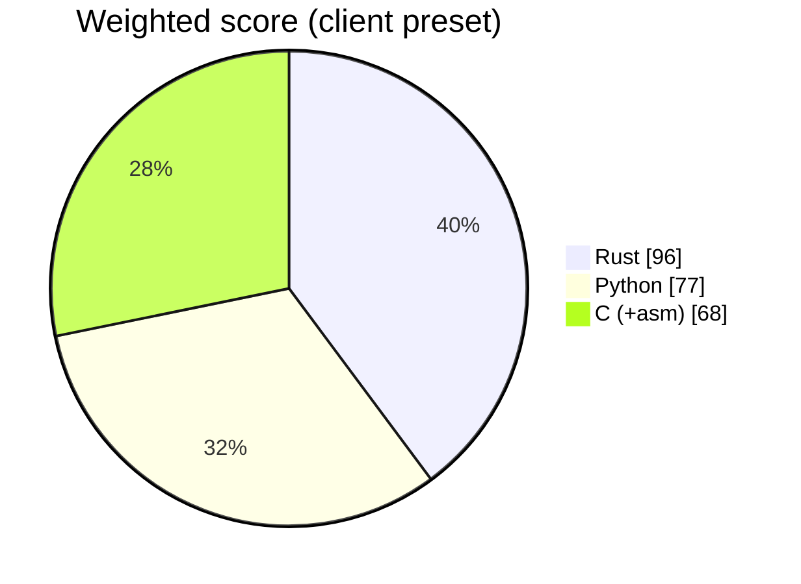

# ADR 0001 — Implementation language: Rust (Profile A)

- Status: accepted
- Date: 2026-10-21
- Deciders: language council (Rust, Python and C/assembly advocates + rebuttal round), approved by the project owner

## Context

PDF authenticity analyzer for client and court deliverables: per PDF it extracts every incremental revision, checks xref/trailer consistency, Info vs XMP metadata, producer/editor fingerprints (bundled + locally learned database), fonts, digital signatures and changes after signing, JavaScript, embedded files/images, hidden text, and renders a visual diff between consecutive revisions. Signals only, never a verdict. Inputs are often malformed or deliberately tampered PDFs; 8 GB laptops and GPU-less VMs; Apache-2.0 licence (no AGPL/GPL renderers). Council: Rust, Python and C advocates plus a rebuttal round (21 Oct 2026).

Weight preset: **client**. Score overrides argued by the council:

- Rust · Team velocity: 3 → 2 (no Rust equivalent of pyhanko; DocMDP, ByteRange and modification analysis are written in-house)
- Rust · Windows GUI maturity: 4 → 3 (side-by-side zoomable revision diff with highlight overlays is hand-built in egui; wgpu/WARP fallback on GPU-less VMs must be tested)
- Python · Windows GUI maturity: 4 → 5 (Qt QGraphicsView gives synced zoom/pan and overlays for the revision diff out of the box)
- C (+asm) · Memory safety / court auditability: 2 → 1 (new C parsing hostile PDFs invites undefined-behaviour challenges in cross-examination)
- C (+asm) · Windows GUI maturity: 2 → 1 (revision diff would be raw Win32/GDI; no mature permissive C toolkit)
- C (+asm) · Team velocity: 3 → 2 (reports, RFC 3161, i18n and signatures are slow to write in C)

## Options scored (1–5, weighted)

| Criterion | Weight | Rust | Python | C (+asm) |
| --- | :-: | :-: | :-: | :-: |
| Speed (throughput, startup) | 3 | 5 | 3 | 5 |
| Transferability (Win10/11 x64 + ARM64, Linux) | 3 | 5 | 4 | 3 |
| Storage (executable / installer size) | 2 | 4 | 2 | 5 |
| Hardware / RAM (8 GB laptops, VMs without GPU) | 2 | 5 | 3 | 5 |
| Windows GUI maturity | 2 | 3 | 5 | 1 |
| CLI --help quality | 2 | 5 | 5 | 2 |
| Packaging, signing, antivirus false positives | 2 | 4 | 2 | 4 |
| Memory safety / court auditability | 3 | 5 | 3 | 1 |
| Team velocity | 2 | 2 | 5 | 2 |
| CI/CD complexity (5 = simple) | 1 | 5 | 3 | 3 |
| **Weighted total** (max 110) | | **96** | 77 | 68 |

## Decision

Profile A (Rust workspace: core + clap CLI + egui GUI). 

## Consequences

- Two static executables (CLI + GUI), no runtime to install; one core library powers both.
- Contributors need Rust; Windows binaries are built on GitHub's `windows-latest` runners.
- No hand-written assembly: hash and parsing crates already use SIMD/CPU intrinsics.

## Rebuttal round (what was rejected and why)

- *Rust transferability 5 → 4 because pdfium.dll ships next to the exe* — rejected: every option ships the same
  PDFium binary (Python via pypdfium2, C directly), so it does not separate the candidates.
- *Rust auditability 5 → 4 because PDFium is C++* — rejected for the same reason; the mitigation (an isolated
  worker process) applies to all three.
- *Python DFIR ecosystem stays 5 (pyhanko, pikepdf, pdfid)* — accepted as true but weight 0 in the client preset;
  it is answered instead by using pyhanko and qpdf as **test oracles** in CI (never shipped).
- C wins nowhere on its own; it enters only as the wrapped PDFium library.

## Technical consequences agreed by the council

- **Own raw tokenizer** (memory-mapped, `#![forbid(unsafe_code)]` in the parser crate): splits revisions at each
  `%%EOF`/`startxref`, keeps every byte offset, never repairs silently. `lopdf` is used only as a cross-check.
- **Rendering for the visual diff:** `pdfium-render` + a pinned PDFium build from `bblanchon/pdfium-binaries`
  (BSD-3/Apache-2.0), shipped as `pdfium.dll` with its own licence file and digest in `environment.json`.
  Excluded: MuPDF / `mupdf` crate (AGPL), Poppler / Xpdf (GPL). `cargo-deny` enforces the licence allow-list.
- **Isolation:** every PDF is parsed and rendered in a child worker process (`rv-pdfauth worker`, Windows Job
  Object: memory cap + timeout, no network). A crash or timeout becomes the finding `PARSER_FAILED` and the bulk
  run continues; the parent alone writes the audit log.
- **Signatures, v1 scope:** cryptographic integrity only — ByteRange coverage, message digest, signature maths,
  DocMDP permissions, revisions added after signing. Trust chain and revocation are reported as **not proven**.
  Results are cross-checked in CI against pyhanko and poppler `pdfsig` (test-only oracles).
- **Fuzzing:** `cargo-fuzz` on the tokenizer and xref reader with a corpus of tampered PDFs; run in CI nightly.

## Implementation status notes (2026-10-21, documentation review)

The decision stands. While documenting the code, these agreed consequences were found **not yet implemented as
written**; they are tracked as gaps in [admissibility.md](../admissibility.md#consolidated-gap-list):

| Agreed above | State of the code at this date | Gap |
| --- | --- | --- |
| Worker in a Job Object with "no network" | Memory cap, kill-on-close and timeout are enforced. A Job Object cannot block network access, so "no network" means: the worker code path contains no network code (tested); on Linux the worker also gets an empty network namespace (`unshare(CLONE_NEWNET)`, fallback recorded); on Windows there is no OS-level network block | G23 (partial) |
| Signature results cross-checked in CI against pyHanko and poppler `pdfsig` | `tests/oracle_pdf.py` (pikepdf/qpdf, pyHanko) runs in the CI job `oracle` on every push (disagreement fails the build); there is **no** `pdfsig` comparison | G21 (partial) |
| `cargo-fuzz` run in CI nightly | `.github/workflows/fuzz.yml`: nightly (02:17 UTC) and on demand, 10 minutes on `analyze()` seeded with the samples; skipped with a warning if the nightly toolchain cannot be installed | — (done) |
| PDFium "digest in `environment.json`" | The library path, SHA-256 and pinned tag are recorded per PDF in the `item_analyzed` audit entry (`details.analysis.visual.renderer`), not in `environment.json` | — (documented) |
