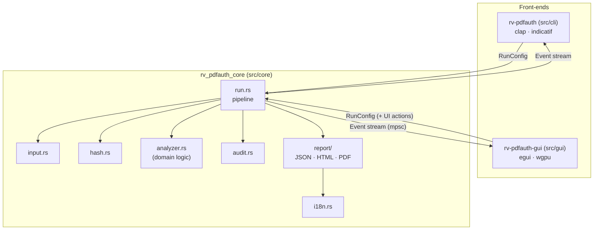
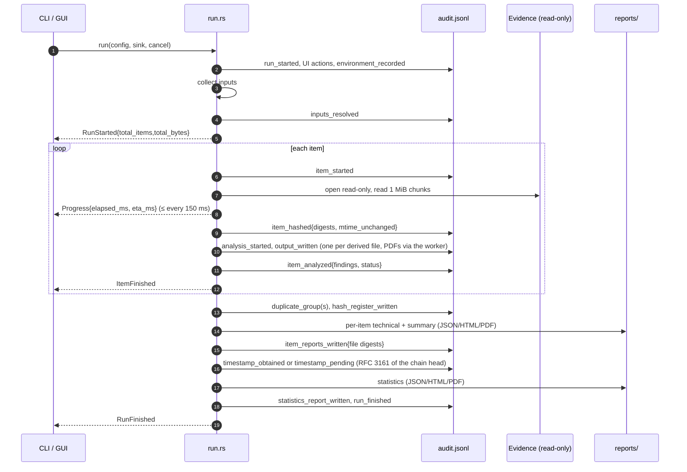
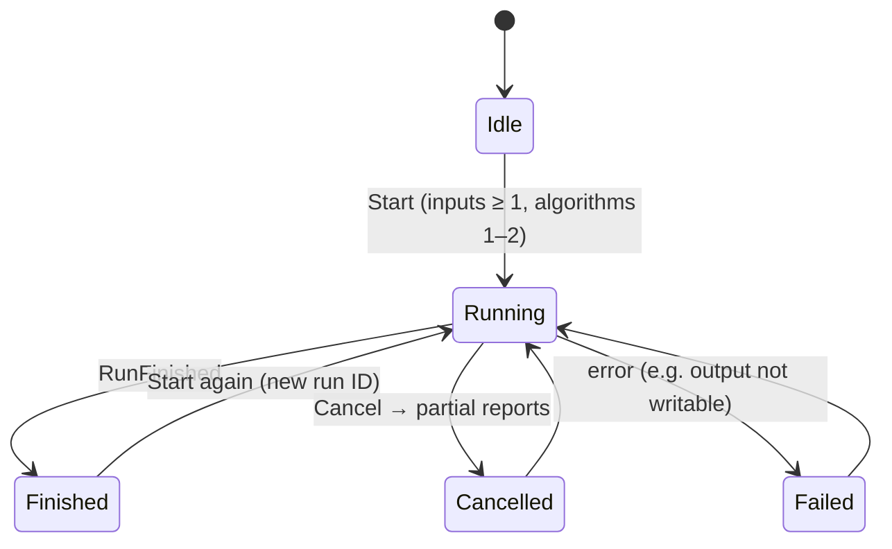

# Architecture

One engine, two front-ends. The engine (`src/core`) does all the work and never prints; the CLI and
the GUI only turn user input into a `RunConfig` and render the `Event`s the engine emits. This is why
both interfaces always produce identical logs and reports.



## Modules

| Module | Responsibility | Replace when building a new tool? |
| --- | --- | --- |
| `input.rs` | Files, folders, list files → sorted, de-duplicated, absolute paths. Symlinks not followed. | No |
| `hash.rs` | One read loop (1 MiB chunks) feeding 1–2 digests; known-answer self-test. | No |
| `analyzer.rs` | Dispatch: PDF candidates to the PDF analysis (worker), other files to signature detection and inventory findings. | **Yes — this is the domain logic** |
| `pdfscan.rs` | In-process PDF analysis of one item: read-only memory map, `rv_pdfauth_pdf::analyze`, derived outputs (revisions, `objects.json`, `embedded/`). | PDF-specific |
| `worker.rs` | Child-process isolation (`<exe> worker`), limits, reply protocol `rv-pdfauth-worker/1`, `PARSER_FAILED`. | Reusable for heavy analyzers |
| `visual.rs` | Visual diff of consecutive revisions with PDFium (`src/render`). | PDF-specific |
| `fingerprints.rs` | Starter, local and extra producer databases and their identity for the audit trail. | PDF-specific |
| `trust.rs` | RFC 3161 timestamp of the chain head; CMS signing of PDF reports. | No |
| `src/pdf` (crate) | PDF parser and findings: scan, revisions, xref, metadata, fonts, content, signatures, DocMDP. `#![forbid(unsafe_code)]`, writes nothing. | PDF-specific |
| `src/render` (crate) | PDFium binding (run-time load), pixel diff, side-by-side PNG. | PDF-specific |
| `audit.rs` | Append-only hash-chained `audit.jsonl` + `audit.log`; `verify`. | No |
| `report/` | View models → minijinja HTML, built-in PDF writer, schema-versioned JSON. | Adapt wording/fields |
| `events.rs` | Typed events; ETA computation. | No |
| `env.rs` | `environment.json` (versions, OS, host, user, command line). | No |
| `run.rs` | Orchestration, cancellation, duplicates, `hashes.csv`. | Small changes |

## One run, step by step



## Run states (as the GUI sees them)



## Concurrency and cancellation

- The GUI runs the engine on a worker thread and receives events through a channel, so the window stays
  responsive; the elapsed-time label is refreshed every 200 ms from the window clock.
- Cancellation is an `AtomicBool` checked after every 1 MiB chunk: large images stop within milliseconds.
  The engine still writes `hashes.csv`, partial reports and `run_cancelled` to the audit log.
- Files are processed sequentially on purpose: the order of audit entries equals the order of work, which is
  easier to explain in court. Hashing is I/O-bound on typical evidence drives.

## PDF analysis: worker isolation and visual diff

```text
run.rs ──► analyzer::analyze_item ── not a PDF ──► inventory analysis (in process)
                    │ PDF (%PDF- or .pdf)
                    ▼
      worker::analyze_in_worker ── spawn `<exe> worker --in … --item-dir … --opts <json>`
        limits first (Unix RLIMIT_AS + no core dump; Windows Job Object), then "RV-WORKER-GO" on stdin
                    ▼
      child: pdfscan::analyze_pdf ── mmap read-only ─► rv_pdfauth_pdf::analyze ─► outputs in the item folder
                    │ one JSON reply on stdout {"protocol":"rv-pdfauth-worker/1","analysis":…}
                    ▼
      parent: validate outputs ─► run.rs hashes + audits each (output_written) ─► item_analyzed
```

- **Failure** (timeout `worker_timeout_s`, crash, `worker_memory_mb` exceeded, bad JSON) → `PARSER_FAILED`
  (high, `reason`, `exit_code`) and `details.worker` with the stderr tail; the run continues with the next item.
- **Crash outputs** are kept and listed as `partial_output`, so they are hashed and audited like every other
  file the tool wrote; they support no finding. Files a successful worker did not list become
  `unlisted_output`; listed paths outside the item folder are rejected.
- **Outputs**: `revisions/rev-NN.pdf` (exact byte prefixes, only with >1 revision), `objects.json`,
  `embedded/NN-<name>.<jpg|bin>` (+ `.inflated.*` for FlateDecode), `visual/rev-NN-vs-MM-page-PPP.png`.
- **Visual diff** (`src/render`): consecutive revisions, pages present in both up to `max_pages`, rendered by
  PDFium on the CPU at `dpi` (lowered for pages above 40 Mpx). A pixel changes when a channel differs by more
  than 32/255 (anti-aliasing and colour rounding); changes are grouped on an 8 px grid, cells up to 2 cells
  apart (1 + ⌊12 px merge gap / 8⌋) are joined into one region, regions with fewer than 3 changed pixels are dropped
  as noise, boxes are padded by 4 px and merged while they touch (max 100 per page, largest kept). Changed pages give
  a side-by-side PNG (boxes in violet on both halves) and `VISUAL_CHANGE_BETWEEN_REVISIONS` (medium); added or
  removed pages are listed. Ratios are integer ppm or decimal strings — no floats in audited JSON.
- **Audit**: `item_analyzed.details.analysis` records the fingerprint DBs used (role, name, version, SHA-256),
  the PDFium library (path, SHA-256, pinned build), the worker outcome and the visual-diff status.

## Why Rust

See [ADR 0001](adr/0001-language.md).

## Further reading

| Page | Covers |
| --- | --- |
| [theory.md](theory.md) | The theory and exact algorithms behind every step above (two levels: plain language and expert) |
| [admissibility.md](admissibility.md) | How each control supports legal requirements; gaps and examiner checklist |
| [installation.md](installation.md) | Release verification, PDFium check, building from source |
| [usage.md](usage.md) | End-to-end use, outputs, interpreting findings, verifying a run |
| [forensic-audit.md](forensic-audit.md) | Audit log files, actions, timestamp, signed reports |
