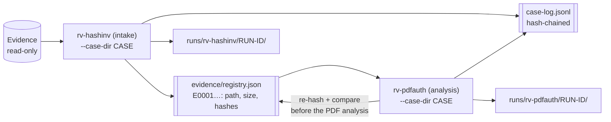
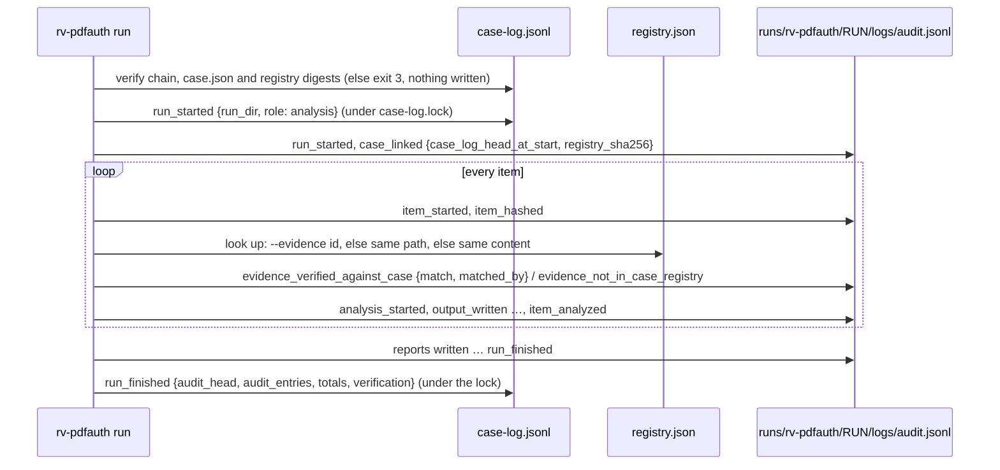
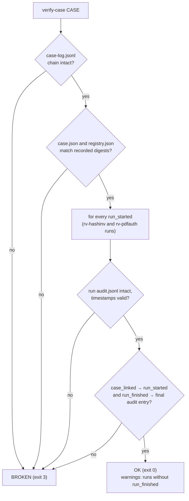

# Case folder

rv-pdfauth can work alone (`--out DIR`). In a real engagement the Rakvor tools share **one case folder**
(`--case-dir`): rv-hashinv, the **intake** tool, registers each evidence file once and gives it an evidence id
(`E0001`, `E0002`, …). rv-pdfauth is an **analysis** tool: before it analyses a PDF it re-hashes the file, compares
it with that registry and links its own audit chain to the case. A reviewer can then follow one item from intake to
the last PDF report and check that the file examined is bit-identical to the one registered.



The contract (`rakvor.case/1`: schemas, events, rules) is shared by every Rakvor tool; the code in
`src/core/src/case.rs` is the forge reference's, unchanged except for the Windows path rule below.

## Layout (`rakvor.case/1`)

```text
<CASE>/
  case.json                   {"schema":"rakvor.case/1","case_id","jurisdiction","created_utc",
                               "created_by":{"tool","version","run_id","actor"}}       (written once)
  case-log.jsonl              hash-chained case log (same algorithm as audit.jsonl), append-only
  case-log.lock               exists only while a tool appends (created exclusively, then removed)
  evidence/registry.json      {"schema":"rakvor.registry/1","items":[{"evidence_id","path","size","hashes",
                               "registered_by":{"tool","version","run_id","audit_seq"},"registered_utc"}]}
  evidence/registry.csv       evidence_id,path,size,<algorithms>,run_id
  runs/rv-hashinv/<RUN-ID>/   the intake runs
  runs/rv-pdfauth/<RUN-ID>/logs/     audit.jsonl, audit.log, hashes.csv, environment.json, timestamp-*.tsr|.json
  runs/rv-pdfauth/<RUN-ID>/reports/  statistics.*, items/<NNNNN>-<NAME>/{technical,summary,custody}.*,
                                     revisions/, visual/, objects.json, embedded/
```

rv-pdfauth **reads** the registry and **never writes** it. JSON schemas:
[case.schema.json](../schemas/case.schema.json) and [registry.schema.json](../schemas/registry.schema.json).

## Using it

```bash
# 1. Intake: open the case and register the evidence (rv-hashinv; --case and --jurisdiction only now)
rv-hashinv scan -i D:\evidence -r --case-dir E:\CASE-014 --case CASE-014 --jurisdiction fr
# 2. Analyse every registered item (no --input needed) ...
rv-pdfauth analyze --case-dir E:\CASE-014
#    ... or only some registered items, or files given by path (matched against the registry)
rv-pdfauth analyze --case-dir E:\CASE-014 --evidence E0001,E0002
rv-pdfauth analyze --case-dir E:\CASE-014 -i D:\evidence\contract.pdf
# 3. Check the whole case before handing it over (either tool; they agree)
rv-pdfauth verify-case E:\CASE-014
```

In the GUI, fill **Case folder** in section 1. The output folder is then derived
(`<case>/runs/rv-pdfauth/<RUN-ID>`) and locked, the change is audited (`ui_case_dir_changed`), the result panel
lists the evidence id and registry check of every item, the results table shows the evidence id next to the file
name, and the **revision viewer header** shows `#N  E000N  file.pdf` with the registry check (green verified, red
mismatch, amber not in the registry).

| Option | Meaning |
| --- | --- |
| `--case-dir DIR` | Work in this case folder. `--out` is not used. |
| `--case ID` | Only needed if the folder is not a case yet (rv-pdfauth then creates `case.json`, with an empty registry: every item is reported as not registered). Afterwards it must match `case.json` or be left out. |
| `--jurisdiction co\|fr` | Set at creation; later runs use the case's jurisdiction for custody forms. |
| `--evidence E0001,E0007` | Analyse these registered items (needs `--case-dir`; unknown id → exit 2). |
| no `--input` | Every registered item is analysed. |

## What rv-pdfauth does with each item



The registry comparison happens **before** `analysis_started`, so the audit log shows the continuity check first.

| Situation | Audit event | Finding | Report |
| --- | --- | --- | --- |
| Same content as the registered item | `evidence_verified_against_case` (match: true) | — | evidence id, "Verified" |
| Registered path (or `--evidence` id), different content | `evidence_verified_against_case` (match: false, expected, actual) | `EVIDENCE_HASH_MISMATCH_WITH_CASE` (**high**, exit 3) | evidence id, "MISMATCH" |
| Not in the registry (path and content unknown) | `evidence_not_in_case_registry` | `EVIDENCE_NOT_IN_CASE_REGISTRY` (medium) | "Not in the case registry" |

On a mismatch the PDF analysis **still runs**: the examiner decides what the difference means, and the report shows
both digests.

**Hash algorithms.** A case run always includes at least one algorithm present in every registered item. If the
examiner picked a disjoint set (e.g. `--hash blake3` against a SHA-256 + MD5 registry), SHA-256 is added — or
replaces the second choice, since the two-algorithm limit still holds — and the change is audited as
`case_algorithm_added`.

**Reports.** The evidence id appears in the technical review (header and identification table, with the registry
check and the intake date), the customer summary, the statistics report (item table and a "Case folder" section
with the counts) and every JSON report (`evidence_id`, `case`). The custody form uses the case id, the evidence id
and the intake date (`registered_utc`) from the registry, and the case's jurisdiction.

## Windows: paths are matched without regard to case

The registry stores the absolute, lexically normalised path the intake tool saw. On Windows the file system is
case-insensitive, so `E:\Evidence\Contract.PDF` and `e:\evidence\contract.pdf` are the same file; rv-pdfauth
therefore compares registry paths **case-insensitively on Windows** (`case::same_path`, `to_lowercase` under
`cfg(windows)` only) and exactly elsewhere. The stored spelling is never changed. Without this rule a file given
with a different case would fall back to content matching (still verified when identical, but a modified file would
be reported as "not in the registry" instead of as a mismatch with its registered id).

## Safety rules

- **A broken case is never extended.** Before every append rv-pdfauth re-verifies the case-log chain, `case.json`
  (digest at creation) and the registry digest; on failure it stops with exit code 3 and writes nothing (no run
  folder, no case-log entry).
- **One writer at a time.** Appends happen under `case-log.lock` (created exclusively). A tool waits up to 30 s for
  another one (then exit 1); a lock older than 10 minutes is reported as *stale* with its owner and is **never
  deleted automatically** — a person decides. The lock is not held during the PDF analysis.
- **`run_finished` is always written**, also after a cancel or a failure, with the final audit head read back from
  disk.
- **The two chains vouch for each other.** `case_linked.case_log_head_at_start` is the hash of the run's
  `run_started` entry in the case log; `run_finished.audit_head` in the case log is the hash of the run's final audit
  entry. Editing either side breaks a link.

## Exit codes with `--case-dir`

| Code | Case-folder causes |
| --- | --- |
| 1 | lock held by another tool (after 30 s) or stale lock; file-system error; `verify-case` on a folder without `case.json` |
| 2 | `case.json` of another schema, case id mismatch, `--case` missing when creating, unknown or malformed evidence id, `--evidence` without `--case-dir` |
| 3 | the case folder fails verification (nothing written); or the run completed with a high finding (e.g. `EVIDENCE_HASH_MISMATCH_WITH_CASE`, or a PDF finding) |

## How a reviewer verifies a case



1. `rv-pdfauth verify-case <CASE>` (rv-hashinv has the same command; they agree). Exit 0 = intact, 3 = broken,
   1 = not a case folder. Only `timestamp_obtained` may follow a run's recorded final entry (a delayed timestamp).
2. Independently of any Rakvor binary: `python tests/verify_chain.py <CASE>/runs/<tool>/<RUN-ID>/logs` re-checks a
   run; the case log uses the same chain rule, and `sha256sum evidence/registry.json` must equal the last
   `registry_sha256` in `case-log.jsonl`.
3. Re-hash the evidence with any tool and compare it with `evidence/registry.csv`.
4. `python tests/validate_reports.py <CASE>` validates `case.json`, `registry.json` and every JSON report against
   `schemas/`.

## Tests

- `src/core/src/case.rs` and `src/core/src/run.rs`: both roles through the core (registration, verification,
  tampered copy, unregistered file, cancelled/failed runs, edited case log and registry, locks).
- `src/cli/tests/cli.rs`: the CLI in the analysis role (exit codes, `--evidence`, `verify-case`).
- `src/cli/tests/toolkit.rs`: a case registered exactly as rv-hashinv does it (shared case code, intake role set
  explicitly, tool name `rv-hashinv`), then `rv-pdfauth analyze --case-dir` on `examples/sample/evidence`: all
  items verified, a tampered copy → mismatch, an unregistered file → medium finding, `verify-case` 0, an edited
  case log → 3. CI does not need the rv-hashinv repository.
- `tests/toolkit_e2e.sh`: the same chain with the real rv-hashinv binary (intake → analysis → `verify-case` by both
  tools); run it by hand when an rv-hashinv build is available (`RV_HASHINV_BIN`).
