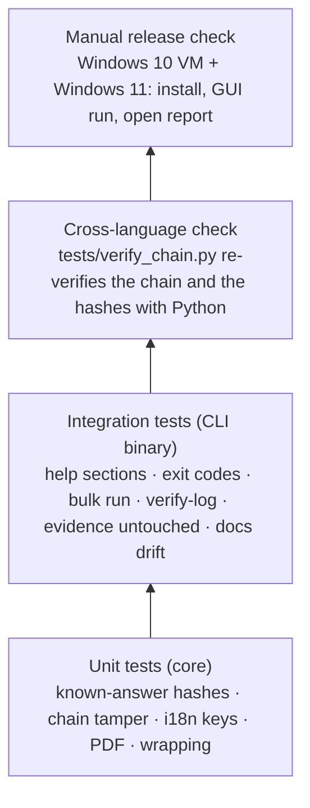
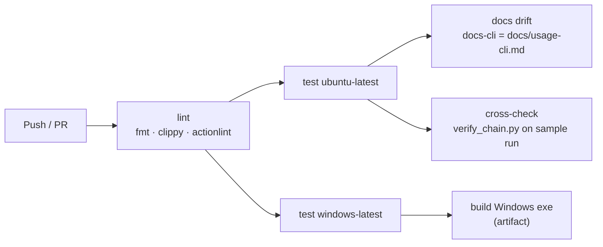
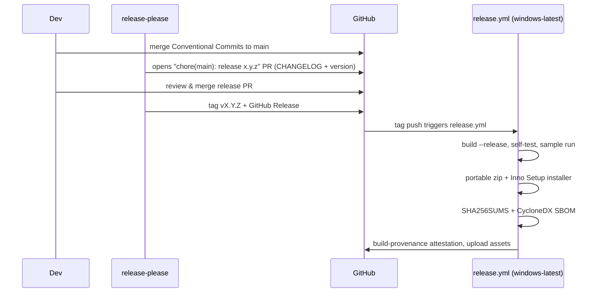

# Development, CI/CD and releases

## Build and test locally

```bash
cargo build --workspace                 # debug build of core, CLI and GUI
cargo test  --workspace                 # unit + integration tests (GUI tests are headless)
cargo clippy --workspace --all-targets -- -D warnings
cargo fmt --all -- --check
cargo run -p rv-pdfauth-cli -- analyze -i examples/sample/evidence --lang all
cargo run -p rv-pdfauth-gui
```

Linux needs no system packages to build. On Windows use the MSVC toolchain (`rustup default stable-msvc`);
binaries are linked with the static C runtime (`.cargo/config.toml`), so they run on a clean Windows 10/11.

### Toolchain

`rust-toolchain.toml` pins the compiler (1.97.0 with rustfmt and clippy); rustup selects it automatically, and
both workflows read their channel from that file (`dtolnay/rust-toolchain@master` with
`toolchain: <channel of rust-toolchain.toml>`), so local builds, CI and release binaries use one compiler. Bump it
deliberately in that one file. The *minimum* versions are separate: `rust-version` is 1.88 for the CLI, core, PDF
and render crates (edition 2024 `let` chains) and 1.95 for the GUI (egui/eframe 0.37); the CI job `msrv` runs
`cargo +1.88.0 check` and `cargo +1.95.0 check -p rv-pdfauth-gui` to keep those numbers true.

### PDFium (visual diff)

The renderer loads PDFium at run time; it is never linked and never committed. Fetch the pinned build (tag and
SHA-256 in `third_party/pdfium/PDFIUM_VERSION.txt`; a digest mismatch aborts) and point the tests at it:

```bash
scripts/fetch_pdfium.sh                                   # -> third_party/pdfium/linux-x64/libpdfium.so
export RV_PDFIUM_PATH="$PWD/third_party/pdfium/linux-x64/libpdfium.so"
```

On Windows: `.\scripts\fetch_pdfium.ps1` and `$env:RV_PDFIUM_PATH = "$PWD\third_party\pdfium\win-x64\pdfium.dll"`.
Without it every test still passes: the PDFium tests print `skipping PDFium test …` and a run records the visual
diff as skipped (`VISUAL_DIFF_SKIPPED`). Release packages put `pdfium.dll` next to the executables. To upgrade,
change the tag, the matching `pdfium-render` feature (root `Cargo.toml`) and both digests together.

`RV_WORKER_TEST_FAULT=crash|hang|oom` (and `RV_WORKER_TEST_TIMEOUT_S`) make the worker misbehave on purpose in
**debug builds only** (`src/cli/tests/worker.rs`); release builds ignore them.

### Documentation figures and oracles

The figures of [theory.md](theory.md) are generated from the synthetic samples by
`python tests/make_theory_figures.py` (SVG byte maps, standard library only) and
`python tests/make_theory_figures.py --bin target/release/rv-pdfauth` (also the visual-diff PNG; needs PDFium and
Pillow). The independent PDF oracles run with `python tests/oracle_pdf.py` (pikepdf/qpdf, pyHanko; not in CI yet).
Mermaid blocks are checked with `npx -y @mermaid-js/mermaid-cli@11 -i <block.mmd> -o <out.svg>`.

## Test pyramid



## Continuous integration



`ci.yml` runs on every push and pull request with read-only permissions.

## Releasing



| Artifact | Built by |
| --- | --- |
| `rv-pdfauth-X.Y.Z-windows-x64.zip` | portable: both exes + README + LICENSE + NOTICE + examples |
| `rv-pdfauth-X.Y.Z-windows-x64-setup.exe` | Inno Setup (`packaging/windows/installer.iss`), per-user install, adds CLI to PATH |
| `SHA256SUMS` | `sha256sum` over the assets |
| `sbom.cdx.json` | `cargo cyclonedx` |
| Attestation | `actions/attest-build-provenance` |

### Code signing

Unsigned executables trigger SmartScreen warnings. Options (decide per legal entity):

| Option | Notes |
| --- | --- |
| Azure Artifact Signing (Trusted Signing) | Low cost, integrates with GitHub Actions; available to organisations in eligible countries (the French entity qualifies, the Colombian one currently does not). |
| OV code-signing certificate (HSM/cloud key) | Works for either entity; slower reputation build-up. |

Signing is a step in `release.yml` guarded by `if: secrets…` so unsigned builds still work for testing.

### Release checklist (manual)

- [ ] `rv-pdfauth self-test` on the released exe passes on Windows 10 **and** Windows 11
- [ ] GUI opens, runs the sample, *Open report* works
- [ ] `SHA256SUMS` matches the downloaded files; `gh attestation verify` passes
- [ ] CHANGELOG entry reviewed by a human
