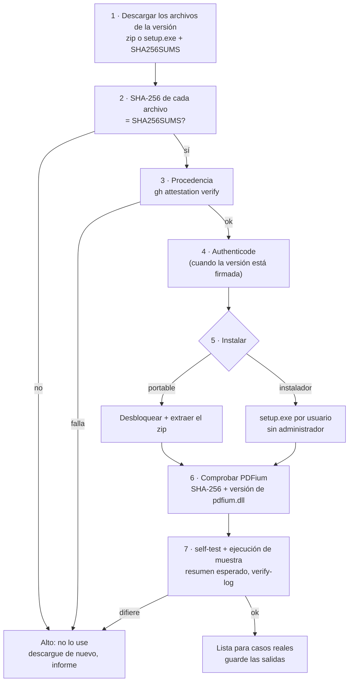

> La versión de referencia es la inglesa ([installation.md](installation.md)); esta traducción la sigue.

# Instalación y verificación (Windows 10/11)

RV PDFAuth se ejecuta **localmente** en el PC con Windows 10 u 11 del perito (x64). No necesita derechos de
administrador, ni runtime (runtime de C estático), ni red, salvo para el sello de tiempo RFC 3161 opcional y la comprobación de versiones opcional. Esta página cubre: obtener
una versión, **demostrar que es la compilación auténtica**, instalarla (zip portable o instalador por usuario),
comprobar el renderizador PDFium, el self-test de la primera ejecución, el uso sin red, la compilación desde el código
fuente para auditores, dónde quedan los archivos y la desinstalación.

Por qué importa la verificación: un tribunal puede preguntar cómo sabe que el programa que ejecutó es aquel cuyo
código revisó un experto. Los pasos 2–4 y 7 dan esa respuesta; guarde su salida con el expediente
([admissibility.md](admissibility.md#examiner-checklist-before-filing-a-report), paso 3, en inglés).



## Requisitos

| Elemento | Requisito |
| --- | --- |
| Sistema operativo | Windows 10 u 11, x64 (`MinVersion=10.0` en el instalador). Linux/macOS: compilar desde el código fuente. |
| Derechos | Usuario estándar. El instalador es por usuario (`PrivilegesRequired=lowest`). |
| Disco | Los dos ejecutables más `pdfium.dll` (7,2 MB) y la documentación; las salidas necesitan espacio para las revisiones (hasta el tamaño de la evidencia por revisión), los renderizados (de decenas a unos cientos de kB por página cambiada) y los informes. |
| Memoria | Cada PDF se analiza en un proceso de análisis limitado por defecto a 2048 MiB (`--worker-memory`). Las máquinas de 8 GB bastan. |
| Gráficos | No se necesita nada: la GUI recurre al renderizado por software (WARP) en máquinas virtuales sin controlador de GPU. |
| Red | Ninguna, salvo la solicitud opcional de sello de tiempo (ver el [paso 8](#8-uso-sin-red-y-en-equipos-aislados)). |
| Comprobación de versiones | Opcional, solo avisa: la aplicación de escritorio al arrancar y `rv-pdfauth update-check` leen la página pública de la última versión en github.com ([Comprobación de versiones](#comprobación-de-versiones)); `RV_NO_UPDATE_CHECK=1` la desactiva. |

## 1. Descarga

Los archivos de la versión están en la página Releases de GitHub del repositorio (`Panacota96/rv-pdfauth` en este commit):

| Archivo | Qué es |
| --- | --- |
| `rv-pdfauth-X.Y.Z-windows-x64.zip` | Portable: `rv-pdfauth.exe`, `rv-pdfauth-gui.exe`, `pdfium.dll`, `licenses/pdfium/`, README, LICENSE, COMMERCIAL.md, NOTICE, CHANGELOG, `docs/`, `examples/` |
| `rv-pdfauth-X.Y.Z-windows-x64-setup.exe` | Instalador Inno Setup, por usuario |
| `SHA256SUMS` | SHA-256 del zip, del instalador y del SBOM (formato `sha256sum`: `<hash>  ./<file>`) |
| `sbom.cdx.json` | Lista de materiales de software CycloneDX (cada dependencia de Rust y su versión) |

Póngalos en una carpeta, p. ej. `C:\Rakvor\downloads\rv-pdfauth-0.1.0\`.

## 2. Verificar la descarga

```powershell
cd C:\Rakvor\downloads\rv-pdfauth-0.1.0
Get-Content .\SHA256SUMS | ForEach-Object {
    $hash, $name = $_ -split '\s+', 2
    $name = $name.TrimStart('*').Replace('./', '')
    if (Test-Path $name) {
        $actual = (Get-FileHash -Algorithm SHA256 $name).Hash.ToLower()
        if ($actual -eq $hash) { "OK    $name" } else { "FAIL  $name  (got $actual)" }
    } else { "skip  $name (not downloaded)" }
}
```

Cada archivo descargado debe imprimir `OK`. Un archivo cada vez:

```powershell
Get-FileHash .\rv-pdfauth-0.1.0-windows-x64.zip -Algorithm SHA256
```

El propio `SHA256SUMS` solo queda protegido indirectamente por el paso 3 (lo produce el mismo flujo de trabajo); la
atestación del paso 3 es la comprobación más fuerte.

## 3. Verificar la procedencia de la compilación

Cada zip e instalador lleva una atestación de procedencia de compilación de GitHub (`actions/attest-build-provenance`):
una declaración firmada de que ese archivo exacto lo compiló el flujo de publicación del repositorio a partir de un
commit dado. En una máquina con acceso a internet y la CLI de GitHub:

```powershell
gh attestation verify .\rv-pdfauth-0.1.0-windows-x64.zip --repo Panacota96/rv-pdfauth
gh attestation verify .\rv-pdfauth-0.1.0-windows-x64-setup.exe --repo Panacota96/rv-pdfauth
```

La salida nombra el flujo de trabajo (`.github/workflows/release.yml`) y el commit de origen; anote ambos. Para un
laboratorio aislado, verifique en una máquina conectada y lleve los archivos verificados en un soporte protegido contra
escritura (la CLI de GitHub también puede descargar el paquete de atestación y la raíz de confianza para
comprobaciones sin red; ver `gh attestation verify --help`). `SHA256SUMS` y el SBOM no tienen atestación propia.

## 4. Verificar la firma Authenticode (versiones firmadas)

El flujo de publicación firma `rv-pdfauth.exe`, `rv-pdfauth-gui.exe` y el instalador **solo cuando hay un certificado
de firma de código configurado** para el repositorio. Las versiones se firman con el certificado de firma de código
**interno** de Rakvor ("Rakvor Code Signing (internal)", emitido por "Rakvor Internal Code Signing Root CA"). No es un
certificado público: Windows solo confía en él en las máquinas donde está instalada la raíz de Rakvor (los portátiles
propios de Rakvor, ya que la herramienta se usa localmente y no se distribuye). Los auditores y los clientes verifican
las versiones con los pasos 2–3 y pueden inspeccionar la firma con la huella de la raíz que figura abajo.

Instale la raíz una vez por máquina de Rakvor (PowerShell, con el usuario que ejecuta la herramienta; el archivo es
`packaging/signing/rakvor-code-signing-root.cer` en el repositorio):

```powershell
# Compruebe primero la huella; debe ser exactamente:
#   SHA-256 DC9BA1A2FCD4F0633C5214B7CCEB25BED8F3F7D9EBAF111590250CBCAA83DF60
(New-Object System.Security.Cryptography.X509Certificates.X509Certificate2 .\rakvor-code-signing-root.cer).GetCertHashString([System.Security.Cryptography.HashAlgorithmName]::SHA256)
Import-Certificate -FilePath .\rakvor-code-signing-root.cer -CertStoreLocation Cert:\CurrentUser\Root
```

Windows muestra un cuadro de confirmación para la nueva raíz; acéptelo solo si la huella coincidió. Sin la raíz,
`Get-AuthenticodeSignature` indica `UnknownError` (cadena hacia una raíz no confiable) y SmartScreen puede seguir
avisando en la primera ejecución. Compruebe:

```powershell
Get-AuthenticodeSignature .\rv-pdfauth-0.1.0-windows-x64-setup.exe |
    Format-List Status, StatusMessage, SignerCertificate, TimeStamperCertificate
# después de extraer el zip:
Get-AuthenticodeSignature .\rv-pdfauth.exe, .\rv-pdfauth-gui.exe | Format-Table Status, Path
```

| Estado | Significado |
| --- | --- |
| `Valid` | Firmado e intacto; el firmante debe ser "Rakvor Code Signing (internal)" |
| `UnknownError` | Firmado, pero la raíz de Rakvor no está instalada en esta máquina (instálela como arriba) |
| `NotSigned` | La versión se compiló sin certificado de firma: apóyese en los pasos 2–3; Windows SmartScreen avisará |
| `HashMismatch` / otro | Alto: el archivo se alteró después de firmarse |

`pdfium.dll` es una compilación de terceros (bblanchon/pdfium-binaries) y **no** tiene firma Authenticode; se verifica
por su SHA-256 en el paso 6. Con el SDK de Windows, `signtool verify /pa /v rv-pdfauth.exe` da la cadena completa.

## 5. Instalar

### 5a. Zip portable

```powershell
# solo después de los pasos 2–4
Unblock-File .\rv-pdfauth-0.1.0-windows-x64.zip
Expand-Archive .\rv-pdfauth-0.1.0-windows-x64.zip -DestinationPath C:\Rakvor\tools\rv-pdfauth-0.1.0
cd C:\Rakvor\tools\rv-pdfauth-0.1.0
.\rv-pdfauth.exe --version
```

Conserve una carpeta por versión para poder volver a ejecutar un caso pasado con la versión exacta registrada en su
`environment.json`. Opcional, solo para la sesión actual: `$env:Path += ";C:\Rakvor\tools\rv-pdfauth-0.1.0"`.

### 5b. Instalador (por usuario, sin administrador)

Haga doble clic en `rv-pdfauth-X.Y.Z-windows-x64-setup.exe` (asistente en inglés, español o francés). Instala en
`%LOCALAPPDATA%\Programs\Rakvor\RV PDFAuth\`, crea un grupo *Rakvor* en el menú Inicio (aplicación + documentación) y
ofrece dos tareas: **Add the rv-pdfauth command to PATH** (PATH del usuario, marcada en la primera instalación) y un
icono en el escritorio. Abra después un terminal **nuevo** para que se aplique el PATH.

Sin intervención:

```powershell
.\rv-pdfauth-0.1.0-windows-x64-setup.exe /VERYSILENT /SUPPRESSMSGBOXES /NORESTART /TASKS="addtopath"
```

El instalador copia los ejecutables, `pdfium.dll`, las licencias, `docs\` y la evidencia de muestra
(`examples\sample\evidence\`), no los scripts de muestra ni `expected_hashes.csv` (están en el zip y en el árbol de
código fuente).

## 6. Comprobar PDFium (renderizador de la comparación visual)

La comparación visual carga `pdfium.dll` **en tiempo de ejecución** desde, por orden: la ruta de `RV_PDFIUM_PATH`
(archivo o carpeta), la carpeta del ejecutable y la carpeta padre del ejecutable. La carpeta de trabajo actual nunca se
examina (no se puede plantar una DLL desde una carpeta de evidencia). Sin la biblioteca cada análisis termina igual, y
los PDF con varias revisiones reciben `VISUAL_DIFF_SKIPPED` con el motivo.

Compilación fijada (de [third_party/pdfium/PDFIUM_VERSION.txt](../third_party/pdfium/PDFIUM_VERSION.txt)):

| Campo | Valor |
| --- | --- |
| Fuente | <https://github.com/bblanchon/pdfium-binaries>, etiqueta `chromium/7881` |
| Versión | 151.0.7881.0 |
| SHA-256 del archivo `pdfium-win-x64.tgz` | `73cc0de638ac2095e7445bf56a38200a5b7c7ca0e9f4ba144598f2457377ac08` |
| SHA-256 de `bin/pdfium.dll` dentro de él | `79d4676b656cfb1abcea88f9ade3b4b0826c5200382db5f4ec72a636c598c118` (7 211 520 bytes) |

```powershell
cd "$env:LOCALAPPDATA\Programs\Rakvor\RV PDFAuth"      # o la carpeta portable
(Get-FileHash .\pdfium.dll -Algorithm SHA256).Hash.ToLower()  # debe ser igual a 79d4676b…c118
(Get-Item .\pdfium.dll).VersionInfo.FileVersion                # 151.0.7881.0
```

Para volver a obtener usted mismo el valor de referencia (cualquier sistema con `tar`):

```powershell
Invoke-WebRequest "https://github.com/bblanchon/pdfium-binaries/releases/download/chromium%2F7881/pdfium-win-x64.tgz" -OutFile pdfium-win-x64.tgz
(Get-FileHash .\pdfium-win-x64.tgz -Algorithm SHA256).Hash.ToLower()   # 73cc0de6…ac08
tar -xzf .\pdfium-win-x64.tgz bin/pdfium.dll
(Get-FileHash .\bin\pdfium.dll -Algorithm SHA256).Hash.ToLower()       # 79d4676b…c118
```

Cada ejecución registra también la biblioteca cargada realmente (ruta, SHA-256, etiqueta y versión fijadas) en la
entrada de auditoría `item_analyzed` de cada PDF (`details.analysis.visual.renderer`).

## 7. Self-test de la primera ejecución y muestra

```powershell
rv-pdfauth --version
rv-pdfauth self-test
```

`self-test` imprime `PASS` para md5, sha1, sha256, sha512, sha3-256 y blake3 (respuestas conocidas para `"abc"`), con
código de salida 0. Solo prueba las implementaciones de hash. Después ejecute la muestra sintética, que pone a prueba
el análisis de PDF, PDFium y la cadena de auditoría:

```powershell
# zip portable (script incluido): espera el código de salida 3, verifica el log y los hashes de la muestra
.\examples\sample\run.ps1 -Bin .\rv-pdfauth.exe

# instalador (no se instala el script): ejecútelo a mano en una carpeta temporal
$app = "$env:LOCALAPPDATA\Programs\Rakvor\RV PDFAuth"
$out = Join-Path $env:TEMP "rv-pdfauth-check"
rv-pdfauth analyze -i "$app\examples\sample\evidence" --hash sha256,md5 --out $out --progress none --no-timestamp
$LASTEXITCODE                                  # 3 = terminado con hallazgos de severidad alta (por diseño)
rv-pdfauth verify-log (Get-ChildItem "$out\logs" | Select-Object -Last 1).FullName   # OK … chain intact
```

Resumen esperado con PDFium presente: **7 items, 0 errors, findings high 3, medium 18, low 3, info 5**, código de salida
3. Sin PDFium los conteos difieren y aparece `VISUAL_DIFF_SKIPPED`: corrija el paso 6 antes de trabajar en casos
reales. Guarde la salida de la consola y la carpeta de la ejecución como registro de esta verificación.

## 8. Uso sin red y en equipos aislados

Aparte de la comprobación de versiones opcional ([Comprobación de versiones](#comprobación-de-versiones)), el **único** acceso a la red en el código es la solicitud de sello de tiempo RFC 3161 (un HTTP POST de un hash de 32 bytes a la
TSA, [src/core/src/trust.rs](../src/core/src/trust.rs)). No hay telemetría ni comprobación de licencia; el aprendizaje
de huellas es local.

| Para desactivar el sello de tiempo | Cómo |
| --- | --- |
| Una ejecución de la CLI | `--no-timestamp` |
| Todas las ejecuciones de la CLI en este PC / sesión | `$env:RV_NO_TIMESTAMP = "1"` (o defínala como variable de entorno del usuario) |
| GUI | desmarque **5. Confianza → Sello de tiempo confiable** antes de *Iniciar revisión* |

Una ejecución sin red con el sello de tiempo activado termina igualmente: registra `timestamp_pending` y el informe de
estadísticas muestra una advertencia. Más tarde, en una máquina que pueda llegar a la TSA, ejecute
`rv-pdfauth timestamp <log folder>` sobre la carpeta de logs de la ejecución (vuelve a verificar la cadena y después
agrega `timestamp_obtained`). Para usar una TSA interna o cualificada, pase `--tsa-url` (ver
[admissibility.md](admissibility.md#53-eidas--regulation-eu-9102014-as-amended-by-eu-20241183), en inglés).
El sello de tiempo solo es cualificado en el sentido de eIDAS si la dirección de la TSA es la de un prestador
cualificado de servicios de confianza (QTSP) inscrito en una lista de confianza de la UE; la dirección por defecto
(DigiCert) no lo es.
El proceso de análisis de PDF no tiene código de red. En Linux se ejecuta además en un espacio de nombres de red vacío
cuando el kernel lo permite (registrado por elemento como `worker.network` en el log de auditoría); en Windows no hay
un bloqueo de red a nivel del sistema operativo para él (brecha G23): en un puesto aislado esto no importa; en otro
caso, una regla de salida del Firewall de Windows para `rv-pdfauth.exe` / `rv-pdfauth-gui.exe` que solo permita el
host de la TSA lo impone.

## 9. Compilar desde el código fuente para auditores

### Cadena de herramientas

| Elemento | Versión |
| --- | --- |
| Rust | Instálelo con `rustup`. Mínimo **1.88** para la CLI y los crates del núcleo (cadenas `let` de la edición 2024; cada dependencia no GUI en `Cargo.lock` declara ≤ 1.85) y **1.95** para la GUI (egui/eframe 0.37): los valores `rust-version` de `Cargo.toml` y `src/gui/Cargo.toml`, comprobados en CI por el job `msrv`. Para igualar una versión, use el compilador exacto del `environment.json` de esa versión → `tool.rustc` (p. ej. `rustc 1.97.0 (2d8144b78 2026-07-07)`): `rustup toolchain install 1.97.0 --profile minimal` y compile con `cargo +1.97.0 …`. Si el árbol de código fuente contiene `rust-toolchain.toml`, rustup lo selecciona automáticamente. |
| Enlazador de Windows | Visual Studio 2022 Build Tools, carga de trabajo *Desktop development with C++* (MSVC + Windows SDK); `rustup default stable-msvc`. El CRT estático se fija en `.cargo/config.toml`. |
| Linux | No hacen falta paquetes del sistema para compilar la CLI. |
| Opcional | Python 3.12 con `blake3 jsonschema pyhanko` para los verificadores independientes y las pruebas de confianza; `pikepdf` para el oráculo de PDF. |

### Compilación

```powershell
git clone https://github.com/Panacota96/rv-pdfauth.git
cd rv-pdfauth
git checkout v0.1.0                       # la etiqueta de la versión bajo revisión
cargo build --release --locked -p rv-pdfauth-cli -p rv-pdfauth-gui
.\scripts\fetch_pdfium.ps1 -Platform win-x64     # descarga chromium/7881, aborta si el SHA-256 no coincide
Copy-Item third_party\pdfium\win-x64\pdfium.dll target\release\
.\target\release\rv-pdfauth.exe self-test
.\examples\sample\run.ps1 -Bin .\target\release\rv-pdfauth.exe
cargo test --workspace --locked            # pruebas unitarias + de integración (las de PDFium se omiten sin RV_PDFIUM_PATH)
```

```bash
# Linux
cargo build --release --locked -p rv-pdfauth-cli
scripts/fetch_pdfium.sh linux-x64
export RV_PDFIUM_PATH="$PWD/third_party/pdfium/linux-x64/libpdfium.so"
target/release/rv-pdfauth self-test && examples/sample/run.sh target/release/rv-pdfauth
python tests/oracle_pdf.py                 # opcional: contraste con pikepdf/qpdf y pyHanko
```

`--locked` se niega a compilar si `Cargo.lock` cambiaría, así que el conjunto de dependencias es igual al que figura en
`environment.json` → `dependencies` y en `sbom.cdx.json`.

### Reproducir los hashes de la versión

Sea preciso sobre qué puede y qué no puede coincidir bit a bit en esta versión (brecha G22):

| Artefacto | ¿Idéntico bit a bit a la versión? | Cómo comprobarlo |
| --- | --- | --- |
| `pdfium.dll` | Sí (se descarga, no se compila) | SHA-256 `79d4676b…c118` ([paso 6](#6-comprobar-pdfium-renderizador-de-la-comparación-visual)) |
| Archivos de `docs/`, `examples/` | Sí (desde git; finales de línea LF salvo `*.ps1`, `*.iss`) | `git ls-files` + `Get-FileHash` contra el zip extraído |
| `rv-pdfauth.exe`, `rv-pdfauth-gui.exe` | **No garantizado**: el compilador está fijado (CI y la publicación leen `rust-toolchain.toml`, 1.97.0, el mismo que `environment.json` → `tool.rustc`), pero las rutas no se reasignan y la cabecera PE lleva datos del momento del enlazado | La atestación de procedencia (paso 3) vincula el binario publicado con el flujo de trabajo y el commit; luego compare el comportamiento (abajo) |
| zip, instalador | No (marcas de tiempo del archivo) | Atestación (paso 3) |

**Equivalencia funcional**: ejecute la muestra con el binario publicado y con su compilación, y compare los hallazgos
de cada elemento y los hashes de la evidencia:

```bash
python - "<release-out>/reports/<RUN-ID>" "<your-out>/reports/<RUN-ID>" <<'EOF'
import glob, json, sys
def load(run):
    out = {}
    for p in sorted(glob.glob(f"{run}/items/*/technical.json")):
        t = json.load(open(p, encoding="utf-8"))
        out[p.replace("\\", "/").split("/")[-2]] = (t["hashes"], [(f["code"], f["severity"], f["params"]) for f in t["findings"]])
    return out
a, b = load(sys.argv[1]), load(sys.argv[2])
print("identical findings and digests" if a == b else "DIFFERENT: " + ", ".join(k for k in a if a.get(k) != b.get(k)))
EOF
```

Compare también los PNG de la comparación visual (idénticos con la misma compilación de PDFium y los mismos PPP) y los
archivos de `revisions/`.

## 10. Dónde quedan las cosas

| Qué | Ubicación |
| --- | --- |
| Programa (instalador) | `%LOCALAPPDATA%\Programs\Rakvor\RV PDFAuth\` (`rv-pdfauth.exe`, `rv-pdfauth-gui.exe`, `pdfium.dll`, `licenses\pdfium\`, `docs\`, `examples\sample\evidence\`, `unins000.exe`) |
| Programa (portable) | la carpeta que extrajo |
| Entrada del PATH (tarea del instalador) | variable de entorno de usuario `Path` (`HKCU\Environment`); la quita el desinstalador |
| Salidas de las ejecuciones | `--out` (por defecto `.\rakvor-out` **relativo a la carpeta actual**): `logs\<RUN-ID>\`, `reports\<RUN-ID>\`. La GUI usa su campo *Carpeta de salida* |
| Base local de huellas | `%LOCALAPPDATA%\Rakvor\rv-pdfauth\fingerprints.local.json` (Linux/macOS: `$XDG_DATA_HOME/rakvor/rv-pdfauth/`, por defecto `~/.local/share/rakvor/rv-pdfauth/`) |
| Su log de cambios | `fingerprints.audit.jsonl` en la misma carpeta (encadenado por hashes) |
| Ajustes de la GUI | no se guardan: cada arranque usa los valores por defecto; cada cambio hecho antes de una ejecución queda registrado en el log de auditoría de esa ejecución |
| Certificado de firma | donde usted lo guarde; solo se registran su ruta, su sujeto y su huella SHA-256, nunca la contraseña |
| Archivos temporales | ninguno (el proceso de análisis solo escribe en la carpeta de informes del elemento) |

## 11. Desinstalar

- **Instalador:** *Configuración → Aplicaciones → Aplicaciones instaladas → RV PDFAuth → Desinstalar*, o ejecute
  `"%LOCALAPPDATA%\Programs\Rakvor\RV PDFAuth\unins000.exe"` (silencioso: agregue `/VERYSILENT`). Quita los archivos
  instalados, los accesos directos y la entrada de la carpeta de instalación en el `Path` del usuario
  (`HKCU\Environment`) que agregó la tarea *Add to PATH*; las demás entradas de `Path` no se tocan (abra después un
  terminal nuevo). CI instala y desinstala el paquete en `windows-latest` y falla si la entrada queda. Las
  compilaciones anteriores a esta corrección no la quitaban; si queda una entrada antigua, bórrela con:

  ```powershell
  $dir = "$env:LOCALAPPDATA\Programs\Rakvor\RV PDFAuth"
  $p = [Environment]::GetEnvironmentVariable("Path", "User").Split(";") | Where-Object { $_ -and $_ -ne $dir }
  [Environment]::SetEnvironmentVariable("Path", ($p -join ";"), "User")
  ```

- **Portable:** borre la carpeta.
- **Se conservan a propósito** (en ambos casos): las salidas de las ejecuciones (material del caso) y la base local
  de huellas con su log de auditoría. Antes de borrar `%LOCALAPPDATA%\Rakvor\rv-pdfauth\`, exporte la base para los
  expedientes (`rv-pdfauth fingerprints export --out <file>`): los informes anteriores citan su SHA-256.

## 12. Solución de problemas de instalación

| Síntoma | Causa y solución |
| --- | --- |
| SmartScreen "Windows protegió su PC" (editor desconocido) | SmartScreen juzga un archivo por la **reputación** de un certificado de confianza pública; la raíz interna de Rakvor no lo es, así que el aviso aparece aunque la firma sea `Valid` (y siempre con `NotSigned`). Solo después de que pasen los pasos 2–4: *Más información → Ejecutar de todas formas*, o quite antes la marca de archivo descargado con `Unblock-File .\<file>` (hágalo en el zip **antes** de extraerlo). Solo desaparece del todo con un certificado público (ver `docs/release-process.md` §5). |
| `rv-pdfauth` no se reconoce | No se eligió la tarea de PATH, o el terminal se abrió antes de instalar: abra un terminal nuevo o use la ruta completa. |
| Cada PDF con varias revisiones muestra `VISUAL_DIFF_SKIPPED` "PDFium library not found" | Falta `pdfium.dll` junto a los ejecutables, el antivirus la puso en cuarentena o es de otra arquitectura. Restáurela y repita el paso 6, o defina `RV_PDFIUM_PATH`. |
| La ventana de la GUI queda en blanco o va muy lenta en una máquina virtual | Sin controlador de GPU: se usa automáticamente el renderizado por software; dé más CPU a la máquina virtual. |
| `self-test` imprime `FAIL` | No use esta compilación para evidencia; descárguela de nuevo y repita los pasos 2–4. |
| El resumen de la muestra difiere del paso 7 | Versión equivocada o falta PDFium; compare `environment.json` con las notas de la versión. |

## Comprobación de versiones

¿Hay publicada una versión más reciente? La herramienta puede decírselo; nunca se actualiza sola.

| | |
| --- | --- |
| Cuándo | La aplicación de escritorio comprueba una vez al arrancar, en segundo plano (solo aparece un aviso con la página de la versión cuando existe una más reciente). La CLI solo comprueba con `rv-pdfauth update-check` (`--json` para scripts; código 0 = la última, 3 = versión más reciente, 1 = no se pudo comprobar). Ningún otro comando contacta la red para esto. RV Hub comprueba cada herramienta que lista. |
| Qué se envía | Un HTTPS GET de `https://github.com/Panacota96/rv-pdfauth/releases/latest` (la redirección se lee, no se sigue) con `User-Agent: rv-pdfauth/<version>` y ninguna otra cabecera, cookie ni parámetro: nada sobre el caso, la evidencia, el perito ni la máquina. |
| Qué hace | Nombra la versión más reciente y su página. Nunca descarga ni instala nada: descargue la versión y verifíquela (`SHA256SUMS`, cadena Authenticode hasta la raíz de Rakvor) como en [Verificar la descarga](#2-verificar-la-descarga) antes de usarla. |
| Auditoría | La comprobación no forma parte de una ejecución y no se escribe en ningún log de auditoría; una comprobación fallida o lenta (sin red, tiempo límite de 5 s) nunca bloquea la herramienta. |
| Desactivarla | `RV_NO_UPDATE_CHECK=1` (cualquier valor salvo vacío o `0`), o el archivo `update-check-off` en `%APPDATA%\Rakvor` (lo escribe el ajuste de RV Hub): desactivada para todas las herramientas Rakvor de este PC. |
| Código | [src/core/src/update.rs](../src/core/src/update.rs) (compartido, idéntico byte a byte, por todas las herramientas Rakvor) |
