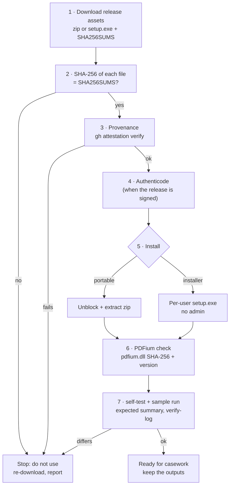

# Installation and verification (Windows 10/11)

RV PDFAuth runs **locally** on the examiner's Windows 10 or 11 PC (x64). It needs no administrator rights, no
runtime (static C runtime) and no network, except for the optional RFC 3161 timestamp. This page covers: getting
a release, **proving it is the genuine build**, installing it (portable zip or per-user installer), checking the
PDFium renderer, the first-run self-test, offline use, building from source for auditors, where files live, and
uninstalling.

Why verification matters: a court may ask how you know the program you ran is the one whose source an expert
reviewed. Steps 2–4 and 7 produce that answer; keep their output with the case file
([admissibility.md](admissibility.md#examiner-checklist-before-filing-a-report), step 3).



## Requirements

| Item | Requirement |
| --- | --- |
| Operating system | Windows 10 or 11, x64 (`MinVersion=10.0` in the installer). Linux/macOS: build from source. |
| Rights | Standard user. The installer is per-user (`PrivilegesRequired=lowest`). |
| Disk | The two executables plus `pdfium.dll` (7.2 MB) and the docs; outputs need room for revisions (up to the evidence size per revision), renders (tens of kB to a few hundred kB per changed page) and reports. |
| Memory | Each PDF is analysed in a worker limited to 2048 MiB by default (`--worker-memory`). 8 GB machines are fine. |
| Graphics | None required: the GUI falls back to software rendering (WARP) on VMs without a GPU driver. |
| Network | None, except the optional timestamp request (see [step 8](#8-offline-and-air-gapped-use)). |

## 1. Download

Release assets on the GitHub Releases page of the repository (`Panacota96/rv-pdfauth` at this commit):

| Asset | What it is |
| --- | --- |
| `rv-pdfauth-X.Y.Z-windows-x64.zip` | Portable: `rv-pdfauth.exe`, `rv-pdfauth-gui.exe`, `pdfium.dll`, `licenses/pdfium/`, README, LICENSE, NOTICE, CHANGELOG, `docs/`, `examples/` |
| `rv-pdfauth-X.Y.Z-windows-x64-setup.exe` | Inno Setup installer, per-user |
| `SHA256SUMS` | SHA-256 of the zip, the installer and the SBOM (`sha256sum` format: `<hash>  ./<file>`) |
| `sbom.cdx.json` | CycloneDX software bill of materials (every Rust dependency and version) |

Put them in one folder, e.g. `C:\Rakvor\downloads\rv-pdfauth-0.1.0\`.

## 2. Verify the download

```powershell
cd C:\Rakvor\downloads\rv-pdfauth-0.1.0
Get-Content .\SHA256SUMS | ForEach-Object {
    $hash, $name = $_ -split '\s+', 2
    $name = $name.TrimStart('*').Replace('./', '')
    if (Test-Path $name) {
        $actual = (Get-FileHash -Algorithm SHA256 $name).Hash.ToLower()
        if ($actual -eq $hash) { "OK    $name" } else { "FAIL  $name  (got $actual)" }
    } else { "skip  $name (not downloaded)" }
}
```

Every downloaded file must print `OK`. One file at a time:

```powershell
Get-FileHash .\rv-pdfauth-0.1.0-windows-x64.zip -Algorithm SHA256
```

`SHA256SUMS` itself is protected by step 3 only indirectly (it is produced by the same workflow); the attestation
in step 3 is the stronger check.

## 3. Verify build provenance

Each zip and installer carries a GitHub build-provenance attestation (`actions/attest-build-provenance`): a signed
statement that this exact file was built by the repository's release workflow from a given commit. On a machine
with internet access and the GitHub CLI:

```powershell
gh attestation verify .\rv-pdfauth-0.1.0-windows-x64.zip --repo Panacota96/rv-pdfauth
gh attestation verify .\rv-pdfauth-0.1.0-windows-x64-setup.exe --repo Panacota96/rv-pdfauth
```

The output names the workflow (`.github/workflows/release.yml`) and the source commit; record both. For an
air-gapped lab, verify on a connected machine and carry the verified files on write-protected media (the GitHub
CLI can also download the attestation bundle and trusted root for offline checks; see
`gh attestation verify --help`). `SHA256SUMS` and the SBOM are not attested themselves.

## 4. Verify the Authenticode signature (signed releases)

The release workflow signs `rv-pdfauth.exe`, `rv-pdfauth-gui.exe` and the installer **only when a code-signing
certificate is configured** for the repository. Releases are signed with Rakvor's **internal** code-signing
certificate ("Rakvor Code Signing (internal)", issued by "Rakvor Internal Code Signing Root CA"). It is not a public
certificate: Windows trusts it only on machines where the Rakvor root is installed — Rakvor's own laptops, since the
tool is used locally and not distributed. Auditors and customers verify releases with steps 2–3 and can inspect the
signature with the root's fingerprint below.

Install the root once per Rakvor machine (PowerShell as the user who runs the tool; the file is
`packaging/signing/rakvor-code-signing-root.cer` in the repository):

```powershell
# Check the fingerprint first — it must be exactly:
#   SHA-256 DC9BA1A2FCD4F0633C5214B7CCEB25BED8F3F7D9EBAF111590250CBCAA83DF60
(New-Object System.Security.Cryptography.X509Certificates.X509Certificate2 .\rakvor-code-signing-root.cer).GetCertHashString([System.Security.Cryptography.HashAlgorithmName]::SHA256)
Import-Certificate -FilePath .\rakvor-code-signing-root.cer -CertStoreLocation Cert:\CurrentUser\Root
```

Windows shows a confirmation dialog for the new root; accept it only if the fingerprint matched. Without the root,
`Get-AuthenticodeSignature` reports `UnknownError` (chain to an untrusted root) and SmartScreen may still warn on
first run. Check:

```powershell
Get-AuthenticodeSignature .\rv-pdfauth-0.1.0-windows-x64-setup.exe |
    Format-List Status, StatusMessage, SignerCertificate, TimeStamperCertificate
# after extracting the zip:
Get-AuthenticodeSignature .\rv-pdfauth.exe, .\rv-pdfauth-gui.exe | Format-Table Status, Path
```

| Status | Meaning |
| --- | --- |
| `Valid` | Signed and intact; the signer must be "Rakvor Code Signing (internal)" |
| `UnknownError` | Signed, but the Rakvor root is not installed on this machine (install it as above) |
| `NotSigned` | The release was built without a signing certificate: rely on steps 2–3; Windows SmartScreen will warn |
| `HashMismatch` / other | Stop: the file was altered after signing |

`pdfium.dll` is a third-party build (bblanchon/pdfium-binaries) and is **not** Authenticode-signed; it is verified
by its SHA-256 in step 6. With the Windows SDK, `signtool verify /pa /v rv-pdfauth.exe` gives the full chain.

## 5. Install

### 5a. Portable zip

```powershell
# only after steps 2–4
Unblock-File .\rv-pdfauth-0.1.0-windows-x64.zip
Expand-Archive .\rv-pdfauth-0.1.0-windows-x64.zip -DestinationPath C:\Rakvor\tools\rv-pdfauth-0.1.0
cd C:\Rakvor\tools\rv-pdfauth-0.1.0
.\rv-pdfauth.exe --version
```

Keep one folder per version so a past case can be re-run with the exact version recorded in its
`environment.json`. Optional, current session only: `$env:Path += ";C:\Rakvor\tools\rv-pdfauth-0.1.0"`.

### 5b. Installer (per-user, no administrator)

Double-click `rv-pdfauth-X.Y.Z-windows-x64-setup.exe` (English, Spanish or French wizard). It installs to
`%LOCALAPPDATA%\Programs\Rakvor\RV PDFAuth\`, creates a *Rakvor* Start-menu group (app + documentation), and
offers two tasks: **Add the rv-pdfauth command to PATH** (user PATH, checked on first install) and a desktop icon.
Open a **new** terminal afterwards for PATH to apply.

Unattended:

```powershell
.\rv-pdfauth-0.1.0-windows-x64-setup.exe /VERYSILENT /SUPPRESSMSGBOXES /NORESTART /TASKS="addtopath"
```

The installer copies the executables, `pdfium.dll`, licences, `docs\` and the sample evidence
(`examples\sample\evidence\`), not the sample scripts or `expected_hashes.csv` (those are in the zip and the
source tree).

## 6. Check PDFium (visual diff renderer)

The visual comparison loads `pdfium.dll` **at run time** from, in order: the path in `RV_PDFIUM_PATH` (file or
folder), the executable's folder, the executable's parent folder. The current working directory is never searched
(no DLL planting from an evidence folder). Without the library every analysis still completes, and multi-revision
PDFs get `VISUAL_DIFF_SKIPPED` with the reason.

Pinned build (from [third_party/pdfium/PDFIUM_VERSION.txt](../third_party/pdfium/PDFIUM_VERSION.txt)):

| Field | Value |
| --- | --- |
| Source | <https://github.com/bblanchon/pdfium-binaries>, tag `chromium/7881` |
| Version | 151.0.7881.0 |
| Archive `pdfium-win-x64.tgz` SHA-256 | `73cc0de638ac2095e7445bf56a38200a5b7c7ca0e9f4ba144598f2457377ac08` |
| `bin/pdfium.dll` inside it, SHA-256 | `79d4676b656cfb1abcea88f9ade3b4b0826c5200382db5f4ec72a636c598c118` (7 211 520 bytes) |

```powershell
cd "$env:LOCALAPPDATA\Programs\Rakvor\RV PDFAuth"      # or the portable folder
(Get-FileHash .\pdfium.dll -Algorithm SHA256).Hash.ToLower()  # must equal 79d4676b…c118
(Get-Item .\pdfium.dll).VersionInfo.FileVersion                # 151.0.7881.0
```

To re-derive the reference value yourself (any OS with `tar`):

```powershell
Invoke-WebRequest "https://github.com/bblanchon/pdfium-binaries/releases/download/chromium%2F7881/pdfium-win-x64.tgz" -OutFile pdfium-win-x64.tgz
(Get-FileHash .\pdfium-win-x64.tgz -Algorithm SHA256).Hash.ToLower()   # 73cc0de6…ac08
tar -xzf .\pdfium-win-x64.tgz bin/pdfium.dll
(Get-FileHash .\bin\pdfium.dll -Algorithm SHA256).Hash.ToLower()       # 79d4676b…c118
```

Every run also records the library actually loaded (path, SHA-256, pinned tag and version) in each PDF's
`item_analyzed` audit entry (`details.analysis.visual.renderer`).

## 7. First-run self-test and sample

```powershell
rv-pdfauth --version
rv-pdfauth self-test
```

`self-test` prints `PASS` for md5, sha1, sha256, sha512, sha3-256 and blake3 (known answers for `"abc"`), exit
code 0. It tests the hash implementations only. Then run the synthetic sample, which exercises the PDF analysis,
PDFium and the audit chain:

```powershell
# portable zip (script included): expects exit code 3, verifies the log and the sample hashes
.\examples\sample\run.ps1 -Bin .\rv-pdfauth.exe

# installer (no script installed): run it by hand into a temporary folder
$app = "$env:LOCALAPPDATA\Programs\Rakvor\RV PDFAuth"
$out = Join-Path $env:TEMP "rv-pdfauth-check"
rv-pdfauth analyze -i "$app\examples\sample\evidence" --hash sha256,md5 --out $out --progress none --no-timestamp
$LASTEXITCODE                                  # 3 = completed with high-severity findings (by design)
rv-pdfauth verify-log (Get-ChildItem "$out\logs" | Select-Object -Last 1).FullName   # OK … chain intact
```

Expected summary with PDFium present: **7 items, 0 errors, findings high 3, medium 18, low 3, info 5**, exit code
3. Without PDFium the counts differ and `VISUAL_DIFF_SKIPPED` appears: fix step 6 before casework. Keep the
console output and the run folder as the record of this verification.

## 8. Offline and air-gapped use

The **only** network access in the code is the RFC 3161 timestamp request (one HTTP POST of a 32-byte hash to the
TSA, [src/core/src/trust.rs](../src/core/src/trust.rs)). There is no telemetry, update check or licence check;
fingerprint learning is local.

| To disable the timestamp | How |
| --- | --- |
| One CLI run | `--no-timestamp` |
| All CLI runs on this PC / session | `$env:RV_NO_TIMESTAMP = "1"` (or set it as a user environment variable) |
| GUI | untick **5. Trust → Trusted timestamp** before *Start review* |

An offline run with the timestamp enabled still completes: it logs `timestamp_pending` and the statistics report
shows a warning. Later, on a machine that can reach the TSA, run `rv-pdfauth timestamp <log folder>` on the run's
log folder (it re-verifies the chain, then appends `timestamp_obtained`). To use an internal or qualified TSA, pass
`--tsa-url` (see [admissibility.md](admissibility.md#53-eidas--regulation-eu-9102014-as-amended-by-eu-20241183)).
The PDF worker has no network code. On Linux it also runs in an empty network namespace when the kernel permits it
(recorded per item as `worker.network` in the audit log); on Windows there is no OS-level network block for it
(gap G23): on an air-gapped workstation this does not matter; elsewhere a Windows Firewall outbound rule for
`rv-pdfauth.exe` / `rv-pdfauth-gui.exe` allowing only the TSA host enforces it.

## 9. Build from source for auditors

### Toolchain

| Item | Version |
| --- | --- |
| Rust | Install with `rustup`. Minimum **1.88** for the CLI and the core crates (edition 2024 `let` chains; every non-GUI dependency in `Cargo.lock` declares ≤ 1.85) and **1.95** for the GUI (egui/eframe 0.37) — the `rust-version` values in `Cargo.toml` and `src/gui/Cargo.toml`, checked in CI by the `msrv` job. To match a release, use the exact compiler in that release's `environment.json` → `tool.rustc` (e.g. `rustc 1.97.0 (2d8144b78 2026-07-07)`): `rustup toolchain install 1.97.0 --profile minimal` and build with `cargo +1.97.0 …`. If the source tree contains `rust-toolchain.toml`, rustup selects it automatically. |
| Windows linker | Visual Studio 2022 Build Tools, workload *Desktop development with C++* (MSVC + Windows SDK); `rustup default stable-msvc`. Static CRT is set in `.cargo/config.toml`. |
| Linux | No system packages needed to build the CLI. |
| Optional | Python 3.12 with `blake3 jsonschema pyhanko` for the independent verifiers and trust tests; `pikepdf` for the PDF oracle. |

### Build

```powershell
git clone https://github.com/Panacota96/rv-pdfauth.git
cd rv-pdfauth
git checkout v0.1.0                       # the tag of the release under review
cargo build --release --locked -p rv-pdfauth-cli -p rv-pdfauth-gui
.\scripts\fetch_pdfium.ps1 -Platform win-x64     # downloads chromium/7881, aborts on SHA-256 mismatch
Copy-Item third_party\pdfium\win-x64\pdfium.dll target\release\
.\target\release\rv-pdfauth.exe self-test
.\examples\sample\run.ps1 -Bin .\target\release\rv-pdfauth.exe
cargo test --workspace --locked            # unit + integration tests (PDFium tests skip without RV_PDFIUM_PATH)
```

```bash
# Linux
cargo build --release --locked -p rv-pdfauth-cli
scripts/fetch_pdfium.sh linux-x64
export RV_PDFIUM_PATH="$PWD/third_party/pdfium/linux-x64/libpdfium.so"
target/release/rv-pdfauth self-test && examples/sample/run.sh target/release/rv-pdfauth
python tests/oracle_pdf.py                 # optional: cross-check with pikepdf/qpdf and pyHanko
```

`--locked` refuses to build if `Cargo.lock` would change, so the dependency set equals the one listed in
`environment.json` → `dependencies` and in `sbom.cdx.json`.

### Reproducing the release hashes

Be precise about what can and cannot match bit for bit in this version (gap G22):

| Artefact | Bit-identical to the release? | How to check |
| --- | --- | --- |
| `pdfium.dll` | Yes (downloaded, not built) | SHA-256 `79d4676b…c118` ([step 6](#6-check-pdfium-visual-diff-renderer)) |
| `docs/`, `examples/` files | Yes (from git; LF line endings except `*.ps1`, `*.iss`) | `git ls-files` + `Get-FileHash` against the extracted zip |
| `rv-pdfauth.exe`, `rv-pdfauth-gui.exe` | **Not guaranteed**: the compiler is pinned (CI and release read `rust-toolchain.toml`, 1.97.0, the same as `environment.json` → `tool.rustc`), but paths are not remapped and the PE header carries link-time data | Provenance attestation (step 3) binds the released binary to the workflow and commit; then compare behaviour (below) |
| zip, installer | No (archive timestamps) | Attestation (step 3) |

**Functional equivalence** — run the sample with the release binary and with your build, then compare the
findings of every item and the evidence digests:

```bash
python - "<release-out>/reports/<RUN-ID>" "<your-out>/reports/<RUN-ID>" <<'EOF'
import glob, json, sys
def load(run):
    out = {}
    for p in sorted(glob.glob(f"{run}/items/*/technical.json")):
        t = json.load(open(p, encoding="utf-8"))
        out[p.replace("\\", "/").split("/")[-2]] = (t["hashes"], [(f["code"], f["severity"], f["params"]) for f in t["findings"]])
    return out
a, b = load(sys.argv[1]), load(sys.argv[2])
print("identical findings and digests" if a == b else "DIFFERENT: " + ", ".join(k for k in a if a.get(k) != b.get(k)))
EOF
```

Also compare the visual-diff PNGs (identical with the same PDFium build and DPI) and the `revisions/` files.

## 10. Where things live

| What | Location |
| --- | --- |
| Program (installer) | `%LOCALAPPDATA%\Programs\Rakvor\RV PDFAuth\` (`rv-pdfauth.exe`, `rv-pdfauth-gui.exe`, `pdfium.dll`, `licenses\pdfium\`, `docs\`, `examples\sample\evidence\`, `unins000.exe`) |
| Program (portable) | the folder you extracted |
| PATH entry (installer task) | user environment variable `Path` (`HKCU\Environment`); removed by the uninstaller |
| Run outputs | `--out` (default `.\rakvor-out` **relative to the current folder**): `logs\<RUN-ID>\`, `reports\<RUN-ID>\`. The GUI uses its *Output folder* field |
| Local fingerprint database | `%LOCALAPPDATA%\Rakvor\rv-pdfauth\fingerprints.local.json` (Linux/macOS: `$XDG_DATA_HOME/rakvor/rv-pdfauth/`, default `~/.local/share/rakvor/rv-pdfauth/`) |
| Its change log | `fingerprints.audit.jsonl` in the same folder (hash-chained) |
| GUI settings | not persisted: each start uses the defaults; every change made before a run is recorded in that run's audit log |
| Signing certificate | wherever you keep it; only its path, subject and SHA-256 fingerprint are logged, never the password |
| Temporary files | none (the worker writes only into the item's report folder) |

## 11. Uninstall

- **Installer:** *Settings → Apps → Installed apps → RV PDFAuth → Uninstall*, or run
  `"%LOCALAPPDATA%\Programs\Rakvor\RV PDFAuth\unins000.exe"` (silent: add `/VERYSILENT`). It removes the
  installed files, the shortcuts and the install folder's entry in the user `Path` (`HKCU\Environment`) that the
  *Add to PATH* task added; other `Path` entries are left untouched (open a new terminal afterwards). CI installs
  and uninstalls the package on `windows-latest` and fails if the entry is left behind. Builds before this fix did
  not remove it; if an old entry remains, delete it with:

  ```powershell
  $dir = "$env:LOCALAPPDATA\Programs\Rakvor\RV PDFAuth"
  $p = [Environment]::GetEnvironmentVariable("Path", "User").Split(";") | Where-Object { $_ -and $_ -ne $dir }
  [Environment]::SetEnvironmentVariable("Path", ($p -join ";"), "User")
  ```

- **Portable:** delete the folder.
- **Kept on purpose** (both cases): run outputs (case material) and the local fingerprint database with its audit
  log. Before deleting `%LOCALAPPDATA%\Rakvor\rv-pdfauth\`, export the database for the case files
  (`rv-pdfauth fingerprints export --out <file>`): past reports cite its SHA-256.

## 12. Installation troubleshooting

| Symptom | Cause and fix |
| --- | --- |
| SmartScreen "Windows protected your PC" (unknown publisher) | SmartScreen judges a file by the **reputation** of a publicly trusted certificate; the internal Rakvor root is not one, so the warning appears even when the signature is `Valid` (and always when `NotSigned`). Only after steps 2–4 pass: *More info → Run anyway*, or remove the downloaded-file mark first with `Unblock-File .\<file>` (do this on the zip **before** extracting it). It goes away for good only with a public certificate (see `docs/release-process.md` §5). |
| `rv-pdfauth` is not recognised | PATH task not selected, or the terminal was opened before installing: open a new terminal or use the full path. |
| Every multi-revision PDF shows `VISUAL_DIFF_SKIPPED` "PDFium library not found" | `pdfium.dll` missing next to the executables, quarantined by antivirus, or the wrong architecture. Restore it and re-check step 6, or set `RV_PDFIUM_PATH`. |
| GUI window blank or very slow on a VM | No GPU driver: software rendering is used automatically; give the VM more CPU. |
| `self-test` prints `FAIL` | Do not use this build for evidence; re-download and repeat steps 2–4. |
| Sample summary differs from step 7 | Wrong version or PDFium missing; compare `environment.json` with the release notes. |
