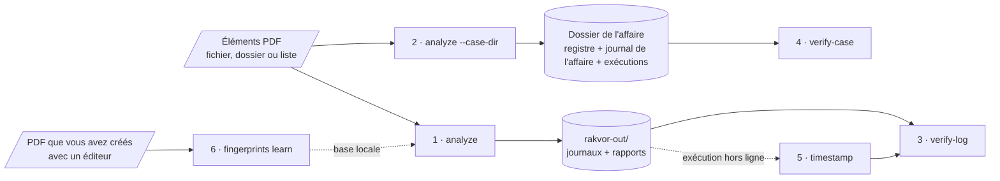
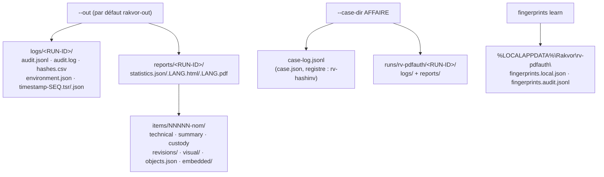

> La version de référence est la version anglaise ([quick-guide.md](quick-guide.md)) ; cette traduction la suit.

# Guide rapide

RV PDFAuth cherche les signes qu'un PDF a été modifié après son premier enregistrement. Il lit chaque élément de
preuve que vous lui donnez (un fichier, un dossier ou une liste de fichiers) sans le modifier, en calcule l'empreinte,
extrait chaque révision enregistrée comme un préfixe exact, octet pour octet, du fichier, compare les révisions
successives page par page (PDFium) et contrôle les dates Info et XMP, les empreintes de producteur et d'éditeur, les
polices, les signatures et les permissions DocMDP, les scripts, les pièces jointes et le texte invisible. Chaque PDF
est analysé dans un processus d'analyse séparé. Il écrit des rapports pour l'expert et pour le client, et inscrit
chaque action dans un journal d'audit chaîné par empreintes. Ses constatations sont des **signaux, pas des
verdicts** : chacune dit ce qu'elle montre et ce qu'elle ne prouve pas. Un PDF sans constatation n'est pas prouvé
authentique, et une constatation ne prouve pas une falsification et ne montre ni qui a modifié le fichier, ni
pourquoi. Cette page couvre les six tâches courantes. Le guide complet est [usage.fr.md](usage.fr.md), et toutes les
options sont dans [usage-cli.md](usage-cli.md) (en anglais).



## Deux façons de l'utiliser

| Mode | Programme | Quand l'utiliser |
| --- | --- | --- |
| Application de bureau (GUI) | `rv-pdfauth-gui.exe` (menu Démarrer : *RV PDFAuth*) | Windows 10/11. Vous choisissez les éléments et les options dans une seule fenêtre, appuyez sur **Lancer l'analyse**, puis examinez les modifications dans la visionneuse de révisions. |
| Ligne de commande (CLI) | `rv-pdfauth.exe` | Scripts, lots, commandes de vérification (`verify-log`, `verify-case`, `timestamp`) et base d'empreintes (`fingerprints`). |

Les deux utilisent le même moteur. Avec les mêmes éléments et les mêmes options, ils donnent les mêmes empreintes et
les mêmes constatations, et écrivent les mêmes fichiers.

## Application de bureau : ce que fait chaque bouton

Rien n'est écrit sur le disque avant d'appuyer sur **Lancer l'analyse**. Chaque modification faite avant est gardée
en mémoire, puis inscrite dans le journal d'audit de l'exécution comme une entrée `ui_*` au démarrage de l'exécution.

| Bouton ou case | Ce qu'il fait | Ce qu'il écrit |
| --- | --- | --- |
| **Ajouter des fichiers…** | Ouvre le sélecteur de fichiers de Windows et ajoute les fichiers choisis à la liste des éléments. | `ui_input_added` (une par fichier) |
| **Ajouter un dossier…** | Ajoute un dossier entier. | `ui_input_added` |
| **Ajouter le chemin** | Ajoute le chemin saisi dans la zone voisine (appuyer sur Entrée fait de même). | `ui_input_added` |
| Glisser-déposer | Les fichiers ou dossiers déposés sur la fenêtre sont ajoutés à la liste des éléments, comme avec **Ajouter des fichiers…**. | `ui_input_added` |
| **x** (à côté d'une entrée) | Retire cette entrée de la liste des éléments. | `ui_input_removed` |
| **Inclure les sous-dossiers** | Coché par défaut : les dossiers sont lus avec leurs sous-dossiers. | `ui_recursive_changed` |
| **Parcourir…** à côté de **Dossier de l'affaire** | Choisit le dossier partagé de l'affaire. Le dossier de sortie devient alors `<case>/runs/rv-pdfauth/<RUN-ID>` et n'est plus modifiable. | `ui_case_dir_changed` |
| **Enregistrer d'abord les éléments de preuve avec RV HashInv** | Affiché dès qu'un dossier de l'affaire est défini. Exécute rv-hashinv sur les mêmes éléments avant l'analyse, pour que l'affaire ait son registre des preuves (Tâche 2). La ligne voisine affiche la version de rv-hashinv trouvée ou, en rouge, pourquoi aucune n'est utilisable. | `ui_intake_changed` |
| **Extraire chaque révision (revisions/rev-NN.pdf)** | Coché par défaut. Écrit chaque révision enregistrée comme un préfixe exact, octet pour octet, de l'élément. | `ui_extract_revisions_changed` |
| **Export des objets (objects.json)** | Coché par défaut. Écrit l'arbre des objets de chaque révision. | `ui_objects_dump_changed` |
| **Comparaison visuelle entre révisions** | Coché par défaut. Rend les révisions successives avec PDFium et écrit une image annotée pour chaque page modifiée. Ses sélecteurs **PPP** et **Pages max.** fixent la résolution (110) et le nombre de pages comparées par paire (50). | `ui_visual_diff_changed`, `ui_dpi_changed`, `ui_max_pages_changed` |
| **Extraire fichiers et images incorporés** | Coché par défaut. Copie les pièces jointes et les images de chaque PDF dans `embedded/`. | `ui_extract_embedded_changed` |
| **Limites du processus d'analyse** (sélecteurs de délai et de mémoire) | Temps (120 s) et mémoire (2048 Mo) accordés au processus d'analyse pour un PDF. Au-delà, le PDF reçoit `PARSER_FAILED` et l'analyse continue. | `ui_worker_timeout_changed`, `ui_worker_memory_changed` |
| **Tous les fichiers** / **Fichiers signalés uniquement** (Rapports par fichier) | Rapports par fichier pour tous les fichiers, ou seulement pour ceux qui ont une constatation au-dessus d'informative. | `ui_item_reports_changed` |
| **Parcourir…** à côté de **Base d'empreintes supplémentaire** | Choisit une base d'empreintes supplémentaire (`.json`, telle qu'écrite par `fingerprints export`), utilisée en plus de la base fournie et de la base locale. | `ui_fingerprints_db_changed` |
| **Parcourir…** à côté de **Dossier de sortie** | Choisit où sont écrits `logs/` et `reports/` (par défaut `rakvor-out`). | Rien jusqu'à l'exécution : le dossier utilisé est consigné dans `environment.json` |
| **Expert** et **Référence du dossier** (champs de texte) | Le nom de l'expert (par défaut : votre utilisateur Windows) et une référence d'affaire facultative. | Rien jusqu'à l'exécution : l'expert est écrit dans chaque entrée d'audit et chaque rapport, la référence sur les rapports |
| **Horodatage qualifié** (case et adresse) | Coché par défaut. Demande à l'autorité RFC 3161 de cette adresse d'horodater le journal d'audit. | `ui_timestamp_changed` |
| **Parcourir…** à côté de **Certificat de signature (.p12/.pfx)** | Choisit votre certificat. Chaque rapport PDF est alors signé avec lui. Saisissez le **Mot de passe du certificat** dans le champ en dessous. Le mot de passe est gardé en mémoire seulement et n'est jamais journalisé. | `ui_signing_certificate_changed` (le chemin seulement) |
| **Lancer l'analyse** | Lance l'exécution avec les réglages affichés. | `ui_start_clicked`, puis toute l'exécution (voir [Où vont les sorties](#où-vont-les-sorties)) |
| **Annuler** | S'arrête après le fichier en cours de lecture et écrit des rapports partiels. | `item_cancelled`, `run_cancelled` |
| **Ouvrir le rapport** | Ouvre le rapport de statistiques (`statistics.<LANG>.html`) de l'exécution terminée. | Rien |
| **Ouvrir le dossier des journaux** | Ouvre le dossier des journaux de l'exécution. | Rien |
| **Ouvrir le rapport d'empreintes** | Après une exécution avec **Enregistrer d'abord les éléments de preuve avec RV HashInv** : ouvre le rapport de statistiques de rv-hashinv. | Rien |
| **Examiner les révisions** (un par ligne du tableau Résultats) | Ouvre la visionneuse de révisions sur ce fichier (fichiers de deux révisions ou plus). | Rien : la consultation n'est pas journalisée |
| **Retour aux résultats** | Quitte la visionneuse de révisions. | Rien |
| **-**, **+** et **Ajuster** (visionneuse de révisions) | Dézooment, zooment et réinitialisent le zoom des deux moitiés de l'image. La molette zoome aussi et le glisser déplace. | Rien |
| **ID des éléments** (panneau de résultat) | Après une exécution dans un dossier de l'affaire, liste l'identifiant de chaque élément (E0001…) et son contrôle contre le registre. Lecture seule. | Rien |
| **Avertissements** (panneau de résultat) | Liste les erreurs rencontrées pendant l'exécution. Lecture seule. | Rien ici : l'exécution journalise chaque erreur comme `item_error` |

Malgré son libellé, cet horodatage n'est qualifié au sens d'eIDAS que si l'adresse est celle d'un prestataire de
services de confiance qualifié (QTSP) inscrit sur une liste de confiance de l'UE ; l'adresse par défaut (DigiCert) ne
l'est pas.

Les sélecteurs (algorithmes d'empreinte, langue des rapports, langue de l'interface, fiche de traçabilité) sont aussi
consignés : `ui_hash_selection_changed`, `ui_language_changed`, `ui_interface_language_changed` et
`ui_jurisdiction_changed`. Dans la visionneuse de révisions, les sélecteurs **Fichier**, **Révisions** et **Page** et
les cartes de la chronologie choisissent ce qui est affiché ; avant d'afficher une image, la visionneuse la compare à
l'empreinte du journal d'audit (vert : correspond ; rouge : modifiée après l'exécution).

## Tâche 1 : Analyser un PDF ou un dossier

1. Vérifiez une fois la version installée sur ce PC : `rv-pdfauth self-test` doit afficher `PASS` pour chaque
   algorithme (code de sortie 0).
2. Lancez l'analyse sur une copie vérifiée des éléments, jamais sur le support d'origine. Omettez `--no-timestamp`
   quand le PC peut joindre la TSA : l'exécution obtient alors aussi l'horodatage (`timestamp: ok …`).

   ```powershell
   rv-pdfauth analyze -i evidence -r --hash sha256,md5 --lang es --case CASE-2026-014 --actor "Ana Ruiz" --no-timestamp
   ```

3. Lisez le résumé. Sur une copie des éléments d'exemple (`examples\sample\evidence`, sept PDF) dans `evidence`, hors
   ligne (`--no-timestamp`), la commande ci-dessus affiche :

   ```text
   DONE (high-severity findings)  run 20261126T124732Z-16203a
     items: 7  bytes: 105085  errors: 0  elapsed: 8.8 s
     findings: high 3, medium 18, low 3, info 5
     timestamp: off
     report: rakvor-out\reports\20261126T124732Z-16203a\statistics.es.html
     logs:   rakvor-out\logs\20261126T124732Z-16203a
   ```

4. Ouvrez le fichier `report:`. Puis, pour chaque élément, ouvrez `technical.<LANG>.html` (pour l'expert) ou
   `summary.<LANG>.html` (pour le client), et regardez les pages modifiées dans `visual/` (ou avec **Examiner les
   révisions** dans l'application de bureau).

**Ce qu'elle écrit :** `rakvor-out/logs/<RUN-ID>/` (journal d'audit, `hashes.csv`, `environment.json`) et
`rakvor-out/reports/<RUN-ID>/` (rapport de statistiques et, par élément, un examen technique, une synthèse, une fiche
de traçabilité, `revisions/`, `visual/`, `objects.json` et `embedded/`).

**Comment lire le résultat :** `DONE` avec le code de sortie 0 signifie aucune constatation de gravité élevée.
`DONE (high-severity findings)` avec le code de sortie 3 est un résultat normal pour des éléments de preuve, pas une
erreur : l'exemple est construit pour le donner. Ouvrez les éléments dont l'état est `problem`. Chaque constatation
indique ce qu'elle montre et ce qu'elle ne prouve pas ; [usage.fr.md](usage.fr.md#5-interpréter-chaque-constatation)
dit quoi vérifier ensuite pour chaque code. `timestamp: pending` signifie que l'autorité n'a pas pu être jointe (voir
la Tâche 5).

Options de l'analyse :

| Option | Ce qu'elle règle |
| --- | --- |
| `--input` (`-i`) | Un fichier ou un dossier à examiner. Répétez-la pour plusieurs. |
| `--input-list` (`-L`) | Un fichier texte avec un chemin par ligne. |
| `--recursive` (`-r`) | Lire aussi les sous-dossiers. |
| `--hash` (`-H`) | Un ou deux parmi md5, sha1, sha256, sha512, sha3-256, blake3 (par défaut sha256). |
| `--out` (`-o`) | Dossier de sortie (par défaut `rakvor-out`). |
| `--lang` (`-l`) | Langue des rapports : en, es, fr ou all. |
| `--actor` (`-a`) | Nom de l'expert dans le journal d'audit et les rapports. |
| `--case` (`-c`) | Identifiant de l'affaire imprimé sur les rapports. |
| `--progress` (`-p`) | bar, jsonl (un événement JSON par ligne) ou none. |
| `--jurisdiction` (`-j`) | Fiche de traçabilité : co (Colombie) ou fr (France). |
| `--tsa-url` | Autorité RFC 3161 (par défaut `http://timestamp.digicert.com`). |
| `--no-timestamp` | Pas de demande d'horodatage (laboratoires hors ligne). |
| `--sign-cert` | Votre certificat `.p12`/`.pfx` : chaque rapport PDF est signé avec lui. |
| `--sign-pass-env` | La variable d'environnement qui contient son mot de passe (par défaut `RV_SIGN_PASSWORD`). |
| `--revisions` | extract (par défaut) ou none : écrire chaque révision comme `revisions/rev-NN.pdf`. |
| `--visual-diff` | on (par défaut) ou off : la comparaison page par page des révisions successives. |
| `--dpi` | Résolution de rendu de la comparaison, de 36 à 600 (par défaut 110). |
| `--max-pages` | Pages comparées par paire de révisions (par défaut 50). |
| `--objects-dump` | on (par défaut) ou off : `objects.json`. |
| `--extract-embedded` | on (par défaut) ou off : `embedded/`. |
| `--worker-timeout` | Secondes accordées pour un PDF (par défaut 120). |
| `--worker-memory` | Limite de mémoire du processus d'analyse en Mio (par défaut 2048). |
| `--fingerprints-db` | Une base d'empreintes supplémentaire (Tâche 6). |
| `--item-reports` | all (par défaut) ou flagged : rapports par fichier seulement pour les fichiers ayant une constatation au-dessus d'informative. |
| `--case-dir` | Le dossier partagé de l'affaire (Tâche 2). |
| `--evidence` (`-E`) | Identifiants des éléments enregistrés à analyser (Tâche 2). |
| `--intake` | hashinv : enregistrer d'abord les éléments avec rv-hashinv (Tâche 2). |
| `--hashinv-exe` | Le programme rv-hashinv à utiliser avec `--intake hashinv` (Tâche 2). |

## Tâche 2 : Analyser des éléments dans un dossier de l'affaire

1. Choisissez un dossier pour l'affaire, sur le volume de l'affaire, par exemple `cases\CASE-2026-014`. rv-pdfauth est
   un outil d'analyse : il vérifie chaque fichier par rapport au registre des preuves écrit par l'outil d'entrée,
   rv-hashinv. Il n'écrit jamais le registre lui-même.
2. Enregistrez et analysez en une étape : `--intake hashinv` exécute d'abord rv-hashinv sur les mêmes éléments (il
   crée l'affaire, donnez donc `--case` et `--jurisdiction`). rv-hashinv est cherché dans `--hashinv-exe`,
   `RV_HASHINV`, à côté de rv-pdfauth, dans le dossier d'installation de RV HashInv, puis dans `PATH`. Si l'affaire a
   déjà été enregistrée, omettez `--intake hashinv`.

   ```powershell
   rv-pdfauth analyze --case-dir cases\CASE-2026-014 --case CASE-2026-014 --jurisdiction co -i evidence -r --intake hashinv --no-timestamp
   ```

3. Lisez la dernière ligne du résumé :

   ```text
     case:   CASE-2026-014 (analysis) verified 7, mismatched 0, not in registry 0
   ```

4. Plus tard, pour analyser de nouveau certains éléments enregistrés, donnez leurs identifiants :

   ```powershell
   rv-pdfauth analyze --case-dir cases\CASE-2026-014 --evidence E0001,E0002 --no-timestamp
   ```

**Ce qu'elle écrit :** l'exécution sous `runs/rv-pdfauth/<RUN-ID>/logs` et `/reports`, et ses entrées `run_started` et
`run_finished` dans `case-log.jsonl` (avec `--intake hashinv`, rv-hashinv écrit aussi `case.json`, le registre
`evidence/registry.json` et `.csv` et sa propre exécution sous `runs/rv-hashinv/`).

**Comment lire le résultat :** `verified` compte les fichiers dont les empreintes correspondent au registre. Un
fichier qui diffère du registre reçoit la constatation élevée `EVIDENCE_HASH_MISMATCH_WITH_CASE` (il est quand même
analysé) ; un fichier absent du registre reçoit `EVIDENCE_NOT_IN_CASE_REGISTRY` (moyenne). Le code de sortie 3 avant
toute lecture signifie que le dossier de l'affaire n'a pas passé la vérification : rien n'y a été écrit (lancez la
Tâche 4). Le code de sortie 2 signale une erreur d'utilisation, par exemple un dossier qui appartient à une autre
affaire ou un identifiant d'élément inconnu.

## Tâche 3 : Vérifier le journal d'audit d'une exécution

1. Donnez à `verify-log` le dossier des journaux de l'exécution (ou le `audit.jsonl` qu'il contient) :

   ```powershell
   rv-pdfauth verify-log rakvor-out\logs\20261126T124732Z-16203a
   ```

2. Lisez la sortie :

   ```text
   OK  69 entries, chain intact: rakvor-out\logs\20261126T124732Z-16203a\audit.jsonl
       outputs: 110 verified of 110 recorded (md5, sha256)
   ```

3. Si l'exécution est horodatée, ajoutez `--tsa-ca <racines de la TSA.pem>` pour vérifier aussi la chaîne de
   certificats de la TSA par rapport aux certificats racine de la TSA elle-même.

**Ce qu'elle écrit :** rien. Elle lit seulement.

**Comment lire le résultat :** `OK` (code de sortie 0) signifie qu'aucune entrée n'a été modifiée, supprimée ni
réordonnée, que chaque jeton d'horodatage correspond, et que chaque rapport, révision, image, `hashes.csv` et
`environment.json` a toujours l'empreinte consignée par le journal. `BROKEN` (code de sortie 3) liste un problème par
ligne. Le code de sortie 1 signifie que le journal ou le fichier `--tsa-ca` ne peut pas être lu. La révocation du
certificat de la TSA n'est jamais vérifiée.

## Tâche 4 : Vérifier une affaire entière

1. Lancez `verify-case` sur le dossier qui contient `case.json` :

   ```powershell
   rv-pdfauth verify-case cases\CASE-2026-014
   ```

2. Lisez la sortie (après la Tâche 2 : l'exécution d'entrée de rv-hashinv et les deux exécutions de rv-pdfauth) :

   ```text
   OK  case CASE-2026-014: 8 case-log entries, 7 registered items, 3 runs verified: cases\CASE-2026-014
       outputs: 223 verified of 223 recorded by the runs' audit logs
   ```

**Ce qu'elle écrit :** rien. Elle lit seulement.

**Comment lire le résultat :** `OK` (code de sortie 0) signifie que le journal de l'affaire, le registre, le journal
d'audit de chaque exécution (de tout outil Rakvor) et les sorties consignées par les exécutions sont intacts. Les
avertissements (par exemple une exécution encore en cours) sont affichés mais ne font pas échouer la vérification.
`BROKEN` (code de sortie 3) liste chaque contrôle en échec. Le code de sortie 1 signifie que le dossier n'est pas un
dossier d'affaire (pas de `case.json`).

## Tâche 5 : Ajouter l'horodatage après un travail hors ligne

1. Hors ligne, lancez l'analyse comme d'habitude, ou avec `--no-timestamp` (ou `RV_NO_TIMESTAMP=1`) pour qu'aucune
   demande ne soit envoyée. Sans `--no-timestamp`, le résumé affiche `timestamp: pending`.

   ```powershell
   rv-pdfauth analyze -i evidence\edited-incremental.pdf -o offline --no-timestamp
   ```

2. Une fois le réseau revenu, horodatez le dossier des journaux de l'exécution :

   ```powershell
   rv-pdfauth timestamp offline\logs\20261126T124751Z-774d23
   ```

3. Lisez le résultat : `OK  timestamp 2026-11-26T12:47:54Z by http://timestamp.digicert.com covers entry #18`.
   Utilisez `--tsa-url` pour choisir une autre autorité et `--actor` pour nommer l'expert dans la nouvelle entrée
   d'audit.
4. Lancez la Tâche 3 sur le même dossier. Elle affiche maintenant la ligne d'horodatage et `TSA signature valid` :

   ```text
   OK  19 entries, chain intact: offline\logs\20261126T124751Z-774d23\audit.jsonl
       timestamp 2026-11-26T12:47:54Z by http://timestamp.digicert.com covers entry #18: TSA signature valid (signer: CN=DigiCert SHA256 RSA4096 Timestamp Responder 2026 1,O=DigiCert\, Inc.,C=US); chain not checked (pass --tsa-ca <CA bundle> to validate it)
       outputs: 23 verified of 24 recorded (sha256), 1 skipped
       not re-hashed: logs/timestamp-00018.tsr (RFC 3161 token: checked by the timestamp verification)
   ```

**Ce qu'elle écrit :** `timestamp-<SEQ>.tsr` (le jeton RFC 3161) et `timestamp-<SEQ>.json` dans le dossier des
journaux, et l'entrée `timestamp_obtained` dans `audit.jsonl`.

**Comment lire le résultat :** le code de sortie 0 signifie que l'horodatage a été obtenu et journalisé. Le code de
sortie 1 signifie que l'autorité n'a pas pu être jointe ; rien n'a changé, réessayez plus tard. Le code de sortie 3
signifie que le journal est absent ou rompu ; aucun horodatage n'est ajouté à un journal rompu. L'horodatage prouve
quand le journal existait, pas que les éléments de preuve sont authentiques.

## Tâche 6 : Apprendre un éditeur PDF à l'outil

1. Fabriquez vous-même des originaux connus : créez un document de test avec l'éditeur ou le service en ligne, puis
   enregistrez-le ou téléchargez-le. N'apprenez qu'à partir de fichiers dont vous pouvez prouver l'origine.
2. Apprenez l'éditeur. Ici, le fichier d'exemple `online-editor.pdf` tient lieu d'un tel fichier :

   ```powershell
   rv-pdfauth fingerprints learn evidence\online-editor.pdf --label "iLovePDF" --category online_editor --case LAB-2026-03 --actor "Ana Ruiz"
   ```

3. Lisez le résultat (premières lignes ; les suivantes donnent les chemins de la base et de son journal d'audit, et
   son SHA-256 avant et après) :

   ```text
   LEARNED local-ilovepdf (iLovePDF, online_editor) from 1 file(s)
     producer contains: iLovePDF | ReportLab PDF Library - www.reportlab.com
     creator contains:  Rakvor make_samples.py
     traits:            binary_comment_hex=bff7a2fe, object_streams=yes, xref_kind=stream
   ```

4. Voyez ce que ce poste a appris avec `rv-pdfauth fingerprints list --db local` (`--db starter` pour les entrées
   fournies, sans `--db` pour les deux).
5. Exportez la base locale pour un autre PC ou pour la communication à la partie adverse (un fichier existant n'est
   jamais écrasé) ; `--db starter` exporte la base fournie :

   ```powershell
   rv-pdfauth fingerprints export --out lab-fingerprints-2026-11.json
   ```

   Sur l'autre PC, donnez-la à l'analyse avec `--fingerprints-db lab-fingerprints-2026-11.json`.

**Ce qu'elle écrit :** `%LOCALAPPDATA%\Rakvor\rv-pdfauth\fingerprints.local.json` (la base locale, utilisée par chaque
analyse ultérieure) et son journal des modifications chaîné `fingerprints.audit.jsonl` dans le même dossier ; `export`
écrit le fichier désigné par `--out`. Rien n'est envoyé nulle part.

**Comment lire le résultat :** une correspondance dans une analyse ultérieure est un signal sur le logiciel qui a
enregistré une révision, pas sur une personne ; les chaînes de producteur peuvent être saisies à la main. Seules les
catégories pdf_editor, online_editor et unlocker donnent des constatations. Le code de sortie 1 signale un fichier qui
n'est pas un PDF ou n'a pas de chaîne de producteur, une base illisible ou un fichier d'export qui existe déjà ; le
code de sortie 2, une erreur d'utilisation (catégorie inconnue, `--label` absent).

## Autres commandes

| Commande | Ce qu'elle fait |
| --- | --- |
| `rv-pdfauth self-test` | Vérifie chaque algorithme d'empreinte avec des valeurs de test publiées. |
| `rv-pdfauth fingerprints` | Regroupe `learn`, `list` et `export` (Tâche 6). |
| `rv-pdfauth update-check` | Indique si une version plus récente est publiée. Elle ne fait que prévenir : rien n'est téléchargé. `RV_NO_UPDATE_CHECK=1` la désactive. |
| `rv-pdfauth describe --json` | Affiche la description de l'outil pour RV Hub. Elle ne lit et n'écrit rien. |

## Codes de sortie

| Code | Signification | Renvoyé par |
| --- | --- | --- |
| 0 | Terminé ; aucune constatation de gravité élevée (commandes de vérification : tout ce qui est vérifié est intact). | toutes les commandes |
| 1 | Erreur d'exécution : entrée introuvable, sortie non inscriptible, journal de l'affaire verrouillé, mauvais mot de passe du certificat, fichier `--fingerprints-db` absent, TSA injoignable (`timestamp` seulement ; `analyze` affiche `timestamp: pending` et continue), dossier qui n'est pas une affaire, autotest en échec, fichier d'empreinte qui n'est pas un PDF ou fichier d'export qui existe déjà, ou vérification des mises à jour impossible. | `analyze`, `verify-log`, `verify-case`, `timestamp`, `self-test`, `fingerprints`, `update-check` |
| 2 | Erreur d'utilisation : option inconnue, valeur incorrecte, plus de deux algorithmes, dossier d'une autre affaire, identifiant d'élément inconnu, catégorie d'empreinte inconnue. | toutes les commandes (option inconnue) ; `analyze`, `fingerprints learn` |
| 3 | Au moins une constatation de gravité élevée, un journal rompu, un contrôle de l'affaire en échec ou (pour `update-check`) une version plus récente. | `analyze`, `verify-log`, `verify-case`, `timestamp`, `update-check` |
| 130 | Annulé avec Ctrl+C : des rapports partiels sont écrits et l'annulation figure dans le journal d'audit. | `analyze` |

## Où vont les sorties



Sans `--case-dir`, chaque exécution crée `logs/<RUN-ID>/` et `reports/<RUN-ID>/` sous `--out` (par défaut
`.\rakvor-out`, relatif au dossier courant). Avec `--case-dir`, ils vont dans `<CASE>/runs/rv-pdfauth/<RUN-ID>/`.
Gardez le dossier des journaux avec les rapports : c'est la preuve de ce qui a été fait.
