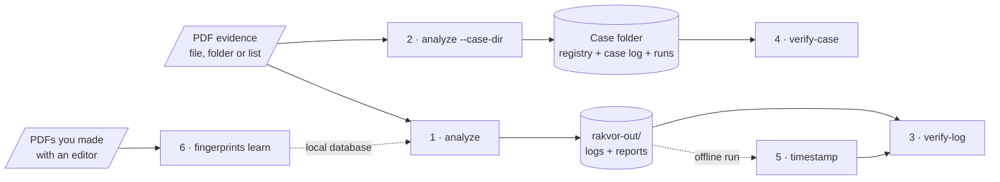
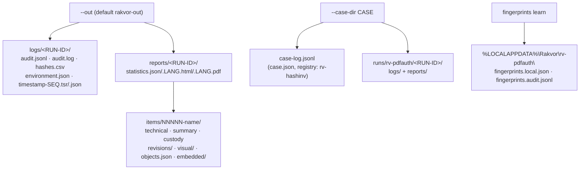

# Quick guide

RV PDFAuth looks for signs that a PDF was changed after it was first saved. It reads each piece of evidence you give
it (one file, a folder or a list of files) without changing it, hashes it, extracts every saved revision as an exact
byte prefix of the file, compares consecutive revisions page by page (PDFium), and checks the Info and XMP dates,
the producer and editor fingerprints, fonts, signatures and DocMDP permissions, scripts, attachments and invisible
text. Each PDF is analysed in a separate worker process. It writes reports for the examiner and for the client, and
records every action in a hash-chained audit log. Its findings are **signals, not verdicts**: each one says what it
shows and what it does not prove. A PDF without findings is not proven authentic, and a finding does not prove
forgery, nor show who changed the file or why. This page covers the six common tasks. The full guide is
[usage.md](usage.md), and every option is in [usage-cli.md](usage-cli.md).



## Two ways to use it

| Mode | Program | When to use it |
| --- | --- | --- |
| Desktop app (GUI) | `rv-pdfauth-gui.exe` (Start menu: *RV PDFAuth*) | Windows 10/11. You pick the evidence and the options in one window, press **Start review**, then look at the changes in the revision viewer. |
| Command line (CLI) | `rv-pdfauth.exe` | Scripts, batches, the verification commands (`verify-log`, `verify-case`, `timestamp`) and the fingerprint database (`fingerprints`). |

Both use the same engine. With the same evidence and options they give the same hashes and findings, and both
write the same files.

## Desktop app: what each button does

Nothing is written to disk until you press **Start review**. Each change you make before that is kept in memory,
then written to the run's audit log as a `ui_*` entry when the run starts.

| Button or box | What it does | What it writes |
| --- | --- | --- |
| **Add files…** | Opens the Windows file picker and adds the chosen files to the evidence list. | `ui_input_added` (one per file) |
| **Add folder…** | Adds a whole folder. | `ui_input_added` |
| **Add path** | Adds the path typed in the box next to it (pressing Enter does the same). | `ui_input_added` |
| Drag and drop | Files or folders dropped onto the window are added to the evidence list, as with **Add files…**. | `ui_input_added` |
| **x** (next to an entry) | Removes that entry from the evidence list. | `ui_input_removed` |
| **Include subfolders** | On by default: the folders are read with their subfolders. | `ui_recursive_changed` |
| **Browse…** next to **Case folder** | Chooses the shared case folder. The output folder then becomes `<case>/runs/rv-pdfauth/<RUN-ID>` and you can no longer edit it. | `ui_case_dir_changed` |
| **Register the evidence with RV HashInv first** | Shown once a case folder is set. Runs rv-hashinv on the same evidence before the analysis, so the case gets its evidence registry (Task 2). The line next to it shows the rv-hashinv version found, or in red why none can be used. | `ui_intake_changed` |
| **Extract each revision (revisions/rev-NN.pdf)** | On by default. Writes each saved revision as an exact byte prefix of the evidence. | `ui_extract_revisions_changed` |
| **Object dump (objects.json)** | On by default. Writes the object tree of every revision. | `ui_objects_dump_changed` |
| **Visual diff between revisions** | On by default. Renders consecutive revisions with PDFium and writes a marked-up picture for each changed page. Its **DPI** and **Page cap** selectors set the resolution (110) and the pages compared per pair (50). | `ui_visual_diff_changed`, `ui_dpi_changed`, `ui_max_pages_changed` |
| **Extract embedded files and images** | On by default. Copies attachments and images out of each PDF into `embedded/`. | `ui_extract_embedded_changed` |
| **Worker limits** (Timeout, Memory selectors) | Time (120 s) and memory (2048 MB) allowed to the worker process for one PDF. Beyond them the PDF gets `PARSER_FAILED` and the review goes on. | `ui_worker_timeout_changed`, `ui_worker_memory_changed` |
| **All items** / **Flagged items only** (Item reports) | Per-file reports for every file, or only for files with a finding above informational. | `ui_item_reports_changed` |
| **Browse…** next to **Extra fingerprint DB** | Chooses an extra fingerprint database (`.json`, as written by `fingerprints export`), used on top of the bundled and local ones. | `ui_fingerprints_db_changed` |
| **Browse…** next to **Output folder** | Chooses where `logs/` and `reports/` are written (default `rakvor-out`). | Nothing until the run: the folder used is recorded in `environment.json` |
| **Examiner** and **Case ID** (text fields) | The examiner's name (default: your Windows user) and an optional case reference. | Nothing until the run: the examiner is written in every audit entry and report, the case ID on the reports |
| **Trusted timestamp** (tick box and address) | On by default. Asks the RFC 3161 authority at that address to timestamp the audit log. | `ui_timestamp_changed` |
| **Browse…** next to **Signing certificate (.p12/.pfx)** | Chooses your certificate. Each PDF report is then signed with it. Type the **Certificate password** in the field below it. The password is kept in memory only and is never logged. | `ui_signing_certificate_changed` (the path only) |
| **Start review** | Starts the run with the settings shown. | `ui_start_clicked`, then the whole run (see [Where the outputs go](#where-the-outputs-go)) |
| **Cancel** | Stops after the file being read and writes partial reports. | `item_cancelled`, `run_cancelled` |
| **Open report** | Opens the statistics report (`statistics.<LANG>.html`) of the finished run. | Nothing |
| **Open log folder** | Opens the run's log folder. | Nothing |
| **Open hash report** | After a run with **Register the evidence with RV HashInv first**: opens rv-hashinv's statistics report. | Nothing |
| **Review revisions** (one per row of the Results table) | Opens the revision viewer on that file (files with two or more revisions). | Nothing: viewing is not logged |
| **Back to results** | Leaves the revision viewer. | Nothing |
| **-**, **+** and **Fit** (revision viewer) | Zoom out, zoom in, and reset the zoom of both halves of the picture. The mouse wheel zooms and dragging pans too. | Nothing |
| **Evidence IDs** (result panel) | After a run in a case folder, lists each item's evidence id (E0001…) and its registry check. Read-only. | Nothing |
| **Warnings** (result panel) | Lists the errors met during the run. Read-only. | Nothing here: the run logs each error as `item_error` |

The timestamp is eIDAS-qualified only if the TSA address is that of a qualified trust service provider (QTSP) on an EU
trusted list; the default address (DigiCert) is not one.

The selectors (hash algorithms, report language, interface language, custody form) are recorded too:
`ui_hash_selection_changed`, `ui_language_changed`, `ui_interface_language_changed` and `ui_jurisdiction_changed`.
In the revision viewer, the **Item**, **Revisions** and **Page** selectors and the timeline cards choose what is
shown; before showing a picture, the viewer checks it against the digest in the audit log (green: matches; red: changed
after the run).

## Task 1: Analyse a PDF or a folder

1. Check the build once on this PC: `rv-pdfauth self-test` must print `PASS` for every algorithm (exit code 0).
2. Run the analysis on a verified copy of the evidence, never on the original media. Leave out `--no-timestamp` when
   the PC can reach the TSA: the run then also obtains the timestamp (`timestamp: ok …`).

   ```powershell
   rv-pdfauth analyze -i evidence -r --hash sha256,md5 --lang es --case CASE-2026-014 --actor "Ana Ruiz" --no-timestamp
   ```

3. Read the summary. On a copy of the sample evidence (`examples\sample\evidence`, seven PDFs) in `evidence`, offline
   (`--no-timestamp`), the command above prints:

   ```text
   DONE (high-severity findings)  run 20261126T124732Z-16203a
     items: 7  bytes: 105085  errors: 0  elapsed: 8.8 s
     findings: high 3, medium 18, low 3, info 5
     timestamp: off
     report: rakvor-out\reports\20261126T124732Z-16203a\statistics.es.html
     logs:   rakvor-out\logs\20261126T124732Z-16203a
   ```

4. Open the `report:` file. Then, for each item, open `technical.<LANG>.html` (for the examiner) or
   `summary.<LANG>.html` (for the client), and look at the changed pages in `visual/` (or with **Review revisions**
   in the desktop app).

**What it writes:** `rakvor-out/logs/<RUN-ID>/` (audit log, `hashes.csv`, `environment.json`) and
`rakvor-out/reports/<RUN-ID>/` (statistics report, and per item a technical review, a summary, a custody form,
`revisions/`, `visual/`, `objects.json` and `embedded/`).

**How to read the result:** `DONE` with exit code 0 means no high-severity finding. `DONE (high-severity findings)`
with exit code 3 is a normal outcome for evidence, not an error: the sample is built to give it. Open the items whose
status is `problem`. Each finding states what it shows and what it does not prove; [usage.md](usage.md#5-interpreting-each-finding)
says what to check next for each code. `timestamp: pending` means that the authority could not be reached (see Task 5).

Analysis options:

| Option | What it sets |
| --- | --- |
| `--input` (`-i`) | A file or folder to review. Repeat it for several. |
| `--input-list` (`-L`) | A text file with one path per line. |
| `--recursive` (`-r`) | Also read subfolders. |
| `--hash` (`-H`) | One or two of md5, sha1, sha256, sha512, sha3-256, blake3 (default sha256). |
| `--out` (`-o`) | Output folder (default `rakvor-out`). |
| `--lang` (`-l`) | Report language: en, es, fr or all. |
| `--actor` (`-a`) | Examiner name in the audit log and the reports. |
| `--case` (`-c`) | Case identifier printed on the reports. |
| `--progress` (`-p`) | bar, jsonl (one JSON event per line) or none. |
| `--jurisdiction` (`-j`) | Custody form: co (Colombia) or fr (France). |
| `--tsa-url` | RFC 3161 authority (default `http://timestamp.digicert.com`). |
| `--no-timestamp` | No timestamp request (offline labs). |
| `--sign-cert` | Your `.p12`/`.pfx` certificate: each PDF report is signed with it. |
| `--sign-pass-env` | The environment variable that holds its password (default `RV_SIGN_PASSWORD`). |
| `--revisions` | extract (default) or none: write each revision as `revisions/rev-NN.pdf`. |
| `--visual-diff` | on (default) or off: the page-by-page comparison of consecutive revisions. |
| `--dpi` | Rendering resolution of the comparison, 36 to 600 (default 110). |
| `--max-pages` | Pages compared per pair of revisions (default 50). |
| `--objects-dump` | on (default) or off: `objects.json`. |
| `--extract-embedded` | on (default) or off: `embedded/`. |
| `--worker-timeout` | Seconds allowed for one PDF (default 120). |
| `--worker-memory` | Memory limit of the worker in MiB (default 2048). |
| `--fingerprints-db` | An extra fingerprint database (Task 6). |
| `--item-reports` | all (default) or flagged: per-file reports only for files with a finding above informational. |
| `--case-dir` | The shared case folder (Task 2). |
| `--evidence` (`-E`) | Registered evidence ids to analyse (Task 2). |
| `--intake` | hashinv: register the evidence with rv-hashinv first (Task 2). |
| `--hashinv-exe` | The rv-hashinv program to use with `--intake hashinv` (Task 2). |

## Task 2: Analyse evidence in a case folder

1. Choose one folder for the case, on the case volume, for example `cases\CASE-2026-014`. rv-pdfauth is an analysis
   tool: it verifies each file against the evidence registry that the intake tool, rv-hashinv, writes. It never writes
   the registry itself.
2. Register and analyse in one step: `--intake hashinv` runs rv-hashinv on the same evidence first (it creates the
   case, so give `--case` and `--jurisdiction`). rv-hashinv is searched in `--hashinv-exe`, `RV_HASHINV`, next to
   rv-pdfauth, the RV HashInv install folder, then `PATH`. If the case was registered before, leave out
   `--intake hashinv`.

   ```powershell
   rv-pdfauth analyze --case-dir cases\CASE-2026-014 --case CASE-2026-014 --jurisdiction co -i evidence -r --intake hashinv --no-timestamp
   ```

3. Read the last line of the summary:

   ```text
     case:   CASE-2026-014 (analysis) verified 7, mismatched 0, not in registry 0
   ```

4. Later, to analyse some registered items again, give their ids:

   ```powershell
   rv-pdfauth analyze --case-dir cases\CASE-2026-014 --evidence E0001,E0002 --no-timestamp
   ```

**What it writes:** the run under `runs/rv-pdfauth/<RUN-ID>/logs` and `/reports`, and its `run_started` and
`run_finished` entries in `case-log.jsonl` (with `--intake hashinv`, rv-hashinv also writes `case.json`, the registry
`evidence/registry.json` and `.csv` and its own run under `runs/rv-hashinv/`).

**How to read the result:** `verified` counts the files whose hashes match the registry. A file that differs from the
registry gets the high finding `EVIDENCE_HASH_MISMATCH_WITH_CASE` (it is still analysed); a file not in the registry
gets `EVIDENCE_NOT_IN_CASE_REGISTRY` (medium). Exit code 3 before anything is read means that the case folder failed
verification: nothing was written to it (run Task 4). Exit code 2 means a usage error, for example a folder that
belongs to another case or an unknown evidence id.

## Task 3: Verify a run's audit log

1. Point `verify-log` at the run's log folder (or at the `audit.jsonl` in it):

   ```powershell
   rv-pdfauth verify-log rakvor-out\logs\20261126T124732Z-16203a
   ```

2. Read the output:

   ```text
   OK  69 entries, chain intact: rakvor-out\logs\20261126T124732Z-16203a\audit.jsonl
       outputs: 110 verified of 110 recorded (md5, sha256)
   ```

3. If the run has a timestamp, add `--tsa-ca <TSA roots.pem>` to also check the TSA certificate chain against the
   TSA's own root certificates.

**What it writes:** nothing. It only reads.

**How to read the result:** `OK` (exit code 0) means that no entry was edited, deleted or re-ordered, that each
timestamp token matches, and that each report, revision, picture, `hashes.csv` and `environment.json` still has the
digest the log recorded. `BROKEN` (exit code 3) lists one problem per line. Exit code 1 means that the log or the
`--tsa-ca` file cannot be read. Revocation of the TSA certificate is never checked.

## Task 4: Verify a whole case

1. Run `verify-case` on the folder that holds `case.json`:

   ```powershell
   rv-pdfauth verify-case cases\CASE-2026-014
   ```

2. Read the output (after Task 2: the rv-hashinv intake run and the two rv-pdfauth runs):

   ```text
   OK  case CASE-2026-014: 8 case-log entries, 7 registered items, 3 runs verified: cases\CASE-2026-014
       outputs: 223 verified of 223 recorded by the runs' audit logs
   ```

**What it writes:** nothing. It only reads.

**How to read the result:** `OK` (exit code 0) means that the case log, the registry, every run's audit log (of
every Rakvor tool) and the runs' recorded outputs are intact. Warnings (for example a run still in progress) are
printed but do not fail the check. `BROKEN` (exit code 3) lists each failed check. Exit code 1 means that the folder
is not a case folder (no `case.json`).

## Task 5: Add the timestamp after offline work

1. Offline, run the analysis as usual, or with `--no-timestamp` (or `RV_NO_TIMESTAMP=1`) so that no request is sent.
   Without `--no-timestamp`, the summary shows `timestamp: pending`.

   ```powershell
   rv-pdfauth analyze -i evidence\edited-incremental.pdf -o offline --no-timestamp
   ```

2. Once the network is back, timestamp the run's log folder:

   ```powershell
   rv-pdfauth timestamp offline\logs\20261126T124751Z-774d23
   ```

3. Read the result: `OK  timestamp 2026-11-26T12:47:54Z by http://timestamp.digicert.com covers entry #18`. Use
   `--tsa-url` to choose another authority, and `--actor` to name the examiner in the new audit entry.
4. Run Task 3 on the same folder. It now shows the timestamp line and `TSA signature valid`:

   ```text
   OK  19 entries, chain intact: offline\logs\20261126T124751Z-774d23\audit.jsonl
       timestamp 2026-11-26T12:47:54Z by http://timestamp.digicert.com covers entry #18: TSA signature valid (signer: CN=DigiCert SHA256 RSA4096 Timestamp Responder 2026 1,O=DigiCert\, Inc.,C=US); chain not checked (pass --tsa-ca <CA bundle> to validate it)
       outputs: 23 verified of 24 recorded (sha256), 1 skipped
       not re-hashed: logs/timestamp-00018.tsr (RFC 3161 token: checked by the timestamp verification)
   ```

**What it writes:** `timestamp-<SEQ>.tsr` (the RFC 3161 token) and `timestamp-<SEQ>.json` in the log folder, and
the `timestamp_obtained` entry in `audit.jsonl`.

**How to read the result:** exit code 0 means that the timestamp was obtained and logged. Exit code 1 means that the
authority could not be reached; nothing changed, so try again later. Exit code 3 means that the log is missing or
broken; no timestamp is added to a broken log. The timestamp proves when the log existed, not that the evidence is
authentic.

## Task 6: Teach the tool a PDF editor

1. Make known originals yourself: create a test document with the editor or online service, and save or download it.
   Learn only from files whose origin you can prove.
2. Learn the editor. Here the sample `online-editor.pdf` stands for such a file:

   ```powershell
   rv-pdfauth fingerprints learn evidence\online-editor.pdf --label "iLovePDF" --category online_editor --case LAB-2026-03 --actor "Ana Ruiz"
   ```

3. Read the result (first lines; the next ones give the database and audit-log paths and its SHA-256 before and
   after):

   ```text
   LEARNED local-ilovepdf (iLovePDF, online_editor) from 1 file(s)
     producer contains: iLovePDF | ReportLab PDF Library - www.reportlab.com
     creator contains:  Rakvor make_samples.py
     traits:            binary_comment_hex=bff7a2fe, object_streams=yes, xref_kind=stream
   ```

4. See what this workstation has learned with `rv-pdfauth fingerprints list --db local` (`--db starter` for the
   bundled entries, no `--db` for both).
5. Export the local database for another PC or for disclosure (an existing file is never overwritten); `--db starter`
   exports the bundled one:

   ```powershell
   rv-pdfauth fingerprints export --out lab-fingerprints-2026-11.json
   ```

   On the other PC, give it to the analysis with `--fingerprints-db lab-fingerprints-2026-11.json`.

**What it writes:** `%LOCALAPPDATA%\Rakvor\rv-pdfauth\fingerprints.local.json` (the local database, used by every
later analysis) and its hash-chained change log `fingerprints.audit.jsonl` in the same folder; `export` writes the
file named by `--out`. Nothing is sent anywhere.

**How to read the result:** a match in a later analysis is a signal about the software that saved a revision, not
about a person; producer strings can be typed by hand. Only the categories pdf_editor, online_editor and unlocker raise
findings. Exit code 1 means a file that is not a PDF or has no producer string, an unreadable database, or an export
file that already exists; exit code 2 a usage error (unknown category, missing `--label`).

## Other commands

| Command | What it does |
| --- | --- |
| `rv-pdfauth self-test` | Checks every hash algorithm against published test values. |
| `rv-pdfauth fingerprints` | Groups `learn`, `list` and `export` (Task 6). |
| `rv-pdfauth update-check` | Tells you whether a newer release is published. It only notifies: nothing is downloaded. `RV_NO_UPDATE_CHECK=1` turns it off. |
| `rv-pdfauth describe --json` | Prints the tool's description for RV Hub. It reads and writes nothing. |

## Exit codes

| Code | Meaning | Returned by |
| --- | --- | --- |
| 0 | Completed; no high-severity finding (verification commands: everything checked is intact). | every command |
| 1 | Runtime error: input not found, output not writable, case log locked, wrong certificate password, missing `--fingerprints-db` file, TSA unreachable (`timestamp` only; `analyze` shows `timestamp: pending` and goes on), not a case folder, a failed self-test, a fingerprint file that is not a PDF or an export file that exists, or an update check that could not be made. | `analyze`, `verify-log`, `verify-case`, `timestamp`, `self-test`, `fingerprints`, `update-check` |
| 2 | Usage error: unknown option, bad value, more than two algorithms, case folder of another case, unknown evidence id, unknown fingerprint category. | every command (unknown option); `analyze`, `fingerprints learn` |
| 3 | At least one high-severity finding, a broken log, a failed case check, or (for `update-check`) a newer release. | `analyze`, `verify-log`, `verify-case`, `timestamp`, `update-check` |
| 130 | Cancelled with Ctrl+C: partial reports are written and the cancellation is in the audit log. | `analyze` |

## Where the outputs go



Without `--case-dir`, each run creates `logs/<RUN-ID>/` and `reports/<RUN-ID>/` under `--out` (default
`.\rakvor-out`, relative to the current folder). With `--case-dir`, they go to `<CASE>/runs/rv-pdfauth/<RUN-ID>/`.
Keep the log folder with the reports: it is the proof of what was done.
