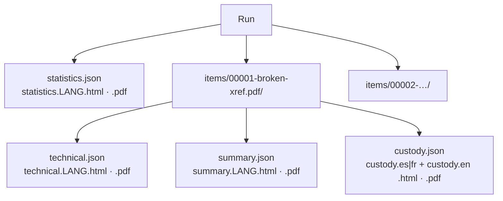
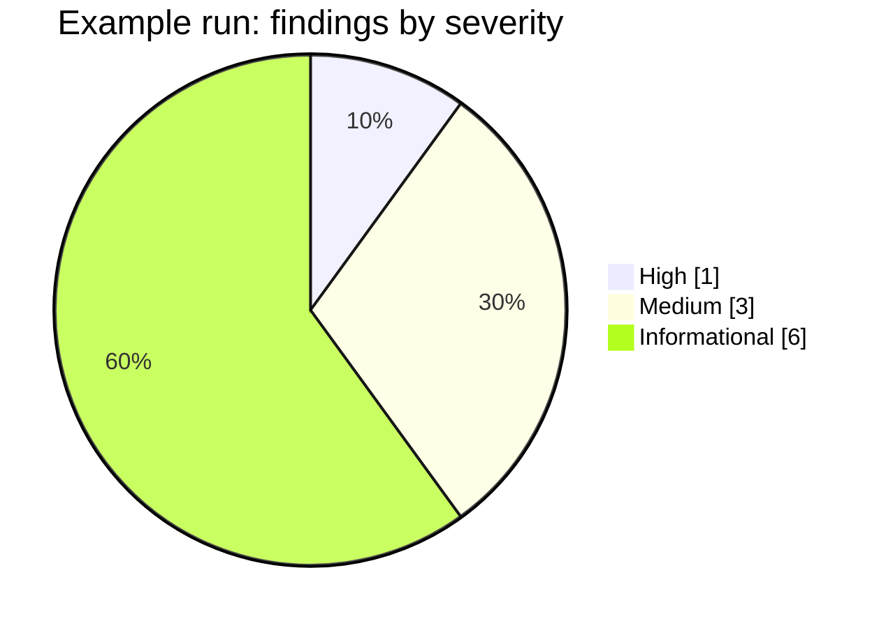

# Reports

Every run produces one **statistics report**. Every reviewed file produces **two separate reviews**:
a hyper-detailed **technical review** for examiners and lawyers, and a concise **customer summary** in plain
language. Each exists as JSON (machine-readable, language-neutral) plus HTML and PDF in each selected language.

Each item folder also holds a **chain-of-custody form** for the chosen jurisdiction (`--jurisdiction co|fr`)
plus its English version — see [forensic-audit.md](forensic-audit.md#chain-of-custody-form-per-item).

**Brand.** HTML and PDF reports carry the Rakvor header band (RV mark, descriptor
*FORENSICS | INCIDENT RESPONSE | SECURITY* and the tagline in the report language) on a light, printable page.
When `--sign-cert` is used, each PDF shows the signer and certificate fingerprint and carries a digital signature
that Acrobat or `pyhanko sign validate` can check. The statistics report shows the trusted timestamp (or a warning
that it is pending).

**Size.** Item reports never list every other file: duplicate partners are capped at 10 names
("… (+N)"); the complete groups are in the statistics report and `hashes.csv`.

## What each report contains

| Section | Statistics | Technical review | Customer summary |
| --- | :-: | :-: | :-: |
| Run ID, case, examiner, start/end, duration, interface | ✔ | ✔ (run ID, case) | case, date |
| Hash algorithms, totals, throughput | ✔ | | |
| Findings by severity and type, items by detected type | ✔ | | |
| Duplicate groups | ✔ | as finding | as finding |
| Full path, size, modified time, extension, detected type | | ✔ | file name |
| All digests | | ✔ | primary only ("digital fingerprint") |
| Findings with **what it shows / what it does not prove** | | ✔ | plain sentence |
| Method | | ✔ | "What we did" |
| Audit entries covering the item | | ✔ (`#first – #last`) | |
| Limitations | ✔ | ✔ | |
| Status and next step | | ✔ | ✔ |
| PDF overview: PDFs with >1 revision, with signatures, with online-editor fingerprints | ✔ | | |
| Revision history table (byte range, Info/XMP dates, producer, time since previous, objects added/changed/deleted, pages changed, signed by) + timeline | | ✔ | |
| Signatures, fonts, producer fingerprints (DB name, version, SHA-256), visual comparison (thumbnails → PNG), extracted files with digests | | ✔ | |
| Plain-language document history ("saved 3 times; last change 9 days after creation, with an online editor") | | | ✔ |

With `--item-reports flagged`, items whose status is `ok` get no technical, summary or custody files; their
derived outputs (e.g. `objects.json`) are still written and audited. They stay listed in the statistics report
(`reports_written: false`) and the audit log records `item_reports_skipped`.

## Status and severity

| Severity | Examples | Item status |
| --- | --- | --- |
| High | CONTENT_CHANGED_AFTER_SIGNATURE, SIGNATURE_INTEGRITY_FAILED, PARSER_FAILED, UNREADABLE | `problem` (exit code 3) |
| Medium | VISUAL_CHANGE_BETWEEN_REVISIONS, METADATA_INFO_XMP_MISMATCH, EXTENSION_MISMATCH | `attention` |
| Low | INCREMENTAL_UPDATES, HYBRID_XREF, EMBEDDED_FILES | `attention` |
| Informational | REVISION_TIME_GAP, SIGNATURE_PRESENT_TRUST_NOT_VERIFIED, DUPLICATE | `ok` |

## Findings catalogue

Every code, its severity, and the rule behind it. The full *shows / does not prove* wording is in
`i18n/en.json` (es, fr); what to check next and what not to conclude: [usage.md](usage.md#5-interpreting-each-finding);
the exact rules and thresholds: [theory.md](theory.md).

| Code | Severity | Raised when |
| --- | :-: | --- |
| `EMPTY_FILE` | info | the file has 0 bytes |
| `EXTENSION_MISMATCH` | medium | name and content signature disagree |
| `EXECUTABLE_CONTENT` | high | a program is stored under a non-program name |
| `DUPLICATE` | info | identical content (primary hash) in several files |
| `UNREADABLE` | high | reading failed (OS error) |
| `NOT_A_PDF` | info | a `.pdf` name without `%PDF-` in the first 1024 bytes |
| `PARSER_FAILED` | high | the isolated PDF analysis did not complete (timeout, memory, crash, bad output) |
| `ENCRYPTED_PARTIAL_ANALYSIS` | info | the PDF is encrypted; content checks skipped |
| `INCREMENTAL_UPDATES` | low | more than one revision |
| `VISUAL_CHANGE_BETWEEN_REVISIONS` | medium | rendered pages of consecutive revisions differ, or pages were added/removed |
| `VISUAL_DIFF_SKIPPED` | info | the visual comparison could not run (reason given) |
| `METADATA_INFO_XMP_MISMATCH` | medium | Info and XMP disagree on producer, creator or dates (final revision) |
| `MODDATE_BEFORE_CREATIONDATE` | high | a modification date earlier than the creation date (Info or XMP) |
| `REVISION_TIME_GAP` | info | consecutive revisions dated at least 1 hour apart |
| `REVISION_DATE_NOT_MONOTONIC` | medium | a revision is dated earlier than the revision before it |
| `PRODUCER_CHANGED_BETWEEN_REVISIONS` | medium | the Info producer changes between consecutive revisions |
| `EDITOR_FINGERPRINT` | medium | a revision was saved by a known PDF editor |
| `ONLINE_EDITOR_OR_UNLOCKER` | high | a revision was saved by an online editor or protection-removal tool |
| `PRODUCER_STRUCTURE_MISMATCH` | medium | the structure differs from what the declared producer writes |
| `UNKNOWN_PRODUCER` | info | a producer string not in the databases used |
| `XREF_OFFSETS_INCONSISTENT` | medium | cross-reference data does not point at its objects, or startxref is wrong |
| `HYBRID_XREF` | low | a classic xref table plus an `/XRefStm` stream |
| `DATA_AFTER_FINAL_EOF` | medium | non-whitespace bytes after the last `%%EOF` |
| `SIGNATURE_INTEGRITY_FAILED` | high | digest mismatch, invalid signature value or a ByteRange not covering exactly one revision |
| `SIGNATURE_PRESENT_TRUST_NOT_VERIFIED` | info | every signature (trust is never validated) |
| `CONTENT_CHANGED_AFTER_SIGNATURE` | high | a later revision changes page content or structure |
| `DOCMDP_VIOLATION` | high | later changes exceed the certification permission level |
| `JAVASCRIPT_PRESENT` | medium | JavaScript actions or name tree |
| `LAUNCH_ACTION` | high | a `/Launch` action |
| `EMBEDDED_FILES` | low | attachments |
| `INVISIBLE_TEXT` | medium | text drawn invisibly on a page (render mode 3/7, white or transparent fill) |
| `TEXT_OVER_SCANNED_IMAGE` | medium | a page mostly covered by one image also contains text |
| `FONT_ADDED_IN_LATER_REVISION` | medium | a font first appears in a later revision and is used by page content |
| `SCANNED_PAGES_STRUCTURE_ONLY` | info | pages that are a single large image without text |

Wording lives in `i18n/en.json`, `es.json`, `fr.json` (same keys in all three — enforced by a test).

## JSON schemas

| File | `schema` value | Schema |
| --- | --- | --- |
| `statistics.json` | `rakvor.statistics/1` | [schemas/statistics.schema.json](../schemas/statistics.schema.json) |
| `technical.json` | `rakvor.item-technical/1` | [schemas/item-technical.schema.json](../schemas/item-technical.schema.json) |
| `summary.json` | `rakvor.item-summary/1` | [schemas/item-summary.schema.json](../schemas/item-summary.schema.json) |

Adding a field is a minor change; removing or renaming one bumps the `/N` version.

## PDF notes

PDFs are generated by a small built-in writer (A4, Helvetica/Courier, WinAnsi encoding), so no external
program is needed on the examiner's PC. WinAnsi covers English, Spanish and French; other scripts would
need an embedded font (upgrade path: Typst). Every report file's digest is recorded in the audit log
(`item_reports_written`, `statistics_report_written`), so a report altered after the run can be detected.
