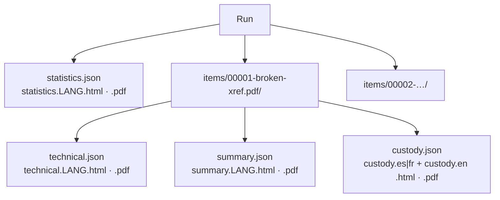
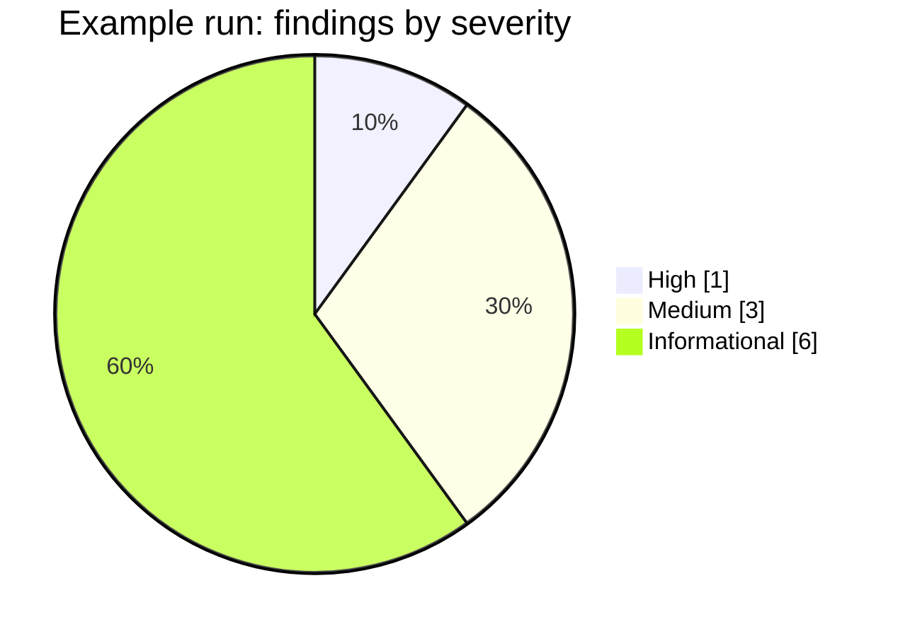

# Reports

Every run produces one **statistics report**. Every reviewed file produces **two separate reviews**:
a hyper-detailed **technical review** for examiners and lawyers, and a concise **customer summary** in plain
language. Each exists as JSON (machine-readable, language-neutral) plus HTML and PDF in each selected language.

Each item folder also holds a **chain-of-custody form** for the chosen jurisdiction (`--jurisdiction co|fr`)
plus its English version — see [forensic-audit.md](forensic-audit.md#chain-of-custody-form-per-item).

**Brand.** HTML and PDF reports carry the Rakvor header band (RV mark, descriptor
*FORENSICS | INCIDENT RESPONSE | SECURITY* and the tagline in the report language) on a light, printable page.
When `--sign-cert` is used, each PDF shows the signer and certificate fingerprint and carries a digital signature
that Acrobat or `pyhanko sign validate` can check. The statistics report shows the trusted timestamp (or a warning
that it is pending).

**Size.** Item reports never list every other file: duplicate partners are capped at 10 names
("… (+N)"); the complete groups are in the statistics report and `hashes.csv`.

## What each report contains

| Section | Statistics | Technical review | Customer summary |
| --- | :-: | :-: | :-: |
| Run ID, case, examiner, start/end, duration, interface | ✔ | ✔ (run ID, case) | case, date |
| Hash algorithms, totals, throughput | ✔ | | |
| Findings by severity and type, items by detected type | ✔ | | |
| Duplicate groups | ✔ | as finding | as finding |
| Full path, size, modified time, extension, detected type | | ✔ | file name |
| All digests | | ✔ | primary only ("digital fingerprint") |
| Findings with **what it shows / what it does not prove** | | ✔ | plain sentence |
| Method | | ✔ | "What we did" |
| Audit entries covering the item | | ✔ (`#first – #last`) | |
| Limitations | ✔ | ✔ | |
| Status and next step | | ✔ | ✔ |

## Status and severity

| Severity | Examples | Item status |
| --- | --- | --- |
| High | UNREADABLE, EXECUTABLE_CONTENT | `problem` (exit code 3) |
| Medium | EXTENSION_MISMATCH | `attention` |
| Low | — | `attention` |
| Informational | EMPTY_FILE, DUPLICATE | `ok` |

## Findings catalogue

| Code | Shows | Does not prove |
| --- | --- | --- |
| `EMPTY_FILE` | The file has 0 bytes | Whether it was emptied on purpose |
| `EXTENSION_MISMATCH` | Name and content signature disagree | Intent to hide anything |
| `EXECUTABLE_CONTENT` | A program is stored under a non-program name | That the program is malicious |
| `DUPLICATE` | Identical content (same primary hash) in several files | Who copied it or when |
| `UNREADABLE` | Reading failed, with the OS error | That the file is damaged |

Wording lives in `i18n/en.json`, `es.json`, `fr.json` (same keys in all three — enforced by a test).

## JSON schemas

| File | `schema` value | Schema |
| --- | --- | --- |
| `statistics.json` | `rakvor.statistics/1` | [schemas/statistics.schema.json](../schemas/statistics.schema.json) |
| `technical.json` | `rakvor.item-technical/1` | [schemas/item-technical.schema.json](../schemas/item-technical.schema.json) |
| `summary.json` | `rakvor.item-summary/1` | [schemas/item-summary.schema.json](../schemas/item-summary.schema.json) |

Adding a field is a minor change; removing or renaming one bumps the `/N` version.

## PDF notes

PDFs are generated by a small built-in writer (A4, Helvetica/Courier, WinAnsi encoding), so no external
program is needed on the examiner's PC. WinAnsi covers English, Spanish and French; other scripts would
need an embedded font (upgrade path: Typst). Every report file's digest is recorded in the audit log
(`item_reports_written`, `statistics_report_written`), so a report altered after the run can be detected.
