# Theory of operation

This page explains **why** each step of RV PDFAuth works, at two levels:

- **[Part A — For clients, lawyers and judges](#part-a--for-clients-lawyers-and-judges)**: plain language,
  analogies and pictures. No prior knowledge of PDF or cryptography is needed.
- **[Part B — For examiners and opposing experts](#part-b--for-examiners-and-opposing-experts)**: algorithms,
  data structures, exact thresholds, the source file that implements each one, and the standards and literature
  behind them. Every number in Part B is taken from the code of this commit; where the code and a standard
  differ, Part B says so.

It describes what the tool **does**, not what it should do. Known weaknesses are listed where they apply and
collected in [admissibility.md](admissibility.md#consolidated-gap-list). How to run the tool:
[usage.md](usage.md). How to install and verify it: [installation.md](installation.md).

## Contents

- Part A: [A1 What the tool is](#a1-what-the-tool-is-and-is-not) ·
  [A2 Digital fingerprints](#a2-digital-fingerprints-hashes) ·
  [A3 How a PDF remembers](#a3-how-a-pdf-remembers-its-past) ·
  [A4 Earlier versions](#a4-getting-the-earlier-versions-back) ·
  [A5 Comparing pictures](#a5-comparing-the-versions-by-eye-but-by-machine) ·
  [A6 Which software](#a6-which-software-saved-the-file) ·
  [A7 Signatures](#a7-digital-signatures-and-changes-after-signing) ·
  [A8 Hidden content](#a8-hidden-and-active-content) ·
  [A9 The tool's own diary](#a9-the-tools-own-diary-the-audit-log) ·
  [A10 Proving when](#a10-proving-when-trusted-timestamps) ·
  [A11 Signed reports](#a11-signed-reports) ·
  [A12 Safety room](#a12-opening-dangerous-files-safely) ·
  [A13 Reading a clean result](#a13-what-no-findings-means)
- Part B: [B1 Source map](#b1-source-map-and-constants) ·
  [B2 Pipeline](#b2-pipeline-and-reads-of-the-evidence) ·
  [B3 Hashing](#b3-hashing) ·
  [B4 File structure](#b4-pdf-file-structure-and-revision-detection) ·
  [B5 Extraction](#b5-revision-extraction-byte-exact-prefixes) ·
  [B6 Object deltas](#b6-what-changed-in-each-revision) ·
  [B7 Metadata and dates](#b7-metadata-and-dates) ·
  [B8 Producer fingerprints](#b8-producer-and-editor-fingerprints) ·
  [B9 Fonts and page content](#b9-fonts-and-page-content) ·
  [B10 Signatures and DocMDP](#b10-digital-signatures-and-docmdp) ·
  [B11 Active content](#b11-active-content-attachments-and-images) ·
  [B12 Visual diff](#b12-visual-diff-rendering-pixel-comparison-and-boxes) ·
  [B13 Worker isolation](#b13-worker-isolation) ·
  [B14 Audit chain](#b14-the-audit-hash-chain) ·
  [B15 RFC 3161](#b15-rfc-3161-trusted-timestamp) ·
  [B16 Signed reports](#b16-signed-pdf-reports) ·
  [B17 Determinism](#b17-determinism-and-reproducibility) ·
  [B18 References](#b18-references)

---

# Part A — For clients, lawyers and judges

## A1 What the tool is (and is not)

RV PDFAuth is a **magnifying glass for PDF files**. It looks for traces that a document was changed after it was
first saved, and writes down every trace it sees as a **finding**. Each finding says, in plain words, **what it
shows** and **what it does not prove**.

It never says "this document is forged" or "this document is authentic". That conclusion belongs to a human
examiner, who weighs the findings with everything else in the case (witnesses, e-mails, the original source).

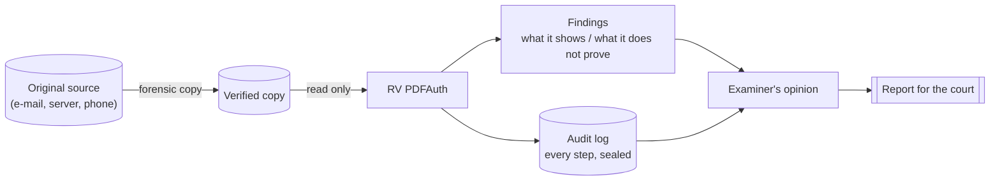

| The tool can tell you | The tool cannot tell you |
| --- | --- |
| The file was saved several times, and what each earlier version looked like | Who saved it, or why |
| A signature no longer covers what is shown today | Whether the signer agreed to the later change |
| The file passed through an online editor (if it says so in its metadata) | That the metadata was not typed by hand |
| The exact digital fingerprint of every file it read and wrote | That the copy you gave it equals the original source |

## A2 Digital fingerprints (hashes)

A **hash** is a short code computed from every byte of a file — like a fingerprint. Change one character and the
fingerprint changes completely; keep the file identical and the fingerprint is always the same, on any computer.

Real example (SHA-256, computed for this page):

| Text | SHA-256 fingerprint |
| --- | --- |
| `Amount due: EUR 1,250.00` | `ff105d2ef195aa26a96f6a7eaf3623488d60cc01c2fb7c2ccc94e74ada7577e5` |
| `Amount due: EUR 7,250.00` | `68890ed16423d5e22e2ba12a10eb995f39694fd9fb1a041413b69884a1c3438e` |

One digit differs; the two fingerprints share nothing recognisable. This is why a hash is used to prove that a
file was **not** changed: if today's fingerprint equals the one written down at intake, the file is the same, bit
for bit. RV PDFAuth computes one or two fingerprints of every file it reads, and of every file it writes.

## A3 How a PDF remembers its past

Many programs do not rewrite a PDF when you edit it. They **append** the changes at the end of the file, like a
notebook where corrections are written on new pages stapled to the back, while the old pages stay untouched.
This is called an **incremental update**. Each append ends with the marker `%%EOF` ("end of file").

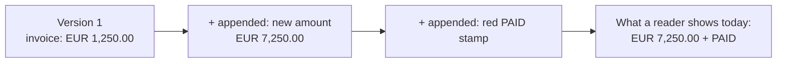

The sample file `edited-incremental.pdf` (in `examples/sample/evidence/`) is exactly that: three saved versions in
one file of 3 613 bytes.

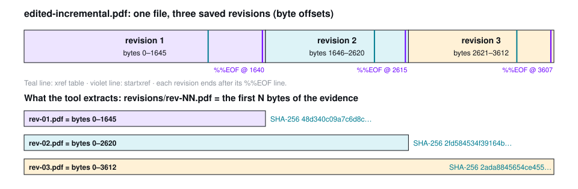

Incremental saving is **normal**: filling a form, signing or adding a comment all do it. What matters is
*what* was changed, *when* (according to the file) and *with what software*.

## A4 Getting the earlier versions back

Because old versions are never overwritten, the first version is simply **the beginning of the file, up to its
first `%%EOF`**. RV PDFAuth cuts the file at each `%%EOF` and saves each beginning as its own PDF:
`revisions/rev-01.pdf`, `rev-02.pdf`, … Nothing is reconstructed or guessed: each one is an exact copy of the first
*N* bytes of the evidence, so anyone can repeat the cut with any tool and get the same fingerprint.

Analogy: a tape recording. To hear what was said at minute 3, you play the tape up to minute 3 — you do not
re-record anything.

## A5 Comparing the versions by eye, but by machine

The tool draws each page of two consecutive versions as a picture and compares the pictures dot by dot. Where they
differ, it draws a violet box on both halves of a side-by-side image. In the sample, the only difference between
version 1 and 2 is one digit of the amount:

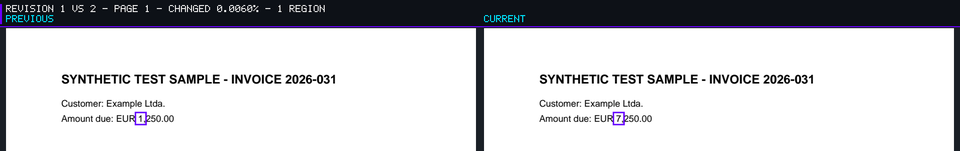

Tiny differences caused only by the way screens smooth letters are ignored, so the boxes point at real changes.
A change that cannot be seen (for example, in hidden metadata) does not appear in the pictures; other checks
cover it.

## A6 Which software saved the file?

Most programs write their name inside the PDF ("Producer"), and many also leave structural habits — a bit like a
printer leaving characteristic marks on paper. RV PDFAuth compares these names and habits with a database of
known programs (office suites, scanners, PDF editors, online editors, password-removal tools).

Limits a court should know:

- The name can be **typed by hand**; a match is a signal about the software, never about a person.
- The database covers a limited list of programs (37 bundled entries in this version); unknown software is
  reported as unknown, not as suspicious.

## A7 Digital signatures and changes after signing

A digital signature works like a **sealed envelope**: it seals an exact set of bytes. If one byte inside changes,
the seal breaks. But a PDF can still receive **new pages stapled outside the envelope** (incremental updates). The
seal stays intact, yet the reader shows the newer content.

RV PDFAuth checks three things:

1. Is the seal intact? (the signed bytes still match the signature)
2. Which version is inside the envelope? (the signature covers exactly one saved version)
3. Was anything added outside the envelope afterwards, and of what kind? (form filling, comments, or other changes)

A **certifying** signature can also carry a note "only these kinds of changes are allowed afterwards" (called
*DocMDP*: none / form filling and signing / also comments). The tool reports changes that go beyond that note.

What the tool does **not** do: it does not check **who** owned the signing key (certificate authority, revocation).
A mathematically valid seal can come from a self-made certificate.

## A8 Hidden and active content

| Trace | Plain meaning | Common innocent reason |
| --- | --- | --- |
| Invisible text | Text drawn so that it cannot be seen (transparent, white, "invisible" mode) | Searchable text layer of a scan |
| Text over a scanned image | A page that is a photo/scan also contains typed text | OCR software makes scans searchable |
| JavaScript | Small programs inside the PDF | Form calculations |
| Launch action | The PDF asks the viewer to open a file or program | Rare; viewers ask before doing it |
| Attachments | Files embedded inside the PDF | Invoices with XML data, portfolios |

## A9 The tool's own diary (the audit log)

Everything the tool does is written to a diary, `audit.jsonl`. Each line carries the fingerprint of the line before
it, like numbered pages where every page quotes the seal of the previous page. Tearing out, editing or reordering a
page breaks every later seal, and `rv-pdfauth verify-log` (or an independent Python script) detects it.

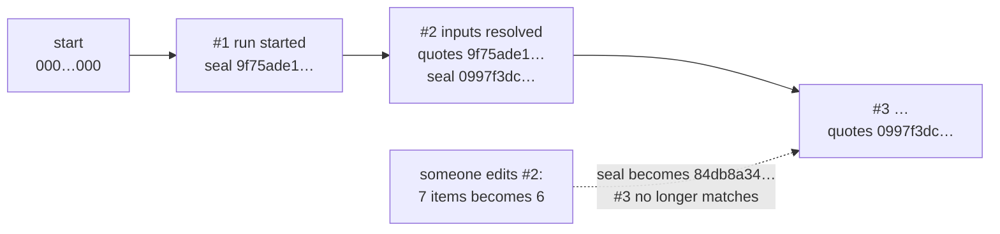

## A10 Proving when: trusted timestamps

The diary proves its own consistency, not *when* it was written. For that, the tool sends the latest seal to a
**time-stamping authority** — an independent online notary — which signs "I saw this seal at 10:39 UTC on
21 October 2026". The notary never sees the evidence, only a 32-byte seal.

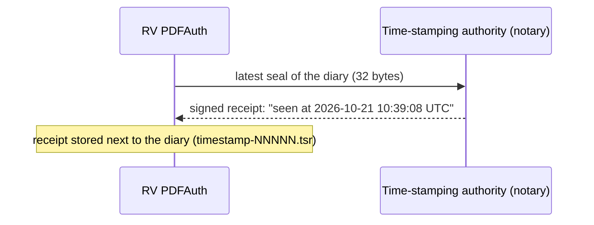

Without internet the run still finishes; the receipt can be requested later with `rv-pdfauth timestamp`.
A timestamp proves the diary existed at that time — not that its content is true.

## A11 Signed reports

With the examiner's certificate, every PDF report is digitally signed, so any later change to a report is
detectable with Adobe Reader or another validator. The HTML and JSON reports are not signed, but their
fingerprints are written in the diary.

## A12 Opening dangerous files safely

PDF files can be damaged or deliberately built to crash programs. RV PDFAuth opens each PDF in a **separate,
locked room** (a worker process) with a time limit and a memory limit. If the file crashes the room, the main
program notes "analysis did not complete" (`PARSER_FAILED`) and moves on to the next file; the diary is never
touched by the room.

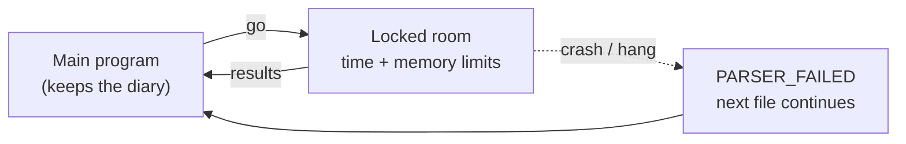

## A13 What "no findings" means

A file without findings is **not** proven authentic. A forger can create a clean new PDF from scratch, or "print to
PDF", which erases all history. The tool's limitations are printed in every report, for example:

- When a PDF is printed to PDF, flattened, optimised or regenerated, its earlier revisions and most editing
  traces are lost; only its last state can be examined.
- Dates and producer names are written by the software that saved the file and can be set freely.
- Changes inside the pixels of a scanned image (retouching) are not detected.
- The copy examined is compared with nothing before intake: integrity is proven **from intake onward**.

---

# Part B — For examiners and opposing experts

## B1 Source map and constants

| Process | Implementation | Key constants (value in this commit) |
| --- | --- | --- |
| Hashing | [src/core/src/hash.rs](../src/core/src/hash.rs) | `CHUNK` = 1 MiB; at most 2 algorithms per run; known answers for `"abc"` |
| Linear scan, revisions, xref | [src/pdf/src/doc.rs](../src/pdf/src/doc.rs) | `MAX_REVISIONS` = 2000; `MAX_WARNINGS` = 500; parse budget = 64 × file size + 64 MiB; decode budget = 2 GiB |
| Revision bytes | [src/pdf/src/lib.rs](../src/pdf/src/lib.rs) `revision_bytes` | `file[..end_offset]` |
| Findings | [src/pdf/src/analysis.rs](../src/pdf/src/analysis.rs) | `MIN_REVISION_GAP_SECS` = 3600; `IMAGE_PAGE_COVER` = 0.5; `MAX_PAGE_FINDINGS` = 100; `CONTENT_OP_BUDGET` = 50 000 000 |
| Dates, Info, XMP | [src/pdf/src/meta.rs](../src/pdf/src/meta.rs) | XMP packet ≤ 16 MiB, XML depth ≤ 64, ≤ 200 000 nodes |
| Page tree, content interpreter | [src/pdf/src/pages.rs](../src/pdf/src/pages.rs) | ≤ 100 000 pages, tree depth ≤ 64, form depth ≤ 4, ≤ 64 saved graphics states |
| Stream filters | [src/pdf/src/filters.rs](../src/pdf/src/filters.rs) | decoded stream ≤ 128 MiB, ≤ 8 filters per stream |
| Signatures, DocMDP | [src/pdf/src/sig.rs](../src/pdf/src/sig.rs) | SHA-256/384/512, RSA PKCS #1 v1.5 only |
| Producer fingerprints | [src/pdf/src/fingerprint.rs](../src/pdf/src/fingerprint.rs), [fingerprints/starter.json](../fingerprints/starter.json), [src/core/src/fingerprints.rs](../src/core/src/fingerprints.rs), [src/cli/src/fingerprints.rs](../src/cli/src/fingerprints.rs) | starter DB `rakvor-starter` 2026.10.21, 37 entries |
| Derived outputs | [src/core/src/pdfscan.rs](../src/core/src/pdfscan.rs) | inflated stream ≤ 256 MiB; ≤ 1000 embedded outputs per item |
| Rendering | [src/render/src/lib.rs](../src/render/src/lib.rs), [third_party/pdfium/PDFIUM_VERSION.txt](../third_party/pdfium/PDFIUM_VERSION.txt) | PDFium `chromium/7881`; ≤ 40 000 000 px and ≤ 20 000 px per side per page |
| Pixel diff | [src/render/src/image.rs](../src/render/src/image.rs), [src/core/src/visual.rs](../src/core/src/visual.rs) | tolerance 32, cell 8 px, merge gap 12 px, pad 4 px, min 3 px, ≤ 100 boxes |
| Worker isolation | [src/core/src/worker.rs](../src/core/src/worker.rs) | defaults 120 s, 2048 MiB; stdout ≤ 64 MiB; stderr tail 4 KiB |
| Audit chain | [src/core/src/audit.rs](../src/core/src/audit.rs), [tests/verify_chain.py](../tests/verify_chain.py) | genesis = 64 zeros |
| Timestamp, report signing | [src/core/src/trust.rs](../src/core/src/trust.rs), [src/core/src/report/pdf.rs](../src/core/src/report/pdf.rs) | default TSA `http://timestamp.digicert.com`; HTTP timeout 15 s; response ≤ 1 MiB |

The PDF layer (`src/pdf`) is `#![forbid(unsafe_code)]`, never writes files and never panics by design (fuzzed
with [fuzz/fuzz_targets/analyze.rs](../fuzz/fuzz_targets/analyze.rs); robustness tests in
[src/pdf/tests/no_panic.rs](../src/pdf/tests/no_panic.rs)). The core decides what to write and audits it.

## B2 Pipeline and reads of the evidence

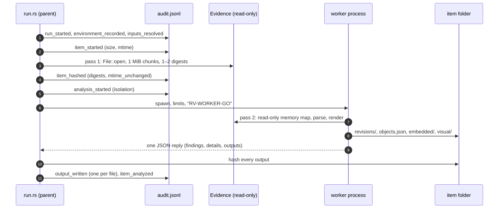

The evidence is read **twice**: once for hashing (sequential) and once by the worker (memory-mapped, random
access). Both opens are read-only. The second read is not re-hashed: if the file changed between the two reads,
the findings would describe different bytes than the digests. The modification time is compared around the first
pass only (`mtime_unchanged`). This is why the tool must run on a write-protected copy (see
[admissibility.md](admissibility.md#consolidated-gap-list), gap G20).

Non-PDF files (no `%PDF-` at offset 0 and no `.pdf` extension) get only the inventory checks of
[src/core/src/analyzer.rs](../src/core/src/analyzer.rs) (type by signature, extension mismatch, executable, empty),
in process.

## B3 Hashing

| Algorithm | Standard | Output | Status for evidence |
| --- | --- | --- | --- |
| md5 | RFC 1321 | 128 bit | Practical collisions since 2004–2005 (Wang & Yu); legacy matching only |
| sha1 | FIPS 180-4 | 160 bit | Practical collision 2017 (Stevens et al., "SHAttered"); legacy matching only |
| sha256 | FIPS 180-4 | 256 bit | Default; recommended primary |
| sha512 | FIPS 180-4 | 512 bit | Recommended |
| sha3-256 | FIPS 202 | 256 bit | Sound; less familiar to courts |
| blake3 | BLAKE3 specification (2020) | 256 bit | Sound; not a NIST-approved hash |

- One read loop feeds both selected digests ([hash.rs](../src/core/src/hash.rs) `hash_reader`), so both describe
  the same bytes. The first selected algorithm is the **primary** (duplicates, customer summary).
- `self-test` checks every algorithm against the published digest of `"abc"` (e.g. SHA-256
  `ba7816bf…f20015ad`, FIPS 180-4 example). It proves the build computes correct digests; it does not test the
  PDF analysis.
- Avalanche, measured: the two texts of [A2](#a2-digital-fingerprints-hashes) differ in 1 character (2 bits:
  `'1'` = 0x31, `'7'` = 0x37); their SHA-256 digests differ in **144 of 256 bits** (expected ≈ 128 for an ideal
  function), and only 1 of the 64 hexadecimal positions coincides.
- The tool does **not** enforce a policy that SHA-256 (or stronger) is one of the two algorithms: `md5,sha1` is
  accepted. Policy is the examiner's (see [usage.md](usage.md#1-before-you-start)).

## B4 PDF file structure and revision detection

### Byte layout of an incrementally updated PDF

Annotated from `examples/sample/evidence/edited-incremental.pdf` (offsets are real):

```text
offset  bytes                                                 revision
     0  %PDF-1.3                                   header     ┐
     9  %<93 8C 8B 9E> ReportLab Generated PDF …   comment    │
    61  1 0 obj … endobj                           body       │
   ...  2 0 obj … 8 0 obj   (8 objects)                       │ revision 1
  1255  xref                                       xref       │ bytes 0–1645
        0 9 / 0000000000 65535 f / 0000000061 00000 n …       │ (end_offset 1646)
  1444  trailer << /ID […] /Info 6 0 R /Root 5 0 R /Size 9 >> │
  1625  startxref 1255                             ─► 1255    │
  1640  %%EOF + LF                                            ┘
  1646  4 0 obj  page: /Contents 9 0 R  (changed)  body       ┐
  1855  6 0 obj  Info: /Producer (Foxit PDF Editor…) (changed)│ revision 2
  2155  9 0 obj  stream "Amount due: EUR 7,250.00" (added)    │ bytes 1646–2620
  2389  xref  4 1 · 6 1 · 9 1                      xref       │
  2466  trailer << … /Prev 1255 >>                 ─► rev 1   │
  2600  startxref 2389                                        │
  2615  %%EOF + LF                                            ┘
  2621  4 0 obj, 6 0 obj (changed); 10 0 obj font             ┐
        /Courier-Bold, 11 0 obj stream "PAID" (added)         │ revision 3
  3360  xref · 3458 trailer << … /Prev 2389 >>                │ bytes 2621–3612
  3592  startxref 3360 · 3607 %%EOF + LF                      ┘
```

ISO 32000-1:2008 §7.5.6 (incremental updates) requires an update to append new or changed objects, a new
cross-reference section and a trailer whose `/Prev` points to the previous section, followed by `startxref` and
`%%EOF`. Earlier bytes are left as they were — which is what makes revision extraction possible.

### How revisions are found

The tool does **not** follow the `/Prev` chain to find revisions (a forged or broken chain would hide some). It
splits the file at every `%%EOF` marker found by a linear scan **outside objects**, then cross-checks each
revision's own `startxref`, xref and trailer ([doc.rs](../src/pdf/src/doc.rs) `scan`, `build_revisions`).

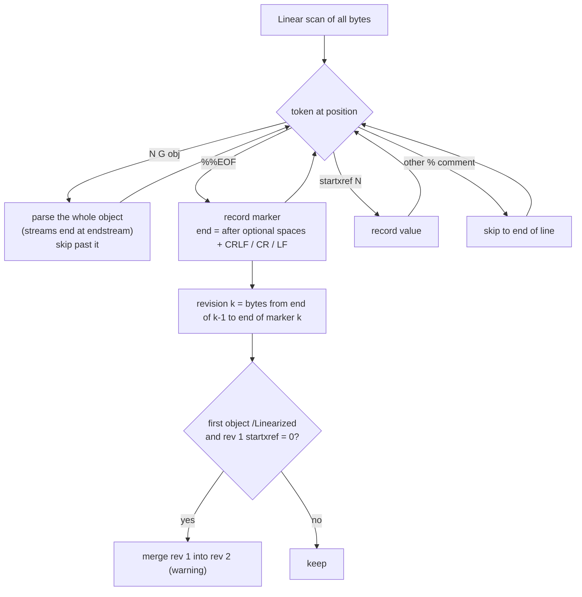

Details that matter in court:

- A `%%EOF` inside a stream or string is not a marker: complete objects are skipped by the scan.
- With more than 2000 markers, the first 1999 are kept and the rest are merged into the last revision (warning).
- Each revision's `startxref` is the **last** `startxref` keyword between its start and its `%%EOF`.
- Linearized files ("fast web view") end their first-page section with `startxref 0` + `%%EOF`; that is not an
  edit, so it is merged into revision 1 (ISO 32000-1 Annex F).
- When the parser finds no `%%EOF` at all, the core falls back to a plain byte search for `%%EOF`
  (`revision_source: "eof_scan"` in the technical report, [pdfscan.rs](../src/core/src/pdfscan.rs)).

### Cross-reference resolution per revision

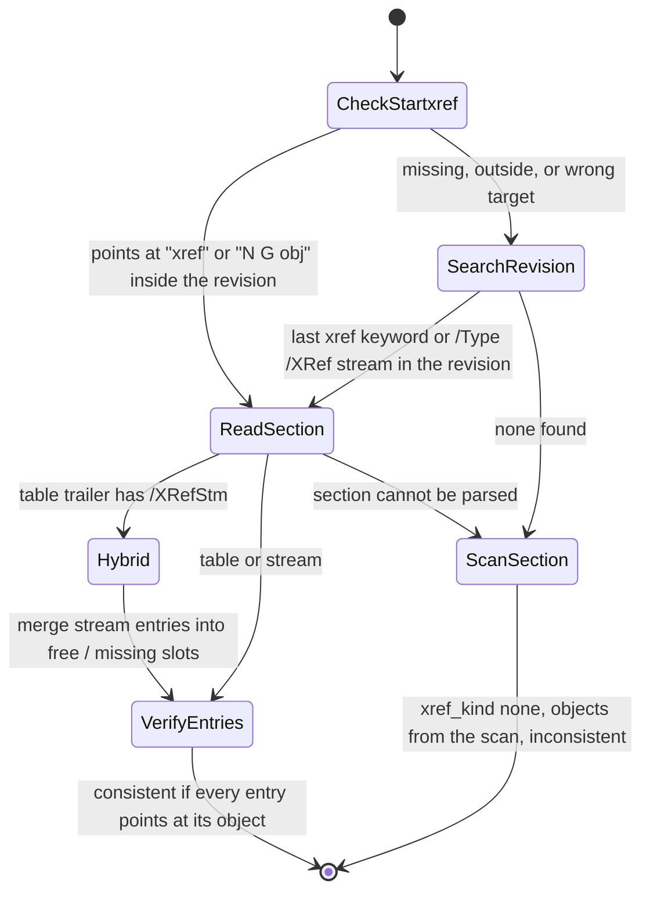

- **Table** entries are `offset gen n|f`; **stream** entries are decoded with `/W` (3 fields, ≤ 8 bytes each)
  and `/Index` (default `[0 /Size]`); types 0 free, 1 in use, 2 compressed (in an object stream); other types are
  ignored (ISO 32000-1 §7.5.8.3).
- **Consistency** (`xref_consistent`, finding `XREF_OFFSETS_INCONSISTENT`): every in-use entry (object ≠ 0) must
  be inside the revision and point, after at most 4 whitespace bytes, at `num gen obj` with the same numbers;
  every compressed entry must name an object stream whose index holds that object number (not checked for
  encrypted files); `startxref` must point at a section. The first 20 bad entries are listed in the warnings
  with their offsets.
- **Not silently repaired**: when an xref offset is wrong, the object is taken from the scan (last copy of that
  number/generation before the end of the revision) and a warning names both offsets.
- `/Prev` that does not point at the previous revision's section, a missing `/Prev`, or a trailer without
  `/Root`, `/Info`, `/Encrypt` (inherited from the previous revision) produce **warnings**, not findings.
- **Hybrid** files (table + `/XRefStm`, ISO 32000-1 §7.5.8.4) are reported as `HYBRID_XREF` because readers that
  ignore `/XRefStm` and readers that use it can see different objects; conflicting entries are warned.
- **Where the warnings are.** The PDF layer returns them as `PdfReport.warnings` (byte offset + message, at most
  500, duplicates removed). In this version they are **not** copied into `technical.json` or the HTML/PDF
  reports (gap G25), although the `XREF_OFFSETS_INCONSISTENT` wording refers to them. To read them, run the PDF
  layer on the evidence copy from the source tree: `cargo run -p rv-pdfauth-pdf --example dump -- <file.pdf>`
  (JSON on stdout; uses the bundled fingerprint database only).

## B5 Revision extraction (byte-exact prefixes)

```text
revision_bytes(k) = file[0 .. end_offset(k)]        (src/pdf/src/lib.rs)
end_offset(k)     = one past the end-of-line that follows the k-th %%EOF
```

Written as `revisions/rev-NN.pdf` only when the file has more than one revision and `--revisions extract`
(default). Each file is hashed with the run's algorithms and logged as `output_written`.

**Why this is sound.** Under ISO 32000-1 §7.5.6 an incremental update never modifies earlier bytes, so the prefix
up to revision *k*'s `%%EOF` is exactly the file a reader would have received at that time — *if* the file was
only appended to. If someone rewrote earlier bytes, the prefix still equals the current bytes (not history), and
other signals usually show it (inconsistent xref offsets, broken signature digests).

**Reproduce it independently** (sample values):

```bash
head -c 1646 edited-incremental.pdf | sha256sum   # 48d340c09a7c6d8cfd3a6f963f56272366b26d3e983d6c1e7a5cce06fa29caa1
head -c 2621 edited-incremental.pdf | sha256sum   # 2fd584534f39164bedfc6cdbfd9b5ed2622724f16e4da40d9481917a88046943
```

```powershell
$b = [IO.File]::ReadAllBytes("edited-incremental.pdf")
$s = [Security.Cryptography.SHA256]::Create()
-join ($s.ComputeHash($b, 0, 2621) | ForEach-Object { $_.ToString("x2") })   # 2fd58453…
```

Both values equal the SHA-256 recorded in the audit log for `revisions/rev-01.pdf` and `rev-02.pdf`.

## B6 What changed in each revision

For revision *k* ≥ 2, only the object numbers listed in **its own** xref section are examined
([analysis.rs](../src/pdf/src/analysis.rs) `delta`):

| Entry in revision *k* | Seen in revision *k−1* | Classified as |
| --- | --- | --- |
| in use | absent | `objects_added` |
| in use | present, other generation or other content | `objects_changed` (streams compared by dictionary without `/Length` + raw bytes) |
| in use | present, same content | not counted (re-listed only) |
| free | present | `objects_deleted` |

**Pages changed** (`pages_changed`): for every page index *i*, a deep 64-bit signature of its `/Contents` and
`/Resources` is compared with page *i* of revision *k−1* ([pages.rs](../src/pdf/src/pages.rs)
`page_signature`). The signature follows references (a reference hashes like its target, so moving an object
between direct and indirect form is not a change), skips `/Parent` and `/Length`, and stops at depth 12. It uses
Rust's `DefaultHasher` (SipHash, 64 bits): not cryptographic, used only inside one run, chance of an accidental
match ≈ 2⁻⁶⁴ per page. Annotations (`/Annots`) are **not** part of the page signature; they are classified below
and rendered by the visual diff. Pages beyond the previous page count count as changed.

**Change kinds** (`change_kind`, used for DocMDP and `CONTENT_CHANGED_AFTER_SIGNATURE`):

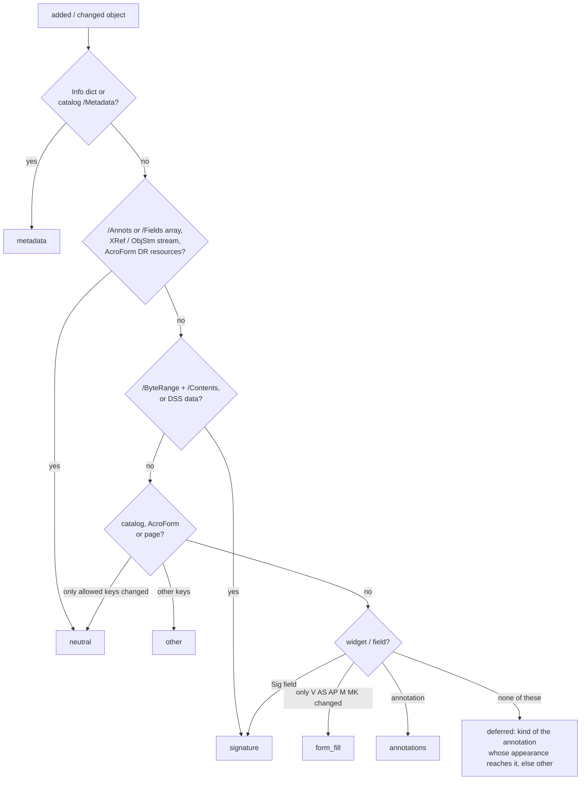

Allowed key sets: catalog → `/AcroForm /Perms /DSS /Metadata /Extensions`; AcroForm →
`/Fields /SigFlags /DR /DA /NeedAppearances`; page → `/Annots` only (and removing an annotation is
`annotations`). Any deleted object adds `other`. The classification is heuristic (this is stated in the
`DOCMDP_VIOLATION` wording).

## B7 Metadata and dates

Sources per revision: the trailer's `/Info` dictionary (`Producer`, `Creator`, `CreationDate`, `ModDate`, …) and
the catalog's XMP `/Metadata` stream (`pdf:Producer`, `xmp:CreatorTool`, `xmp:CreateDate`, `xmp:ModifyDate`,
`xmp:MetadataDate`, `xmpMM:DocumentID/InstanceID`, `xmpMM:History`), parsed by a bounded XML reader
([meta.rs](../src/pdf/src/meta.rs)).

**Date grammar.** PDF: `D:YYYYMMDDHHmmSSOHH'mm'` with every field after the year optional (ISO 32000-1 §7.9.4).
XMP: ISO 8601 subset `YYYY[-MM[-DD[Thh:mm[:ss[.s+]][TZD]]]]`. Invalid calendar values reject the date. A date
without a zone is kept with `tz_missing: true` and treated as UTC for arithmetic. Two dates are the **same
instant** when equal at the coarser precision of the two; date-only values compare the written dates; when one
zone is missing, either the wall clocks or the instants may match.

| Finding | Rule (code) | Severity |
| --- | --- | --- |
| `METADATA_INFO_XMP_MISMATCH` | Final revision only: Producer ≠ `pdf:Producer` or Creator ≠ `xmp:CreatorTool` (trimmed strings); CreationDate / ModDate ≠ `xmp:CreateDate` / `xmp:ModifyDate` (same-instant rule) | medium |
| `MODDATE_BEFORE_CREATIONDATE` | In any revision, Info ModDate < CreationDate, or XMP ModifyDate < CreateDate (each pair reported once) | high |
| `REVISION_TIME_GAP` | Consecutive revisions dated ≥ 3600 s apart; date = Info ModDate, else XMP ModifyDate, else (revision 1 only) CreationDate | info |
| `PRODUCER_CHANGED_BETWEEN_REVISIONS` | Info Producer of revision *k* ≠ that of *k−1* (exact string) | medium |

A revision dated **before** the previous one gives no finding in this version (the GUI timeline shows the gap in
red); check the revision table of the technical report.

## B8 Producer and editor fingerprints

**Database format** ([fingerprints/starter.json](../fingerprints/starter.json)): `{name, version, entries[]}`; each
entry has `id`, `label`, `category` (office, pdf_library, scanner, pdf_editor, online_editor, unlocker,
printer_driver, browser), `producer_contains[]`, `creator_contains[]`, optional structural `traits{}` and a
`source` (vendor documentation, or "generated by Rakvor on <date> with <tool version>").

**Matching** ([fingerprint.rs](../src/pdf/src/fingerprint.rs) `match_all`):

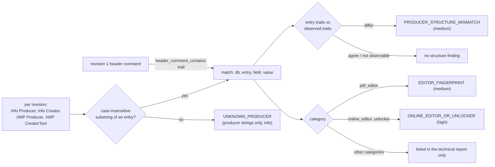

Producer patterns are matched against Producer and `pdf:Producer`; creator patterns against Creator and
`xmp:CreatorTool`. The same (database, entry, field, string) is reported once, and each finding code once per
label. The category finding and the structure finding are independent: one match can raise both.

**Observed traits** (per revision): `xref_kind` (`table`, `stream`, `hybrid`, `none`), `object_streams`
(`yes`/`no`: compressed entries in that revision's section); for revision 1 only: `header_version`,
`binary_comment_hex` (first ≤ 8 bytes of the comment line after `%PDF-x.y`, hex), `header_comment_contains`
(printable text of up to 4 comment lines). A trait that cannot be observed for a revision is skipped, not failed.

**Three databases**, all recorded with role, name, version, entry count and SHA-256 in `item_analyzed`:
starter (bundled; SHA-256 of its canonical JSON), local (learned on this workstation; SHA-256 of the file),
extra (`--fingerprints-db`; SHA-256 of the file). A database with the same name and version as one already loaded
is used once.

**Learning** (`fingerprints learn`): strings from the first revision that has a Producer/Creator, plus the traits
`xref_kind`, `object_streams`, `binary_comment_hex`, `header_comment_contains` observed by the same parser; with
several files, strings are united and only traits shared by **all** files are kept. Each change is appended to a
hash-chained `fingerprints.audit.jsonl` with the database SHA-256 before and after.

**Limits.** Strings are trivially forged; traits are coarse (four values) and shared by many writers; no false
positive / false negative rates have been measured (gap G5). A match identifies software, never a person.

## B9 Fonts and page content

**Fonts.** Every dictionary of `/Type /Font` (or with `/BaseFont` and a font `/Subtype`) listed in any revision's
xref section is recorded once with the revision where it first appears, its subset prefix (`ABCDEF+`) and whether
a font file is embedded (`/FontFile`, `/FontFile2`, `/FontFile3`, Type 3 always). `FONT_ADDED_IN_LATER_REVISION`
(medium) requires all of: first appearance in revision *k* ≥ 2; referenced from page resources of revision *k*
(including form XObjects up to depth 3); and its base name (subset prefix removed) **not** used by any page
resources of revision *k−1*.

**Content interpreter** ([pages.rs](../src/pdf/src/pages.rs) `Interp`) — final revision only, skipped for
encrypted files. It tracks only what the findings need:

| Operators | State kept |
| --- | --- |
| `q` `Q` `cm` | CTM (6-element matrix), save stack ≤ 64 |
| `Tr` | text render mode |
| `g` `rg` `k` `cs` `sc` `scn` | "fill is white": gray ≥ 0.99, RGB all ≥ 0.99, CMYK all ≤ 0.01 |
| `gs` | ExtGState `/ca` ≤ 0.001 (fully transparent fill) |
| `Tj` `'` `"` `TJ` | text shown (a string with a byte other than space or NUL) |
| `Do` (Image), inline `BI … ID … EI` | image coverage |
| `Do` (Form) | recurse into the form (≤ 4 levels, loops detected) |

- **Invisible** text show: render mode 3 or 7, or a filling mode (0, 4) with white or fully transparent fill
  → `INVISIBLE_TEXT` (medium, one finding per page, ≤ 100). White text on a dark background is not recognised as
  visible: that is a stated false positive.
- **Image coverage**: the unit square transformed by the CTM, its bounding box clipped to the MediaBox, divided by
  the MediaBox area. Coverage ≥ 0.5 and text → `TEXT_OVER_SCANNED_IMAGE` (medium, with the first revision in which
  that page index had text); coverage ≥ 0.5 and no text → `SCANNED_PAGES_STRUCTURE_ONLY` (info).
- A shared budget of 50 000 000 operators per file stops pathological content (warning).

## B10 Digital signatures and DocMDP

### ByteRange

A PDF signature dictionary holds `/ByteRange [a b c d]` and `/Contents <hex CMS>`. The signed bytes are
`file[a .. a+b] ‖ file[c .. c+d]`; the gap `[a+b, c)` is the `/Contents` string itself (ISO 32000-1 §12.8.1).

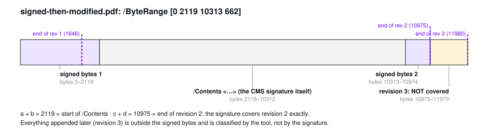

```text
signed-then-modified.pdf (11 980 bytes)   /ByteRange [0 2119 10313 662]
0          2119                  10313      10975        11980
├─ signed ─┤<── /Contents hex ──>├─ signed ─┤── rev 3 ───┤
   part 1      (gap = CMS)          part 2    not covered
end of revision 2 = 10313 + 662 = 10975 → the signature covers revision 2 exactly
```

### Checks ([analysis.rs](../src/pdf/src/analysis.rs), [sig.rs](../src/pdf/src/sig.rs))

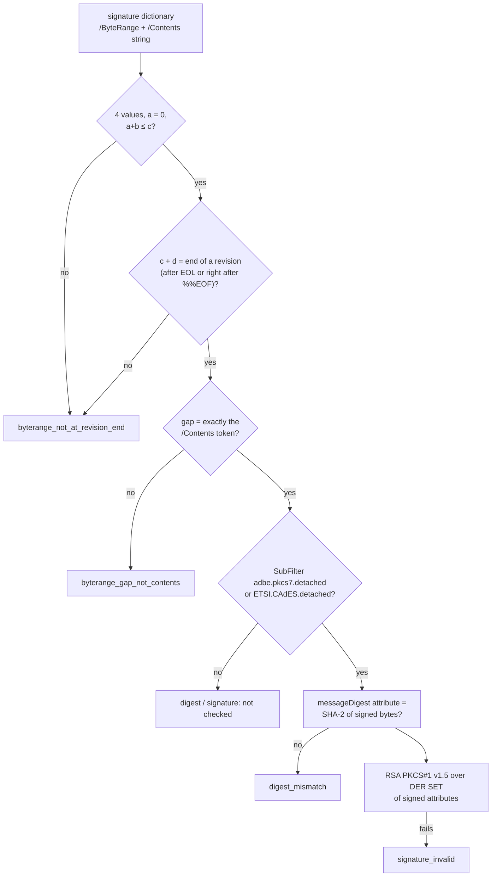

- Any of `F1`–`F4` → `SIGNATURE_INTEGRITY_FAILED` (high) with the reasons. Every signature also gets
  `SIGNATURE_PRESENT_TRUST_NOT_VERIFIED` (info).
- Supported: digests SHA-256/384/512; signature algorithms `rsaEncryption`, `sha256/384/512WithRSAEncryption`
  (PKCS #1 v1.5, RFC 8017). **Not checked** (value `null`, warning in the report): SHA-1, ECDSA, RSASSA-PSS, other
  SubFilters (`adbe.pkcs7.sha1`, `adbe.x509.rsa_sha1`), or no signer certificate in the CMS. "Not checked" is not
  "valid".
- The signer is found by issuer + serial or subject key identifier; if not found and the CMS holds exactly one
  certificate, that one is used. Signing time comes from the CMS `signingTime` attribute, else `/M`.
- **Not validated**: certificate chain, trust lists (EU Trusted List, Colombian ECD roots), revocation, embedded
  signature timestamps, LTV data. ADR 0001 scopes v1 to cryptographic integrity; trust is "not proven".

### Revisions after signing

`later_revisions` = every revision after the signed one. `CONTENT_CHANGED_AFTER_SIGNATURE` (high) is raised when a
later revision has change kind `other` **or** changed pages. Form filling, annotations, metadata and new
signatures alone do not raise it (they may still breach DocMDP).

### DocMDP

The certification level *P* comes from the catalog `/Perms /DocMDP` reference to this signature (any revision
from the signed one on) or from the signature's `/Reference` transform with `TransformMethod /DocMDP`; a
certifying signature without `/P` is level 2 (ISO 32000-1 §12.8.2.2).

| *P* | Change kinds allowed after the signature (code) | ISO 32000-1 §12.8.2.2 meaning |
| :-: | --- | --- |
| 1 | `metadata`; `signature` only if every signature added in that revision is a `/DocTimeStamp` | no changes |
| 2 | `metadata`, `signature`, `form_fill` | form filling, page templates, signing |
| 3 | `metadata`, `signature`, `form_fill`, `annotations` | also annotation creation, deletion, modification |

`other` always violates → `DOCMDP_VIOLATION` (high). Known limitation: under *P* = 1 a revision that adds only
DSS validation data (classified `signature`) without a document timestamp is reported as a violation; whether
ISO 32000-2 / PAdES treat that as permitted is to be verified against the standard text, and the examiner should
check such a case by hand. The attacks this detects are documented by Mladenov et al. (2019) and Rohlmann et al.
(2021), see [B18](#b18-references).

## B11 Active content, attachments and images

| Signal | Rule | Output |
| --- | --- | --- |
| `JAVASCRIPT_PRESENT` (medium) | any object (any revision, each physical object once) with `/S /JavaScript`, a `/JS` key, a `/JavaScript` key at top level without `/Type`, or catalog `/Names /JavaScript`; up to 20 objects listed | finding |
| `LAUNCH_ACTION` (high) | `/S /Launch` anywhere | finding |
| `EMBEDDED_FILES` (low) | file specifications with `/EF`, plus `/Type /EmbeddedFile` streams not reached that way | finding + `embedded/NN-<name>.bin` |
| Images | every `/Subtype /Image` stream (`--extract-embedded on`) | `embedded/NN-image-<num>-<gen>.jpg` or `.bin` |

Extraction writes the **stored** bytes (`.jpg` when the only filter is `DCTDecode`, else `.bin`) and, when the
first filter is `FlateDecode`, an `.inflated.*` copy if it decodes to ≤ 256 MiB. At most 1000 files per item;
names are sanitised (letters, digits, `.`, `-`, `_`; ≤ 60 characters); nothing is overwritten.

## B12 Visual diff: rendering, pixel comparison and boxes

```mermaid
flowchart LR
    A["rev k−1 bytes<br/>rev k bytes"] --> B["PDFium chromium/7881<br/>CPU, white background,<br/>forms + annotations drawn"]
    B --> C["pages 1..min(pages, max_pages)<br/>at --dpi (110)"]
    C --> D["per pixel: any channel<br/>differs by > 32 / 255"]
    D --> E["8 × 8 px cells:<br/>count + tight bounds"]
    E --> F["connect cells within<br/>2 cells (Chebyshev)"]
    F --> G["drop regions<br/>with < 3 changed px"]
    G --> H["pad 4 px, merge boxes<br/>that touch, until stable"]
    H --> I["≤ 100 boxes (largest kept)<br/>ratio in ppm"]
    I --> J[["visual/rev-AA-vs-BB-page-PPP.png<br/>+ VISUAL_CHANGE_BETWEEN_REVISIONS"]]
```

**Rendering** ([render/src/lib.rs](../src/render/src/lib.rs)). PDFium is bound at run time from `RV_PDFIUM_PATH`
or the executable's folder (and its parent); the current working directory is never searched (DLL planting next
to evidence). No password is tried. DPI is clamped to 18–600 (the CLI accepts 36–600); if a page would exceed
40 000 000 pixels or 20 000 pixels per side, the DPI is multiplied by ¾ until it fits. PDFium's output is
composited over white. Same PDFium build + same bytes + same DPI → same pixels.

**Comparison** ([render/src/image.rs](../src/render/src/image.rs) `diff`). The canvas is the larger width and
height of the two renders; outside a render the canvas is white (top-left aligned), and a size change alone marks
the page as changed.

Grid connectivity: with cell = 8 and merge gap = 12, cells are connected when their indices differ by at most
`1 + ⌊12 / 8⌋ = 2` in x and y. Two changed pixels end up in one region when the blank space between their cells
is at most one cell, i.e. a gap of roughly 9 to 23 px depending on where they fall in their cells. Example on the
8-px grid (`#` = cell with changed pixels):

```text
cells:  0  1  2  3  4  5  6  7
row 0   #  .  #  .  .  .  #  .      cells 0 and 2 → one region (distance 2)
row 1   .  .  .  .  .  .  .  .      cell 6 → separate region (distance 4 from cell 2)
```

Worked example from the unit test `one_changed_rectangle_gives_one_padded_box`: a black 30 × 10 rectangle drawn at
(50, 40) on a white 200 × 100 page → 300 changed pixels, one box `x 46, y 36, w 38, h 18` (4 px padding each
side), ratio 300 / 20 000 = 15 000 ppm = `0.015000`. Anti-aliasing shades within 32 levels and a single changed
pixel are ignored (`anti_aliasing_and_single_pixel_noise_are_ignored`).

**Ratios** are integers in parts per million (`changed_ppm`) or 6-decimal strings (`0.000060` = 0.0060 %): no
floating point enters audited JSON. The PNG shows previous | current with boxes outlined in violet **outside** the
box on both halves, so the changed pixels stay visible, and a caption (pair, page, changed %, region count, page
size change).

**Limits.** A change smaller than about one pixel at the chosen DPI (≈ 0.23 mm at 110 DPI) can vanish; colour
changes of ≤ 32 levels per channel are ignored; pages beyond `--max-pages` are only compared structurally
(`pages_not_compared`); added or removed pages are listed, not drawn; content not rendered (metadata, invisible
text) cannot appear. The per-page numbers (boxes, effective DPI, changed pixels) are computed but only the summary
(`status`, PNG list, pages changed) reaches `technical.json` in this version.

## B13 Worker isolation

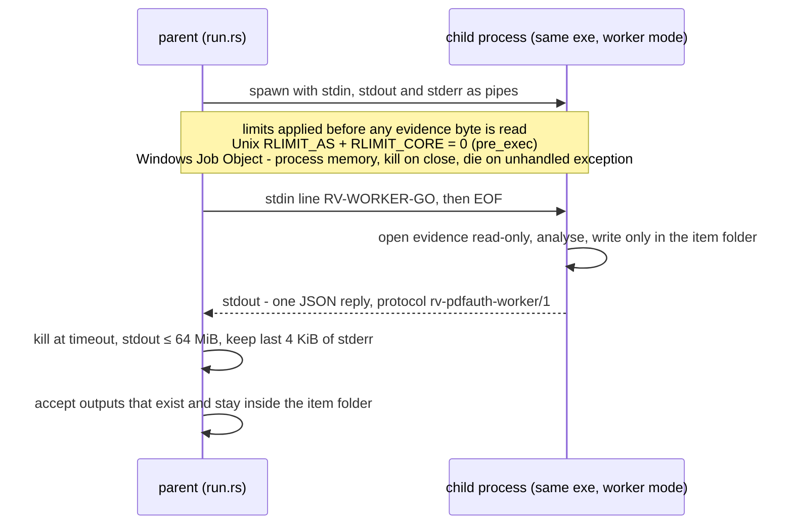

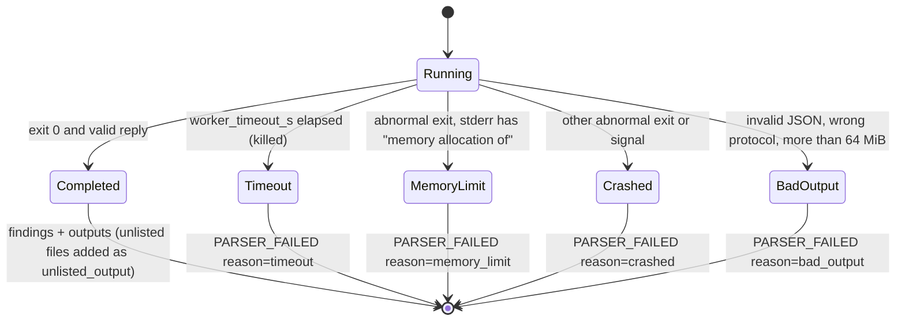

Other `PARSER_FAILED` reasons: `spawn_failed`, `isolation_failed` (Job Object could not be created/assigned),
`unreadable` (memory map failed), `panic` (in-process parser panic; the parser is designed never to panic).
Files left by a failed worker are kept, hashed and audited as `partial_output`; they support no finding. The child
never writes the audit log. The worker is **not** network-isolated by the operating system (no firewall rule or
job network limit); it simply has no network code. Fault injection (`RV_WORKER_TEST_FAULT=crash|hang|oom`) exists
in debug builds only.

## B14 The audit hash chain

Each line of `audit.jsonl` is one JSON object: `seq`, `ts_utc`, `run_id`, `actor`, `action`, optional `item`,
`details`, `prev_entry_hash`, `entry_hash` ([audit.rs](../src/core/src/audit.rs)).

```text
canonical(e)  = JSON of e without "entry_hash"; keys sorted at every level; no whitespace; UTF-8, non-ASCII
                not escaped; integers only (Python: json.dumps(e, sort_keys=True, separators=(",", ":"),
                ensure_ascii=False))
entry_hash_n  = SHA-256( canonical(e_n) )            (hex, lower case)
prev_entry_hash_1 = 64 × "0";  prev_entry_hash_n = entry_hash_(n-1);  seq_n = n
```

**Worked example** (computed for this page; values are real SHA-256):

```text
#1  {"action":"run_started","actor":"Ana Ruiz","details":{"tool":"rv-pdfauth","version":"0.1.0"},
     "prev_entry_hash":"0000…0000","run_id":"20261021T103903Z-67d213","seq":1,"ts_utc":"2026-10-21T10:39:03.511Z"}
     entry_hash = 9f75ade153e1629c2bc765addd9d63ac2d494a7fc92d4e60b94180b731644995
#2  {"action":"inputs_resolved","actor":"Ana Ruiz","details":{"bytes":105085,"items":7},
     "prev_entry_hash":"9f75ade1…644995","run_id":"…","seq":2,"ts_utc":"2026-10-21T10:39:03.512Z"}
     entry_hash = 0997f3dc4cbd5498c8e201ffeb2ac2dcb85d91b2dcce06957dfdad5f61b11da5
#2 edited ("items":6) → 84db8a34a40799f0233a55a39c69e5176888fa7bf4dd065cfdbc777560d2afa2 ≠ stored → broken
```

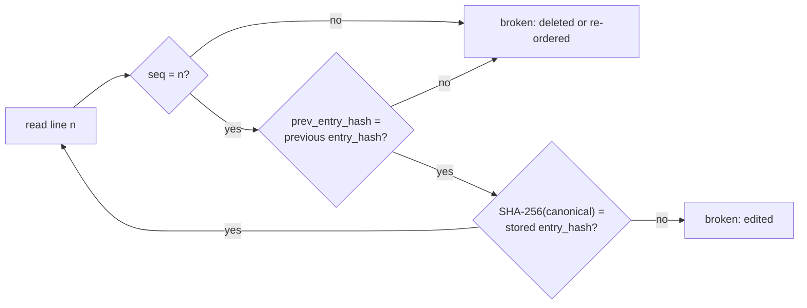

What the chain proves and does not prove:

| Proves | Does not prove, on its own |
| --- | --- |
| No entry was edited, inserted, deleted or reordered **before the last entry present** | That entries were not removed **from the end** (a shorter chain is still valid) |
| The order of work equals the order of entries | That the whole chain was not recomputed by someone who rewrote it from scratch |
| Report and output digests are bound to the run | When the entries were written (host clock, `ts_utc`) |

External anchors close those gaps: the RFC 3161 token binds entry *N* ([B15](#b15-rfc-3161-trusted-timestamp));
the reports print the chain head and entry count at the time they were written; a signed PDF report binds that
head to the examiner's key; the head can also be recorded in the case management system. A complete run always
ends with `run_finished` (or `run_failed` / `run_cancelled`).

Independent check: [tests/verify_chain.py](../tests/verify_chain.py) re-implements the chain in Python and
re-hashes the evidence listed in `hashes.csv`.

## B15 RFC 3161 trusted timestamp

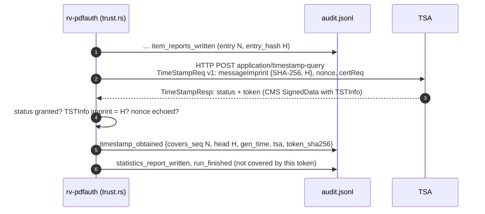

- The **message imprint is the chain head itself** (the 32 bytes of `entry_hash` of entry *N*, declared as a
  SHA-256 value), not a hash of it. So `openssl ts -verify -digest <H> …` works directly.
- Nonce: 8 bytes derived from the clock and process id (positive), used only to detect a replayed response.
- `genTime` is stored to the second (fractions dropped). The token is stored as `timestamp-<NNNNN>.tsr` (DER) with
  a readable `timestamp-<NNNNN>.json`.
- Offline → `timestamp_pending` and the run completes; `rv-pdfauth timestamp <log>` later re-verifies the chain and
  appends `timestamp_obtained` for the then-current head (earlier entries are never rewritten).
- `verify-log` re-checks: the token file's SHA-256, the TSA status, and that the token's imprint equals the
  `entry_hash` of `covers_seq`. It does **not** verify the TSA's signature, certificate chain, policy OID or
  accuracy. Do that with OpenSSL against the TSA's published chain (see [usage.md](usage.md#6-timestamps)) — a
  required step before relying on the time in court (gap G18).
- The default TSA URL is plain HTTP; integrity rests on the TSA's signature, which is why the OpenSSL check
  matters. eIDAS qualified status depends on the TSA chosen (see [admissibility.md](admissibility.md)).

Standards: RFC 3161 (Time-Stamp Protocol), RFC 5816 (ESSCertIDv2 update), RFC 5652 (CMS).

## B16 Signed PDF reports

[report/pdf.rs](../src/core/src/report/pdf.rs) writes each report PDF with a signature dictionary
`/Type /Sig /Filter /Adobe.PPKLite /SubFilter /adbe.pkcs7.detached`, a 10-digit `/ByteRange` placeholder and a
zero-filled `/Contents` placeholder, plus an invisible signature widget and `/SigFlags 3`. After the whole file is
written, `/ByteRange [0 start end len−end]` is filled in and the bytes outside `/Contents` are signed
([trust.rs](../src/core/src/trust.rs) `PdfSigner`): CMS SignedData, detached, SHA-256, RSA PKCS #1 v1.5, signed
attributes content-type, message-digest and signing-time, certificates from the `.p12`/`.pfx`. RSA keys only.

This is a plain ISO 32000-1 CMS signature. It is not a PAdES baseline signature (ETSI EN 319 142-1: SubFilter
`ETSI.CAdES.detached` and a signing-certificate-v2 attribute), it carries no signature timestamp and no
revocation data. Its legal weight depends on the certificate (see [admissibility.md](admissibility.md),
gap G3). The certificate subject and SHA-256 fingerprint are logged as `signing_certificate_loaded`; the
password never is.

## B17 Determinism and reproducibility

| Same input + same build gives the same … | Varies between runs |
| --- | --- |
| evidence digests, revision files and their digests | `run_id`, `ts_utc`, every entry_hash (they include time) |
| findings and their parameters | absolute paths, host, OS user (recorded in `environment.json`) |
| visual-diff PNGs (same PDFium build and DPI) | report digests (they print run id and times) |
| `objects.json`, embedded files | the RFC 3161 token |

`environment.json` records the tool version, `rustc` version, target triple, every dependency version from
`Cargo.lock`, OS, host, OS user, working directory and command line. The PDFium library path, SHA-256 and pinned
tag are recorded in each `item_analyzed` entry (`details.analysis.visual.renderer`).

## B18 References

Standards and specifications

- ISO 32000-1:2008, *Document management — Portable document format — Part 1: PDF 1.7* (§7.5 file structure,
  §7.5.6 incremental updates, §7.5.8 cross-reference streams, §7.9.4 dates, §12.8 digital signatures, §12.8.2.2
  DocMDP, Annex F linearized PDF). ISO 32000-2:2020 (PDF 2.0).
- ETSI EN 319 142-1, *PAdES digital signatures — Part 1: Building blocks and PAdES baseline signatures*.
- RFC 3161 (Time-Stamp Protocol, 2001); RFC 5816 (ESSCertIDv2 update for RFC 3161, 2010); RFC 5652
  (Cryptographic Message Syntax, 2009); RFC 8017 (PKCS #1 v2.2, 2016); RFC 5280 (X.509 PKI profile, 2008);
  RFC 1321 (MD5, 1992).
- NIST FIPS 180-4 (Secure Hash Standard, 2015); NIST FIPS 202 (SHA-3, 2015).
- J. O'Connor, J.-P. Aumasson, S. Neves, Z. Wilcox-O'Hearn, *BLAKE3: one function, fast everywhere* (2020).
- ISO/IEC 27037:2012 (identification, collection, acquisition and preservation of digital evidence) — see
  [admissibility.md](admissibility.md) for what was verified of it.

Academic and practitioner literature

- X. Wang, H. Yu, "How to Break MD5 and Other Hash Functions", EUROCRYPT 2005.
- M. Stevens, E. Bursztein, P. Karpman, A. Albertini, Y. Markov, "The first collision for full SHA-1",
  CRYPTO 2017.
- V. Mladenov, C. Mainka, K. Meyer zu Selhausen, M. Grothe, J. Schwenk, "1 Trillion Dollar Refund — How To
  Spoof PDF Signatures", ACM CCS 2019 (incremental saving, signature wrapping, universal signature forgery).
- C. Mainka, V. Mladenov, S. Rohlmann, "Shadow Attacks: Hiding and Replacing Content in Signed PDFs", NDSS 2021.
- S. Rohlmann, V. Mladenov, C. Mainka, J. Schwenk, "Breaking the Specification: PDF Certification",
  IEEE S&P 2021 (DocMDP / certification attacks).
- A. Rosenfeld, J. Pfaltz, "Sequential operations in digital picture processing", JACM 13(4), 1966
  (connected-component labelling, the basis of the region grouping).
- Didier Stevens, *PDF Tools* (pdfid, pdf-parser) — practitioner tools for manual cross-checks of PDF structure.

Independent oracles used to cross-check this tool: pikepdf/qpdf and pyHanko via
[tests/oracle_pdf.py](../tests/oracle_pdf.py) (run manually in this version, not in CI); Python `hashlib`/`blake3`
for [examples/sample/expected_hashes.csv](../examples/sample/expected_hashes.csv); OpenSSL for RFC 3161 tokens.

Figures on this page are generated by [tests/make_theory_figures.py](../tests/make_theory_figures.py) from the
synthetic samples.
