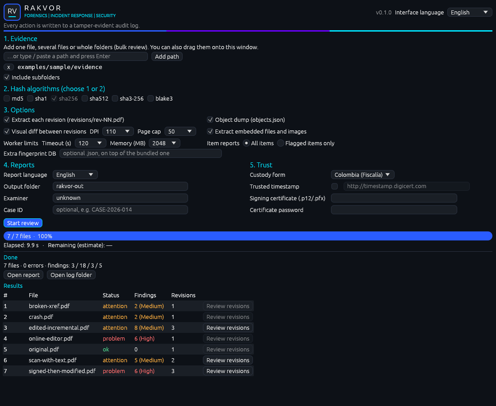
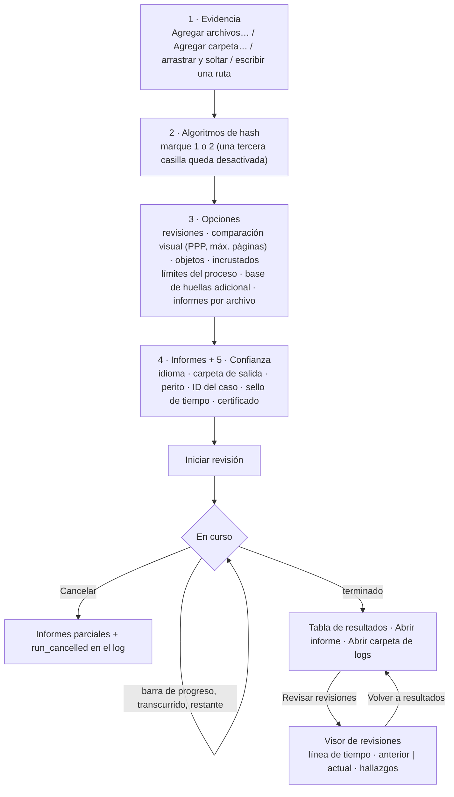
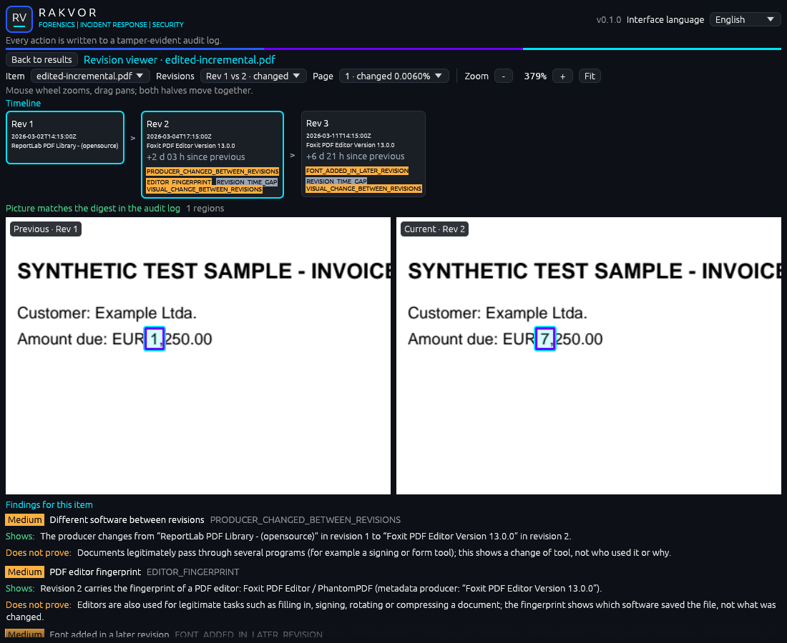

> La versión de referencia es la inglesa ([usage-gui.md](usage-gui.md)); esta traducción la sigue.

# Uso de la aplicación de escritorio (Windows 10/11)

Inicie **RV PDFAuth** desde el menú Inicio (instalador) o haga doble clic en `rv-pdfauth-gui.exe` (zip portable).
No hace falta instalar ningún otro programa; la aplicación también funciona en máquinas virtuales sin controlador
gráfico (renderizado por software, sin código de GPU propio).

## Flujo de trabajo

## La ventana

| Zona | Qué hace |
| --- | --- |
| **1. Evidencia** | *Agregar archivos…* y *Agregar carpeta…* abren los selectores de Windows. También puede arrastrar archivos o carpetas a la ventana (o al icono de `rv-pdfauth-gui.exe` antes de que arranque), o pegar una ruta y pulsar Enter. *Incluir subcarpetas* está activada por defecto. Quite una entrada con **x**. *Carpeta del caso* vincula la ejecución a un caso compartido ([case-folder.md](case-folder.md), en inglés); una vez definida, *Registrar primero la evidencia con RV HashInv* ejecuta rv-hashinv sobre la misma evidencia antes del análisis: la ventana muestra la versión de rv-hashinv encontrada (al pasar el ratón: ruta y SHA-256) o, en rojo, por qué no se puede usar ninguna. Durante la recepción una línea muestra *Ingreso (RV HashInv): n/N archivos*; después, **Abrir informe de hashes** abre el informe de rv-hashinv. |
| **2. Algoritmos de hash** | Marque uno o dos. Con dos marcados, los demás se desactivan; no se puede desmarcar el último. |
| **3. Opciones** | Hasta dónde llega el análisis del PDF (ver la tabla siguiente). Los valores por defecto sirven para casi todos los casos. |
| **4. Informes** | Idioma (English, Español, Français o los tres), carpeta de salida, nombre del perito (por defecto su usuario de Windows), ID del caso opcional. |
| **5. Confianza** | *Sello de tiempo confiable* (activado por defecto; la dirección de la TSA se puede editar), *Certificate…* para elegir su `.p12`/`.pfx` y su contraseña (solo en memoria, nunca se registra) para firmar cada PDF, y *Formato de custodia* (Colombia / Francia). |
| **Idioma de la interfaz** | Selector arriba a la derecha: English, Español, Français. Cambia todas las etiquetas de inmediato; es independiente del idioma de los informes. |
| **Iniciar revisión / Cancelar** | Iniciar se habilita en cuanto se agrega evidencia. Durante una ejecución los ajustes quedan bloqueados y el botón pasa a ser *Cancelar*. |
| **Progreso** | Barra por bytes procesados, `archivos hechos / total`, tiempo transcurrido (siempre en movimiento) y tiempo restante estimado. Debajo se muestra el archivo que se está leyendo. |
| **Resultado** | Conteos por severidad, **Abrir informe** (página de estadísticas en su idioma), **Abrir carpeta de logs** y la tabla **Resultados**: una fila por archivo con su estado, el número de hallazgos (y la severidad más alta) y el número de revisiones. **Revisar revisiones** se habilita para los archivos con dos o más revisiones. |

### 3. Opciones

Cada opción corresponde 1:1 a un ajuste de análisis del motor (los mismos que usa la línea de comandos).

| Opción | Por defecto | Efecto |
| --- | --- | --- |
| Extraer cada revisión | activada | Escribe `revisions/rev-NN.pdf` (prefijos exactos en bytes de la evidencia, cada uno con su hash en el log). |
| Comparación visual entre revisiones | activada | Renderiza las páginas de cada par de revisiones con PDFium y escribe `visual/rev-NN-vs-MM-page-PPP.png` para las páginas cambiadas. |
| PPP / Máx. páginas | 110 / 50 | Resolución de renderizado y cuántas páginas por par se comparan (las páginas por encima del límite se informan como no comparadas). |
| Volcado de objetos | activada | Escribe `objects.json` (el árbol de objetos de cada revisión). |
| Extraer archivos e imágenes incrustados | activada | Escribe `embedded/` (adjuntos y flujos de imagen, en bruto y descomprimidos). |
| Límites del proceso de análisis | 120 s / 2048 MB | Cada PDF se analiza en un proceso de análisis separado; un fallo, un bloqueo o un exceso de memoria se convierte en un hallazgo `PARSER_FAILED` en lugar de detener la revisión. |
| Base de huellas adicional | ninguna | Una base JSON de huellas de productor/editor que se usa además de la incluida. Debe existir al pulsar Iniciar. |
| Informes por archivo | Todos los archivos | *Solo archivos señalados* omite los informes por archivo de los archivos sin nada por encima de informativo. |

Las opciones numéricas se eligen de valores predefinidos (el valor actual siempre aparece en la lista), de modo que
cada elección es un único cambio registrado y no una serie de ediciones.

## Visor de revisiones

Ábralo con **Revisar revisiones** en una fila de la tabla de resultados. Lee las salidas de la propia ejecución: los
datos de revisiones y los hallazgos que devolvió el motor, y las imágenes de diferencias en
`reports/<run>/items/<NNNNN-name>/visual/`.

| Parte | Qué muestra |
| --- | --- |
| **Archivo / Revisiones / Página** | Elija el archivo, el par de revisiones (`Rev r-1 vs r`, marcado *cambiada* o *sin cambio visual*) y la página (las páginas cambiadas muestran la proporción de píxeles cambiados). Al abrir un archivo se salta a su primer par con un cambio y a la primera página cambiada de ese par. |
| **Línea de tiempo** | Una tarjeta por revisión: fecha (Info ModDate, si no CreationDate, si no XMP), productor, tiempo desde la revisión anterior (en rojo cuando una revisión tiene fecha *anterior* a la previa), firma, y distintivos de los hallazgos asociados a esa revisión, coloreados por severidad. El par seleccionado aparece resaltado; haga clic en una tarjeta para compararla con la revisión anterior. |
| **Anterior / Actual** | Las dos mitades de la imagen de diferencias lado a lado, las regiones cambiadas recuadradas en violeta por el motor y resaltadas en cian por el visor. La rueda del ratón amplía en el puntero, arrastrar desplaza, el doble clic (o **Ajustar**) restablece; ambas mitades se mueven siempre juntas. **–** / **+** amplían por pasos (del 50 % al 1600 % de "ajustar"). |
| **Control de hash** | Antes de mostrar una imagen el visor calcula su hash y lo compara con el hash escrito en el log de auditoría durante la ejecución: verde *coincide*, rojo *NO coincide* (el archivo se modificó tras la ejecución). |
| **Hallazgos de este archivo** | Todos los hallazgos del archivo, los más graves primero, con lo que **muestra** y lo que **no demuestra**, en el idioma de la interfaz. |

Cuando la comparación visual no se ejecutó (falta PDFium, opción desactivada), el visor sigue mostrando la línea de
tiempo y los hallazgos e indica por qué no hay imagen.

El visor muestra la ejecución recién terminada en esta ventana (usa los resultados que devolvió el motor y los hashes
registrados para cada imagen durante esa ejecución). Una ejecución anterior no se puede reabrir en el visor: abra en
su lugar sus PNG de `visual/` y su informe `technical.*`, y compruebe sus hashes como se describe en
[usage.es.md](usage.es.md#8-verificar-una-ejecución). Cómo leer cada hallazgo:
[usage.es.md](usage.es.md#5-interpretar-cada-hallazgo).

### Por qué la visualización no se registra

El log de auditoría de una ejecución queda **cerrado** cuando la ejecución termina: su última entrada es
`run_finished`, su cabeza puede estar cubierta por un sello de tiempo confiable, y `verify-log` comprueba la cadena tal
como quedó sellada. Abrir el visor más tarde no cambia ninguna evidencia ni salida: solo lee archivos cuyos hashes ya
están en esa cadena (y los vuelve a comprobar en pantalla). Escribir una "nota del visor" aparte junto al log sellado
pondría en la carpeta de logs datos sin encadenar y sin sello de tiempo que un lector podría tomar por parte del
registro, así que el visor deliberadamente no escribe nada. Lo que vio el perito se puede reproducir por completo a
partir de las salidas de la ejecución; las conclusiones van en el informe propio del perito.

## Apertura desde RV Hub

RV Hub abre la aplicación con la carpeta del caso ya completada: `rv-pdfauth-gui.exe --case-dir <CASE> [FILES...]`
(o `--case-dir=<CASE>`). El log de auditoría empieza entonces con `ui_case_dir_from_launcher` (la ruta y `at_utc`); un
`--case-dir` sin carpeta se ignora, se indica en la ventana y se registra como `ui_launch_argument_ignored`.

## Qué registra la GUI

Sus elecciones forman parte del registro de la evidencia. Antes de que empiece la ejecución, la GUI las escribe en el
log de auditoría, cada una con la hora en que ocurrió (`at_utc`):

| Acción | Se registra como |
| --- | --- |
| Agregar / quitar evidencia | `ui_input_added`, `ui_input_removed` |
| Cambiar la selección de hash | `ui_hash_selection_changed` |
| Cambiar el idioma / las subcarpetas | `ui_language_changed`, `ui_recursive_changed` |
| Idioma de la interfaz, formato de custodia, sello de tiempo, certificado | `ui_interface_language_changed`, `ui_jurisdiction_changed`, `ui_timestamp_changed`, `ui_signing_certificate_changed` |
| Opciones | `ui_extract_revisions_changed`, `ui_visual_diff_changed`, `ui_dpi_changed`, `ui_max_pages_changed`, `ui_objects_dump_changed`, `ui_extract_embedded_changed`, `ui_worker_timeout_changed`, `ui_worker_memory_changed`, `ui_fingerprints_db_changed`, `ui_item_reports_changed` |
| Abierta por RV Hub con `--case-dir` | `ui_case_dir_from_launcher`, `ui_case_dir_changed` (o `ui_launch_argument_ignored`) |
| Pulsar Iniciar | `ui_start_clicked` (ajustes finales, incluidas todas las opciones) |
| Pulsar Cancelar | `item_cancelled`, `run_cancelled` |

Los errores durante la ejecución aparecen en **Advertencias** y en el log como `item_error`.
Los mensajes de validación mostrados *antes* de una ejecución (p. ej. "Add at least one file or folder", una base de
huellas que falta) no se registran, porque todavía no existe ninguna ejecución, y por tanto ningún log. El uso del
visor de revisiones después de la ejecución no se registra (ver arriba).

## Mismos resultados que la línea de comandos

La GUI llama al mismo motor que `rv-pdfauth analyze`. Una ejecución en la GUI con la misma evidencia, los mismos
algoritmos, opciones e idioma da hashes y hallazgos idénticos; `environment.json` registra `"frontend": "gui"` y los
ajustes usados (incluido `options={…}`).
