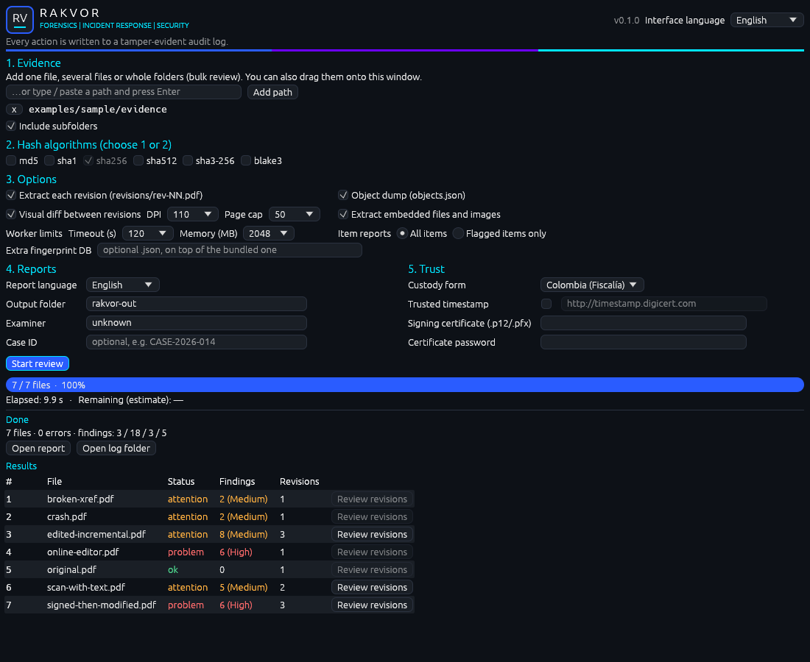
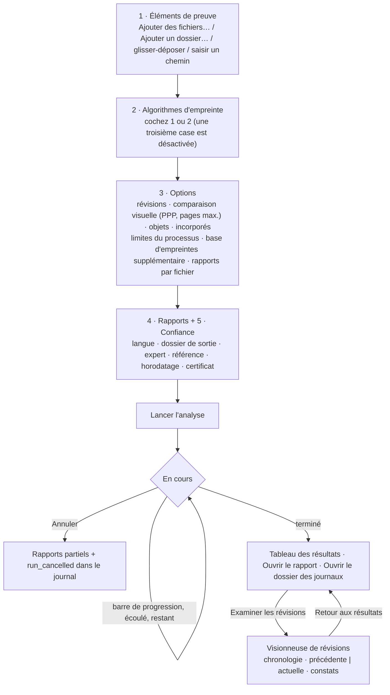
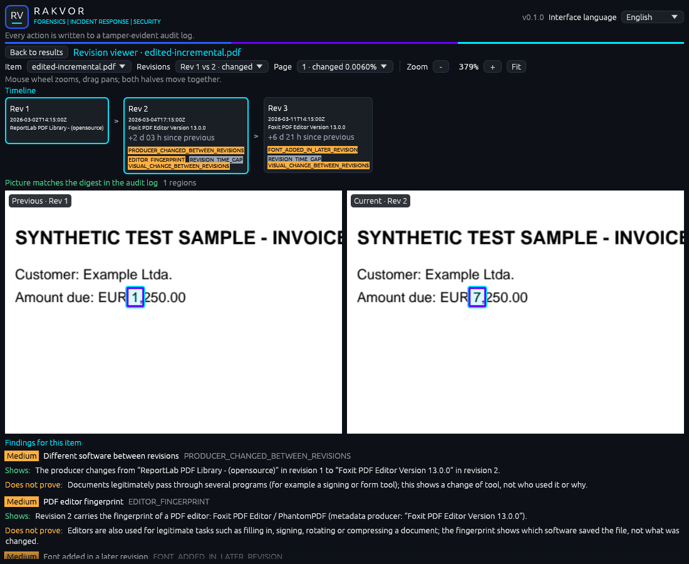

> La version de référence est la version anglaise ([usage-gui.md](usage-gui.md)) ; cette traduction la suit.

# Utiliser l'application de bureau (Windows 10/11)

Lancez **RV PDFAuth** depuis le menu Démarrer (programme d'installation) ou double-cliquez sur `rv-pdfauth-gui.exe`
(zip portable). Aucun autre logiciel n'est à installer ; l'application fonctionne aussi sur des machines virtuelles
sans pilote graphique (rendu logiciel, aucun code GPU propre).

## Déroulement

## La fenêtre

| Zone | Ce qu'elle fait |
| --- | --- |
| **1. Éléments de preuve** | *Ajouter des fichiers…* et *Ajouter un dossier…* ouvrent les sélecteurs de Windows. Vous pouvez aussi glisser des fichiers ou des dossiers sur la fenêtre (ou sur l'icône de `rv-pdfauth-gui.exe` avant son lancement), ou coller un chemin et appuyer sur Entrée. *Inclure les sous-dossiers* est coché par défaut. Retirez une entrée avec **x**. *Dossier de l'affaire* rattache l'exécution à une affaire partagée ([case-folder.md](case-folder.md), en anglais) ; une fois défini, *Enregistrer d'abord les éléments de preuve avec RV HashInv* exécute rv-hashinv sur les mêmes éléments avant l'analyse : la fenêtre affiche la version de rv-hashinv trouvée (au survol : chemin et SHA-256) ou, en rouge, pourquoi aucune n'est utilisable. Pendant l'entrée, une ligne affiche *Entrée (RV HashInv) : n/N fichiers* ; ensuite, **Ouvrir le rapport d'empreintes** ouvre le rapport de rv-hashinv. |
| **2. Algorithmes d'empreinte** | Cochez-en un ou deux. Quand deux sont cochés, les autres sont désactivés ; on ne peut pas décocher le dernier. |
| **3. Options** | Jusqu'où va l'analyse du PDF (voir le tableau ci-dessous). Les valeurs par défaut conviennent à presque toutes les affaires. |
| **4. Rapports** | Langue (English, Español, Français, ou les trois), dossier de sortie, nom de l'expert (par défaut votre utilisateur Windows), référence du dossier facultative. |
| **5. Confiance** | *Horodatage qualifié* (activé par défaut ; adresse de la TSA modifiable), *Certificate…* pour choisir votre `.p12`/`.pfx` et son mot de passe (gardé en mémoire seulement, jamais journalisé) afin de signer chaque PDF, et *Fiche de possession* (Colombie / France). |
| **Langue de l'interface** | Sélecteur en haut à droite : English, Español, Français. Change immédiatement tous les libellés ; indépendant de la langue des rapports. |
| **Lancer l'analyse / Annuler** | Lancer est actif dès qu'un élément est ajouté. Pendant une exécution, les réglages sont verrouillés et le bouton devient *Annuler*. |
| **Progression** | Barre selon les octets traités, `fichiers traités / total`, temps écoulé (toujours en mouvement) et temps restant estimé. Le fichier en cours de lecture s'affiche en dessous. |
| **Résultat** | Nombre par gravité, **Ouvrir le rapport** (page des statistiques dans votre langue), **Ouvrir le dossier des journaux** et le tableau **Résultats** : une ligne par fichier avec son état, le nombre de constatations (et la gravité la plus élevée) et le nombre de révisions. **Examiner les révisions** est actif pour les fichiers de deux révisions ou plus. |

### 3. Options

Chaque option correspond 1:1 à un réglage d'analyse du moteur (les mêmes que ceux de la ligne de commande).

| Option | Par défaut | Effet |
| --- | --- | --- |
| Extraire chaque révision | activé | Écrit `revisions/rev-NN.pdf` (préfixes exacts, octet pour octet, de l'élément, chacun avec son empreinte dans le journal). |
| Comparaison visuelle entre révisions | activé | Rend les pages de chaque paire de révisions avec PDFium et écrit `visual/rev-NN-vs-MM-page-PPP.png` pour les pages modifiées. |
| PPP / Pages max. | 110 / 50 | Résolution de rendu et nombre de pages comparées par paire (les pages au-delà de la limite sont signalées comme non comparées). |
| Export des objets | activé | Écrit `objects.json` (l'arbre des objets de chaque révision). |
| Extraire fichiers et images incorporés | activé | Écrit `embedded/` (pièces jointes et flux d'images, bruts et décompressés). |
| Limites du processus d'analyse | 120 s / 2048 Mo | Chaque PDF est analysé dans un processus séparé ; un plantage, un blocage ou un débordement de mémoire devient une constatation `PARSER_FAILED` au lieu d'arrêter l'analyse. |
| Base d'empreintes supplémentaire | aucune | Une base JSON d'empreintes de producteurs/éditeurs utilisée en plus de la base fournie. Elle doit exister au moment de Lancer. |
| Rapports par fichier | Tous les fichiers | *Fichiers signalés uniquement* omet les rapports par fichier des fichiers sans rien au-dessus d'informatif. |

Les options numériques se choisissent parmi des valeurs prédéfinies (la valeur actuelle est toujours listée) : chaque
choix est ainsi une seule modification consignée, et non une suite de saisies.

## Visionneuse de révisions

Ouvrez-la avec **Examiner les révisions** sur une ligne du tableau des résultats. Elle lit les sorties de l'exécution
elle-même : les données de révision et les constatations renvoyées par le moteur, et les images de différences dans
`reports/<run>/items/<NNNNN-name>/visual/`.

| Partie | Ce qu'elle montre |
| --- | --- |
| **Fichier / Révisions / Page** | Choisissez le fichier, la paire de révisions (`Rév r-1 vs r`, marquée *modifiée* ou *aucun changement visuel*) et la page (les pages modifiées indiquent la part de pixels modifiés). Ouvrir un fichier saute à sa première paire avec une modification et à la première page modifiée de cette paire. |
| **Chronologie** | Une carte par révision : date (Info ModDate, sinon CreationDate, sinon XMP), producteur, temps depuis la révision précédente (en rouge quand une révision est datée *avant* la précédente), signature, et pastilles des constatations rattachées à cette révision, colorées selon la gravité. La paire sélectionnée est encadrée ; cliquez sur une carte pour la comparer à la révision précédente. |
| **Précédente / Actuelle** | Les deux moitiés de l'image de différences côte à côte, les zones modifiées entourées en violet par le moteur et surlignées en cyan par la visionneuse. La molette zoome sous le pointeur, le glisser déplace, le double-clic (ou **Ajuster**) réinitialise ; les deux moitiés bougent toujours ensemble. **–** / **+** zooment par paliers (de 50 % à 1600 % de « ajuster »). |
| **Contrôle d'empreinte** | Avant d'afficher une image, la visionneuse en calcule l'empreinte et la compare à celle écrite dans le journal d'audit pendant l'exécution : vert *correspond*, rouge *NE correspond PAS* (le fichier a été modifié après l'exécution). |
| **Constats pour ce fichier** | Toutes les constatations du fichier, les plus graves d'abord, avec ce qu'elles **montrent** et ce qu'elles **ne prouvent pas**, dans la langue de l'interface. |

Quand la comparaison visuelle n'a pas été faite (PDFium absent, option désactivée), la visionneuse affiche quand même
la chronologie et les constatations, et indique pourquoi il n'y a pas d'image.

La visionneuse montre l'exécution qui vient de se terminer dans cette fenêtre (elle utilise les résultats renvoyés par
le moteur et les empreintes consignées pour chaque image pendant cette exécution). Une exécution plus ancienne ne peut
pas être rouverte dans la visionneuse : ouvrez plutôt ses PNG de `visual/` et son rapport `technical.*`, et vérifiez
leurs empreintes comme décrit dans [usage.fr.md](usage.fr.md#8-vérifier-une-exécution). Comment lire chaque
constatation : [usage.fr.md](usage.fr.md#5-interpréter-chaque-constatation).

### Pourquoi la consultation n'est pas journalisée

Le journal d'audit d'une exécution est **clos** à la fin de l'exécution : sa dernière entrée est `run_finished`, sa
tête peut être couverte par un horodatage de confiance, et `verify-log` vérifie la chaîne telle qu'elle a été scellée.
Ouvrir la visionneuse plus tard ne modifie aucun élément de preuve ni aucune sortie : elle ne lit que des fichiers
dont les empreintes sont déjà dans cette chaîne (et les revérifie à l'écran). Écrire une « note de visionneuse » à côté
du journal scellé mettrait dans le dossier des journaux des données non chaînées et non horodatées qu'un lecteur
pourrait prendre pour une partie du registre ; la visionneuse n'écrit donc délibérément rien. Ce que l'expert a vu est
entièrement reproductible à partir des sorties de l'exécution ; les conclusions vont dans le rapport propre de
l'expert.

## Ouverture depuis RV Hub

RV Hub ouvre l'application avec le dossier de l'affaire déjà renseigné : `rv-pdfauth-gui.exe --case-dir <CASE>
[FILES...]` (ou `--case-dir=<CASE>`). Le journal d'audit commence alors par `ui_case_dir_from_launcher` (le chemin et
`at_utc`) ; un `--case-dir` sans dossier est ignoré, signalé dans la fenêtre et journalisé comme
`ui_launch_argument_ignored`.

## Ce que la GUI consigne

Vos choix font partie du registre de la preuve. Avant le début de l'exécution, la GUI les écrit dans le journal
d'audit, chacun avec l'heure à laquelle il a eu lieu (`at_utc`) :

| Action | Journalisée comme |
| --- | --- |
| Ajouter / retirer des éléments | `ui_input_added`, `ui_input_removed` |
| Modifier la sélection d'empreintes | `ui_hash_selection_changed` |
| Modifier la langue / les sous-dossiers | `ui_language_changed`, `ui_recursive_changed` |
| Langue de l'interface, fiche de traçabilité, horodatage, certificat | `ui_interface_language_changed`, `ui_jurisdiction_changed`, `ui_timestamp_changed`, `ui_signing_certificate_changed` |
| Options | `ui_extract_revisions_changed`, `ui_visual_diff_changed`, `ui_dpi_changed`, `ui_max_pages_changed`, `ui_objects_dump_changed`, `ui_extract_embedded_changed`, `ui_worker_timeout_changed`, `ui_worker_memory_changed`, `ui_fingerprints_db_changed`, `ui_item_reports_changed` |
| Ouverte par RV Hub avec `--case-dir` | `ui_case_dir_from_launcher`, `ui_case_dir_changed` (ou `ui_launch_argument_ignored`) |
| Appuyer sur Lancer | `ui_start_clicked` (réglages finaux, toutes les options comprises) |
| Appuyer sur Annuler | `item_cancelled`, `run_cancelled` |

Les erreurs pendant l'exécution apparaissent sous **Avertissements** et dans le journal comme `item_error`.
Les messages de validation affichés *avant* une exécution (par ex. « Add at least one file or folder », une base
d'empreintes absente) ne sont pas journalisés, car aucune exécution, et donc aucun journal, n'existe encore.
L'utilisation de la visionneuse de révisions après l'exécution n'est pas journalisée (voir ci-dessus).

## Mêmes résultats que la ligne de commande

La GUI appelle le même moteur que `rv-pdfauth analyze`. Une exécution dans la GUI avec les mêmes éléments, algorithmes,
options et langue donne des empreintes et des constatations identiques ; `environment.json` consigne
`"frontend": "gui"` et les réglages utilisés (y compris `options={…}`).
