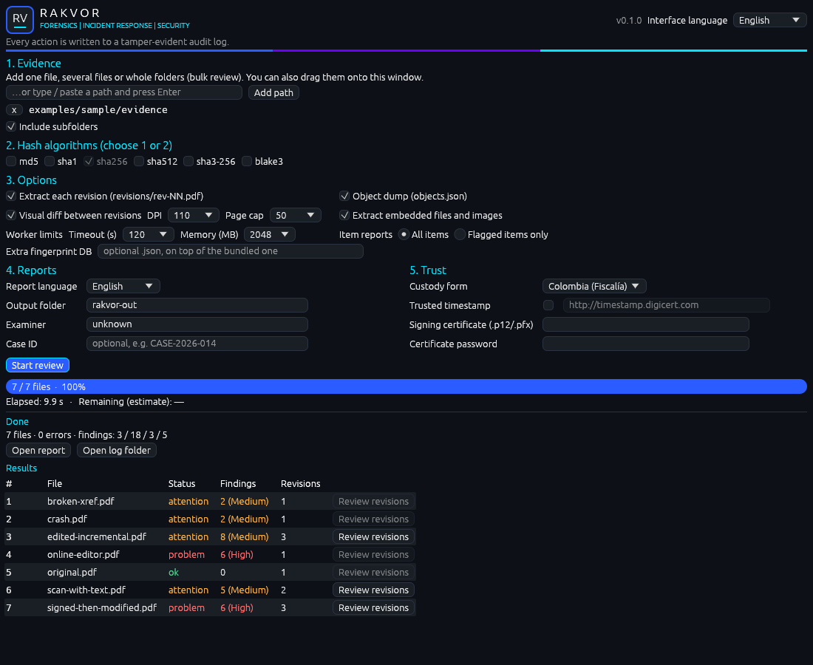
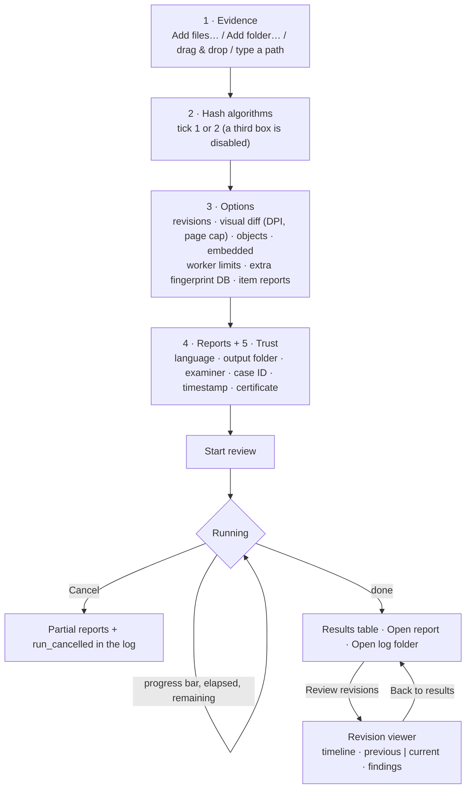
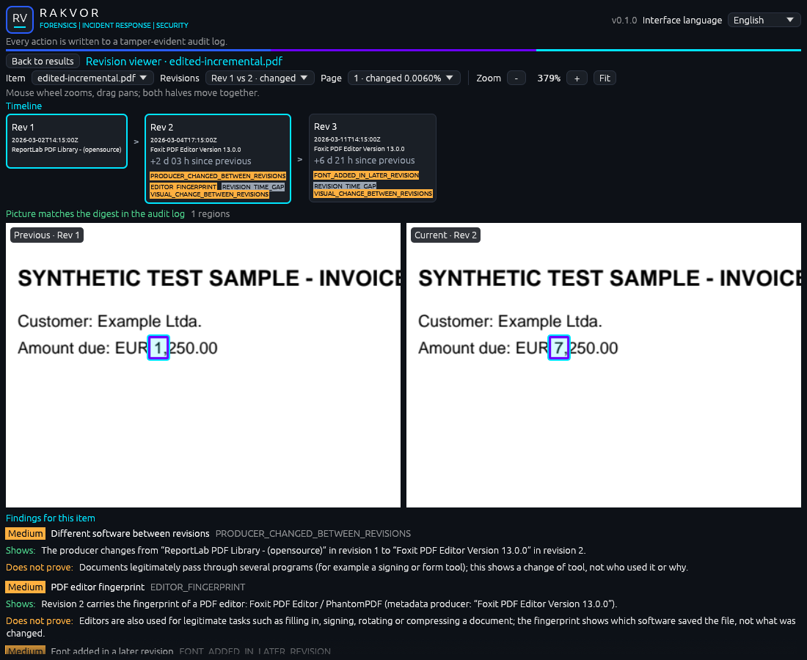

# Using the desktop app (Windows 10/11)

Start **RV PDFAuth** from the Start menu (installer) or double-click `rv-pdfauth-gui.exe` (portable zip).
No installation of other software is required; the app also runs on virtual machines without a graphics
driver (software rendering, no GPU code of its own).

## Workflow

## The window

| Area | What it does |
| --- | --- |
| **1. Evidence** | *Add files…* and *Add folder…* open the Windows pickers. You can also drag files or folders onto the window (or onto the `rv-pdfauth-gui.exe` icon before it starts), or paste a path and press Enter. *Include subfolders* is on by default. Remove an entry with **x**. |
| **2. Hash algorithms** | Tick one or two. When two are ticked, the others are disabled; you cannot untick the last one. |
| **3. Options** | How deep the PDF analysis goes (see the table below). Defaults suit almost every case. |
| **4. Reports** | Language (English, Español, Français, or all three), output folder, examiner name (defaults to your Windows user), optional case ID. |
| **5. Trust** | *Trusted timestamp* (on by default; TSA address editable), *Certificate…* to pick your `.p12`/`.pfx` and its password (kept in memory only, never logged) so every PDF is signed, and *Custody form* (Colombia / France). |
| **Interface language** | Top-right selector: English, Español, Français. Changes every label immediately; independent of the report language. |
| **Start review / Cancel** | Start is enabled once evidence is added. During a run the settings are locked and the button becomes *Cancel*. |
| **Progress** | Bar by bytes processed, `files done / total`, elapsed time (always moving) and estimated time remaining. The file being read is shown below. |
| **Result** | Counts by severity, **Open report** (statistics page in your language), **Open log folder**, and the **Results** table: one row per file with its status, number of findings (and the highest severity) and number of revisions. **Review revisions** is enabled for files with two or more revisions. |

### 3. Options

Every option maps 1:1 onto the engine's analysis settings (the same ones the command line uses).

| Option | Default | Effect |
| --- | --- | --- |
| Extract each revision | on | Writes `revisions/rev-NN.pdf` (exact byte prefixes of the evidence, each hashed in the log). |
| Visual diff between revisions | on | Renders the pages of each revision pair with PDFium and writes `visual/rev-NN-vs-MM-page-PPP.png` for changed pages. |
| DPI / Page cap | 110 / 50 | Rendering resolution and how many pages per pair are compared (pages beyond the cap are reported as not compared). |
| Object dump | on | Writes `objects.json` (the object tree of every revision). |
| Extract embedded files and images | on | Writes `embedded/` (attachments and image streams, raw and inflated). |
| Worker limits | 120 s / 2048 MB | Each PDF is analysed in a separate worker process; a crash, hang or memory blow-up becomes a `PARSER_FAILED` finding instead of stopping the review. |
| Extra fingerprint DB | none | A JSON database of producer/editor fingerprints used on top of the bundled one. Must exist when Start is pressed. |
| Item reports | All items | *Flagged items only* skips the per-file reports for files with nothing above informational. |

Numeric options are picked from preset values (the current value is always listed), so each choice is one
recorded change rather than a stream of edits.

## Revision viewer

Open it with **Review revisions** on a row of the results table. It reads the run's own outputs: the revision
data and findings the engine returned, and the diff pictures in `reports/<run>/items/<NNNNN-name>/visual/`.

| Part | What it shows |
| --- | --- |
| **Item / Revisions / Page** | Pick the file, the revision pair (`Rev r-1 vs r`, marked *changed* or *no visual change*) and the page (changed pages show the changed share of pixels). Opening an item jumps to its first pair with a change and that pair's first changed page. |
| **Timeline** | One card per revision: date (Info ModDate, else CreationDate, else XMP), producer, time since the previous revision (red when a revision is dated *before* the previous one), signature, and badges for the findings attached to that revision, coloured by severity. The selected pair is outlined; click a card to compare it with the revision before it. |
| **Previous / Current** | The two halves of the diff picture side by side, changed regions outlined in violet by the engine and highlighted in cyan by the viewer. The mouse wheel zooms at the pointer, dragging pans, double-click (or **Fit**) resets; both halves always move together. **–** / **+** zoom in steps (50 % to 1600 % of "fit"). |
| **Digest check** | Before showing a picture the viewer hashes it and compares it with the digest written to the audit log during the run: green *matches*, red *does NOT match* (the file was changed after the run). |
| **Findings for this item** | Every finding of the file, most severe first, with what it **shows** and what it **does not prove**, in the interface language. |

When the visual diff did not run (PDFium missing, option off), the viewer still shows the timeline and the
findings and says why there is no picture.

### Why viewing is not logged

The audit log of a run is **closed** when the run finishes: its last entry is `run_finished`, its head may be
covered by a trusted timestamp, and `verify-log` checks the chain as it was sealed. Opening the viewer later does
not change any evidence or output — it only reads files whose digests are already in that chain (and re-checks
them on screen). Writing a separate "viewer note" next to the sealed log would put unchained, untimestamped data in
the log folder that a reader could mistake for part of the record, so the viewer deliberately writes nothing. What
the examiner saw is fully reproducible from the run's outputs; conclusions belong in the examiner's own report.

## What the GUI records

Your choices are part of the evidence record. Before the run starts, the GUI writes them to the audit log, each
with the time it happened (`at_utc`):

| Action | Logged as |
| --- | --- |
| Add / remove evidence | `ui_input_added`, `ui_input_removed` |
| Change hash selection | `ui_hash_selection_changed` |
| Change language / subfolders | `ui_language_changed`, `ui_recursive_changed` |
| Interface language, custody form, timestamp, certificate | `ui_interface_language_changed`, `ui_jurisdiction_changed`, `ui_timestamp_changed`, `ui_signing_certificate_changed` |
| Options | `ui_extract_revisions_changed`, `ui_visual_diff_changed`, `ui_dpi_changed`, `ui_max_pages_changed`, `ui_objects_dump_changed`, `ui_extract_embedded_changed`, `ui_worker_timeout_changed`, `ui_worker_memory_changed`, `ui_fingerprints_db_changed`, `ui_item_reports_changed` |
| Press Start | `ui_start_clicked` (final settings, including all options) |
| Press Cancel | `item_cancelled`, `run_cancelled` |

Errors during the run appear under **Warnings** and in the log as `item_error`.
Validation messages shown *before* a run (e.g. "Add at least one file or folder", a missing fingerprint database)
are not logged, because no run — and therefore no log — exists yet. Using the revision viewer after the run is not
logged (see above).

## Same results as the command line

The GUI calls the same engine as `rv-pdfauth scan`. A GUI run with the same evidence, algorithms, options and
language gives identical hashes and findings; `environment.json` records `"frontend": "gui"` and the settings used
(including `options={…}`).
