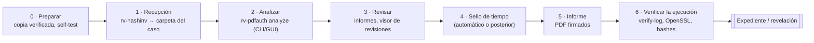
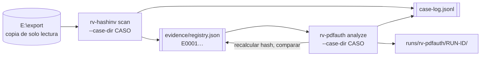
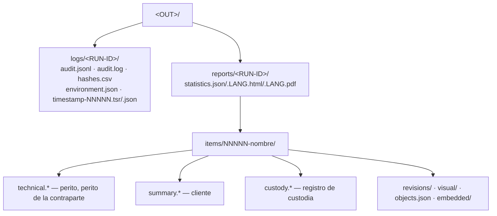
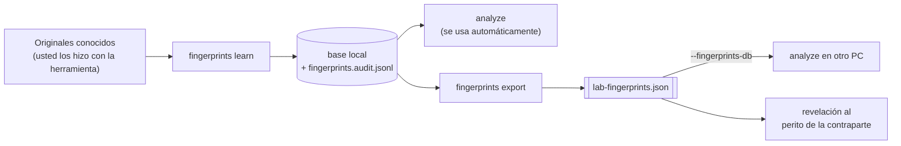

> La versión de referencia es la inglesa ([usage.md](usage.md)); esta traducción la sigue.

# Guía de uso: de la recepción de la evidencia a un informe verificado

Esta es la guía completa para el perito. Recorre un caso, explica cada salida, indica cómo interpretar cada hallazgo
y cómo demostrar después que nada cambió. Las listas de opciones no se repiten aquí:

- las tareas habituales en breve: [quick-guide.es.md](quick-guide.es.md);
- cada comando, opción, valor por defecto, ejemplo y código de salida: [usage-cli.md](usage-cli.md) (generado a partir de `--help`, en inglés);
- la aplicación de escritorio, ventana por ventana: [usage-gui.es.md](usage-gui.es.md);
- por qué funciona cada comprobación: [theory.md](theory.md); peso legal: [admissibility.md](admissibility.md) (en inglés);
- instalación y verificación de la herramienta: [installation.es.md](installation.es.md).



## 1. Antes de empezar

| Comprobación | Por qué | Cómo |
| --- | --- | --- |
| Trabaje sobre una **copia verificada** (imagen forense, exportación con bloqueador de escritura), nunca sobre el soporte original | La herramienta es de solo lectura por software, no un bloqueador de escritura; además lee cada PDF dos veces ([theory.md B2](theory.md#b2-pipeline-and-reads-of-the-evidence)) | Herramienta de imagen + bloqueador de escritura; anote modelo y número de serie |
| La herramienta instalada es la versión auténtica | Pregunta del tribunal: "¿cómo sabe qué ejecutó?" | [installation.es.md](installation.es.md) pasos 2–4, 6, 7 |
| Política de hash | MD5/SHA-1 solos no son resistentes a colisiones | Incluya siempre `sha256` (o `sha512`): `--hash sha256,md5` cuando un registro anterior usa MD5 |
| Reloj | Las horas de auditoría vienen del reloj del puesto | Compruebe la sincronización horaria de Windows antes de la ejecución |
| Jurisdicción | Elige el formato de custodia | `--jurisdiction co` (por defecto) o `fr` |
| Sello de tiempo | TSA en línea por defecto | `--no-timestamp` sin red y luego `rv-pdfauth timestamp`; `--tsa-url` para una TSA cualificada / de una ECD |
| Certificado del perito | Firma cada informe PDF | `--sign-cert examiner.p12` ([firma](#7-firmar-los-informes-con-el-certificado-del-perito)) |

## 2. Recorrido de un caso

El caso de ejemplo: `CASE-2026-014`, jurisdicción colombiana, perita Ana Ruiz, una exportación del cliente en
`E:\export` con facturas y contratos.

### 2.1 Recepción con rv-hashinv en una carpeta del caso

En un encargo real las herramientas Rakvor comparten **una carpeta del caso**: la herramienta de recepción
`rv-hashinv` registra cada elemento una vez (ID de evidencia, tamaño, hashes); cada herramienta posterior vuelve a
verificar cada archivo contra ese registro antes de analizarlo y enlaza su propia cadena de auditoría con el log del
caso. Estructura (`rakvor.case/1`):

```text
D:\cases\CASE-2026-014\
  case.json                 case id, jurisdiction, created (written once, never changed)
  case-log.jsonl            hash-chained case log (same algorithm as audit.jsonl)
  evidence\registry.json    E0001…: path, size, hashes, who registered it (written only by the intake tool)
  evidence\registry.csv     the same, flat
  runs\rv-hashinv\<RUN-ID>\logs\ and reports\
  runs\rv-pdfauth\<RUN-ID>\logs\ and reports\
```



La parte de recepción es rv-hashinv (`rv-hashinv scan --help`); rv-pdfauth es la herramienta de **análisis**: lee el
registro y nunca lo escribe. Referencia completa: [case-folder.md](case-folder.md) (en inglés).

```powershell
# 1. Recepción: crea case.json, el registro y el log del caso
rv-hashinv scan --case-dir D:\cases\CASE-2026-014 --case CASE-2026-014 --jurisdiction co `
    -i E:\export -r --hash sha256,md5 --actor "Ana Ruiz"

# 2. Análisis de cada elemento registrado (no hace falta --input) ...
rv-pdfauth analyze --case-dir D:\cases\CASE-2026-014 --actor "Ana Ruiz" --sign-cert C:\certs\ana-ruiz.p12
#    ... o solo de algunos elementos registrados
rv-pdfauth analyze --case-dir D:\cases\CASE-2026-014 --evidence E0001,E0007 --actor "Ana Ruiz"

# 3. Comprobación del caso completo: log del caso, hash del registro, la cadena de cada ejecución y su cabeza registrada en el log del caso
rv-pdfauth verify-case D:\cases\CASE-2026-014
```

Qué hace `analyze --case-dir`:

- rechaza una carpeta del caso cuyo log del caso, `case.json` o hash del registro no se verifica (código 3, no se
  escribe nada), una carpeta de otro caso (`--case` debe coincidir con `case.json` u omitirse; código 2) y los ID de
  evidencia desconocidos (código 2);
- toma por defecto cada elemento registrado (o los ID de `--evidence`, o las rutas de `--input`, emparejadas con el
  registro por ID, si no por ruta, si no por contenido);
- se asegura de que al menos un algoritmo de hash elegido esté en el registro (si hace falta se agrega SHA-256 y se
  registra como `case_algorithm_added`, siempre con un máximo de dos);
- justo después de calcular el hash de cada elemento, **antes** del análisis del PDF, registra
  `evidence_verified_against_case` o genera `EVIDENCE_HASH_MISMATCH_WITH_CASE` (alto, código 3; el análisis se hace
  igualmente) o `EVIDENCE_NOT_IN_CASE_REGISTRY` (medio);
- empieza su log de auditoría con `run_started`, `case_linked` (cabeza del log del caso, SHA-256 del registro) y
  escribe en `runs\rv-pdfauth\<RUN-ID>\logs\` y `reports\` (`--out` no se usa);
- muestra el ID de evidencia en cada informe, la fecha de recepción y la jurisdicción del caso en el formato de
  custodia, y una sección "Carpeta del caso" con los conteos en el informe de estadísticas;
- agrega `run_finished` (cabeza final de auditoría, totales, conteos de verificación) al log del caso, también tras
  una cancelación o un fallo.

El resumen que se imprime al final tiene una línea más, p. ej.
`case:   CASE-2026-014 (analysis) verified 41, mismatched 0, not in registry 0`. En la aplicación de escritorio,
complete **Carpeta del caso** en la sección 1: la carpeta de salida se deriva y se bloquea, y la tabla de resultados,
el panel de resultado y la cabecera del visor de revisiones muestran el ID de evidencia y el control contra el
registro de cada elemento.

En Windows, las rutas del registro se comparan sin distinguir mayúsculas de minúsculas (el sistema de archivos no las
distingue).

**Un paso en lugar de dos:** agregue `--intake hashinv` al comando `analyze` (o marque *Registrar primero la evidencia
con RV HashInv* en la GUI) y rv-pdfauth ejecuta rv-hashinv sobre la misma evidencia antes de analizarla. Detalles y
reglas: [case-folder.md](case-folder.md#one-step-intake-with-rv-hashinv) (en inglés).

### 2.2 Ejecutar `analyze` desde la línea de comandos

```powershell
rv-pdfauth analyze -i E:\export -r --hash sha256,md5 --lang es --jurisdiction co `
    --case CASE-2026-014 --actor "Ana Ruiz" --sign-cert C:\certs\ana-ruiz.p12 --out D:\cases\CASE-2026-014\rv-pdfauth
```

Se revisa cada archivo (los que no son PDF reciben las comprobaciones de inventario: tipo por firma, extensión que no
coincide, ejecutable, vacío, duplicado). Los valores por defecto del análisis de PDF (revisiones extraídas,
comparación visual a 110 PPP en hasta 50 páginas por par de revisiones, volcado de objetos, archivos incrustados,
proceso de análisis 120 s / 2048 MiB) sirven para casi todos los casos. Ajustes útiles:
`--visual-diff off --item-reports flagged` para lotes muy grandes; `--worker-timeout 600 --worker-memory 4096` para
archivos enormes o dañados; `--max-pages 500` cuando hay que comparar todas las páginas; `--fingerprints-db <file>`
para usar la base de un colega o una específica del caso. Todas las opciones: [usage-cli.md](usage-cli.md).

Al final la CLI imprime un resumen:

```text
DONE (high-severity findings)  run 20261021T103903Z-67d213
  items: 7  bytes: 105085  errors: 0  elapsed: 4.9 s
  findings: high 3, medium 18, low 3, info 5
  timestamp: ok 2026-10-21T10:39:08Z
  report: D:\cases\…\reports\20261021T103903Z-67d213\statistics.es.html
  logs:   D:\cases\…\logs\20261021T103903Z-67d213
```

El código de salida 3 significa "terminado, al menos un hallazgo de severidad alta": un resultado normal para una
evidencia, no un error.

### 2.3 Ejecutarlo desde la aplicación de escritorio

Inicie **RV PDFAuth**, agregue la evidencia (archivos, carpetas o arrastrar y soltar), marque uno o dos algoritmos de
hash, ajuste *3. Opciones* si hace falta, fije idioma, carpeta de salida, perito e ID del caso en *4. Informes*, y el
sello de tiempo, el certificado y el formato de custodia en *5. Confianza*; luego **Iniciar revisión**. Cada ajuste que
cambie antes de iniciar se escribe en el log de auditoría de la ejecución (acciones `ui_*`). El motor, las salidas y
los hallazgos son los mismos que los de la CLI. Detalles: [usage-gui.es.md](usage-gui.es.md).

### Inicio desde RV Hub: `--case-dir` y `describe --json`

RV Hub (el lanzador de Rakvor) encuentra las herramientas instaladas, las abre sobre una carpeta del caso y sugiere
cuál conviene para un archivo. Se apoya en dos puntos de entrada de RV PDFAuth:

- **`rv-pdfauth-gui.exe --case-dir <CASE> [FILES...]`** inicia la aplicación de escritorio con **Carpeta del caso** ya
  completada (`--case-dir=<CASE>` también funciona). Los demás argumentos se cargan como evidencia, como cuando se
  sueltan archivos sobre el icono. El ajuste previo se escribe en el log de auditoría de la ejecución como
  `ui_case_dir_from_launcher` (ruta y `at_utc`) seguido de `ui_case_dir_changed`. Un `--case-dir` sin carpeta se
  ignora: la ventana lo indica y el log de auditoría registra `ui_launch_argument_ignored`.
- **`rv-pdfauth describe --json`** imprime un objeto JSON (claves ordenadas) que lee RV Hub; está oculto en
  `rv-pdfauth --help` pero figura en [usage-cli.md](usage-cli.md). No lee ni escribe nada. Esquema:
  [`schemas/describe.schema.json`](../schemas/describe.schema.json) (`rakvor.describe/1`, idéntico en todas las
  herramientas Rakvor).

| Campo | Significado |
| --- | --- |
| `schema` | `rakvor.describe/1` |
| `tool`, `title`, `version` | `rv-pdfauth`, `RV PDFAuth`, la versión del producto (`version.txt`) |
| `role` | `analysis` (examina evidencia registrada en la carpeta del caso) |
| `main_verb` | `analyze`: el comando que hace el trabajo principal |
| `accepts` | `extensions` (en minúsculas, sin punto) y `signatures` de contenido (`format` + `match`: bytes hexadecimales en un desplazamiento); `"*"` = cualquier archivo |
| `case_formats`, `log_formats` | `rakvor.case/1`; `rakvor.audit/1` = `logs/audit.jsonl`, `rakvor.review/1` = `logs/review.jsonl` |
| `cli_exe`, `gui_exe` | `rv-pdfauth.exe`, `rv-pdfauth-gui.exe` |
| `exit_codes` | El significado de 0, 1, 2, 3 y 130 (la tabla de códigos de salida en Solución de problemas) |

```powershell
rv-pdfauth describe --json
```

## 3. Leer las salidas



| Salida | Para | Para qué sirve |
| --- | --- | --- |
| `statistics.*` | Perito, abogado | Visión general de la ejecución: quién, cuándo, interfaz, algoritmos, totales, hallazgos por severidad y código, PDF con varias revisiones / firmas / huellas de editores en línea, grupos de duplicados, estado del sello de tiempo, cabeza de la cadena de auditoría y número de entradas en el momento de escribirse |
| `technical.*` | Perito, perito de la contraparte | Todo sobre un archivo: ruta, tamaño, todos los hashes, hallazgos con *lo que muestra / lo que no demuestra*, método, entradas de auditoría `#primera–#última`, limitaciones; para los PDF: tabla del historial de revisiones (rango de bytes, fechas Info/XMP, productor, tiempo desde la anterior, objetos agregados/cambiados/borrados, páginas cambiadas, firmado por) y línea de tiempo, firmas, fuentes (primeras 100 filas; todas en `objects.json`), huellas de productor con las bases usadas (nombre, versión, SHA-256), imágenes de la comparación visual y medidas por página (píxeles cambiados y proporción, regiones, PPP, cambio de tamaño de página), advertencias del analizador con desplazamientos en bytes (primeras 100; todas en `warnings.json`), archivos extraídos con sus hashes |
| `summary.*` | Cliente | Estado en lenguaje sencillo, la huella principal, los hallazgos en una frase cada uno, un breve historial del documento ("guardado 3 veces; último cambio 9 días después de su creación, con un editor de PDF") y el siguiente paso |
| `custody.*` | Registro de custodia | Formato de la jurisdicción (español para `co`, francés para `fr`) + copia en inglés, prellenado a partir de la ejecución, con una tabla de personas (perito, asistentes, testigos: nombre, cargo, tipo y número de documento, firma) y filas de traspaso para llenar a mano y firmar. Un registro interno, que se usa **junto con** el formato oficial ([admissibility.md](admissibility.md) G9) |
| `revisions/rev-NN.pdf` | Perito | Cada versión guardada, prefijo exacto en bytes de la evidencia; ábralas en cualquier visor, vuelva a obtenerlas con `head -c` ([theory.md B5](theory.md#b5-revision-extraction-byte-exact-prefixes)) |
| `visual/rev-AA-vs-BB-page-PPP.png` | Todos | Página anterior y actual lado a lado, regiones cambiadas recuadradas en violeta; el pie da la proporción cambiada y el número de regiones |
| `objects.json` | Experto | Árbol de objetos de cada revisión: id, desplazamiento en el archivo, tipo, diccionario (profundidad ≤ 8, ≤ 1000 entradas por nivel, cadenas largas truncadas en hexadecimal), flujo de objetos, desplazamiento/longitud del flujo |
| `embedded/NN-name.*` | Perito | Adjuntos e imágenes tal como están almacenados (`.jpg` para DCT, si no `.bin`) y `.inflated.*` cuando están comprimidos con Flate |
| `audit.jsonl` / `audit.log` | Verificación | Cada acción, encadenada por hashes / lo mismo, legible |
| `hashes.csv` | Verificación | Registro de hashes: `index,path,size,<algo1>[,<algo2>],status,error` |
| `environment.json` | Reproducibilidad | Herramienta, compilador, versión de cada dependencia, SO, equipo, usuario, línea de comandos |

**Estado y siguiente paso por elemento:** `problem` (un hallazgo alto: no confíe en el archivo hasta que se explique),
`attention` (medio o bajo: revíselo con el perito), `ok` (solo informativo). Con `--item-reports flagged`, los
elementos con estado `ok` no reciben archivos technical/summary/custody (sus salidas derivadas, como `objects.json`, se
escriben y se auditan igualmente, y la omisión se registra como `item_reports_skipped`).

## 4. Uso del visor de revisiones

Tras una ejecución en la GUI, haga clic en **Revisar revisiones** en una fila con dos o más revisiones. Elija el par
de revisiones y la página; la línea de tiempo muestra la fecha de cada revisión (Info ModDate, si no CreationDate, si
no XMP), el productor, el tiempo desde la anterior (en rojo cuando una revisión tiene fecha *anterior* a la previa: en
esta versión no se genera ningún hallazgo por ello, así que búsquelo aquí), las firmas y los distintivos de los
hallazgos. Las dos mitades se amplían y desplazan juntas. Antes de mostrar una imagen el visor vuelve a calcular su
hash y lo compara con el registrado durante la ejecución: verde *coincide*, rojo *NO coincide* (el archivo se modificó
tras la ejecución). El visor trabaja sobre la ejecución recién terminada en esa ventana; para una ejecución anterior,
abra sus PNG de `visual/` y su informe `technical.*`. La visualización no se registra, a propósito
([usage-gui.es.md](usage-gui.es.md#por-qué-la-visualización-no-se-registra)).

## 5. Interpretar cada hallazgo

Severidad entre paréntesis. "Qué comprobar después" es lo que un perito debe hacer antes de apoyarse en el hallazgo;
"no concluya" es la extralimitación que hay que evitar en un informe. El texto exacto que se imprime en los informes
está en `i18n/en.json` (es, fr).

| Código | Qué comprobar después | No concluya |
| --- | --- | --- |
| `INCREMENTAL_UPDATES` (bajo) | Abra `revisions/`, lea la tabla de revisiones (fechas, productor, tipos de cambio) y la comparación visual | Que el archivo fue manipulado: los formularios, las firmas y los comentarios se guardan así |
| `VISUAL_CHANGE_BETWEEN_REVISIONS` (medio) | Mire el PNG; compare el texto de ambas revisiones; relacione el cambio con el productor y la fecha de la revisión | Quién hizo el cambio ni por qué; un cambio puede ser una corrección legítima |
| `VISUAL_DIFF_SKIPPED` (info) | El motivo: falta PDFium, una revisión que PDFium no puede abrir (p. ej. contraseña); corríjalo y vuelva a ejecutar, o compare `revisions/` a mano | Que las revisiones se ven iguales |
| `METADATA_INFO_XMP_MISMATCH` (medio) | Qué campo; el historial XMP (`technical.json`) y el productor de cada revisión | Contenido falsificado: muchas herramientas actualizan solo uno de los dos |
| `MODDATE_BEFORE_CREATIONDATE` (alto) | Valores en bruto y zonas horarias en la tabla de revisiones; los errores de fecha conocidos del productor | Antedatado deliberado (relojes, zonas, plantillas) |
| `REVISION_TIME_GAP` (info) | Si el intervalo encaja con lo que cuenta el cliente (p. ej. firmado el día 1, modificado el día 9) | Cuándo ocurrió realmente el cambio: las fechas las pone el software que guarda |
| `REVISION_DATE_NOT_MONOTONIC` (medio) | Ambas fechas en la tabla de revisiones; el reloj y la zona horaria de la máquina que guardó la revisión posterior | Antedatado: un reloj mal puesto o un editor que copia fechas antiguas también lo producen |
| `PRODUCER_CHANGED_BETWEEN_REVISIONS` (medio) | Qué software guardó cada revisión; ¿es un flujo conocido (herramienta de firma, relleno de formularios)? | Quién usó el software |
| `EDITOR_FINGERPRINT` (medio) | Qué cambió esa revisión (comparación visual, objetos agregados/cambiados) | Que se cambió el contenido: los editores también rellenan, firman, giran, comprimen |
| `ONLINE_EDITOR_OR_UNLOCKER` (alto) | La cadena y el campo coincidentes; si el cliente usó ese servicio; qué cambió esa revisión | Alteración del contenido; la cadena se puede escribir a mano |
| `PRODUCER_STRUCTURE_MISMATCH` (medio) | Los rasgos que difieren; si un optimizador o un guardado posterior los explica | Falsificación; las versiones de un mismo programa difieren |
| `UNKNOWN_PRODUCER` (info) | Nada, salvo que importe; considere aprenderlo a partir de originales conocidos | Sospecha: la base es limitada |
| `XREF_OFFSETS_INCONSISTENT` (medio) | Qué revisiones; las advertencias del analizador con desplazamientos en bytes (tabla *Parser warnings* del informe técnico, lista completa en el `warnings.json` del elemento; ver [theory.md](theory.md#cross-reference-resolution-per-revision)); compare con otro analizador (qpdf) | Manipulación: los escritores con fallos y las transferencias dañadas lo producen |
| `HYBRID_XREF` (bajo) | Si las vistas de tabla y de flujo difieren (advertencias) | Nada por sí solo: algunos escritores corrientes lo hacen |
| `DATA_AFTER_FINAL_EOF` (medio) | Extraiga los bytes finales (desplazamiento = fin de la última revisión) y examínelos por separado | Contenido oculto: el relleno y las herramientas de transferencia agregan bytes |
| `SIGNATURE_INTEGRITY_FAILED` (alto) | El motivo (`digest_mismatch`, `signature_invalid`, `byterange_*`); valide con Acrobat o pyHanko; obtenga el archivo de otra fuente | Quién alteró los bytes; una transferencia dañada puede causarlo |
| `SIGNATURE_PRESENT_TRUST_NOT_VERIFIED` (info) | Valide la cadena de certificados, la revocación y la identidad del firmante con un validador aparte si la identidad importa | Que el firmante es quien nombra el certificado |
| `CONTENT_CHANGED_AFTER_SIGNATURE` (alto) | Compare la revisión firmada (`revisions/rev-NN.pdf` de la revisión firmada) con la final, página por página | Que el firmante no estuvo de acuerdo; que la firma es inválida (sigue siendo válida para su revisión) |
| `DOCMDP_VIOLATION` (alto) | Qué revisiones posteriores y qué tipos de cambio; si son solo datos de validación (DSS) con P = 1 ([theory.md B10](theory.md#docmdp)) | Intención; la clasificación es heurística y los visores difieren |
| `JAVASCRIPT_PRESENT` (medio) | Los objetos listados (`objects.json`); analice los scripts en un entorno aislado | Comportamiento malicioso: los formularios usan scripts |
| `LAUNCH_ACTION` (alto) | El destino de la acción (`objects.json`); trate el archivo como potencialmente hostil | Que la acción se ejecutó |
| `EMBEDDED_FILES` (bajo) | Abra `embedded/`; analice cada adjunto como un elemento de evidencia propio | Nada sobre la intención: los adjuntos son normales |
| `INVISIBLE_TEXT` (medio) | Qué página; ¿es una capa OCR sobre un escaneo, texto de accesibilidad, texto blanco sobre fondo oscuro? Compare con el renderizado visual | Un intento de ocultar contenido |
| `TEXT_OVER_SCANNED_IMAGE` (medio) | En qué revisión aparece el texto por primera vez; si es posterior al escaneo, compare las revisiones visualmente | Alteración: los escáneres agregan texto OCR |
| `FONT_ADDED_IN_LATER_REVISION` (medio) | Qué dibujó esa revisión con la fuente (comparación visual, contenido) | Falsificación: rellenar un formulario o agregar un sello agrega fuentes |
| `SCANNED_PAGES_STRUCTURE_ONLY` (info) | Si importa el contenido de la imagen, use análisis forense de imágenes sobre `embedded/` | Que la imagen no se retocó |
| `ENCRYPTED_PARTIAL_ANALYSIS` (info) | Obtenga la contraseña de forma lícita y analice una copia descifrada si importan las comprobaciones de contenido | Nada a partir de la ausencia de hallazgos de contenido |
| `NOT_A_PDF` (info) | El tipo real (`detected_type`); use una herramienta adecuada | Que el archivo es malicioso |
| `PARSER_FAILED` (alto) | El `reason` (tabla siguiente); vuelva a ejecutar con límites más altos; examine a mano | Que el archivo es malicioso o falsificado |
| `EVIDENCE_CHANGED_DURING_ANALYSIS` (alto) | Qué programa tocó el archivo (cliente de sincronización, antivirus); cópielo a un soporte protegido contra escritura y vuelva a ejecutar; los resultados de esta ejecución no describen la evidencia hasheada | Que se alteró la evidencia original |
| `EXTENSION_MISMATCH` (medio) | El tipo detectado; abra el archivo con una herramienta adecuada | Intención de ocultar algo |
| `EXECUTABLE_CONTENT` (alto) | Trátelo como hostil; analícelo en un entorno aislado | Que el programa es malicioso |
| `EMPTY_FILE` (info) | Si la fuente tiene el archivo con contenido | Que se vació a propósito |
| `DUPLICATE` (info) | El grupo de duplicados en `statistics.*` y `hashes.csv` | Quién copió el archivo ni cuándo |
| `UNREADABLE` (alto) | El error del sistema operativo (permisos, bloqueos); vuelva a adquirirlo | Que el archivo está dañado |

## 6. Sellos de tiempo

Por defecto cada ejecución pide a la TSA (`http://timestamp.digicert.com`, se cambia con `--tsa-url`) que firme la
cabeza de la cadena de auditoría justo antes de escribir el informe de estadísticas. El token cubre cada hash de
evidencia, hallazgo, hash de salida y hash de informe por elemento registrado antes de él
([theory.md B15](theory.md#b15-rfc-3161-trusted-timestamp)).

| Situación | Qué ocurre | Qué hacer |
| --- | --- | --- |
| TSA accesible | `timestamp_obtained`; archivos `timestamp-NNNNN.tsr` y `.json` en la carpeta de logs; el informe de estadísticas muestra la hora | Verifique con OpenSSL (abajo) |
| Sin red | `timestamp_pending`; la ejecución termina; advertencia en el informe de estadísticas | Más tarde, con red: `rv-pdfauth timestamp <log folder>` |
| `--no-timestamp` / `RV_NO_TIMESTAMP=1` / GUI desmarcada | Sin solicitud | Use `rv-pdfauth timestamp` más tarde si hace falta |
| Cadena rota | `rv-pdfauth timestamp` se niega (código 3): a un log roto no se le agrega ningún sello de tiempo | Investigue; no repare |

`rv-pdfauth verify-log` comprueba el hash del token, que cubre la cabeza registrada, y la firma CMS de la TSA
(certificado firmante en el token, vínculo ESS, resumen del mensaje, firma RSA, uso de clave crítico y solo
timeStamping) de cada token que registra el log de auditoría, y de cualquier archivo de token que ninguna entrada
registre; un token registrado cuyo `.tsr` o `.json` falta hace fallar el log (código 3). Entréguele el paquete de CA
de la TSA para validar también la cadena de certificados:

```powershell
rv-pdfauth verify-log <OUT>\logs\<RUN-ID> --tsa-ca C:\certs\tsa-roots.pem
#     timestamp … covers entry #60: TSA signature valid (signer: …); chain validated to CN=… (revocation not checked)
```

Sin `--tsa-ca` la línea termina con *chain not checked*; un token cuya firma o cadena falla da el código 3. La
revocación, el OID de política y la precisión nunca los comprueba la herramienta. Contraste la **firma y la cadena**
con OpenSSL (Git for Windows incluye `openssl.exe`); tampoco comprueba la revocación (no se le da ninguna CRL y
OpenSSL no consulta OCSP):

```bash
cd <OUT>/logs/<RUN-ID>
N=00060                                                   # del nombre de archivo timestamp-00060.tsr
H=$(python -c "import json;print(json.load(open('timestamp-$N.json'))['head'])")
openssl ts -reply -in timestamp-$N.tsr -text              # genTime, OID de política, nombre de la TSA, serie, precisión
openssl ts -reply -in timestamp-$N.tsr -token_out -out token.der
openssl pkcs7 -inform DER -in token.der -print_certs > tsa-certs.pem   # certificados enviados por la TSA
openssl ts -verify -digest "$H" -in timestamp-$N.tsr -CAfile <TSA root.pem> -untrusted tsa-certs.pem
# → "Verification: OK"  (solo firma y cadena, no revocación)
```

Establezca por separado el estado de revocación del certificado de la TSA, a partir de evidencia CRL/OCSP que cubra
genTime (una CRL emitida después de genTime por la CA de la TSA, o una respuesta OCSP archivada en el momento del
sellado), p. ej.
`openssl verify -crl_check -CRLfile tsa-ca.crl -CAfile <TSA root.pem> -untrusted tsa-certs.pem -attime <genTime-epoch> tsa.pem`,
o `rv-certcheck analyze --crl … --ocsp …`. Obtenga el certificado raíz de la TSA del repositorio de la propia TSA, no del token. Registre la salida en el
expediente: es la evidencia de que la hora es auténtica.

> **Fechas de la CRL y `-attime`.** OpenSSL aplica `-attime` también a la CRL, así que `openssl verify -crl_check -attime <genTime-epoch>` solo funciona con una CRL cuyo intervalo `thisUpdate`–`nextUpdate` contenga genTime; una CRL emitida después de genTime falla con "CRL is not yet valid". Para usar una CRL posterior como evidencia, compruebe su firma (`openssl crl -in tsa-ca.crl -CAfile <TSA root.pem> -noout -verify`) y luego busque en ella el número de serie del certificado de la TSA (`openssl crl -in tsa-ca.crl -noout -text`): si no figura, o figura con una fecha de revocación posterior a genTime, no estaba revocado en genTime. Una CA puede quitar de sus CRL los certificados caducados, así que para un certificado de TSA que ya caducó un número de serie ausente no es concluyente: use una CRL anterior a su caducidad, o una respuesta OCSP archivada en el momento del sellado.

## 7. Firmar los informes con el certificado del perito

`--sign-cert <file.p12|.pfx>` firma **cada informe PDF** (estadísticas, técnico, resumen, custodia) con su propio
certificado (solo claves RSA). La contraseña se lee de la variable de entorno indicada por `--sign-pass-env` (por
defecto `RV_SIGN_PASSWORD`) o se pide en el terminal sin eco (`Certificate password (input hidden):`, leída de la
consola con el eco desactivado; el campo de la GUI también está enmascarado).
Nunca se registra; el log registra `signing_certificate_loaded` con el sujeto y el SHA-256 del certificado. Una
contraseña incorrecta detiene la ejecución (`run_failed`, código 1) antes de leer ninguna evidencia. En la GUI:
*5. Confianza → Certificate…*.

```powershell
$s = Read-Host "Certificate password" -AsSecureString
$env:RV_SIGN_PASSWORD = [Runtime.InteropServices.Marshal]::PtrToStringBSTR(
    [Runtime.InteropServices.Marshal]::SecureStringToBSTR($s))
rv-pdfauth analyze -i E:\export -r --sign-cert C:\certs\ana-ruiz.p12 --case CASE-2026-014
Remove-Item Env:RV_SIGN_PASSWORD
(Get-PfxCertificate C:\certs\ana-ruiz.p12).GetCertHashString("SHA256")   # publique esta huella
```

Compruebe un informe firmado con Adobe Acrobat/Reader (panel Firma) o pyHanko:
`pyhanko sign validate --pretty-print --trust <your CA or certificate .pem> technical.es.pdf`. Los informes HTML y JSON
no se firman; sus hashes están en la cadena de auditoría con sello de tiempo. El peso legal de esta firma depende del
certificado ([admissibility.md](admissibility.md) G3).

## 8. Verificar una ejecución

Cualquiera (usted, un colega, un perito de la contraparte) puede comprobar una ejecución con la carpeta de logs, la
carpeta de informes y la copia de la evidencia:

```powershell
rv-pdfauth verify-log D:\cases\CASE-2026-014\rv-pdfauth\logs\20261021T103903Z-67d213
# OK  63 entries, chain intact: …\audit.jsonl
#     timestamp 2026-10-21T10:39:08Z by http://timestamp.digicert.com covers entry #60
#     outputs: 170 verified of 171 recorded (md5, sha256), 1 skipped
#     not re-hashed: logs/timestamp-00060.tsr (RFC 3161 token: checked by the timestamp verification)
```

La línea `outputs:` es el recálculo del hash de cada archivo que, según el log, escribió la ejecución (informes por elemento, estadísticas, revisiones, comparaciones visuales, `objects.json`, archivos incrustados, `warnings.json`, `hashes.csv`,
`environment.json`), con cada algoritmo que registró el log; la entrada más reciente de un archivo prevalece. Un
archivo editado, borrado o sustituido después de la ejecución deja la ejecución en `BROKEN` (código 3) y se nombra:

```text
BROKEN  …\audit.jsonl
  - output reports/items/00003-edited-incremental.pdf/revisions/rev-01.pdf: md5 differs from audit entry #20 (recorded 3888…, now 88f4…): edited or replaced after the run
  - output reports/statistics.en.pdf: missing (recorded by audit entry #69): deleted or moved after the run
    outputs: 168 verified of 171 recorded (md5, sha256), 1 missing, 1 changed, 1 skipped
```

Una ruta registrada que es absoluta, contiene `..` o se resuelve fuera de la carpeta de la ejecución a través de un
enlace simbólico o una unión se rechaza y nunca se lee. El token de sello de tiempo aparece como `not re-hashed`
porque la comprobación del sello de tiempo ya lo verifica. Los archivos que la ejecución no registró (cualquier cosa
agregada después a la carpeta) no se comprueban.

| Paso | Comando | Demuestra |
| --- | --- | --- |
| 1 | `rv-pdfauth verify-log <log> [--tsa-ca <bundle>]` (código 0 intacto, 3 roto o una salida cambiada) | Ninguna entrada editada, borrada ni reordenada; el token de sello de tiempo coincide con la cabeza que cubre y lleva una firma de TSA válida (y cadena, con `--tsa-ca`); cada salida registrada conserva su hash (línea `outputs:`) |
| 2 | `python tests/verify_chain.py <log>` (árbol de código fuente) | Lo mismo, con una implementación independiente; además vuelve a calcular el hash de la evidencia listada en `hashes.csv` y de cada salida que registra el log de auditoría |
| 3 | OpenSSL ([Sellos de tiempo](#6-sellos-de-tiempo)) | La TSA firmó realmente esa cabeza a esa hora |
| 4 | Paso 1 (línea `outputs:`); script de abajo para una comprobación independiente | Cada informe y archivo de salida conserva el hash registrado en el log |
| 5 | Compare `hashes.csv` con el registro de recepción ([2.1](#21-recepción-con-rv-hashinv-en-una-carpeta-del-caso)) | Los archivos analizados son la evidencia registrada |

El paso 4 está integrado en `verify-log` y `verify-case`. Para comprobarlo con un código que se lee en una pantalla
(una implementación independiente, p. ej. para un perito de la contraparte), vuelva a calcular el hash de cada archivo
que registró la ejecución (necesita `sha256` entre los algoritmos de la ejecución):

```bash
python - "<OUT>/logs/<RUN-ID>" "<OUT>/reports/<RUN-ID>" <<'EOF'
import hashlib, json, pathlib, sys
log, rep = pathlib.Path(sys.argv[1]), pathlib.Path(sys.argv[2])
checked = bad = 0
for line in (log / "audit.jsonl").open(encoding="utf-8"):
    e = json.loads(line); d = e["details"]
    if e["action"] == "output_written":
        files = {d["file"]: d["hashes"]["sha256"]}
    elif e["action"] == "item_reports_written":
        files = {f'{d["folder"]}/{k}': v["sha256"] for k, v in d["files"].items()}
    elif e["action"] == "statistics_report_written":
        files = {k: v["sha256"] for k, v in d["files"].items()}
    else:
        continue
    for rel, want in files.items():
        checked += 1
        p = rep / rel
        got = hashlib.sha256(p.read_bytes()).hexdigest() if p.is_file() else "missing"
        if got != want:
            bad += 1; print("MISMATCH", rel, got)
print(f"{checked} files checked, {bad} mismatches"); sys.exit(3 if bad else 0)
EOF
```

En la ejecución de muestra esto comprueba 101 archivos. Un solo archivo en PowerShell:
`(Get-FileHash <file> -Algorithm SHA256).Hash.ToLower()` y busque el valor en `audit.jsonl`.

## 9. Base de huellas de productor

Cada análisis usa tres bases, que se listan con su SHA-256 en cada entrada `item_analyzed` y en el informe técnico:
la base **starter** incluida, su base **local** aprendida
(`%LOCALAPPDATA%\Rakvor\rv-pdfauth\fingerprints.local.json`) y una base **adicional** opcional (`--fingerprints-db`).



```powershell
# 1. Haga usted mismo los originales conocidos: cree un documento de prueba en el editor/servicio, guárdelo o descárguelo
rv-pdfauth fingerprints learn .\originals\smallpdf-1.pdf .\originals\smallpdf-2.pdf `
    --label "Smallpdf (online)" --category online_editor --case LAB-2026-03 --actor "Ana Ruiz"
# 2. Vea lo que tiene (versión y SHA-256 de cada base)
rv-pdfauth fingerprints list
# 3. Comparta o revele (nunca sobrescribe un archivo existente)
rv-pdfauth fingerprints export --out D:\lab\lab-fingerprints-2026-10.json
rv-pdfauth analyze -i E:\export -r --fingerprints-db D:\lab\lab-fingerprints-2026-10.json
```

Reglas: aprenda solo de archivos cuyo origen pueda probar; con varios archivos se conservan solo los rasgos
estructurales que todos comparten; aprender de nuevo la misma etiqueta se fusiona con la entrada; no se escribe nada
si algún archivo falla; cada cambio queda en el `fingerprints.audit.jsonl` encadenado por hashes con el SHA-256 de la
base antes y después. Cuando un informe se apoya en una coincidencia de la base local, expórtela al expediente: el
informe cita su SHA-256. Categorías: office, pdf_library, scanner, pdf_editor, online_editor, unlocker,
printer_driver, browser (solo pdf_editor, online_editor y unlocker generan hallazgos; las demás se listan en el
informe técnico).

## 10. Solución de problemas

### Motivos de `PARSER_FAILED`

| `reason` | Significado | Acción |
| --- | --- | --- |
| `timeout` | Proceso de análisis detenido tras `--worker-timeout` segundos | Vuelva a ejecutar ese archivo con `--worker-timeout 600` |
| `memory_limit` | El proceso de análisis superó `--worker-memory` | Vuelva a ejecutar con `--worker-memory 4096` (o más) |
| `crashed` | El proceso de análisis terminó de forma anómala (código de salida o señal en `exit_code`, final de stderr en el informe técnico) | Vuelva a ejecutar una vez; si se repite, examine a mano e informe del archivo (en privado) a ingeniería |
| `bad_output` | La respuesta del proceso de análisis no es JSON válido o es demasiado grande | Como `crashed` |
| `spawn_failed` / `isolation_failed` | El proceso de análisis no pudo arrancar, o no se pudo establecer el Job Object de Windows | Compruebe si el antivirus bloquea `rv-pdfauth.exe worker …`; vuelva a ejecutar |
| `unreadable` | El archivo no se pudo mapear en memoria en solo lectura | Compruebe permisos / bloqueos |
| `panic` | Error interno del analizador (no debería ocurrir) | Informe a ingeniería con el hash del archivo |

Los archivos que deja un proceso de análisis fallido se conservan como `partial_output` (hasheados, auditados) y no
sostienen ningún hallazgo.

### Motivos de `VISUAL_DIFF_SKIPPED`

| Texto del motivo | Acción |
| --- | --- |
| `PDFium library not found or not loadable: …` (rutas probadas) | Restaure `pdfium.dll` junto a los ejecutables o defina `RV_PDFIUM_PATH` ([installation.es.md](installation.es.md#6-comprobar-pdfium-renderizador-de-la-comparación-visual)) |
| `revisions A→B: PDFium cannot open this revision: …` | Protegido con contraseña (no se prueba ninguna contraseña) o un prefijo dañado; compare `revisions/` a mano |

La comparación visual *no aplica* (sin hallazgo) para archivos de una sola revisión o con `--visual-diff off`.

### Códigos de salida

| Comando | 0 | 1 | 2 | 3 | 130 |
| --- | --- | --- | --- | --- | --- |
| `analyze` | terminado, sin hallazgo alto | error de ejecución (entrada no encontrada, salida no escribible, contraseña de certificado incorrecta, falta el archivo de `--fingerprints-db`) | error de uso (tres algoritmos, idioma desconocido) | terminado, ≥ 1 hallazgo alto | cancelado (Ctrl+C), informes parciales escritos |
| `verify-log` | intacto, los tokens se verifican | log o archivo `--tsa-ca` ilegible | — | cadena rota, token que no coincide, firma de la TSA inválida o cadena no confiable | — |
| `timestamp` | obtenido y registrado | TSA inalcanzable (no cambió nada) | — | log roto (no se agrega nada) | — |
| `self-test` | todo pasa | un fallo: no use la compilación | — | — | — |
| `fingerprints learn / list / export` | hecho | archivo que no es PDF / sin productor / base ilegible / la salida existe | error de uso | — | — |
| `describe` | descripción impresa | — | error de uso (opción desconocida) | — | — |

### Otros mensajes

| Mensaje | Solución |
| --- | --- |
| `cannot load signing certificate …: wrong password or unsupported file` | Compruebe `RV_SIGN_PASSWORD`; el archivo debe ser un `.p12`/`.pfx` con clave privada |
| `only RSA signing certificates are supported` | Use un certificado RSA (ECDSA no se admite para firmar informes) |
| `warning: timestamp pending (…)` | Ver [Sellos de tiempo](#6-sellos-de-tiempo) |
| Falta la carpeta de informes de un elemento | `--item-reports flagged` y el elemento estaba `ok` (ver `item_reports_skipped` en el log) |
