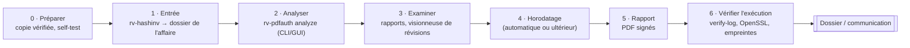
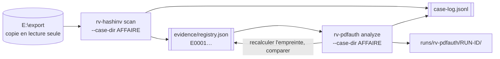
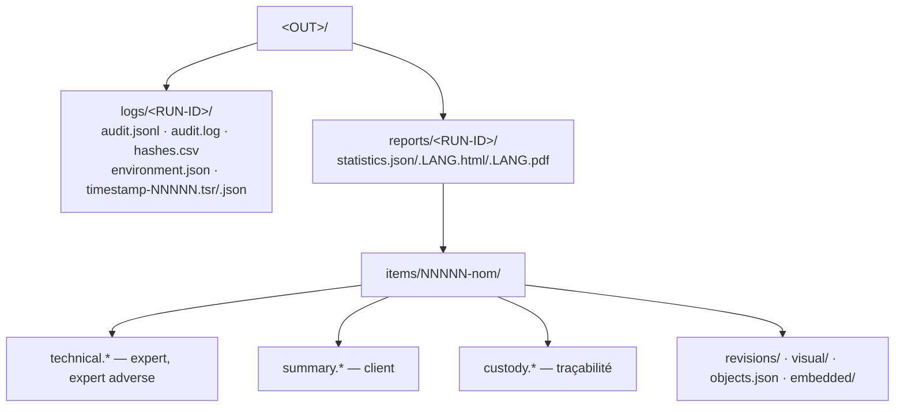
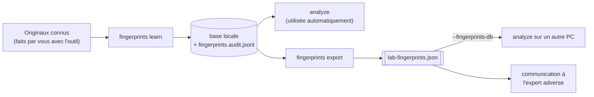

> La version de référence est la version anglaise ([usage.md](usage.md)) ; cette traduction la suit.

# Guide d'utilisation : de l'entrée des éléments de preuve à un rapport vérifié

Voici le guide complet de l'expert. Il suit une affaire de bout en bout, explique chaque sortie, indique comment
interpréter chaque constatation et comment prouver ensuite que rien n'a changé. Les listes d'options ne sont pas
reprises ici :

- les tâches courantes en bref : [quick-guide.fr.md](quick-guide.fr.md) ;
- chaque commande, option, valeur par défaut, exemple et code de sortie : [usage-cli.md](usage-cli.md) (généré à partir de `--help`, en anglais) ;
- l'application de bureau, fenêtre par fenêtre : [usage-gui.fr.md](usage-gui.fr.md) ;
- pourquoi chaque contrôle fonctionne : [theory.md](theory.md) ; portée juridique : [admissibility.md](admissibility.md) (en anglais) ;
- installer et vérifier l'outil : [installation.fr.md](installation.fr.md).



## 1. Avant de commencer

| Contrôle | Pourquoi | Comment |
| --- | --- | --- |
| Travaillez sur une **copie vérifiée** (image forensique, export avec bloqueur d'écriture), jamais sur le support d'origine | L'outil est en lecture seule au niveau logiciel, ce n'est pas un bloqueur d'écriture ; il lit de plus chaque PDF deux fois ([theory.md B2](theory.md#b2-pipeline-and-reads-of-the-evidence)) | Outil d'imagerie + bloqueur d'écriture ; notez le modèle et le numéro de série |
| L'outil installé est la version authentique | Question du tribunal : « comment savez-vous ce que vous avez exécuté ? » | [installation.fr.md](installation.fr.md) étapes 2–4, 6, 7 |
| Politique d'empreinte | MD5/SHA-1 seuls ne résistent pas aux collisions | Incluez toujours `sha256` (ou `sha512`) : `--hash sha256,md5` quand un registre antérieur utilise MD5 |
| Horloge | Les heures d'audit viennent de l'horloge du poste | Vérifiez la synchronisation horaire de Windows avant l'exécution |
| Juridiction | Choisit la fiche de traçabilité | `--jurisdiction co` (par défaut) ou `fr` |
| Horodatage | TSA en ligne par défaut | `--no-timestamp` hors ligne, puis `rv-pdfauth timestamp` plus tard ; `--tsa-url` pour une TSA qualifiée / d'une ECD |
| Certificat de l'expert | Signe chaque rapport PDF | `--sign-cert examiner.p12` ([signature](#7-signer-les-rapports-avec-le-certificat-de-lexpert)) |

## 2. Parcours d'une affaire

L'affaire d'exemple : `CASE-2026-014`, juridiction colombienne, experte Ana Ruiz, un export du client sur `E:\export`
contenant des factures et des contrats.

### 2.1 Entrée avec rv-hashinv dans un dossier de l'affaire

Dans une mission réelle, les outils Rakvor partagent **un dossier de l'affaire** : l'outil d'entrée `rv-hashinv`
enregistre chaque élément une fois (identifiant, taille, empreintes) ; chaque outil ultérieur revérifie chaque fichier
par rapport à ce registre avant de l'analyser et relie sa propre chaîne d'audit au journal de l'affaire. Organisation
(`rakvor.case/1`) :

```text
D:\cases\CASE-2026-014\
  case.json                 case id, jurisdiction, created (written once, never changed)
  case-log.jsonl            hash-chained case log (same algorithm as audit.jsonl)
  evidence\registry.json    E0001…: path, size, hashes, who registered it (written only by the intake tool)
  evidence\registry.csv     the same, flat
  runs\rv-hashinv\<RUN-ID>\logs\ and reports\
  runs\rv-pdfauth\<RUN-ID>\logs\ and reports\
```



Le côté entrée est rv-hashinv (`rv-hashinv scan --help`) ; rv-pdfauth est l'outil d'**analyse** : il lit le registre
et ne l'écrit jamais. Référence complète : [case-folder.md](case-folder.md) (en anglais).

```powershell
# 1. Entrée : crée case.json, le registre et le journal de l'affaire
rv-hashinv scan --case-dir D:\cases\CASE-2026-014 --case CASE-2026-014 --jurisdiction co `
    -i E:\export -r --hash sha256,md5 --actor "Ana Ruiz"

# 2. Analyse de chaque élément enregistré (pas besoin de --input) ...
rv-pdfauth analyze --case-dir D:\cases\CASE-2026-014 --actor "Ana Ruiz" --sign-cert C:\certs\ana-ruiz.p12
#    ... ou seulement de certains éléments enregistrés
rv-pdfauth analyze --case-dir D:\cases\CASE-2026-014 --evidence E0001,E0007 --actor "Ana Ruiz"

# 3. Contrôle de toute l'affaire : journal de l'affaire, empreinte du registre, chaîne de chaque exécution et sa tête consignée dans le journal de l'affaire
rv-pdfauth verify-case D:\cases\CASE-2026-014
```

Ce que fait `analyze --case-dir` :

- il refuse un dossier de l'affaire dont le journal, `case.json` ou l'empreinte du registre ne se vérifie pas (code 3,
  rien n'est écrit), un dossier d'une autre affaire (`--case` doit correspondre à `case.json` ou être omis ; code 2) et
  les identifiants d'éléments inconnus (code 2) ;
- il prend par défaut chaque élément enregistré (ou les identifiants de `--evidence`, ou les chemins de `--input`,
  rapprochés du registre par identifiant, sinon par chemin, sinon par contenu) ;
- il s'assure qu'au moins un algorithme d'empreinte choisi figure dans le registre (SHA-256 est ajouté et consigné
  comme `case_algorithm_added` si nécessaire, toujours deux au plus) ;
- juste après le calcul de l'empreinte de chaque élément, **avant** l'analyse du PDF, il consigne
  `evidence_verified_against_case` ou lève `EVIDENCE_HASH_MISMATCH_WITH_CASE` (élevée, code 3 ; l'analyse a quand même
  lieu) ou `EVIDENCE_NOT_IN_CASE_REGISTRY` (moyenne) ;
- il commence son journal d'audit par `run_started`, `case_linked` (tête du journal de l'affaire, SHA-256 du registre)
  et écrit dans `runs\rv-pdfauth\<RUN-ID>\logs\` et `reports\` (`--out` n'est pas utilisé) ;
- il affiche l'identifiant de l'élément dans chaque rapport, la date d'entrée et la juridiction de l'affaire sur la
  fiche de traçabilité, et une section « Dossier de l'affaire » avec les comptes dans le rapport de statistiques ;
- il ajoute `run_finished` (tête finale d'audit, totaux, comptes de vérification) au journal de l'affaire, même après
  une annulation ou un échec.

Le résumé affiché à la fin comporte une ligne de plus, par ex.
`case:   CASE-2026-014 (analysis) verified 41, mismatched 0, not in registry 0`. Dans l'application de bureau,
renseignez **Dossier de l'affaire** dans la section 1 : le dossier de sortie est déduit et verrouillé, et le tableau
des résultats, le panneau de résultat et l'en-tête de la visionneuse de révisions affichent l'identifiant et le
contrôle contre le registre de chaque élément.

Sous Windows, les chemins du registre sont comparés sans tenir compte des majuscules et minuscules (le système de
fichiers ne les distingue pas).

**Une étape au lieu de deux :** ajoutez `--intake hashinv` à la commande `analyze` (ou cochez *Enregistrer d'abord les
éléments de preuve avec RV HashInv* dans la GUI) et rv-pdfauth exécute rv-hashinv sur les mêmes éléments avant de les
analyser. Détails et règles : [case-folder.md](case-folder.md#one-step-intake-with-rv-hashinv) (en anglais).

### 2.2 Lancer `analyze` en ligne de commande

```powershell
rv-pdfauth analyze -i E:\export -r --hash sha256,md5 --lang es --jurisdiction co `
    --case CASE-2026-014 --actor "Ana Ruiz" --sign-cert C:\certs\ana-ruiz.p12 --out D:\cases\CASE-2026-014\rv-pdfauth
```

Chaque fichier est examiné (les fichiers qui ne sont pas des PDF reçoivent les contrôles d'inventaire : type par
signature, extension incohérente, exécutable, vide, doublon). Les valeurs par défaut de l'analyse PDF (révisions
extraites, comparaison visuelle à 110 PPP sur au plus 50 pages par paire de révisions, export des objets, fichiers
incorporés, processus d'analyse 120 s / 2048 Mio) conviennent à presque toutes les affaires. Réglages utiles :
`--visual-diff off --item-reports flagged` pour de très gros lots ; `--worker-timeout 600 --worker-memory 4096` pour
des fichiers énormes ou endommagés ; `--max-pages 500` quand toutes les pages doivent être comparées ;
`--fingerprints-db <file>` pour utiliser la base d'un collègue ou une base propre à l'affaire. Toutes les options :
[usage-cli.md](usage-cli.md).

À la fin, la CLI affiche un résumé :

```text
DONE (high-severity findings)  run 20261021T103903Z-67d213
  items: 7  bytes: 105085  errors: 0  elapsed: 4.9 s
  findings: high 3, medium 18, low 3, info 5
  timestamp: ok 2026-10-21T10:39:08Z
  report: D:\cases\…\reports\20261021T103903Z-67d213\statistics.es.html
  logs:   D:\cases\…\logs\20261021T103903Z-67d213
```

Le code de sortie 3 signifie « terminé, au moins une constatation de gravité élevée » : un résultat normal pour des
éléments de preuve, pas une erreur.

### 2.3 Le lancer depuis l'application de bureau

Lancez **RV PDFAuth**, ajoutez les éléments (fichiers, dossiers ou glisser-déposer), cochez un ou deux algorithmes
d'empreinte, ajustez *3. Options* si besoin, réglez la langue, le dossier de sortie, l'expert et la référence du
dossier dans *4. Rapports*, ainsi que l'horodatage, le certificat et la fiche de traçabilité dans *5. Confiance* ;
puis **Lancer l'analyse**. Chaque réglage modifié avant le lancement est écrit dans le journal d'audit de l'exécution
(actions `ui_*`). Le moteur, les sorties et les constatations sont les mêmes que ceux de la CLI. Détails :
[usage-gui.fr.md](usage-gui.fr.md).

### Démarrage depuis RV Hub : `--case-dir` et `describe --json`

RV Hub (le lanceur de Rakvor) trouve les outils installés, les ouvre sur un dossier de l'affaire et suggère celui qui
convient à un fichier. Il s'appuie sur deux points d'entrée de RV PDFAuth :

- **`rv-pdfauth-gui.exe --case-dir <CASE> [FILES...]`** démarre l'application de bureau avec **Dossier de l'affaire**
  déjà renseigné (`--case-dir=<CASE>` fonctionne aussi). Les autres arguments sont chargés comme éléments, comme
  lorsque des fichiers sont déposés sur l'icône. Ce préréglage est écrit dans le journal d'audit de l'exécution comme
  `ui_case_dir_from_launcher` (chemin et `at_utc`) suivi de `ui_case_dir_changed`. Un `--case-dir` sans dossier est
  ignoré : la fenêtre l'indique et le journal d'audit consigne `ui_launch_argument_ignored`.
- **`rv-pdfauth describe --json`** affiche un objet JSON (clés triées) que lit RV Hub ; il est masqué dans
  `rv-pdfauth --help` mais figure dans [usage-cli.md](usage-cli.md). Il ne lit et n'écrit rien. Schéma :
  [`schemas/describe.schema.json`](../schemas/describe.schema.json) (`rakvor.describe/1`, identique dans tous les
  outils Rakvor).

| Champ | Signification |
| --- | --- |
| `schema` | `rakvor.describe/1` |
| `tool`, `title`, `version` | `rv-pdfauth`, `RV PDFAuth`, la version du produit (`version.txt`) |
| `role` | `analysis` (examine des éléments enregistrés dans le dossier de l'affaire) |
| `main_verb` | `analyze` : la commande qui fait le travail principal |
| `accepts` | `extensions` (en minuscules, sans point) et `signatures` de contenu (`format` + `match` : octets hexadécimaux à un décalage) ; `"*"` = tout fichier |
| `case_formats`, `log_formats` | `rakvor.case/1` ; `rakvor.audit/1` = `logs/audit.jsonl`, `rakvor.review/1` = `logs/review.jsonl` |
| `cli_exe`, `gui_exe` | `rv-pdfauth.exe`, `rv-pdfauth-gui.exe` |
| `exit_codes` | La signification de 0, 1, 2, 3 et 130 (le tableau des codes de sortie dans Dépannage) |

```powershell
rv-pdfauth describe --json
```

## 3. Lire les sorties



| Sortie | Pour | À quoi elle sert |
| --- | --- | --- |
| `statistics.*` | Expert, avocat | Vue d'ensemble de l'exécution : qui, quand, interface, algorithmes, totaux, constatations par gravité et par code, PDF à plusieurs révisions / signatures / empreintes d'éditeurs en ligne, groupes de doublons, état de l'horodatage, tête de la chaîne d'audit et nombre d'entrées au moment de son écriture |
| `technical.*` | Expert, expert adverse | Tout sur un fichier : chemin, taille, toutes les empreintes, constatations avec *ce qu'elle montre / ce qu'elle ne prouve pas*, méthode, entrées d'audit `#première–#dernière`, limites ; pour les PDF : tableau de l'historique des révisions (plage d'octets, dates Info/XMP, producteur, temps depuis la précédente, objets ajoutés/modifiés/supprimés, pages modifiées, signé par) et chronologie, signatures, polices (100 premières lignes ; toutes dans `objects.json`), empreintes de producteur avec les bases utilisées (nom, version, SHA-256), images de la comparaison visuelle et mesures par page (pixels modifiés et part, zones, PPP, changement de taille de page), avertissements de l'analyseur avec décalages en octets (100 premiers ; tous dans `warnings.json`), fichiers extraits avec leurs empreintes |
| `summary.*` | Client | État en langage courant, l'empreinte principale, les constatations en une phrase chacune, un bref historique du document (« enregistré 3 fois ; dernière modification 9 jours après la création, avec un éditeur PDF ») et l'étape suivante |
| `custody.*` | Traçabilité | Fiche de la juridiction (espagnol pour `co`, français pour `fr`) + copie anglaise, préremplie à partir de l'exécution, avec un tableau des personnes (expert, assistants, témoins : nom, fonction, type et numéro de pièce d'identité, signature) et des lignes de transfert à remplir à la main et à signer. Un registre interne, utilisé **avec** le formulaire officiel ([admissibility.md](admissibility.md) G9) |
| `revisions/rev-NN.pdf` | Expert | Chaque version enregistrée, préfixe exact, octet pour octet, de l'élément ; ouvrez-les dans n'importe quelle visionneuse, recalculez-les avec `head -c` ([theory.md B5](theory.md#b5-revision-extraction-byte-exact-prefixes)) |
| `visual/rev-AA-vs-BB-page-PPP.png` | Tous | Page précédente et page actuelle côte à côte, zones modifiées entourées en violet ; la légende donne la part modifiée et le nombre de zones |
| `objects.json` | Expert | Arbre des objets de chaque révision : id, décalage dans le fichier, type, dictionnaire (profondeur ≤ 8, ≤ 1000 entrées par niveau, longues chaînes tronquées en hexadécimal), flux d'objets, décalage/longueur du flux |
| `embedded/NN-name.*` | Expert | Pièces jointes et images telles que stockées (`.jpg` pour DCT, sinon `.bin`) et `.inflated.*` quand elles sont compressées Flate |
| `audit.jsonl` / `audit.log` | Vérification | Chaque action, chaînée par empreintes / la même chose, lisible |
| `hashes.csv` | Vérification | Registre des empreintes : `index,path,size,<algo1>[,<algo2>],status,error` |
| `environment.json` | Reproductibilité | Outil, compilateur, version de chaque dépendance, OS, machine, utilisateur, ligne de commande |

**État et étape suivante par élément :** `problem` (une constatation élevée : ne vous fiez pas au fichier tant qu'elle
n'est pas expliquée), `attention` (moyenne ou faible : à revoir avec l'expert), `ok` (informatif seulement). Avec
`--item-reports flagged`, les éléments à l'état `ok` n'ont pas de fichiers technical/summary/custody (leurs sorties
dérivées comme `objects.json` sont quand même écrites et auditées, et l'omission est consignée comme
`item_reports_skipped`).

## 4. Utiliser la visionneuse de révisions

Après une exécution dans la GUI, cliquez sur **Examiner les révisions** sur une ligne de deux révisions ou plus.
Choisissez la paire de révisions et la page ; la chronologie affiche la date de chaque révision (Info ModDate, sinon
CreationDate, sinon XMP), le producteur, le temps depuis la précédente (en rouge quand une révision est datée *avant*
la précédente : aucune constatation n'est levée pour cela dans cette version, cherchez-le donc ici), les signatures et
les pastilles des constatations. Les deux moitiés zooment et se déplacent ensemble. Avant d'afficher une image, la
visionneuse en recalcule l'empreinte et la compare à celle consignée pendant l'exécution : vert *correspond*, rouge *NE
correspond PAS* (le fichier a été modifié après l'exécution). La visionneuse travaille sur l'exécution qui vient de se
terminer dans cette fenêtre ; pour une exécution plus ancienne, ouvrez ses PNG de `visual/` et son rapport
`technical.*`. La consultation n'est pas journalisée, à dessein
([usage-gui.fr.md](usage-gui.fr.md#pourquoi-la-consultation-nest-pas-journalisée)).

## 5. Interpréter chaque constatation

Gravité entre parenthèses. « À vérifier ensuite » est ce qu'un expert doit faire avant de s'appuyer sur la
constatation ; « ne concluez pas » est l'excès à éviter dans un rapport. Le libellé exact imprimé dans les rapports se
trouve dans `i18n/en.json` (es, fr).

| Code | À vérifier ensuite | Ne concluez pas |
| --- | --- | --- |
| `INCREMENTAL_UPDATES` (faible) | Ouvrez `revisions/`, lisez le tableau des révisions (dates, producteur, types de modification) et la comparaison visuelle | Que le fichier a été falsifié : formulaires, signatures et commentaires s'enregistrent ainsi |
| `VISUAL_CHANGE_BETWEEN_REVISIONS` (moyenne) | Regardez le PNG ; comparez le texte des deux révisions ; rapprochez la modification du producteur et de la date de la révision | Qui a fait la modification ni pourquoi ; une modification peut être une correction légitime |
| `VISUAL_DIFF_SKIPPED` (info) | La raison : PDFium absent, une révision que PDFium ne peut pas ouvrir (par ex. mot de passe) ; corrigez et relancez, ou comparez `revisions/` à la main | Que les révisions se ressemblent |
| `METADATA_INFO_XMP_MISMATCH` (moyenne) | Quel champ ; l'historique XMP (`technical.json`) et le producteur de chaque révision | Un contenu falsifié : beaucoup d'outils ne mettent à jour qu'un des deux |
| `MODDATE_BEFORE_CREATIONDATE` (élevée) | Valeurs brutes et fuseaux horaires dans le tableau des révisions ; les bogues de date connus du producteur | Une antidatation délibérée (horloges, fuseaux, modèles) |
| `REVISION_TIME_GAP` (info) | Si l'intervalle correspond au récit du client (par ex. signé le jour 1, modifié le jour 9) | Quand la modification a vraiment eu lieu : les dates sont fixées par le logiciel qui enregistre |
| `REVISION_DATE_NOT_MONOTONIC` (moyenne) | Les deux dates dans le tableau des révisions ; l'horloge et le fuseau de la machine qui a enregistré la révision ultérieure | Une antidatation : une horloge fausse ou un éditeur qui recopie d'anciennes dates le font aussi |
| `PRODUCER_CHANGED_BETWEEN_REVISIONS` (moyenne) | Quel logiciel a enregistré quelle révision ; s'agit-il d'un flux connu (outil de signature, remplissage de formulaires) ? | Qui a utilisé le logiciel |
| `EDITOR_FINGERPRINT` (moyenne) | Ce que cette révision a modifié (comparaison visuelle, objets ajoutés/modifiés) | Que le contenu a été modifié : les éditeurs remplissent, signent, pivotent, compressent aussi |
| `ONLINE_EDITOR_OR_UNLOCKER` (élevée) | La chaîne et le champ trouvés ; si le client a utilisé un tel service ; ce que cette révision a modifié | Une altération du contenu ; la chaîne peut être saisie à la main |
| `PRODUCER_STRUCTURE_MISMATCH` (moyenne) | Les traits qui diffèrent ; si un optimiseur ou un réenregistrement ultérieur les explique | Une falsification ; les versions d'un même programme diffèrent |
| `UNKNOWN_PRODUCER` (info) | Rien, sauf si cela compte ; envisagez de l'apprendre à partir d'originaux connus | Un soupçon : la base est limitée |
| `XREF_OFFSETS_INCONSISTENT` (moyenne) | Quelles révisions ; les avertissements de l'analyseur avec décalages en octets (tableau *Parser warnings* du rapport technique, liste complète dans le `warnings.json` de l'élément ; voir [theory.md](theory.md#cross-reference-resolution-per-revision)) ; comparez avec un autre analyseur (qpdf) | Une manipulation : des générateurs bogués et des transferts endommagés le font |
| `HYBRID_XREF` (faible) | Si les vues table et flux diffèrent (avertissements) | Quoi que ce soit à lui seul : certains générateurs courants le font |
| `DATA_AFTER_FINAL_EOF` (moyenne) | Extrayez les octets de fin (décalage = fin de la dernière révision) et examinez-les à part | Un contenu caché : le remplissage et les outils de transfert ajoutent des octets |
| `SIGNATURE_INTEGRITY_FAILED` (élevée) | La raison (`digest_mismatch`, `signature_invalid`, `byterange_*`) ; validez avec Acrobat ou pyHanko ; obtenez le fichier d'une autre source | Qui a modifié les octets ; un transfert endommagé peut en être la cause |
| `SIGNATURE_PRESENT_TRUST_NOT_VERIFIED` (info) | Validez la chaîne de certificats, la révocation et l'identité du signataire avec un validateur distinct si l'identité compte | Que le signataire est celui que nomme le certificat |
| `CONTENT_CHANGED_AFTER_SIGNATURE` (élevée) | Comparez la révision signée (`revisions/rev-NN.pdf` de la révision signée) avec la version finale, page par page | Que le signataire n'était pas d'accord ; que la signature est invalide (elle reste valide pour sa révision) |
| `DOCMDP_VIOLATION` (élevée) | Quelles révisions ultérieures et quels types de modification ; s'il ne s'agit que de données de validation (DSS) avec P = 1 ([theory.md B10](theory.md#docmdp)) | Une intention ; la classification est heuristique et les visionneuses diffèrent |
| `JAVASCRIPT_PRESENT` (moyenne) | Les objets listés (`objects.json`) ; analysez les scripts dans un environnement isolé | Un comportement malveillant : les formulaires utilisent des scripts |
| `LAUNCH_ACTION` (élevée) | La cible de l'action (`objects.json`) ; traitez le fichier comme potentiellement hostile | Que l'action s'est exécutée |
| `EMBEDDED_FILES` (faible) | Ouvrez `embedded/` ; analysez chaque pièce jointe comme un élément de preuve à part entière | Quoi que ce soit sur l'intention : les pièces jointes sont normales |
| `INVISIBLE_TEXT` (moyenne) | Quelle page ; est-ce une couche OCR sur un scan, un texte d'accessibilité, du texte blanc sur fond sombre ? Comparez avec le rendu visuel | Une tentative de cacher du contenu |
| `TEXT_OVER_SCANNED_IMAGE` (moyenne) | Dans quelle révision le texte apparaît pour la première fois ; s'il est postérieur au scan, comparez les révisions visuellement | Une altération : les scanners ajoutent du texte OCR |
| `FONT_ADDED_IN_LATER_REVISION` (moyenne) | Ce que cette révision a dessiné avec la police (comparaison visuelle, contenu) | Une falsification : remplir un formulaire ou ajouter un tampon ajoute des polices |
| `SCANNED_PAGES_STRUCTURE_ONLY` (info) | Si le contenu de l'image compte, utilisez une analyse forensique d'image sur `embedded/` | Que l'image n'a pas été retouchée |
| `ENCRYPTED_PARTIAL_ANALYSIS` (info) | Obtenez légalement le mot de passe et analysez une copie déchiffrée si les contrôles de contenu comptent | Quoi que ce soit de l'absence de constatations de contenu |
| `NOT_A_PDF` (info) | Le type réel (`detected_type`) ; utilisez un outil adapté | Que le fichier est malveillant |
| `PARSER_FAILED` (élevée) | Le `reason` (tableau ci-dessous) ; relancez avec des limites plus hautes ; examinez à la main | Que le fichier est malveillant ou falsifié |
| `EVIDENCE_CHANGED_DURING_ANALYSIS` (élevée) | Quel programme a touché le fichier (client de synchronisation, antivirus) ; copiez-le sur un support protégé en écriture et relancez ; les résultats de cette exécution ne décrivent pas l'élément haché | Que l'élément de preuve d'origine a été altéré |
| `EXTENSION_MISMATCH` (moyenne) | Le type détecté ; ouvrez le fichier avec un outil adapté | Une intention de cacher quoi que ce soit |
| `EXECUTABLE_CONTENT` (élevée) | Traitez-le comme hostile ; analysez-le dans un bac à sable | Que le programme est malveillant |
| `EMPTY_FILE` (info) | Si la source possède le fichier avec un contenu | Qu'il a été vidé volontairement |
| `DUPLICATE` (info) | Le groupe de doublons dans `statistics.*` et `hashes.csv` | Qui a copié le fichier ni quand |
| `UNREADABLE` (élevée) | L'erreur du système (droits, verrous) ; refaites l'acquisition | Que le fichier est endommagé |

## 6. Horodatages

Par défaut, chaque exécution demande à la TSA (`http://timestamp.digicert.com`, modifiable avec `--tsa-url`) de signer
la tête de la chaîne d'audit juste avant l'écriture du rapport de statistiques. Le jeton couvre chaque empreinte
d'élément, constatation, empreinte de sortie et empreinte de rapport par élément consignée avant lui
([theory.md B15](theory.md#b15-rfc-3161-trusted-timestamp)).

| Situation | Ce qui se passe | Que faire |
| --- | --- | --- |
| TSA joignable | `timestamp_obtained` ; fichiers `timestamp-NNNNN.tsr` et `.json` dans le dossier des journaux ; le rapport de statistiques affiche l'heure | Vérifiez avec OpenSSL (ci-dessous) |
| Hors ligne | `timestamp_pending` ; l'exécution se termine ; avertissement sur le rapport de statistiques | Plus tard, en ligne : `rv-pdfauth timestamp <log folder>` |
| `--no-timestamp` / `RV_NO_TIMESTAMP=1` / GUI décochée | Aucune demande | Utilisez `rv-pdfauth timestamp` plus tard si nécessaire |
| Chaîne rompue | `rv-pdfauth timestamp` refuse (code 3) : aucun horodatage n'est ajouté à un journal rompu | Enquêtez ; ne réparez pas |

`rv-pdfauth verify-log` vérifie l'empreinte du jeton, qu'il couvre la tête consignée, et la signature CMS de la TSA
(certificat signataire dans le jeton, liaison ESS, condensé du message, signature RSA, usage de clé critique et
uniquement timeStamping) pour chaque jeton que consigne le journal d'audit, et pour tout fichier de jeton qu'aucune
entrée ne consigne ; un jeton consigné dont le `.tsr` ou le `.json` manque fait échouer le journal (code 3). Donnez-lui
le paquet de CA de la TSA pour valider aussi la chaîne de certificats :

```powershell
rv-pdfauth verify-log <OUT>\logs\<RUN-ID> --tsa-ca C:\certs\tsa-roots.pem
#     timestamp … covers entry #60: TSA signature valid (signer: …); chain validated to CN=… (revocation not checked)
```

Sans `--tsa-ca`, la ligne se termine par *chain not checked* ; un jeton dont la signature ou la chaîne échoue donne le
code 3. La révocation, l'OID de politique et la précision ne sont jamais vérifiés par l'outil. Recoupez la **signature
et la chaîne** avec OpenSSL (Git for Windows fournit `openssl.exe`) ; il ne vérifie pas non plus la révocation (aucune
CRL n'est fournie et OpenSSL n'interroge pas OCSP) :

```bash
cd <OUT>/logs/<RUN-ID>
N=00060                                                   # d'après le nom de fichier timestamp-00060.tsr
H=$(python -c "import json;print(json.load(open('timestamp-$N.json'))['head'])")
openssl ts -reply -in timestamp-$N.tsr -text              # genTime, OID de politique, nom de la TSA, numéro de série, précision
openssl ts -reply -in timestamp-$N.tsr -token_out -out token.der
openssl pkcs7 -inform DER -in token.der -print_certs > tsa-certs.pem   # certificats envoyés par la TSA
openssl ts -verify -digest "$H" -in timestamp-$N.tsr -CAfile <TSA root.pem> -untrusted tsa-certs.pem
# → "Verification: OK"  (signature et chaîne seulement, pas la révocation)
```

Établissez à part l'état de révocation du certificat de la TSA, à partir d'éléments CRL/OCSP couvrant genTime (une CRL
émise après genTime par la CA de la TSA, ou une réponse OCSP archivée au moment de l'horodatage), par ex.
`openssl verify -crl_check -CRLfile tsa-ca.crl -CAfile <TSA root.pem> -untrusted tsa-certs.pem -attime <genTime-epoch> tsa.pem`,
ou `rv-certcheck analyze --crl … --ocsp …`. Obtenez le certificat racine de la TSA depuis le dépôt de la TSA elle-même, pas depuis le jeton. Consignez la sortie dans
le dossier : c'est la preuve que l'heure est authentique.

> **Dates de la CRL et `-attime`.** OpenSSL applique aussi `-attime` à la CRL, donc `openssl verify -crl_check -attime <genTime-epoch>` ne fonctionne qu'avec une CRL dont l'intervalle `thisUpdate`–`nextUpdate` contient genTime ; une CRL émise après genTime échoue avec « CRL is not yet valid ». Pour utiliser une CRL ultérieure comme élément de preuve, vérifiez sa signature (`openssl crl -in tsa-ca.crl -CAfile <TSA root.pem> -noout -verify`), puis cherchez-y le numéro de série du certificat de la TSA (`openssl crl -in tsa-ca.crl -noout -text`) : absent, ou listé avec une date de révocation postérieure à genTime, il n'était pas révoqué à genTime. Une CA peut retirer de ses CRL les certificats expirés ; pour un certificat de TSA expiré depuis, un numéro absent n'est donc pas concluant : utilisez une CRL antérieure à son expiration, ou une réponse OCSP archivée au moment de l'horodatage.

## 7. Signer les rapports avec le certificat de l'expert

`--sign-cert <file.p12|.pfx>` signe **chaque rapport PDF** (statistiques, technique, synthèse, traçabilité) avec votre
propre certificat (clés RSA uniquement). Le mot de passe est lu dans la variable d'environnement désignée par
`--sign-pass-env` (par défaut `RV_SIGN_PASSWORD`) ou demandé dans le terminal sans écho (`Certificate password (input hidden):`,
lu depuis la console avec l'écho désactivé ; le champ de la GUI est masqué lui aussi).
Il n'est jamais journalisé ; le journal consigne `signing_certificate_loaded` avec le sujet et le SHA-256 du
certificat. Un mauvais mot de passe arrête l'exécution (`run_failed`, code 1) avant la lecture du moindre élément. Dans
la GUI : *5. Confiance → Certificate…*.

```powershell
$s = Read-Host "Certificate password" -AsSecureString
$env:RV_SIGN_PASSWORD = [Runtime.InteropServices.Marshal]::PtrToStringBSTR(
    [Runtime.InteropServices.Marshal]::SecureStringToBSTR($s))
rv-pdfauth analyze -i E:\export -r --sign-cert C:\certs\ana-ruiz.p12 --case CASE-2026-014
Remove-Item Env:RV_SIGN_PASSWORD
(Get-PfxCertificate C:\certs\ana-ruiz.p12).GetCertHashString("SHA256")   # publiez cette empreinte
```

Vérifiez un rapport signé avec Adobe Acrobat/Reader (panneau Signatures) ou pyHanko :
`pyhanko sign validate --pretty-print --trust <your CA or certificate .pem> technical.es.pdf`. Les rapports HTML et
JSON ne sont pas signés ; leurs empreintes sont dans la chaîne d'audit horodatée. La portée juridique de cette
signature dépend du certificat ([admissibility.md](admissibility.md) G3).

## 8. Vérifier une exécution

N'importe qui (vous, un collègue, un expert adverse) peut vérifier une exécution avec le dossier des journaux, le
dossier des rapports et la copie des éléments de preuve :

```powershell
rv-pdfauth verify-log D:\cases\CASE-2026-014\rv-pdfauth\logs\20261021T103903Z-67d213
# OK  63 entries, chain intact: …\audit.jsonl
#     timestamp 2026-10-21T10:39:08Z by http://timestamp.digicert.com covers entry #60
#     outputs: 170 verified of 171 recorded (md5, sha256), 1 skipped
#     not re-hashed: logs/timestamp-00060.tsr (RFC 3161 token: checked by the timestamp verification)
```

La ligne `outputs:` est le recalcul de l'empreinte de chaque fichier que, selon le journal, l'exécution a écrit (rapports par élément, statistiques, révisions, comparaisons visuelles, `objects.json`, fichiers incorporés, `warnings.json`, `hashes.csv`,
`environment.json`), avec chaque algorithme consigné par le journal ; l'entrée la plus récente pour un fichier
l'emporte. Un fichier modifié, supprimé ou remplacé après l'exécution rend l'exécution `BROKEN` (code 3) et est nommé :

```text
BROKEN  …\audit.jsonl
  - output reports/items/00003-edited-incremental.pdf/revisions/rev-01.pdf: md5 differs from audit entry #20 (recorded 3888…, now 88f4…): edited or replaced after the run
  - output reports/statistics.en.pdf: missing (recorded by audit entry #69): deleted or moved after the run
    outputs: 168 verified of 171 recorded (md5, sha256), 1 missing, 1 changed, 1 skipped
```

Un chemin consigné qui est absolu, contient `..` ou mène hors du dossier de l'exécution par un lien symbolique ou une
jonction est rejeté et jamais lu. Le jeton d'horodatage est listé comme `not re-hashed` parce que le contrôle de
l'horodatage le vérifie déjà. Les fichiers que l'exécution n'a pas consignés (tout ce qui a été ajouté au dossier
ensuite) ne sont pas vérifiés.

| Étape | Commande | Prouve |
| --- | --- | --- |
| 1 | `rv-pdfauth verify-log <log> [--tsa-ca <bundle>]` (code 0 intact, 3 rompu ou sortie modifiée) | Aucune entrée modifiée, supprimée ni réordonnée ; le jeton d'horodatage correspond à la tête qu'il couvre et porte une signature de TSA valide (et une chaîne, avec `--tsa-ca`) ; chaque sortie consignée a toujours son empreinte (ligne `outputs:`) |
| 2 | `python tests/verify_chain.py <log>` (arbre des sources) | La même chose, avec une implémentation indépendante ; recalcule aussi l'empreinte des éléments listés dans `hashes.csv` et de chaque sortie consignée par le journal d'audit |
| 3 | OpenSSL ([Horodatages](#6-horodatages)) | La TSA a vraiment signé cette tête à cette heure |
| 4 | Étape 1 (ligne `outputs:`) ; script ci-dessous pour un contrôle indépendant | Chaque rapport et fichier de sortie a toujours l'empreinte consignée dans le journal |
| 5 | Comparez `hashes.csv` avec le registre d'entrée ([2.1](#21-entrée-avec-rv-hashinv-dans-un-dossier-de-laffaire)) | Les fichiers analysés sont les éléments enregistrés |

L'étape 4 est intégrée à `verify-log` et `verify-case`. Pour la vérifier avec un code qui tient sur un écran (une
implémentation indépendante, par ex. pour un expert adverse), recalculez l'empreinte de chaque fichier consigné par
l'exécution (il faut `sha256` parmi les algorithmes de l'exécution) :

```bash
python - "<OUT>/logs/<RUN-ID>" "<OUT>/reports/<RUN-ID>" <<'EOF'
import hashlib, json, pathlib, sys
log, rep = pathlib.Path(sys.argv[1]), pathlib.Path(sys.argv[2])
checked = bad = 0
for line in (log / "audit.jsonl").open(encoding="utf-8"):
    e = json.loads(line); d = e["details"]
    if e["action"] == "output_written":
        files = {d["file"]: d["hashes"]["sha256"]}
    elif e["action"] == "item_reports_written":
        files = {f'{d["folder"]}/{k}': v["sha256"] for k, v in d["files"].items()}
    elif e["action"] == "statistics_report_written":
        files = {k: v["sha256"] for k, v in d["files"].items()}
    else:
        continue
    for rel, want in files.items():
        checked += 1
        p = rep / rel
        got = hashlib.sha256(p.read_bytes()).hexdigest() if p.is_file() else "missing"
        if got != want:
            bad += 1; print("MISMATCH", rel, got)
print(f"{checked} files checked, {bad} mismatches"); sys.exit(3 if bad else 0)
EOF
```

Sur l'exécution d'exemple, cela vérifie 101 fichiers. Un seul fichier en PowerShell :
`(Get-FileHash <file> -Algorithm SHA256).Hash.ToLower()` puis cherchez la valeur dans `audit.jsonl`.

## 9. Base d'empreintes de producteurs

Chaque analyse utilise trois bases, listées avec leur SHA-256 dans chaque entrée `item_analyzed` et dans le rapport
technique : la base **starter** fournie, votre base **locale** apprise
(`%LOCALAPPDATA%\Rakvor\rv-pdfauth\fingerprints.local.json`) et une base **supplémentaire** facultative
(`--fingerprints-db`).



```powershell
# 1. Fabriquez vous-même des originaux connus : créez un document de test dans l'éditeur/le service, enregistrez-le ou téléchargez-le
rv-pdfauth fingerprints learn .\originals\smallpdf-1.pdf .\originals\smallpdf-2.pdf `
    --label "Smallpdf (online)" --category online_editor --case LAB-2026-03 --actor "Ana Ruiz"
# 2. Voyez ce que vous avez (version et SHA-256 de chaque base)
rv-pdfauth fingerprints list
# 3. Partagez ou communiquez (n'écrase jamais un fichier existant)
rv-pdfauth fingerprints export --out D:\lab\lab-fingerprints-2026-10.json
rv-pdfauth analyze -i E:\export -r --fingerprints-db D:\lab\lab-fingerprints-2026-10.json
```

Règles : n'apprenez qu'à partir de fichiers dont vous pouvez prouver l'origine ; avec plusieurs fichiers, seuls les
traits structurels qu'ils partagent tous sont gardés ; réapprendre le même libellé fusionne avec l'entrée ; rien
n'est écrit si un fichier échoue ; chaque modification figure dans le `fingerprints.audit.jsonl` chaîné, avec le
SHA-256 de la base avant et après. Quand un rapport s'appuie sur une correspondance de la base locale, exportez-la dans
le dossier : le rapport cite son SHA-256. Catégories : office, pdf_library, scanner, pdf_editor, online_editor,
unlocker, printer_driver, browser (seules pdf_editor, online_editor et unlocker donnent des constatations ; les autres
sont listées dans le rapport technique).

## 10. Dépannage

### Raisons de `PARSER_FAILED`

| `reason` | Signification | Action |
| --- | --- | --- |
| `timeout` | Processus d'analyse arrêté après `--worker-timeout` secondes | Relancez ce fichier avec `--worker-timeout 600` |
| `memory_limit` | Le processus d'analyse a dépassé `--worker-memory` | Relancez avec `--worker-memory 4096` (ou plus) |
| `crashed` | Le processus d'analyse s'est terminé anormalement (code de sortie ou signal dans `exit_code`, fin de stderr dans le rapport technique) | Relancez une fois ; si cela se répète, examinez à la main et signalez le fichier (en privé) à l'équipe technique |
| `bad_output` | Réponse du processus d'analyse en JSON invalide ou trop volumineuse | Comme `crashed` |
| `spawn_failed` / `isolation_failed` | Le processus d'analyse n'a pas pu démarrer, ou le Job Object de Windows n'a pas pu être mis en place | Vérifiez si l'antivirus bloque `rv-pdfauth.exe worker …` ; relancez |
| `unreadable` | Le fichier n'a pas pu être projeté en mémoire en lecture seule | Vérifiez les droits / verrous |
| `panic` | Erreur interne de l'analyseur (ne devrait pas arriver) | Signalez-la à l'équipe technique avec l'empreinte du fichier |

Les fichiers laissés par un processus d'analyse en échec sont conservés comme `partial_output` (hachés, audités) et
ne fondent aucune constatation.

### Raisons de `VISUAL_DIFF_SKIPPED`

| Texte de la raison | Action |
| --- | --- |
| `PDFium library not found or not loadable: …` (chemins essayés) | Remettez `pdfium.dll` à côté des exécutables ou définissez `RV_PDFIUM_PATH` ([installation.fr.md](installation.fr.md#6-vérifier-pdfium-moteur-de-rendu-de-la-comparaison-visuelle)) |
| `revisions A→B: PDFium cannot open this revision: …` | Protégé par mot de passe (aucun mot de passe n'est essayé) ou préfixe endommagé ; comparez `revisions/` à la main |

La comparaison visuelle est *sans objet* (pas de constatation) pour les fichiers à une seule révision ou avec
`--visual-diff off`.

### Codes de sortie

| Commande | 0 | 1 | 2 | 3 | 130 |
| --- | --- | --- | --- | --- | --- |
| `analyze` | terminé, sans constatation élevée | erreur d'exécution (entrée introuvable, sortie non inscriptible, mauvais mot de passe du certificat, fichier `--fingerprints-db` absent) | erreur d'utilisation (trois algorithmes, langue inconnue) | terminé, ≥ 1 constatation élevée | annulé (Ctrl+C), rapports partiels écrits |
| `verify-log` | intact, jetons vérifiés | journal ou fichier `--tsa-ca` illisible | — | chaîne rompue, jeton discordant, signature de la TSA invalide ou chaîne non approuvée | — |
| `timestamp` | obtenu et journalisé | TSA injoignable (rien n'a changé) | — | journal rompu (rien n'est ajouté) | — |
| `self-test` | tout passe | un échec : n'utilisez pas cette version | — | — | — |
| `fingerprints learn / list / export` | fait | fichier non PDF / sans producteur / base illisible / la sortie existe | erreur d'utilisation | — | — |
| `describe` | description affichée | — | erreur d'utilisation (option inconnue) | — | — |

### Autres messages

| Message | Correction |
| --- | --- |
| `cannot load signing certificate …: wrong password or unsupported file` | Vérifiez `RV_SIGN_PASSWORD` ; le fichier doit être un `.p12`/`.pfx` avec clé privée |
| `only RSA signing certificates are supported` | Utilisez un certificat RSA (ECDSA n'est pas pris en charge pour signer les rapports) |
| `warning: timestamp pending (…)` | Voir [Horodatages](#6-horodatages) |
| Le dossier de rapports d'un élément manque | `--item-reports flagged` et l'élément était `ok` (voir `item_reports_skipped` dans le journal) |
