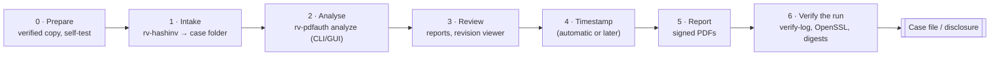
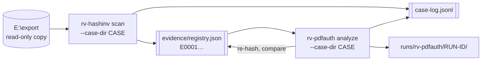
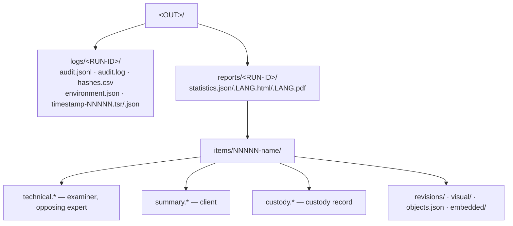
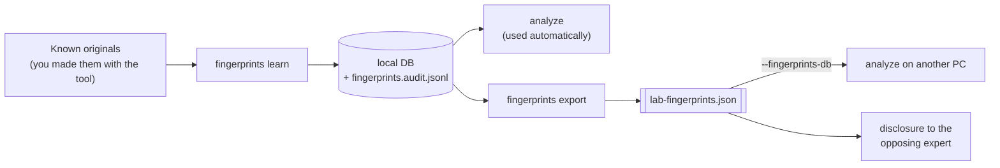

# Usage guide: from intake to a verified report

This is the end-to-end guide for an examiner. It walks through one case, explains every output, says how to
interpret each finding, and how to prove afterwards that nothing changed. Option lists are not repeated here:

- every command, option, default, example and exit code: [usage-cli.md](usage-cli.md) (generated from `--help`);
- the desktop app, window by window: [usage-gui.md](usage-gui.md);
- why each check works: [theory.md](theory.md); legal weight: [admissibility.md](admissibility.md);
- installing and verifying the tool: [installation.md](installation.md).



## 1. Before you start

| Check | Why | How |
| --- | --- | --- |
| Work on a **verified copy** (forensic image, write-blocked export), never the original media | The tool is read-only in software, not a write blocker; it also reads each PDF twice ([theory.md B2](theory.md#b2-pipeline-and-reads-of-the-evidence)) | Imaging tool + write blocker; note model and serial |
| The installed tool is the genuine release | Court question: "how do you know what you ran?" | [installation.md](installation.md) steps 2–4, 6, 7 |
| Hash policy | MD5/SHA-1 alone are not collision-resistant | Always include `sha256` (or `sha512`): `--hash sha256,md5` when an older record uses MD5 |
| Clock | Audit times come from the workstation clock | Check Windows time sync before the run |
| Jurisdiction | Selects the custody form | `--jurisdiction co` (default) or `fr` |
| Timestamp | Online TSA by default | `--no-timestamp` offline, then `rv-pdfauth timestamp` later; `--tsa-url` for a qualified / ECD TSA |
| Examiner certificate | Signs every PDF report | `--sign-cert examiner.p12` ([signing](#7-signing-reports-with-the-examiner-certificate)) |

## 2. Case walkthrough

The example case: `CASE-2026-014`, Colombian jurisdiction, examiner Ana Ruiz, a client export on `E:\export`
containing invoices and contracts.

### 2.1 Intake with rv-hashinv into a case folder

In a real engagement the Rakvor tools share **one case folder**: the intake tool `rv-hashinv` registers each item
once (evidence id, size, hashes); every later tool re-verifies each file against that registry before analysing
it and links its own audit chain to the case log. Layout (`rakvor.case/1`):

```text
D:\cases\CASE-2026-014\
  case.json                 case id, jurisdiction, created (written once, never changed)
  case-log.jsonl            hash-chained case log (same algorithm as audit.jsonl)
  evidence\registry.json    E0001…: path, size, hashes, who registered it (written only by the intake tool)
  evidence\registry.csv     the same, flat
  runs\rv-hashinv\<RUN-ID>\logs\ and reports\
  runs\rv-pdfauth\<RUN-ID>\logs\ and reports\
```



The intake side is rv-hashinv (`rv-hashinv scan --help`); rv-pdfauth is the **analysis** tool: it reads the
registry and never writes it. Full reference: [case-folder.md](case-folder.md).

```powershell
# 1. Intake: creates case.json, the registry and the case log
rv-hashinv scan --case-dir D:\cases\CASE-2026-014 --case CASE-2026-014 --jurisdiction co `
    -i E:\export -r --hash sha256,md5 --actor "Ana Ruiz"

# 2. Analysis of every registered item (no --input needed) ...
rv-pdfauth analyze --case-dir D:\cases\CASE-2026-014 --actor "Ana Ruiz" --sign-cert C:\certs\ana-ruiz.p12
#    ... or only some registered items
rv-pdfauth analyze --case-dir D:\cases\CASE-2026-014 --evidence E0001,E0007 --actor "Ana Ruiz"

# 3. Whole-case check: case log, registry digest, each run's chain and its head recorded in the case log
rv-pdfauth verify-case D:\cases\CASE-2026-014
```

What `analyze --case-dir` does:

- refuses a case folder whose case log, `case.json` or registry digest does not verify (exit 3, nothing written),
  a folder of another case (`--case` must match `case.json` or be left out; exit 2) and unknown evidence ids
  (exit 2);
- takes every registered item by default (or the `--evidence` ids, or the `--input` paths, matched against the
  registry by id, else path, else content);
- makes sure at least one selected hash algorithm is in the registry (SHA-256 is added and logged as
  `case_algorithm_added` if needed, still at most two);
- right after hashing each item, **before** the PDF analysis, logs `evidence_verified_against_case` or raises
  `EVIDENCE_HASH_MISMATCH_WITH_CASE` (high, exit 3; the analysis still runs) or `EVIDENCE_NOT_IN_CASE_REGISTRY`
  (medium);
- starts its audit log with `run_started`, `case_linked` (case-log head, registry SHA-256) and writes into
  `runs\rv-pdfauth\<RUN-ID>\logs\` and `reports\` (`--out` is not used);
- shows the evidence id in every report, the intake date and the case's jurisdiction on the custody form, and a
  "Case folder" section with the counts in the statistics report;
- appends `run_finished` (final audit head, totals, verification counts) to the case log, also after a cancel or
  a failure.

The summary printed at the end has one more line, e.g.
`case:   CASE-2026-014 (analysis) verified 41, mismatched 0, not in registry 0`. In the desktop app, fill **Case
folder** in section 1: the output folder is derived and locked, and the results table, result panel and revision
viewer header show each item's evidence id and registry check.

On Windows, registry paths are compared without regard to upper/lower case (the file system is case-insensitive).

### 2.2 Running `analyze` from the command line

```powershell
rv-pdfauth analyze -i E:\export -r --hash sha256,md5 --lang es --jurisdiction co `
    --case CASE-2026-014 --actor "Ana Ruiz" --sign-cert C:\certs\ana-ruiz.p12 --out D:\cases\CASE-2026-014\rv-pdfauth
```

Every file is reviewed (non-PDFs get the inventory checks: type by signature, extension mismatch, executable,
empty, duplicate). Defaults for the PDF analysis (revisions extracted, visual diff at 110 DPI on up to 50 pages
per revision pair, object dump, embedded files, worker 120 s / 2048 MiB) suit almost every case. Useful
adjustments: `--visual-diff off --item-reports flagged` for very large batches; `--worker-timeout 600
--worker-memory 4096` for huge or damaged files; `--max-pages 500` when all pages must be compared;
`--fingerprints-db <file>` to use a colleague's or a case-specific database. All options: [usage-cli.md](usage-cli.md).

At the end the CLI prints a summary:

```text
DONE (high-severity findings)  run 20261021T103903Z-67d213
  items: 7  bytes: 105085  errors: 0  elapsed: 4.9 s
  findings: high 3, medium 18, low 3, info 5
  timestamp: ok 2026-10-21T10:39:08Z
  report: D:\cases\…\reports\20261021T103903Z-67d213\statistics.es.html
  logs:   D:\cases\…\logs\20261021T103903Z-67d213
```

Exit code 3 means "completed, at least one high-severity finding" — a normal outcome for evidence, not an error.

### 2.3 Running it from the desktop app

Start **RV PDFAuth**, add the evidence (files, folders or drag and drop), tick one or two hash algorithms, adjust
*3. Options* if needed, set language, output folder, examiner and case ID in *4. Reports*, and the timestamp,
certificate and custody form in *5. Trust*; then **Start review**. Every setting you change before starting is
written to the run's audit log (`ui_*` actions). The engine, outputs and findings are the same as the CLI's.
Details: [usage-gui.md](usage-gui.md).

## 3. Reading the outputs



| Output | For | What to use it for |
| --- | --- | --- |
| `statistics.*` | Examiner, lawyer | Run overview: who, when, interface, algorithms, totals, findings by severity and code, PDFs with several revisions / signatures / online-editor fingerprints, duplicate groups, timestamp status, audit chain head and entry count at the time it was written |
| `technical.*` | Examiner, opposing expert | Everything about one file: path, size, all digests, findings with *what it shows / what it does not prove*, method, audit entries `#first–#last`, limitations; for PDFs: revision history table (byte range, Info/XMP dates, producer, time since previous, objects added/changed/deleted, pages changed, signed by) and timeline, signatures, fonts (first 100 rows; all in `objects.json`), producer fingerprints with the databases used (name, version, SHA-256), visual comparison images, extracted files with digests |
| `summary.*` | Client | Plain-language status, the primary fingerprint, the findings in one sentence each, a short document history ("saved 3 times; last change 9 days after creation, with a PDF editor") and the next step |
| `custody.*` | Custody record | Jurisdiction form (Spanish for `co`, French for `fr`) + English copy, pre-filled from the run, with blank transfer rows to sign. An internal record, used **alongside** the official form ([admissibility.md](admissibility.md) G9) |
| `revisions/rev-NN.pdf` | Examiner | Each saved version, byte-exact prefix of the evidence; open them in any viewer, re-derive them with `head -c` ([theory.md B5](theory.md#b5-revision-extraction-byte-exact-prefixes)) |
| `visual/rev-AA-vs-BB-page-PPP.png` | Everyone | Previous and current page side by side, changed regions outlined in violet; the caption gives the changed share and region count |
| `objects.json` | Expert | Object tree of every revision: id, file offset, type, dictionary (depth ≤ 8, ≤ 1000 entries per level, long strings hex-truncated), object stream, stream offset/length |
| `embedded/NN-name.*` | Examiner | Attachments and images as stored (`.jpg` for DCT, else `.bin`) and `.inflated.*` when Flate-compressed |
| `audit.jsonl` / `audit.log` | Verification | Every action, hash-chained / the same, readable |
| `hashes.csv` | Verification | Hash register: `index,path,size,<algo1>[,<algo2>],status,error` |
| `environment.json` | Reproducibility | Tool, compiler, every dependency version, OS, host, user, command line |

**Status and next step per item:** `problem` (a high finding: do not rely on the file until explained),
`attention` (medium or low: review with the examiner), `ok` (informational only). With
`--item-reports flagged`, items with status `ok` get no technical/summary/custody files (their derived outputs
such as `objects.json` are still written and audited, and the skip is logged as `item_reports_skipped`).

## 4. Using the revision viewer

After a GUI run, click **Review revisions** on a row with two or more revisions. Pick the revision pair and the
page; the timeline shows each revision's date (Info ModDate, else CreationDate, else XMP), producer, the time since
the previous one (red when a revision is dated *before* the previous one — no finding is raised for that in this
version, so look for it here), signatures and finding badges. The two halves zoom and pan together. Before showing
a picture the viewer re-hashes it and compares it with the digest recorded during the run: green *matches*, red
*does NOT match* (the file was changed after the run). The viewer works on the run just completed in that window;
for an older run, open its `visual/` PNGs and `technical.*` report. Viewing is not logged, on purpose
([usage-gui.md](usage-gui.md#why-viewing-is-not-logged)).

## 5. Interpreting each finding

Severity in brackets. "Check next" is what an examiner should do before relying on the finding; "do not conclude"
is the overreach to avoid in a report. The exact wording printed in reports is in `i18n/en.json` (es, fr).

| Code | Check next | Do not conclude |
| --- | --- | --- |
| `INCREMENTAL_UPDATES` (low) | Open `revisions/`, read the revision table (dates, producer, change kinds) and the visual diff | That the file was tampered with — forms, signatures and comments save this way |
| `VISUAL_CHANGE_BETWEEN_REVISIONS` (medium) | Look at the PNG; compare the text of both revisions; relate the change to the revision's producer and date | Who made the change or why; a change can be a legitimate correction |
| `VISUAL_DIFF_SKIPPED` (info) | The reason: PDFium missing, a revision PDFium cannot open (e.g. password); fix and re-run, or compare `revisions/` manually | That the revisions look the same |
| `METADATA_INFO_XMP_MISMATCH` (medium) | Which field; the XMP history (`technical.json`) and producer of each revision | Falsified content — many tools update only one store |
| `MODDATE_BEFORE_CREATIONDATE` (high) | Raw values and time zones in the revision table; the producer's known date bugs | Deliberate backdating (clocks, zones, templates) |
| `REVISION_TIME_GAP` (info) | Whether the gap fits the client's account (e.g. signed on day 1, amended on day 9) | When the change really happened — dates are set by the saving software |
| `PRODUCER_CHANGED_BETWEEN_REVISIONS` (medium) | Which software saved which revision; is it a known workflow (sign tool, form filler)? | Who used the software |
| `EDITOR_FINGERPRINT` (medium) | What that revision changed (visual diff, objects added/changed) | That content was changed — editors also fill, sign, rotate, compress |
| `ONLINE_EDITOR_OR_UNLOCKER` (high) | The matched string and field; whether the client used such a service; what that revision changed | Alteration of content; the string can be typed by hand |
| `PRODUCER_STRUCTURE_MISMATCH` (medium) | The differing traits; whether an optimiser or later re-save explains them | Falsification; versions of one program differ |
| `UNKNOWN_PRODUCER` (info) | Nothing, unless it matters; consider learning it from known originals | Suspicion — the database is limited |
| `XREF_OFFSETS_INCONSISTENT` (medium) | Which revisions; the warnings with offsets (`cargo run -p rv-pdfauth-pdf --example dump -- <file>`, see [theory.md](theory.md#cross-reference-resolution-per-revision)); compare with another parser (qpdf) | Manipulation — buggy writers and damaged transfers do this |
| `HYBRID_XREF` (low) | Whether the table and stream views differ (warnings) | Anything by itself — some mainstream writers do it |
| `DATA_AFTER_FINAL_EOF` (medium) | Extract the trailing bytes (offset = end of last revision) and examine them separately | Hidden content — padding and transfer tools add bytes |
| `SIGNATURE_INTEGRITY_FAILED` (high) | The reason (`digest_mismatch`, `signature_invalid`, `byterange_*`); validate with Acrobat or pyHanko; obtain the file from another source | Who altered the bytes; a damaged transfer can cause it |
| `SIGNATURE_PRESENT_TRUST_NOT_VERIFIED` (info) | Validate the certificate chain, revocation and signer identity with a separate validator if identity matters | That the signer is who the certificate names |
| `CONTENT_CHANGED_AFTER_SIGNATURE` (high) | Compare the signed revision (`revisions/rev-NN.pdf` of the signed revision) with the final one, page by page | That the signer did not agree; that the signature is invalid (it remains valid for its revision) |
| `DOCMDP_VIOLATION` (high) | Which later revisions and change kinds; whether they are only validation data (DSS) under P = 1 ([theory.md B10](theory.md#docmdp)) | Intent; the classification is heuristic and viewers differ |
| `JAVASCRIPT_PRESENT` (medium) | The listed objects (`objects.json`); analyse scripts in an isolated environment | Malicious behaviour — forms use scripts |
| `LAUNCH_ACTION` (high) | The target of the action (`objects.json`); treat the file as potentially hostile | That the action ran |
| `EMBEDDED_FILES` (low) | Open `embedded/`; analyse each attachment as its own evidence item | Anything about intent — attachments are normal |
| `INVISIBLE_TEXT` (medium) | Which page; is it an OCR layer over a scan, accessibility text, white text on a dark background? Compare with the visual render | An attempt to hide content |
| `TEXT_OVER_SCANNED_IMAGE` (medium) | In which revision the text first appears; if later than the scan, compare revisions visually | Alteration — scanners add OCR text |
| `FONT_ADDED_IN_LATER_REVISION` (medium) | What that revision drew with the font (visual diff, content) | Falsification — filling a form or adding a stamp adds fonts |
| `SCANNED_PAGES_STRUCTURE_ONLY` (info) | If image content matters, use image forensics on `embedded/` | That the image was not retouched |
| `ENCRYPTED_PARTIAL_ANALYSIS` (info) | Obtain the password lawfully and analyse a decrypted copy if content checks matter | Anything from the absence of content findings |
| `NOT_A_PDF` (info) | The real type (`detected_type`); use a suitable tool | That the file is malicious |
| `PARSER_FAILED` (high) | The `reason` (table below); re-run with higher limits; examine manually | That the file is malicious or forged |
| `EXTENSION_MISMATCH` (medium) | The detected type; open the file with a suitable tool | Intent to hide anything |
| `EXECUTABLE_CONTENT` (high) | Treat as hostile; analyse in a sandbox | That the program is malicious |
| `EMPTY_FILE` (info) | Whether the source has the file with content | That it was emptied on purpose |
| `DUPLICATE` (info) | The duplicate group in `statistics.*` and `hashes.csv` | Who copied the file or when |
| `UNREADABLE` (high) | The OS error (permissions, locks); re-acquire | That the file is damaged |

## 6. Timestamps

By default each run asks the TSA (`http://timestamp.digicert.com`, change with `--tsa-url`) to sign the audit
chain head just before the statistics report is written. The token covers every evidence hash, finding, output
digest and item-report digest recorded before it ([theory.md B15](theory.md#b15-rfc-3161-trusted-timestamp)).

| Situation | What happens | What to do |
| --- | --- | --- |
| TSA reachable | `timestamp_obtained`; files `timestamp-NNNNN.tsr` and `.json` in the log folder; statistics report shows the time | Verify with OpenSSL (below) |
| Offline | `timestamp_pending`; the run completes; warning on the statistics report | Later, online: `rv-pdfauth timestamp <log folder>` |
| `--no-timestamp` / `RV_NO_TIMESTAMP=1` / GUI unticked | No request | Use `rv-pdfauth timestamp` later if needed |
| Broken chain | `rv-pdfauth timestamp` refuses (exit 3): no timestamp is added to a broken log | Investigate; do not repair |

`rv-pdfauth verify-log` checks the token's digest and that it covers the logged head, **not** the TSA's signature
and certificate (gap G18). Do that with OpenSSL (Git for Windows ships `openssl.exe`):

```bash
cd <OUT>/logs/<RUN-ID>
N=00060                                                   # from the file name timestamp-00060.tsr
H=$(python -c "import json;print(json.load(open('timestamp-$N.json'))['head'])")
openssl ts -reply -in timestamp-$N.tsr -text              # genTime, policy OID, TSA name, serial, accuracy
openssl ts -reply -in timestamp-$N.tsr -token_out -out token.der
openssl pkcs7 -inform DER -in token.der -print_certs > tsa-certs.pem   # certificates sent by the TSA
openssl ts -verify -digest "$H" -in timestamp-$N.tsr -CAfile <TSA root.pem> -untrusted tsa-certs.pem
# → "Verification: OK"
```

Get the TSA root certificate from the TSA's own repository, not from the token. Record the output in the case
file: it is the evidence that the time is genuine.

## 7. Signing reports with the examiner certificate

`--sign-cert <file.p12|.pfx>` signs **every PDF report** (statistics, technical, summary, custody) with your own
certificate (RSA keys only). The password is read from the environment variable named by `--sign-pass-env`
(default `RV_SIGN_PASSWORD`) or asked for on the terminal without echo (`Certificate password (input hidden):`, read from the console with echo off;
the GUI field is masked too).
It is never logged; the log records `signing_certificate_loaded` with the subject and the certificate's SHA-256.
A wrong password stops the run (`run_failed`, exit 1) before any evidence is read. In the GUI: *5. Trust →
Certificate…*.

```powershell
$s = Read-Host "Certificate password" -AsSecureString
$env:RV_SIGN_PASSWORD = [Runtime.InteropServices.Marshal]::PtrToStringBSTR(
    [Runtime.InteropServices.Marshal]::SecureStringToBSTR($s))
rv-pdfauth analyze -i E:\export -r --sign-cert C:\certs\ana-ruiz.p12 --case CASE-2026-014
Remove-Item Env:RV_SIGN_PASSWORD
(Get-PfxCertificate C:\certs\ana-ruiz.p12).GetCertHashString("SHA256")   # publish this fingerprint
```

Check a signed report with Adobe Acrobat/Reader (Signature panel) or pyHanko:
`pyhanko sign validate --pretty-print --trust <your CA or certificate .pem> technical.es.pdf`. HTML and JSON
reports are not signed; their digests are in the timestamped audit chain. The legal weight of this signature
depends on the certificate ([admissibility.md](admissibility.md) G3).

## 8. Verifying a run

Anyone — you, a colleague, an opposing expert — can check a run with the log folder, the report folder and the
evidence copy:

```powershell
rv-pdfauth verify-log D:\cases\CASE-2026-014\rv-pdfauth\logs\20261021T103903Z-67d213
# OK  63 entries, chain intact: …\audit.jsonl
#     timestamp 2026-10-21T10:39:08Z by http://timestamp.digicert.com covers entry #60
```

| Step | Command | Proves |
| --- | --- | --- |
| 1 | `rv-pdfauth verify-log <log>` (exit 0 intact, 3 broken) | No entry edited, deleted or reordered; timestamp token matches the head it covers |
| 2 | `python tests/verify_chain.py <log>` (source tree) | Same, with an independent implementation; also re-hashes the evidence listed in `hashes.csv` |
| 3 | OpenSSL ([Timestamps](#6-timestamps)) | The TSA really signed that head at that time |
| 4 | Script below | Every report and output file still has the digest recorded in the log |
| 5 | Compare `hashes.csv` with the intake registry ([2.1](#21-intake-with-rv-hashinv-into-a-case-folder)) | The analysed files are the registered evidence |

Step 4 (no built-in command yet, gap G19) — re-hash every file the run recorded (needs `sha256` among the run's
algorithms):

```bash
python - "<OUT>/logs/<RUN-ID>" "<OUT>/reports/<RUN-ID>" <<'EOF'
import hashlib, json, pathlib, sys
log, rep = pathlib.Path(sys.argv[1]), pathlib.Path(sys.argv[2])
checked = bad = 0
for line in (log / "audit.jsonl").open(encoding="utf-8"):
    e = json.loads(line); d = e["details"]
    if e["action"] == "output_written":
        files = {d["file"]: d["hashes"]["sha256"]}
    elif e["action"] == "item_reports_written":
        files = {f'{d["folder"]}/{k}': v["sha256"] for k, v in d["files"].items()}
    elif e["action"] == "statistics_report_written":
        files = {k: v["sha256"] for k, v in d["files"].items()}
    else:
        continue
    for rel, want in files.items():
        checked += 1
        p = rep / rel
        got = hashlib.sha256(p.read_bytes()).hexdigest() if p.is_file() else "missing"
        if got != want:
            bad += 1; print("MISMATCH", rel, got)
print(f"{checked} files checked, {bad} mismatches"); sys.exit(3 if bad else 0)
EOF
```

On the sample run this checks 101 files. A single file in PowerShell:
`(Get-FileHash <file> -Algorithm SHA256).Hash.ToLower()` and search the value in `audit.jsonl`.

## 9. Producer fingerprint database

Three databases are used by every analysis and listed with their SHA-256 in each `item_analyzed` entry and in the
technical report: the bundled **starter** database, your **local** learned database
(`%LOCALAPPDATA%\Rakvor\rv-pdfauth\fingerprints.local.json`), and an optional **extra** one (`--fingerprints-db`).



```powershell
# 1. Make known originals yourself: create a test document in the editor/service, save or download it
rv-pdfauth fingerprints learn .\originals\smallpdf-1.pdf .\originals\smallpdf-2.pdf `
    --label "Smallpdf (online)" --category online_editor --case LAB-2026-03 --actor "Ana Ruiz"
# 2. See what you have (version and SHA-256 of each database)
rv-pdfauth fingerprints list
# 3. Share or disclose (never overwrites an existing file)
rv-pdfauth fingerprints export --out D:\lab\lab-fingerprints-2026-10.json
rv-pdfauth analyze -i E:\export -r --fingerprints-db D:\lab\lab-fingerprints-2026-10.json
```

Rules: learn only from files whose origin you can prove; several files keep only the structural traits they all
share; learning the same label again merges into the entry; nothing is written if any file fails; every change is
in the hash-chained `fingerprints.audit.jsonl` with the database SHA-256 before and after. When a report relies on
a match from the local database, export it into the case file — the report cites its SHA-256. Categories:
office, pdf_library, scanner, pdf_editor, online_editor, unlocker, printer_driver, browser (only pdf_editor,
online_editor and unlocker raise findings; the others are listed in the technical report).

## 10. Troubleshooting

### `PARSER_FAILED` reasons

| `reason` | Meaning | Action |
| --- | --- | --- |
| `timeout` | Worker killed after `--worker-timeout` seconds | Re-run that file with `--worker-timeout 600` |
| `memory_limit` | Worker exceeded `--worker-memory` | Re-run with `--worker-memory 4096` (or more) |
| `crashed` | Worker ended abnormally (exit code or signal in `exit_code`, stderr tail in the technical report) | Re-run once; if repeatable, examine manually and report the file (privately) to engineering |
| `bad_output` | Worker reply not valid JSON or too large | As `crashed` |
| `spawn_failed` / `isolation_failed` | Worker could not start, or the Windows Job Object could not be set | Check antivirus blocking `rv-pdfauth.exe worker …`; run again |
| `unreadable` | The file could not be memory-mapped read-only | Check permissions / locks |
| `panic` | Internal parser error (should not happen) | Report to engineering with the file's hash |

Files left by a failed worker are kept as `partial_output` (hashed, audited) and support no finding.

### `VISUAL_DIFF_SKIPPED` reasons

| Reason text | Action |
| --- | --- |
| `PDFium library not found or not loadable: …` (paths tried) | Restore `pdfium.dll` next to the executables or set `RV_PDFIUM_PATH` ([installation.md](installation.md#6-check-pdfium-visual-diff-renderer)) |
| `revisions A→B: PDFium cannot open this revision: …` | Password-protected (no password is tried) or a damaged prefix; compare `revisions/` manually |

The visual diff is *not applicable* (no finding) for single-revision files or with `--visual-diff off`.

### Exit codes

| Command | 0 | 1 | 2 | 3 | 130 |
| --- | --- | --- | --- | --- | --- |
| `analyze` | done, no high finding | runtime error (input not found, output not writable, wrong certificate password, missing `--fingerprints-db` file) | usage error (three algorithms, unknown language) | done, ≥ 1 high finding | cancelled (Ctrl+C), partial reports written |
| `verify-log` | intact | log unreadable | — | broken chain or token mismatch | — |
| `timestamp` | obtained and logged | TSA unreachable (nothing changed) | — | broken log (nothing added) | — |
| `self-test` | all pass | a failure: do not use the build | — | — | — |
| `fingerprints learn / list / export` | done | file not a PDF / no producer / DB unreadable / output exists | usage error | — | — |

### Other messages

| Message | Fix |
| --- | --- |
| `cannot load signing certificate …: wrong password or unsupported file` | Check `RV_SIGN_PASSWORD`; the file must be a `.p12`/`.pfx` with a private key |
| `only RSA signing certificates are supported` | Use an RSA certificate (ECDSA is not supported for report signing) |
| `warning: timestamp pending (…)` | See [Timestamps](#6-timestamps) |
| Report folder for an item is missing | `--item-reports flagged` and the item was `ok` (see `item_reports_skipped` in the log) |
