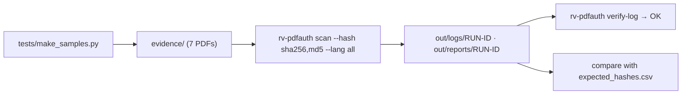

# Examples

## `sample/`: seven synthetic PDFs, one per type of trace

Every file is a **SYNTHETIC TEST SAMPLE** generated by `tests/make_samples.py` (deterministic: fixed dates, fixed
`/ID`, seeded keys and images). The producer names of real products appear only so that fingerprint matching can be
exercised. The signature in `signed-then-modified.pdf` uses a test certificate ("Rakvor TEST CA") that nobody trusts.

| File | What it demonstrates | Expected findings |
| --- | --- | --- |
| `original.pdf` | Clean one-revision document (ReportLab) | none |
| `edited-incremental.pdf` | Three revisions: the amount is changed in a "Foxit" revision, then a new font and a "PAID" stamp are added nine days later | PRODUCER_CHANGED_BETWEEN_REVISIONS, EDITOR_FINGERPRINT, FONT_ADDED_IN_LATER_REVISION (medium); INCREMENTAL_UPDATES (low); REVISION_TIME_GAP (info) |
| `signed-then-modified.pdf` | Certification signature (DocMDP P=2), then the amount is changed in a later revision | CONTENT_CHANGED_AFTER_SIGNATURE, DOCMDP_VIOLATION (high); INCREMENTAL_UPDATES (low); REVISION_TIME_GAP, SIGNATURE_PRESENT_TRUST_NOT_VERIFIED (info) |
| `online-editor.pdf` | Info says "iLovePDF", XMP keeps the original producer and dates; xref and object streams; invisible text | ONLINE_EDITOR_OR_UNLOCKER (high); METADATA_INFO_XMP_MISMATCH, PRODUCER_STRUCTURE_MISMATCH, INVISIBLE_TEXT (medium) |
| `broken-xref.pdf` | Two xref offsets shifted, bytes appended after `%%EOF` | XREF_OFFSETS_INCONSISTENT, DATA_AFTER_FINAL_EOF (medium) |
| `scan-with-text.pdf` | Two scanned pages; a text layer with a new font is added over page 1 in a second revision | TEXT_OVER_SCANNED_IMAGE, FONT_ADDED_IN_LATER_REVISION (medium); INCREMENTAL_UPDATES (low); SCANNED_PAGES_STRUCTURE_ONLY (info) |
| `crash.pdf` | Deliberately malformed: page-tree loop, absurd lengths and counts, corrupt Flate data, self-referencing form, 5 000 nested arrays | XREF_OFFSETS_INCONSISTENT, DATA_AFTER_FINAL_EOF (medium); the run must finish without error |

The files with more than one revision also get VISUAL_CHANGE_BETWEEN_REVISIONS (medium) when PDFium is available.
`expected_findings.json` lists the exact codes of the PDF analysis per file (checked by `cargo test -p rv-pdfauth-pdf`),
and `expected_hashes.csv` holds the digests of the seven files in all six algorithms, computed independently with
Python's `hashlib` and `blake3`, so you can check the tool's output.



Run it:

```bash
examples/sample/run.sh target/release/rv-pdfauth          # Linux / macOS
```

```powershell
.\examples\sample\run.ps1 -Bin .\rv-pdfauth.exe          # Windows
```

Expected summary (with PDFium): 7 items, 0 errors, findings `high 3, medium 18, low 3, info 5`, exit code 3
(at least one high-severity finding, by design).

Regenerate the files (test-only Python dependencies: reportlab, pikepdf, pillow, cryptography, asn1crypto, blake3):

```bash
python tests/make_samples.py              # rewrites evidence/ and expected_hashes.csv
python tests/oracle_pdf.py                # cross-checks the analysis with pikepdf/qpdf and pyHanko
```
